# Engineering review report: motor_prius_lut_cold_rev5

- **Run:** `20261123-230647_motor_prius_lut_cold_rev5`
- **Generated:** 2026-11-24T05:47:26+00:00
- **Case file SHA-256:** `dfb748156f6a13c49780b6bd315124cd6b75543c224befa77731987ac4d2afaa`
- **Environment:** Python 3.14.10, numpy 2.5.5, scipy 1.18.1, matplotlib 3.11.2, cadquery 2.8.0; Windows-11-10.0.26100-SP0
- **Tools:** pyleecan 1.5.2; SciDataTool 2.5.0; numpy_pyleecan_env 2.5.5
- **Code version:** git `b4e208947409c4d21dcdce0b7b3cca66f385bf31`
- **Simulation status:** completed
- **Verification status:** PASS

## Scope

2004 Toyota Prius traction motor (revision 5, laminations M330-35A, magnets at 20 C), dq look-up table, id 0 to -300 A rms and iq 0 to 300 A rms in 25 A steps, 1000 rpm; Pyleecan + FEMM 4.2 magnetostatics over one electrical period (48 steps) with element fields; mesh fineness 2; torque, dq flux linkages and iron-loss coefficients. Revision 5 (client data: magnet 83.1 x 18.9 x 6.5 mm centred in the 6.80 mm pocket, 1.255 T at 20 C, air gap 0.775 mm; machine Toyota_Prius_ORNL_rev5centre.json).

**Assumptions**

- 2D magnetostatics (FEMM), no end effects; torque is the mean of FEMM's stress-tensor torque over one electrical period.
- Iron loss from the element fields with the M330-35A three-term fit applied per harmonic; rotational fields counted as two orthogonal alternating ones; minor loops and DC bias not modelled.
- Core mass without the stacking factor (FEMM models the stack as solid steel, lam_fill 1).
- Magnet temperature 20 C (MagFEMM T_mag; Br falls 0.1 %/K).
- Copper 76.4 mm^2 per slot (Pyleecan's 13 x 0.912 mm strands per turn, 9 turns), consistent with ORNL's 0.84 fill on the squares of insulated wires.

## Requirements

| ID | Requirement | Metric | Limit |
|---|---|---|---|
| REQ-M3 | The column's operating points shall stay within the 25 A/mm^2 rms copper current-density limit (marks the grid points the motor can sustain for a short time). | `current_density_max_A_per_mm2` | <= 25 A/mm^2 |

## Summary across points

| Point | id_A | REQ-M3 | Checks |
|---|---|---|---|
| p00_id_A--300 | -300 | 49.96 A/mm^2: **FAIL** | 5/5 PASS |
| p01_id_A--275 | -275 | 47.92 A/mm^2: **FAIL** | 5/5 PASS |
| p02_id_A--250 | -250 | 45.98 A/mm^2: **FAIL** | 5/5 PASS |
| p03_id_A--225 | -225 | 44.16 A/mm^2: **FAIL** | 5/5 PASS |
| p04_id_A--200 | -200 | 42.46 A/mm^2: **FAIL** | 5/5 PASS |
| p05_id_A--175 | -175 | 40.9 A/mm^2: **FAIL** | 5/5 PASS |
| p06_id_A--150 | -150 | 39.49 A/mm^2: **FAIL** | 5/5 PASS |
| p07_id_A--125 | -125 | 38.27 A/mm^2: **FAIL** | 5/5 PASS |
| p08_id_A--100 | -100 | 37.24 A/mm^2: **FAIL** | 5/5 PASS |
| p09_id_A--75 | -75 | 36.41 A/mm^2: **FAIL** | 5/5 PASS |
| p10_id_A--50 | -50 | 35.81 A/mm^2: **FAIL** | 5/5 PASS |
| p11_id_A--25 | -25 | 35.45 A/mm^2: **FAIL** | 5/5 PASS |
| p12_id_A-0 | 0 | 35.32 A/mm^2: **FAIL** | 5/5 PASS |

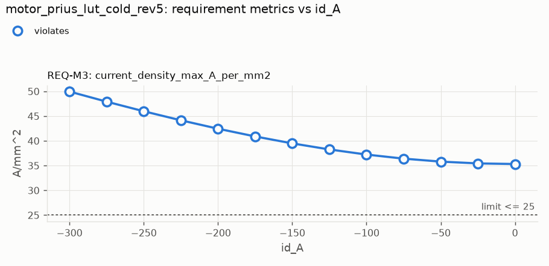

## Point details

### p00_id_A--300

Parameters: machine = Toyota_Prius_ORNL_rev5centre.json, speed_rpm = 1000, id_A = -300, iq_min_A = 0, iq_max_A = 300, iq_steps = 13, mesh_fineness = 2, steps_per_period = 48, angle_points = 2048, magnet_temperature_C = 20, iron_kh = 0.0202, iron_alpha = 1.791, iron_kc = 7.91e-05, iron_ke = 0.00037, slot_fill = 0.5345, slot_area_mm2 = 143, turns_per_slot = 9

Derived: current_rms_max_A = 424.3

| Requirement | Result | Limit | Margin | Verdict | Evidence |
|---|---|---|---|---|---|
| REQ-M3 | 49.96 A/mm^2 | <= 25 | -25 | **FAIL** | [point.json](points/p00_id_A--300/point.json) |

| Check | Description | Value | Tolerance | Status |
|---|---|---|---|---|
| power_balance | max over q-axis currents (|T| >= 5 N m) of |mean(sum i dphi/dt) - mean torque x omega_m| / (mean torque x omega_m) | 2.51e-03 | 2e-02 | PASS |
| dq_torque | max over q-axis currents (|T| >= 5 N m) of |3 p (phi_d i_q - phi_q i_d) - FEMM torque| / FEMM torque: the mean dq flux linkages the efficiency map interpolates reproduce the torque (model form: harmonics are left out of the dq means) | 2.51e-03 | 5e-03 | PASS |
| current_amplitude | max |imposed phase current fundamental - sqrt(2) x requested rms| / peak | 4.29e-16 | 1e-03 | PASS |
| iron_coefficients_non_negative | min iron-loss coefficient over cores and currents (W), below 0 would be unphysical | -2.86e-03 | 0e+00 | PASS |
| time_resolution (validity) | 48 / steps per electrical period (below 1: at least 48) | 1.00e+00 | 1e+00 | PASS |

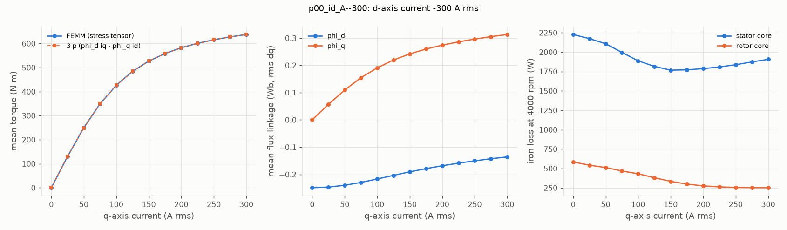

### p01_id_A--275

Parameters: machine = Toyota_Prius_ORNL_rev5centre.json, speed_rpm = 1000, id_A = -275, iq_min_A = 0, iq_max_A = 300, iq_steps = 13, mesh_fineness = 2, steps_per_period = 48, angle_points = 2048, magnet_temperature_C = 20, iron_kh = 0.0202, iron_alpha = 1.791, iron_kc = 7.91e-05, iron_ke = 0.00037, slot_fill = 0.5345, slot_area_mm2 = 143, turns_per_slot = 9

Derived: current_rms_max_A = 407

| Requirement | Result | Limit | Margin | Verdict | Evidence |
|---|---|---|---|---|---|
| REQ-M3 | 47.92 A/mm^2 | <= 25 | -22.9 | **FAIL** | [point.json](points/p01_id_A--275/point.json) |

| Check | Description | Value | Tolerance | Status |
|---|---|---|---|---|
| power_balance | max over q-axis currents (|T| >= 5 N m) of |mean(sum i dphi/dt) - mean torque x omega_m| / (mean torque x omega_m) | 3.11e-03 | 2e-02 | PASS |
| dq_torque | max over q-axis currents (|T| >= 5 N m) of |3 p (phi_d i_q - phi_q i_d) - FEMM torque| / FEMM torque: the mean dq flux linkages the efficiency map interpolates reproduce the torque (model form: harmonics are left out of the dq means) | 3.11e-03 | 5e-03 | PASS |
| current_amplitude | max |imposed phase current fundamental - sqrt(2) x requested rms| / peak | 4.13e-16 | 1e-03 | PASS |
| iron_coefficients_non_negative | min iron-loss coefficient over cores and currents (W), below 0 would be unphysical | -2.80e-03 | 0e+00 | PASS |
| time_resolution (validity) | 48 / steps per electrical period (below 1: at least 48) | 1.00e+00 | 1e+00 | PASS |

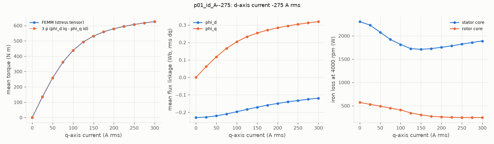

### p02_id_A--250

Parameters: machine = Toyota_Prius_ORNL_rev5centre.json, speed_rpm = 1000, id_A = -250, iq_min_A = 0, iq_max_A = 300, iq_steps = 13, mesh_fineness = 2, steps_per_period = 48, angle_points = 2048, magnet_temperature_C = 20, iron_kh = 0.0202, iron_alpha = 1.791, iron_kc = 7.91e-05, iron_ke = 0.00037, slot_fill = 0.5345, slot_area_mm2 = 143, turns_per_slot = 9

Derived: current_rms_max_A = 390.5

| Requirement | Result | Limit | Margin | Verdict | Evidence |
|---|---|---|---|---|---|
| REQ-M3 | 45.98 A/mm^2 | <= 25 | -21 | **FAIL** | [point.json](points/p02_id_A--250/point.json) |

| Check | Description | Value | Tolerance | Status |
|---|---|---|---|---|
| power_balance | max over q-axis currents (|T| >= 5 N m) of |mean(sum i dphi/dt) - mean torque x omega_m| / (mean torque x omega_m) | 2.82e-03 | 2e-02 | PASS |
| dq_torque | max over q-axis currents (|T| >= 5 N m) of |3 p (phi_d i_q - phi_q i_d) - FEMM torque| / FEMM torque: the mean dq flux linkages the efficiency map interpolates reproduce the torque (model form: harmonics are left out of the dq means) | 2.82e-03 | 5e-03 | PASS |
| current_amplitude | max |imposed phase current fundamental - sqrt(2) x requested rms| / peak | 3.20e-16 | 1e-03 | PASS |
| iron_coefficients_non_negative | min iron-loss coefficient over cores and currents (W), below 0 would be unphysical | -2.74e-03 | 0e+00 | PASS |
| time_resolution (validity) | 48 / steps per electrical period (below 1: at least 48) | 1.00e+00 | 1e+00 | PASS |

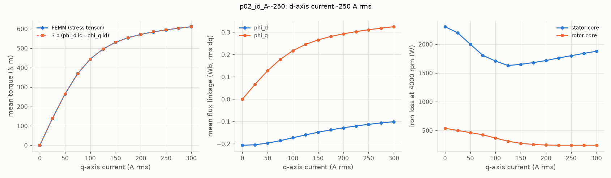

### p03_id_A--225

Parameters: machine = Toyota_Prius_ORNL_rev5centre.json, speed_rpm = 1000, id_A = -225, iq_min_A = 0, iq_max_A = 300, iq_steps = 13, mesh_fineness = 2, steps_per_period = 48, angle_points = 2048, magnet_temperature_C = 20, iron_kh = 0.0202, iron_alpha = 1.791, iron_kc = 7.91e-05, iron_ke = 0.00037, slot_fill = 0.5345, slot_area_mm2 = 143, turns_per_slot = 9

Derived: current_rms_max_A = 375

| Requirement | Result | Limit | Margin | Verdict | Evidence |
|---|---|---|---|---|---|
| REQ-M3 | 44.16 A/mm^2 | <= 25 | -19.2 | **FAIL** | [point.json](points/p03_id_A--225/point.json) |

| Check | Description | Value | Tolerance | Status |
|---|---|---|---|---|
| power_balance | max over q-axis currents (|T| >= 5 N m) of |mean(sum i dphi/dt) - mean torque x omega_m| / (mean torque x omega_m) | 1.76e-03 | 2e-02 | PASS |
| dq_torque | max over q-axis currents (|T| >= 5 N m) of |3 p (phi_d i_q - phi_q i_d) - FEMM torque| / FEMM torque: the mean dq flux linkages the efficiency map interpolates reproduce the torque (model form: harmonics are left out of the dq means) | 1.76e-03 | 5e-03 | PASS |
| current_amplitude | max |imposed phase current fundamental - sqrt(2) x requested rms| / peak | 4.01e-16 | 1e-03 | PASS |
| iron_coefficients_non_negative | min iron-loss coefficient over cores and currents (W), below 0 would be unphysical | -2.65e-03 | 0e+00 | PASS |
| time_resolution (validity) | 48 / steps per electrical period (below 1: at least 48) | 1.00e+00 | 1e+00 | PASS |

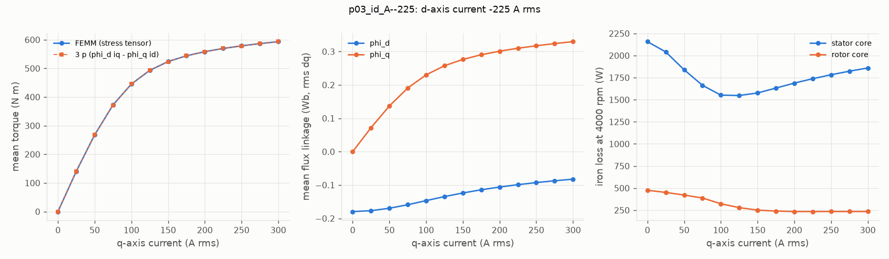

### p04_id_A--200

Parameters: machine = Toyota_Prius_ORNL_rev5centre.json, speed_rpm = 1000, id_A = -200, iq_min_A = 0, iq_max_A = 300, iq_steps = 13, mesh_fineness = 2, steps_per_period = 48, angle_points = 2048, magnet_temperature_C = 20, iron_kh = 0.0202, iron_alpha = 1.791, iron_kc = 7.91e-05, iron_ke = 0.00037, slot_fill = 0.5345, slot_area_mm2 = 143, turns_per_slot = 9

Derived: current_rms_max_A = 360.6

| Requirement | Result | Limit | Margin | Verdict | Evidence |
|---|---|---|---|---|---|
| REQ-M3 | 42.46 A/mm^2 | <= 25 | -17.5 | **FAIL** | [point.json](points/p04_id_A--200/point.json) |

| Check | Description | Value | Tolerance | Status |
|---|---|---|---|---|
| power_balance | max over q-axis currents (|T| >= 5 N m) of |mean(sum i dphi/dt) - mean torque x omega_m| / (mean torque x omega_m) | 1.29e-03 | 2e-02 | PASS |
| dq_torque | max over q-axis currents (|T| >= 5 N m) of |3 p (phi_d i_q - phi_q i_d) - FEMM torque| / FEMM torque: the mean dq flux linkages the efficiency map interpolates reproduce the torque (model form: harmonics are left out of the dq means) | 1.29e-03 | 5e-03 | PASS |
| current_amplitude | max |imposed phase current fundamental - sqrt(2) x requested rms| / peak | 3.90e-16 | 1e-03 | PASS |
| iron_coefficients_non_negative | min iron-loss coefficient over cores and currents (W), below 0 would be unphysical | -2.53e-03 | 0e+00 | PASS |
| time_resolution (validity) | 48 / steps per electrical period (below 1: at least 48) | 1.00e+00 | 1e+00 | PASS |

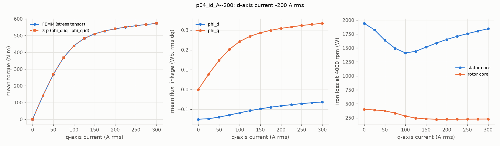

### p05_id_A--175

Parameters: machine = Toyota_Prius_ORNL_rev5centre.json, speed_rpm = 1000, id_A = -175, iq_min_A = 0, iq_max_A = 300, iq_steps = 13, mesh_fineness = 2, steps_per_period = 48, angle_points = 2048, magnet_temperature_C = 20, iron_kh = 0.0202, iron_alpha = 1.791, iron_kc = 7.91e-05, iron_ke = 0.00037, slot_fill = 0.5345, slot_area_mm2 = 143, turns_per_slot = 9

Derived: current_rms_max_A = 347.3

| Requirement | Result | Limit | Margin | Verdict | Evidence |
|---|---|---|---|---|---|
| REQ-M3 | 40.9 A/mm^2 | <= 25 | -15.9 | **FAIL** | [point.json](points/p05_id_A--175/point.json) |

| Check | Description | Value | Tolerance | Status |
|---|---|---|---|---|
| power_balance | max over q-axis currents (|T| >= 5 N m) of |mean(sum i dphi/dt) - mean torque x omega_m| / (mean torque x omega_m) | 8.02e-04 | 2e-02 | PASS |
| dq_torque | max over q-axis currents (|T| >= 5 N m) of |3 p (phi_d i_q - phi_q i_d) - FEMM torque| / FEMM torque: the mean dq flux linkages the efficiency map interpolates reproduce the torque (model form: harmonics are left out of the dq means) | 8.02e-04 | 5e-03 | PASS |
| current_amplitude | max |imposed phase current fundamental - sqrt(2) x requested rms| / peak | 2.82e-16 | 1e-03 | PASS |
| iron_coefficients_non_negative | min iron-loss coefficient over cores and currents (W), below 0 would be unphysical | -2.37e-03 | 0e+00 | PASS |
| time_resolution (validity) | 48 / steps per electrical period (below 1: at least 48) | 1.00e+00 | 1e+00 | PASS |

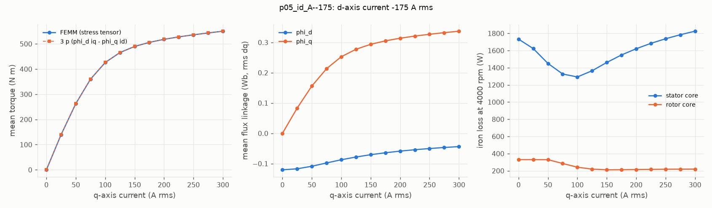

### p06_id_A--150

Parameters: machine = Toyota_Prius_ORNL_rev5centre.json, speed_rpm = 1000, id_A = -150, iq_min_A = 0, iq_max_A = 300, iq_steps = 13, mesh_fineness = 2, steps_per_period = 48, angle_points = 2048, magnet_temperature_C = 20, iron_kh = 0.0202, iron_alpha = 1.791, iron_kc = 7.91e-05, iron_ke = 0.00037, slot_fill = 0.5345, slot_area_mm2 = 143, turns_per_slot = 9

Derived: current_rms_max_A = 335.4

| Requirement | Result | Limit | Margin | Verdict | Evidence |
|---|---|---|---|---|---|
| REQ-M3 | 39.49 A/mm^2 | <= 25 | -14.5 | **FAIL** | [point.json](points/p06_id_A--150/point.json) |

| Check | Description | Value | Tolerance | Status |
|---|---|---|---|---|
| power_balance | max over q-axis currents (|T| >= 5 N m) of |mean(sum i dphi/dt) - mean torque x omega_m| / (mean torque x omega_m) | 4.72e-04 | 2e-02 | PASS |
| dq_torque | max over q-axis currents (|T| >= 5 N m) of |3 p (phi_d i_q - phi_q i_d) - FEMM torque| / FEMM torque: the mean dq flux linkages the efficiency map interpolates reproduce the torque (model form: harmonics are left out of the dq means) | 4.72e-04 | 5e-03 | PASS |
| current_amplitude | max |imposed phase current fundamental - sqrt(2) x requested rms| / peak | 3.79e-16 | 1e-03 | PASS |
| iron_coefficients_non_negative | min iron-loss coefficient over cores and currents (W), below 0 would be unphysical | -2.19e-03 | 0e+00 | PASS |
| time_resolution (validity) | 48 / steps per electrical period (below 1: at least 48) | 1.00e+00 | 1e+00 | PASS |

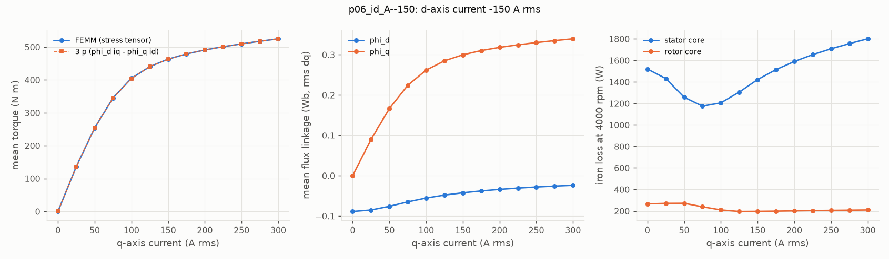

### p07_id_A--125

Parameters: machine = Toyota_Prius_ORNL_rev5centre.json, speed_rpm = 1000, id_A = -125, iq_min_A = 0, iq_max_A = 300, iq_steps = 13, mesh_fineness = 2, steps_per_period = 48, angle_points = 2048, magnet_temperature_C = 20, iron_kh = 0.0202, iron_alpha = 1.791, iron_kc = 7.91e-05, iron_ke = 0.00037, slot_fill = 0.5345, slot_area_mm2 = 143, turns_per_slot = 9

Derived: current_rms_max_A = 325

| Requirement | Result | Limit | Margin | Verdict | Evidence |
|---|---|---|---|---|---|
| REQ-M3 | 38.27 A/mm^2 | <= 25 | -13.3 | **FAIL** | [point.json](points/p07_id_A--125/point.json) |

| Check | Description | Value | Tolerance | Status |
|---|---|---|---|---|
| power_balance | max over q-axis currents (|T| >= 5 N m) of |mean(sum i dphi/dt) - mean torque x omega_m| / (mean torque x omega_m) | 1.01e-03 | 2e-02 | PASS |
| dq_torque | max over q-axis currents (|T| >= 5 N m) of |3 p (phi_d i_q - phi_q i_d) - FEMM torque| / FEMM torque: the mean dq flux linkages the efficiency map interpolates reproduce the torque (model form: harmonics are left out of the dq means) | 1.01e-03 | 5e-03 | PASS |
| current_amplitude | max |imposed phase current fundamental - sqrt(2) x requested rms| / peak | 4.68e-16 | 1e-03 | PASS |
| iron_coefficients_non_negative | min iron-loss coefficient over cores and currents (W), below 0 would be unphysical | -2.01e-03 | 0e+00 | PASS |
| time_resolution (validity) | 48 / steps per electrical period (below 1: at least 48) | 1.00e+00 | 1e+00 | PASS |

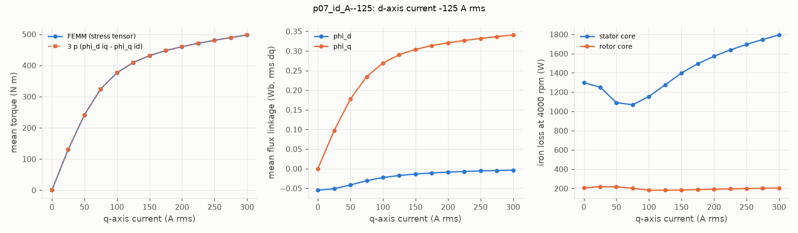

### p08_id_A--100

Parameters: machine = Toyota_Prius_ORNL_rev5centre.json, speed_rpm = 1000, id_A = -100, iq_min_A = 0, iq_max_A = 300, iq_steps = 13, mesh_fineness = 2, steps_per_period = 48, angle_points = 2048, magnet_temperature_C = 20, iron_kh = 0.0202, iron_alpha = 1.791, iron_kc = 7.91e-05, iron_ke = 0.00037, slot_fill = 0.5345, slot_area_mm2 = 143, turns_per_slot = 9

Derived: current_rms_max_A = 316.2

| Requirement | Result | Limit | Margin | Verdict | Evidence |
|---|---|---|---|---|---|
| REQ-M3 | 37.24 A/mm^2 | <= 25 | -12.2 | **FAIL** | [point.json](points/p08_id_A--100/point.json) |

| Check | Description | Value | Tolerance | Status |
|---|---|---|---|---|
| power_balance | max over q-axis currents (|T| >= 5 N m) of |mean(sum i dphi/dt) - mean torque x omega_m| / (mean torque x omega_m) | 7.38e-04 | 2e-02 | PASS |
| dq_torque | max over q-axis currents (|T| >= 5 N m) of |3 p (phi_d i_q - phi_q i_d) - FEMM torque| / FEMM torque: the mean dq flux linkages the efficiency map interpolates reproduce the torque (model form: harmonics are left out of the dq means) | 7.38e-04 | 5e-03 | PASS |
| current_amplitude | max |imposed phase current fundamental - sqrt(2) x requested rms| / peak | 3.90e-16 | 1e-03 | PASS |
| iron_coefficients_non_negative | min iron-loss coefficient over cores and currents (W), below 0 would be unphysical | -1.59e-03 | 0e+00 | PASS |
| time_resolution (validity) | 48 / steps per electrical period (below 1: at least 48) | 1.00e+00 | 1e+00 | PASS |

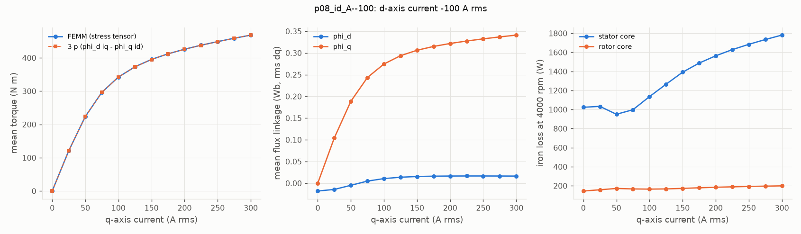

### p09_id_A--75

Parameters: machine = Toyota_Prius_ORNL_rev5centre.json, speed_rpm = 1000, id_A = -75, iq_min_A = 0, iq_max_A = 300, iq_steps = 13, mesh_fineness = 2, steps_per_period = 48, angle_points = 2048, magnet_temperature_C = 20, iron_kh = 0.0202, iron_alpha = 1.791, iron_kc = 7.91e-05, iron_ke = 0.00037, slot_fill = 0.5345, slot_area_mm2 = 143, turns_per_slot = 9

Derived: current_rms_max_A = 309.2

| Requirement | Result | Limit | Margin | Verdict | Evidence |
|---|---|---|---|---|---|
| REQ-M3 | 36.41 A/mm^2 | <= 25 | -11.4 | **FAIL** | [point.json](points/p09_id_A--75/point.json) |

| Check | Description | Value | Tolerance | Status |
|---|---|---|---|---|
| power_balance | max over q-axis currents (|T| >= 5 N m) of |mean(sum i dphi/dt) - mean torque x omega_m| / (mean torque x omega_m) | 8.29e-04 | 2e-02 | PASS |
| dq_torque | max over q-axis currents (|T| >= 5 N m) of |3 p (phi_d i_q - phi_q i_d) - FEMM torque| / FEMM torque: the mean dq flux linkages the efficiency map interpolates reproduce the torque (model form: harmonics are left out of the dq means) | 8.29e-04 | 5e-03 | PASS |
| current_amplitude | max |imposed phase current fundamental - sqrt(2) x requested rms| / peak | 4.62e-16 | 1e-03 | PASS |
| iron_coefficients_non_negative | min iron-loss coefficient over cores and currents (W), below 0 would be unphysical | -1.01e-03 | 0e+00 | PASS |
| time_resolution (validity) | 48 / steps per electrical period (below 1: at least 48) | 1.00e+00 | 1e+00 | PASS |

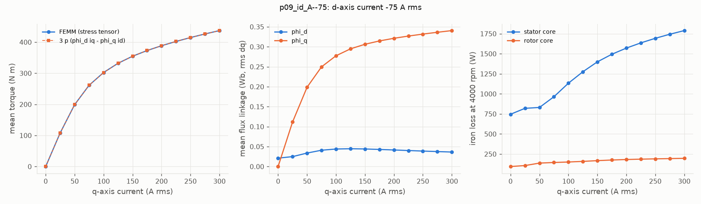

### p10_id_A--50

Parameters: machine = Toyota_Prius_ORNL_rev5centre.json, speed_rpm = 1000, id_A = -50, iq_min_A = 0, iq_max_A = 300, iq_steps = 13, mesh_fineness = 2, steps_per_period = 48, angle_points = 2048, magnet_temperature_C = 20, iron_kh = 0.0202, iron_alpha = 1.791, iron_kc = 7.91e-05, iron_ke = 0.00037, slot_fill = 0.5345, slot_area_mm2 = 143, turns_per_slot = 9

Derived: current_rms_max_A = 304.1

| Requirement | Result | Limit | Margin | Verdict | Evidence |
|---|---|---|---|---|---|
| REQ-M3 | 35.81 A/mm^2 | <= 25 | -10.8 | **FAIL** | [point.json](points/p10_id_A--50/point.json) |

| Check | Description | Value | Tolerance | Status |
|---|---|---|---|---|
| power_balance | max over q-axis currents (|T| >= 5 N m) of |mean(sum i dphi/dt) - mean torque x omega_m| / (mean torque x omega_m) | 1.59e-03 | 2e-02 | PASS |
| dq_torque | max over q-axis currents (|T| >= 5 N m) of |3 p (phi_d i_q - phi_q i_d) - FEMM torque| / FEMM torque: the mean dq flux linkages the efficiency map interpolates reproduce the torque (model form: harmonics are left out of the dq means) | 1.59e-03 | 5e-03 | PASS |
| current_amplitude | max |imposed phase current fundamental - sqrt(2) x requested rms| / peak | 4.73e-16 | 1e-03 | PASS |
| iron_coefficients_non_negative | min iron-loss coefficient over cores and currents (W), below 0 would be unphysical | -5.39e-04 | 0e+00 | PASS |
| time_resolution (validity) | 48 / steps per electrical period (below 1: at least 48) | 1.00e+00 | 1e+00 | PASS |

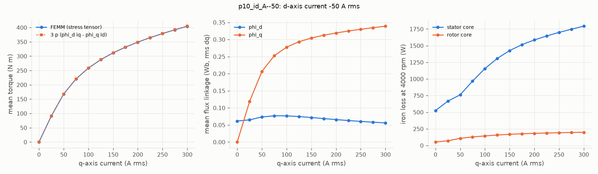

### p11_id_A--25

Parameters: machine = Toyota_Prius_ORNL_rev5centre.json, speed_rpm = 1000, id_A = -25, iq_min_A = 0, iq_max_A = 300, iq_steps = 13, mesh_fineness = 2, steps_per_period = 48, angle_points = 2048, magnet_temperature_C = 20, iron_kh = 0.0202, iron_alpha = 1.791, iron_kc = 7.91e-05, iron_ke = 0.00037, slot_fill = 0.5345, slot_area_mm2 = 143, turns_per_slot = 9

Derived: current_rms_max_A = 301

| Requirement | Result | Limit | Margin | Verdict | Evidence |
|---|---|---|---|---|---|
| REQ-M3 | 35.45 A/mm^2 | <= 25 | -10.4 | **FAIL** | [point.json](points/p11_id_A--25/point.json) |

| Check | Description | Value | Tolerance | Status |
|---|---|---|---|---|
| power_balance | max over q-axis currents (|T| >= 5 N m) of |mean(sum i dphi/dt) - mean torque x omega_m| / (mean torque x omega_m) | 1.62e-03 | 2e-02 | PASS |
| dq_torque | max over q-axis currents (|T| >= 5 N m) of |3 p (phi_d i_q - phi_q i_d) - FEMM torque| / FEMM torque: the mean dq flux linkages the efficiency map interpolates reproduce the torque (model form: harmonics are left out of the dq means) | 1.62e-03 | 5e-03 | PASS |
| current_amplitude | max |imposed phase current fundamental - sqrt(2) x requested rms| / peak | 4.73e-16 | 1e-03 | PASS |
| iron_coefficients_non_negative | min iron-loss coefficient over cores and currents (W), below 0 would be unphysical | -2.54e-04 | 0e+00 | PASS |
| time_resolution (validity) | 48 / steps per electrical period (below 1: at least 48) | 1.00e+00 | 1e+00 | PASS |

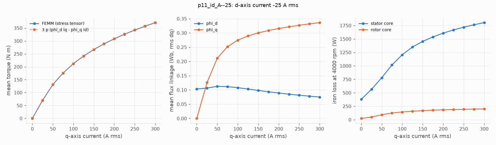

### p12_id_A-0

Parameters: machine = Toyota_Prius_ORNL_rev5centre.json, speed_rpm = 1000, id_A = 0, iq_min_A = 0, iq_max_A = 300, iq_steps = 13, mesh_fineness = 2, steps_per_period = 48, angle_points = 2048, magnet_temperature_C = 20, iron_kh = 0.0202, iron_alpha = 1.791, iron_kc = 7.91e-05, iron_ke = 0.00037, slot_fill = 0.5345, slot_area_mm2 = 143, turns_per_slot = 9

Derived: current_rms_max_A = 300

| Requirement | Result | Limit | Margin | Verdict | Evidence |
|---|---|---|---|---|---|
| REQ-M3 | 35.32 A/mm^2 | <= 25 | -10.3 | **FAIL** | [point.json](points/p12_id_A-0/point.json) |

| Check | Description | Value | Tolerance | Status |
|---|---|---|---|---|
| power_balance | max over q-axis currents (|T| >= 5 N m) of |mean(sum i dphi/dt) - mean torque x omega_m| / (mean torque x omega_m) | 1.27e-03 | 2e-02 | PASS |
| dq_torque | max over q-axis currents (|T| >= 5 N m) of |3 p (phi_d i_q - phi_q i_d) - FEMM torque| / FEMM torque: the mean dq flux linkages the efficiency map interpolates reproduce the torque (model form: harmonics are left out of the dq means) | 1.27e-03 | 5e-03 | PASS |
| current_amplitude | max |imposed phase current fundamental - sqrt(2) x requested rms| / peak | 3.57e-16 | 1e-03 | PASS |
| iron_coefficients_non_negative | min iron-loss coefficient over cores and currents (W), below 0 would be unphysical | -1.90e-04 | 0e+00 | PASS |
| time_resolution (validity) | 48 / steps per electrical period (below 1: at least 48) | 1.00e+00 | 1e+00 | PASS |

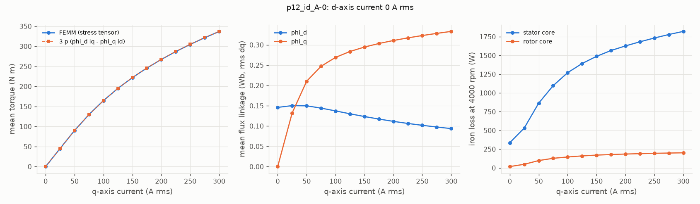

## Limitations

- No test data in this case: the ORNL comparison is a separate, blind step at the end of the study.
- The loss fit covers 0.1-1.8 T at 50-2500 Hz; deep-saturation regions (tooth tips at load) extrapolate it.
- No magnet eddy-current loss, no AC copper loss (proximity, skin), no mechanical loss.
- A converged solver run that matches an analytical reference shows that the equations were solved correctly. It does not show that the equations represent real hardware.

## Engineering acceptance

Pending human review. This report does not accept or reject the design.
