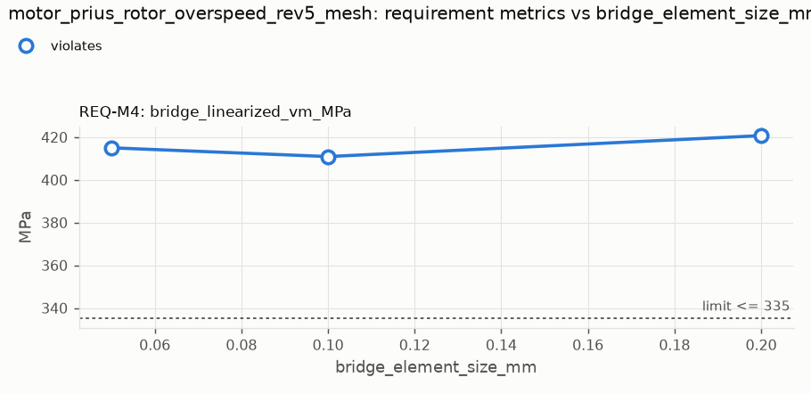
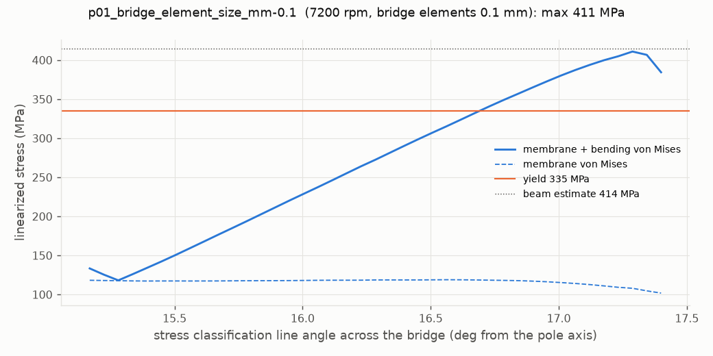

# Engineering review report: motor_prius_rotor_overspeed_rev5_mesh

- **Run:** `20261124-063835_motor_prius_rotor_overspeed_rev5_mesh`
- **Generated:** 2026-11-24T11:39:37+00:00
- **Case file SHA-256:** `4ac860c569002e787e7b5666d0773b089f1734517a8fe210565c21ddae1edd3f`
- **Environment:** Python 3.14.10, numpy 2.5.5, scipy 1.18.1, matplotlib 3.11.2, cadquery 2.8.0; Windows-11-10.0.26100-SP0
- **Tools:** gmsh 4.15.0; CalculiX This is Version 2.22
- **Code version:** git `823d08a610b766e76c0f2039dbcba8332610b35e`
- **Simulation status:** completed
- **Verification status:** PASS

## Scope

2004 Toyota Prius rotor lamination, REVISION 5 (client data: magnet 83.1 x 18.9 x 6.5 mm, 77 g, centred in the 6.80 mm pocket; pocket and bridges from the drawing) at 7200 rpm, the IEC 60034-1 overspeed; half a pole in plane stress, CalculiX; linearized von Mises through the 1.45 mm bridges against a 335 MPa yield; bridge element size 0.2 / 0.1 / 0.05 mm.

**Assumptions**

- Plane stress: each 0.35 mm lamination carries its own load; the stack is uniform.
- The magnets carry no stiffness: each magnet's centrifugal force (the BOM mass, 77 g, over the stack) acts as a uniform traction on its seat, the pocket's outer edge over the magnet width; the 0.15 mm of polymer between them is taken as closed (no bonding, no friction).
- Linear elastic steel (E 215 GPa, nu 0.3, density 7650 kg/m^3, Pyleecan's M400-50A data); yield 335 MPa (M330-35A, a stand-in for the unpublished grade).
- Sharp pocket corners as in Pyleecan's HoleM50; the requirement uses linearized stress, so the corner radius does not enter it.
- Free bore: the press fit or keyed fit on the hub is not modelled.

## Requirements

| ID | Requirement | Metric | Limit |
|---|---|---|---|
| REQ-M4 | At the IEC 60034-1 overspeed (1.2 x 6000 = 7200 rpm), the linearized von Mises stress through the rotor bridges shall not exceed the lamination's 335 MPa yield strength. | `bridge_linearized_vm_MPa` | <= 335 MPa |

## Summary across points

| Point | bridge_element_size_mm | REQ-M4 | Checks |
|---|---|---|---|
| p00_bridge_element_size_mm-0.2 | 0.2 | 420.7 MPa: **FAIL** | 4/4 PASS |
| p01_bridge_element_size_mm-0.1 | 0.1 | 410.9 MPa: **FAIL** | 4/4 PASS |
| p02_bridge_element_size_mm-0.05 | 0.05 | 415 MPa: **FAIL** | 4/4 PASS |

## Run-level checks

Checks that use several points together (for example mesh convergence).

| Check | Description | Value | Tolerance | Status |
|---|---|---|---|---|
| discretization_bridge_linearized_vm_MPa | relative discretization uncertainty of bridge_linearized_vm_MPa, oscillatory (R = -0.418): 1.25 x half-range of the 3 finest solutions | 0.0148 | 0.03 | PASS |
| discretization_bridge_membrane_vm_MPa | relative discretization uncertainty of bridge_membrane_vm_MPa, oscillatory (R = -0.418): 1.25 x half-range of the 3 finest solutions | 0.000398 | 0.03 | PASS |

## Point details

### p00_bridge_element_size_mm-0.2

Parameters: machine = Toyota_Prius_ORNL_rev5centre.json, magnet_mass_g = 77, speed_rpm = 7200, max_speed_rpm = 6000, yield_strength_MPa = 335, bridge_element_size_mm = 0.2, far_element_size_mm = 2, refine_distance_mm = 1, scl_count = 41, scl_points = 61

Derived: speed_ratio_to_max = 1.2

| Requirement | Result | Limit | Margin | Verdict | Evidence |
|---|---|---|---|---|---|
| REQ-M4 | 420.7 MPa | <= 335 | -85.7 | **FAIL** | [point.json](points/p00_bridge_element_size_mm-0.2/point.json) |

| Check | Description | Value | Tolerance | Status |
|---|---|---|---|---|
| rotating_disk | plain annulus through the same pipeline: max |sigma - exact| / sigma_theta at the bore (plane-stress rotating disk, free edges) | 3.82e-04 | 2e-03 | PASS |
| equilibrium | |steel centrifugal + magnet load + constrained reactions| / |load| (pole axis y and inter-pole normal components only) | 4.99e-05 | 1e-04 | PASS |
| beam_estimate | |FE linearized - fixed-guided beam estimate (tension + end bending)| / FE (model form; estimate 414 MPa) | 1.54e-02 | 3e-01 | PASS |
| membrane_elastic (validity) | bridge membrane von Mises / yield (below 1: the section does not yield through its thickness, so a linear-elastic model applies to the membrane) | 3.55e-01 | 1e+00 | PASS |

### p01_bridge_element_size_mm-0.1

Parameters: machine = Toyota_Prius_ORNL_rev5centre.json, magnet_mass_g = 77, speed_rpm = 7200, max_speed_rpm = 6000, yield_strength_MPa = 335, bridge_element_size_mm = 0.1, far_element_size_mm = 2, refine_distance_mm = 1, scl_count = 41, scl_points = 61

Derived: speed_ratio_to_max = 1.2

| Requirement | Result | Limit | Margin | Verdict | Evidence |
|---|---|---|---|---|---|
| REQ-M4 | 410.9 MPa | <= 335 | -75.9 | **FAIL** | [point.json](points/p01_bridge_element_size_mm-0.1/point.json) |

| Check | Description | Value | Tolerance | Status |
|---|---|---|---|---|
| rotating_disk | plain annulus through the same pipeline: max |sigma - exact| / sigma_theta at the bore (plane-stress rotating disk, free edges) | 3.59e-04 | 2e-03 | PASS |
| equilibrium | |steel centrifugal + magnet load + constrained reactions| / |load| (pole axis y and inter-pole normal components only) | 2.86e-05 | 1e-04 | PASS |
| beam_estimate | |FE linearized - fixed-guided beam estimate (tension + end bending)| / FE (model form; estimate 414 MPa) | 8.08e-03 | 3e-01 | PASS |
| membrane_elastic (validity) | bridge membrane von Mises / yield (below 1: the section does not yield through its thickness, so a linear-elastic model applies to the membrane) | 3.55e-01 | 1e+00 | PASS |

### p02_bridge_element_size_mm-0.05

Parameters: machine = Toyota_Prius_ORNL_rev5centre.json, magnet_mass_g = 77, speed_rpm = 7200, max_speed_rpm = 6000, yield_strength_MPa = 335, bridge_element_size_mm = 0.05, far_element_size_mm = 2, refine_distance_mm = 1, scl_count = 41, scl_points = 61

Derived: speed_ratio_to_max = 1.2

| Requirement | Result | Limit | Margin | Verdict | Evidence |
|---|---|---|---|---|---|
| REQ-M4 | 415 MPa | <= 335 | -80 | **FAIL** | [point.json](points/p02_bridge_element_size_mm-0.05/point.json) |

| Check | Description | Value | Tolerance | Status |
|---|---|---|---|---|
| rotating_disk | plain annulus through the same pipeline: max |sigma - exact| / sigma_theta at the bore (plane-stress rotating disk, free edges) | 4.80e-04 | 2e-03 | PASS |
| equilibrium | |steel centrifugal + magnet load + constrained reactions| / |load| (pole axis y and inter-pole normal components only) | 1.30e-05 | 1e-04 | PASS |
| beam_estimate | |FE linearized - fixed-guided beam estimate (tension + end bending)| / FE (model form; estimate 414 MPa) | 1.86e-03 | 3e-01 | PASS |
| membrane_elastic (validity) | bridge membrane von Mises / yield (below 1: the section does not yield through its thickness, so a linear-elastic model applies to the membrane) | 3.55e-01 | 1e+00 | PASS |

## Limitations

- No hub fit stress, no temperature, no magnet-to-steel bonding.
- The real lamination grade and corner radii are not published.
- Static strength at one speed only; no fatigue from start-stop cycles.
- A converged solver run that matches an analytical reference shows that the equations were solved correctly. It does not show that the equations represent real hardware.

## Engineering acceptance

Pending human review. This report does not accept or reject the design.
