# Engineering review report: motor_prius_lut_cold_refine_rev5

- **Run:** `20261124-075333_motor_prius_lut_cold_refine_rev5`
- **Generated:** 2026-11-24T13:23:50+00:00
- **Case file SHA-256:** `87f1c1802d9f7a843b57766d3141bd7a1cc5148862d853b7b7eb0fdb0b85fe9d`
- **Environment:** Python 3.14.10, numpy 2.5.5, scipy 1.18.1, matplotlib 3.11.2, cadquery 2.8.0; Windows-11-10.0.26100-SP0
- **Tools:** pyleecan 1.5.2; SciDataTool 2.5.0; numpy_pyleecan_env 2.5.5
- **Code version:** git `f970290d212fe775efecab9158944e4e3d0f1171`
- **Simulation status:** completed
- **Verification status:** FAIL

> **Warning:** verification did not pass for every point. Requirement verdicts marked *(unverified)* are not supported by evidence and must not be used for acceptance.

## Scope

SUPPLEMENTARY REFINEMENT of the revision-5 tables (an id column at -37.5 A over every iq row, and iq rows at 3.125 and 9.375 A over every id column, so the merged grid stays complete): 2004 Toyota Prius traction motor (revision 5, laminations M330-35A, magnets at 20 C), dq look-up table, id 0 to -300 A rms and iq 6.25 to 43.75 A rms in 6.25 A steps (supplementary low-current rows), 1000 rpm; Pyleecan + FEMM 4.2 magnetostatics over one electrical period (48 steps) with element fields; mesh fineness 2; torque, dq flux linkages and iron-loss coefficients. Revision 5 (client data: magnet 83.1 x 18.9 x 6.5 mm centred in the 6.80 mm pocket, 1.255 T at 20 C, air gap 0.775 mm; machine Toyota_Prius_ORNL_rev5centre.json).

**Assumptions**

- 2D magnetostatics (FEMM), no end effects; torque is the mean of FEMM's stress-tensor torque over one electrical period.
- Iron loss from the element fields with the M330-35A three-term fit applied per harmonic; rotational fields counted as two orthogonal alternating ones; minor loops and DC bias not modelled.
- Core mass without the stacking factor (FEMM models the stack as solid steel, lam_fill 1).
- Magnet temperature 20 C (MagFEMM T_mag; Br falls 0.1 %/K).
- Copper 76.4 mm^2 per slot (Pyleecan's 13 x 0.912 mm strands per turn, 9 turns), consistent with ORNL's 0.84 fill on the squares of insulated wires.

## Requirements

| ID | Requirement | Metric | Limit |
|---|---|---|---|
| REQ-M3 | The column's operating points shall stay within the 25 A/mm^2 rms copper current-density limit (marks the grid points the motor can sustain for a short time). | `current_density_max_A_per_mm2` | <= 25 A/mm^2 |

## Summary across points

| Point | scenario | REQ-M3 | Checks |
|---|---|---|---|
| p00_col_m37p5_main | col_m37p5_main | 35.6 A/mm^2: **FAIL** | 5/5 PASS |
| p01_col_m37p5_low | col_m37p5_low | 6.785 A/mm^2: **PASS** | 5/5 PASS |
| p02_row_id_m300 | row_id_m300 | 35.34 A/mm^2: **FAIL (unverified)** | 4/5 FAIL |
| p03_row_id_m275 | row_id_m275 | 32.4 A/mm^2: **FAIL (unverified)** | 4/5 FAIL |
| p04_row_id_m250 | row_id_m250 | 29.46 A/mm^2: **FAIL (unverified)** | 4/5 FAIL |
| p05_row_id_m225 | row_id_m225 | 26.52 A/mm^2: **FAIL (unverified)** | 4/5 FAIL |
| p06_row_id_m200 | row_id_m200 | 23.58 A/mm^2: **PASS (unverified)** | 4/5 FAIL |
| p07_row_id_m175 | row_id_m175 | 20.64 A/mm^2: **PASS (unverified)** | 4/5 FAIL |
| p08_row_id_m150 | row_id_m150 | 17.7 A/mm^2: **PASS (unverified)** | 4/5 FAIL |
| p09_row_id_m125 | row_id_m125 | 14.76 A/mm^2: **PASS (unverified)** | 4/5 FAIL |
| p10_row_id_m100 | row_id_m100 | 11.83 A/mm^2: **PASS (unverified)** | 4/5 FAIL |
| p11_row_id_m75 | row_id_m75 | 8.9 A/mm^2: **PASS** | 5/5 PASS |
| p12_row_id_m50 | row_id_m50 | 5.99 A/mm^2: **PASS** | 5/5 PASS |
| p13_row_id_m37p5 | row_id_m37p5 | 4.551 A/mm^2: **PASS** | 5/5 PASS |
| p14_row_id_m25 | row_id_m25 | 3.144 A/mm^2: **PASS** | 5/5 PASS |
| p15_row_id_0 | row_id_0 | 1.104 A/mm^2: **PASS** | 5/5 PASS |

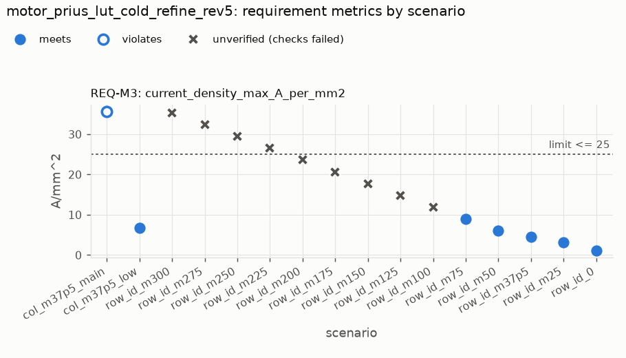

## Point details

### p00_col_m37p5_main

Parameters: machine = Toyota_Prius_ORNL_rev5centre.json, speed_rpm = 1000, id_A = -37.5, iq_min_A = 0, iq_max_A = 300, iq_steps = 13, mesh_fineness = 2, steps_per_period = 48, angle_points = 2048, magnet_temperature_C = 20, iron_kh = 0.0202, iron_alpha = 1.791, iron_kc = 7.91e-05, iron_ke = 0.00037, slot_fill = 0.5345, slot_area_mm2 = 143, turns_per_slot = 9, scenario = col_m37p5_main

Derived: current_rms_max_A = 302.3

| Requirement | Result | Limit | Margin | Verdict | Evidence |
|---|---|---|---|---|---|
| REQ-M3 | 35.6 A/mm^2 | <= 25 | -10.6 | **FAIL** | [point.json](points/p00_col_m37p5_main/point.json) |

| Check | Description | Value | Tolerance | Status |
|---|---|---|---|---|
| power_balance | max over q-axis currents (|T| >= 5 N m) of |mean(sum i dphi/dt) - mean torque x omega_m| / (mean torque x omega_m) | 1.77e-03 | 2e-02 | PASS |
| dq_torque | max over q-axis currents (|T| >= 5 N m) of |3 p (phi_d i_q - phi_q i_d) - FEMM torque| / FEMM torque: the mean dq flux linkages the efficiency map interpolates reproduce the torque (model form: harmonics are left out of the dq means) | 1.77e-03 | 5e-03 | PASS |
| current_amplitude | max |imposed phase current fundamental - sqrt(2) x requested rms| / peak | 4.62e-16 | 1e-03 | PASS |
| iron_coefficients_non_negative | min iron-loss coefficient over cores and currents (W), below 0 would be unphysical | -3.71e-04 | 0e+00 | PASS |
| time_resolution (validity) | 48 / steps per electrical period (below 1: at least 48) | 1.00e+00 | 1e+00 | PASS |

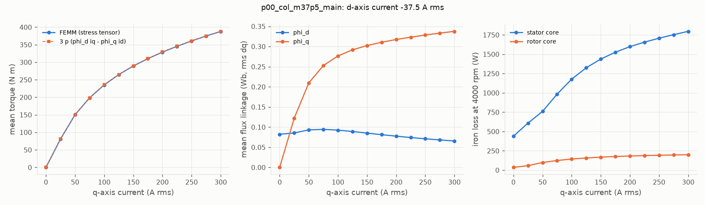

### p01_col_m37p5_low

Parameters: machine = Toyota_Prius_ORNL_rev5centre.json, speed_rpm = 1000, id_A = -37.5, iq_min_A = 6.25, iq_max_A = 43.75, iq_steps = 7, mesh_fineness = 2, steps_per_period = 48, angle_points = 2048, magnet_temperature_C = 20, iron_kh = 0.0202, iron_alpha = 1.791, iron_kc = 7.91e-05, iron_ke = 0.00037, slot_fill = 0.5345, slot_area_mm2 = 143, turns_per_slot = 9, scenario = col_m37p5_low

Derived: current_rms_max_A = 57.62

| Requirement | Result | Limit | Margin | Verdict | Evidence |
|---|---|---|---|---|---|
| REQ-M3 | 6.785 A/mm^2 | <= 25 | 18.2 | **PASS** | [point.json](points/p01_col_m37p5_low/point.json) |

| Check | Description | Value | Tolerance | Status |
|---|---|---|---|---|
| power_balance | max over q-axis currents (|T| >= 5 N m) of |mean(sum i dphi/dt) - mean torque x omega_m| / (mean torque x omega_m) | 1.97e-03 | 2e-02 | PASS |
| dq_torque | max over q-axis currents (|T| >= 5 N m) of |3 p (phi_d i_q - phi_q i_d) - FEMM torque| / FEMM torque: the mean dq flux linkages the efficiency map interpolates reproduce the torque (model form: harmonics are left out of the dq means) | 1.97e-03 | 5e-03 | PASS |
| current_amplitude | max |imposed phase current fundamental - sqrt(2) x requested rms| / peak | 3.79e-16 | 1e-03 | PASS |
| iron_coefficients_non_negative | min iron-loss coefficient over cores and currents (W), below 0 would be unphysical | -3.90e-04 | 0e+00 | PASS |
| time_resolution (validity) | 48 / steps per electrical period (below 1: at least 48) | 1.00e+00 | 1e+00 | PASS |

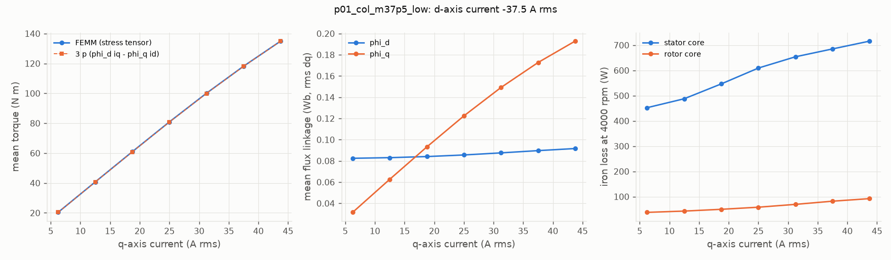

### p02_row_id_m300

Parameters: machine = Toyota_Prius_ORNL_rev5centre.json, speed_rpm = 1000, id_A = -300, iq_min_A = 3.125, iq_max_A = 9.375, iq_steps = 2, mesh_fineness = 2, steps_per_period = 48, angle_points = 2048, magnet_temperature_C = 20, iron_kh = 0.0202, iron_alpha = 1.791, iron_kc = 7.91e-05, iron_ke = 0.00037, slot_fill = 0.5345, slot_area_mm2 = 143, turns_per_slot = 9, scenario = row_id_m300

Derived: current_rms_max_A = 300.1

| Requirement | Result | Limit | Margin | Verdict | Evidence |
|---|---|---|---|---|---|
| REQ-M3 | 35.34 A/mm^2 | <= 25 | -10.3 | **FAIL (unverified)** | [point.json](points/p02_row_id_m300/point.json) |

| Check | Description | Value | Tolerance | Status |
|---|---|---|---|---|
| power_balance | max over q-axis currents (|T| >= 5 N m) of |mean(sum i dphi/dt) - mean torque x omega_m| / (mean torque x omega_m) | 1.44e-02 | 2e-02 | PASS |
| dq_torque | max over q-axis currents (|T| >= 5 N m) of |3 p (phi_d i_q - phi_q i_d) - FEMM torque| / FEMM torque: the mean dq flux linkages the efficiency map interpolates reproduce the torque (model form: harmonics are left out of the dq means) | 1.44e-02 | 5e-03 | FAIL |
| current_amplitude | max |imposed phase current fundamental - sqrt(2) x requested rms| / peak | 1.34e-16 | 1e-03 | PASS |
| iron_coefficients_non_negative | min iron-loss coefficient over cores and currents (W), below 0 would be unphysical | -6.53e-03 | 0e+00 | PASS |
| time_resolution (validity) | 48 / steps per electrical period (below 1: at least 48) | 1.00e+00 | 1e+00 | PASS |

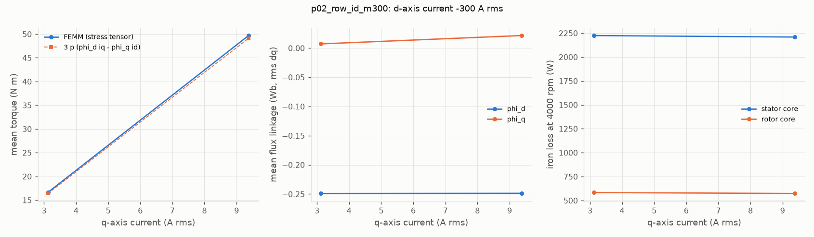

### p03_row_id_m275

Parameters: machine = Toyota_Prius_ORNL_rev5centre.json, speed_rpm = 1000, id_A = -275, iq_min_A = 3.125, iq_max_A = 9.375, iq_steps = 2, mesh_fineness = 2, steps_per_period = 48, angle_points = 2048, magnet_temperature_C = 20, iron_kh = 0.0202, iron_alpha = 1.791, iron_kc = 7.91e-05, iron_ke = 0.00037, slot_fill = 0.5345, slot_area_mm2 = 143, turns_per_slot = 9, scenario = row_id_m275

Derived: current_rms_max_A = 275.2

| Requirement | Result | Limit | Margin | Verdict | Evidence |
|---|---|---|---|---|---|
| REQ-M3 | 32.4 A/mm^2 | <= 25 | -7.4 | **FAIL (unverified)** | [point.json](points/p03_row_id_m275/point.json) |

| Check | Description | Value | Tolerance | Status |
|---|---|---|---|---|
| power_balance | max over q-axis currents (|T| >= 5 N m) of |mean(sum i dphi/dt) - mean torque x omega_m| / (mean torque x omega_m) | 1.05e-02 | 2e-02 | PASS |
| dq_torque | max over q-axis currents (|T| >= 5 N m) of |3 p (phi_d i_q - phi_q i_d) - FEMM torque| / FEMM torque: the mean dq flux linkages the efficiency map interpolates reproduce the torque (model form: harmonics are left out of the dq means) | 1.05e-02 | 5e-03 | FAIL |
| current_amplitude | max |imposed phase current fundamental - sqrt(2) x requested rms| / peak | 2.92e-16 | 1e-03 | PASS |
| iron_coefficients_non_negative | min iron-loss coefficient over cores and currents (W), below 0 would be unphysical | -6.36e-03 | 0e+00 | PASS |
| time_resolution (validity) | 48 / steps per electrical period (below 1: at least 48) | 1.00e+00 | 1e+00 | PASS |

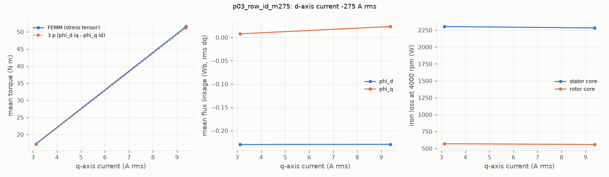

### p04_row_id_m250

Parameters: machine = Toyota_Prius_ORNL_rev5centre.json, speed_rpm = 1000, id_A = -250, iq_min_A = 3.125, iq_max_A = 9.375, iq_steps = 2, mesh_fineness = 2, steps_per_period = 48, angle_points = 2048, magnet_temperature_C = 20, iron_kh = 0.0202, iron_alpha = 1.791, iron_kc = 7.91e-05, iron_ke = 0.00037, slot_fill = 0.5345, slot_area_mm2 = 143, turns_per_slot = 9, scenario = row_id_m250

Derived: current_rms_max_A = 250.2

| Requirement | Result | Limit | Margin | Verdict | Evidence |
|---|---|---|---|---|---|
| REQ-M3 | 29.46 A/mm^2 | <= 25 | -4.46 | **FAIL (unverified)** | [point.json](points/p04_row_id_m250/point.json) |

| Check | Description | Value | Tolerance | Status |
|---|---|---|---|---|
| power_balance | max over q-axis currents (|T| >= 5 N m) of |mean(sum i dphi/dt) - mean torque x omega_m| / (mean torque x omega_m) | 5.60e-03 | 2e-02 | PASS |
| dq_torque | max over q-axis currents (|T| >= 5 N m) of |3 p (phi_d i_q - phi_q i_d) - FEMM torque| / FEMM torque: the mean dq flux linkages the efficiency map interpolates reproduce the torque (model form: harmonics are left out of the dq means) | 5.60e-03 | 5e-03 | FAIL |
| current_amplitude | max |imposed phase current fundamental - sqrt(2) x requested rms| / peak | 1.61e-16 | 1e-03 | PASS |
| iron_coefficients_non_negative | min iron-loss coefficient over cores and currents (W), below 0 would be unphysical | -5.92e-03 | 0e+00 | PASS |
| time_resolution (validity) | 48 / steps per electrical period (below 1: at least 48) | 1.00e+00 | 1e+00 | PASS |

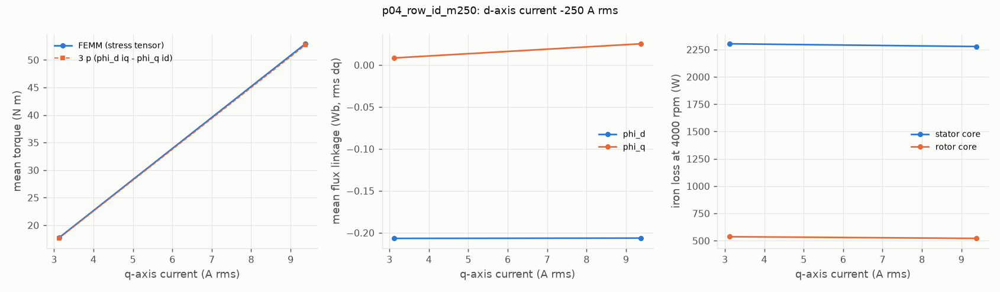

### p05_row_id_m225

Parameters: machine = Toyota_Prius_ORNL_rev5centre.json, speed_rpm = 1000, id_A = -225, iq_min_A = 3.125, iq_max_A = 9.375, iq_steps = 2, mesh_fineness = 2, steps_per_period = 48, angle_points = 2048, magnet_temperature_C = 20, iron_kh = 0.0202, iron_alpha = 1.791, iron_kc = 7.91e-05, iron_ke = 0.00037, slot_fill = 0.5345, slot_area_mm2 = 143, turns_per_slot = 9, scenario = row_id_m225

Derived: current_rms_max_A = 225.2

| Requirement | Result | Limit | Margin | Verdict | Evidence |
|---|---|---|---|---|---|
| REQ-M3 | 26.52 A/mm^2 | <= 25 | -1.52 | **FAIL (unverified)** | [point.json](points/p05_row_id_m225/point.json) |

| Check | Description | Value | Tolerance | Status |
|---|---|---|---|---|
| power_balance | max over q-axis currents (|T| >= 5 N m) of |mean(sum i dphi/dt) - mean torque x omega_m| / (mean torque x omega_m) | 6.43e-03 | 2e-02 | PASS |
| dq_torque | max over q-axis currents (|T| >= 5 N m) of |3 p (phi_d i_q - phi_q i_d) - FEMM torque| / FEMM torque: the mean dq flux linkages the efficiency map interpolates reproduce the torque (model form: harmonics are left out of the dq means) | 6.43e-03 | 5e-03 | FAIL |
| current_amplitude | max |imposed phase current fundamental - sqrt(2) x requested rms| / peak | 1.79e-16 | 1e-03 | PASS |
| iron_coefficients_non_negative | min iron-loss coefficient over cores and currents (W), below 0 would be unphysical | -5.20e-03 | 0e+00 | PASS |
| time_resolution (validity) | 48 / steps per electrical period (below 1: at least 48) | 1.00e+00 | 1e+00 | PASS |

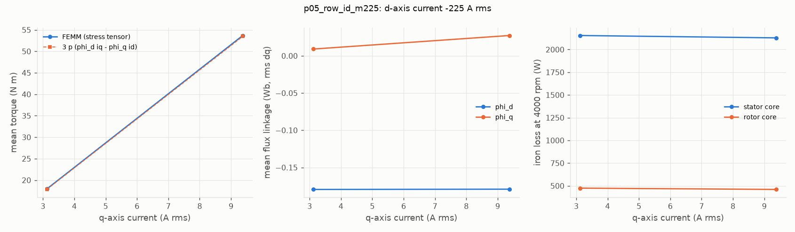

### p06_row_id_m200

Parameters: machine = Toyota_Prius_ORNL_rev5centre.json, speed_rpm = 1000, id_A = -200, iq_min_A = 3.125, iq_max_A = 9.375, iq_steps = 2, mesh_fineness = 2, steps_per_period = 48, angle_points = 2048, magnet_temperature_C = 20, iron_kh = 0.0202, iron_alpha = 1.791, iron_kc = 7.91e-05, iron_ke = 0.00037, slot_fill = 0.5345, slot_area_mm2 = 143, turns_per_slot = 9, scenario = row_id_m200

Derived: current_rms_max_A = 200.2

| Requirement | Result | Limit | Margin | Verdict | Evidence |
|---|---|---|---|---|---|
| REQ-M3 | 23.58 A/mm^2 | <= 25 | 1.42 | **PASS (unverified)** | [point.json](points/p06_row_id_m200/point.json) |

| Check | Description | Value | Tolerance | Status |
|---|---|---|---|---|
| power_balance | max over q-axis currents (|T| >= 5 N m) of |mean(sum i dphi/dt) - mean torque x omega_m| / (mean torque x omega_m) | 5.62e-03 | 2e-02 | PASS |
| dq_torque | max over q-axis currents (|T| >= 5 N m) of |3 p (phi_d i_q - phi_q i_d) - FEMM torque| / FEMM torque: the mean dq flux linkages the efficiency map interpolates reproduce the torque (model form: harmonics are left out of the dq means) | 5.62e-03 | 5e-03 | FAIL |
| current_amplitude | max |imposed phase current fundamental - sqrt(2) x requested rms| / peak | 2.01e-16 | 1e-03 | PASS |
| iron_coefficients_non_negative | min iron-loss coefficient over cores and currents (W), below 0 would be unphysical | -4.45e-03 | 0e+00 | PASS |
| time_resolution (validity) | 48 / steps per electrical period (below 1: at least 48) | 1.00e+00 | 1e+00 | PASS |

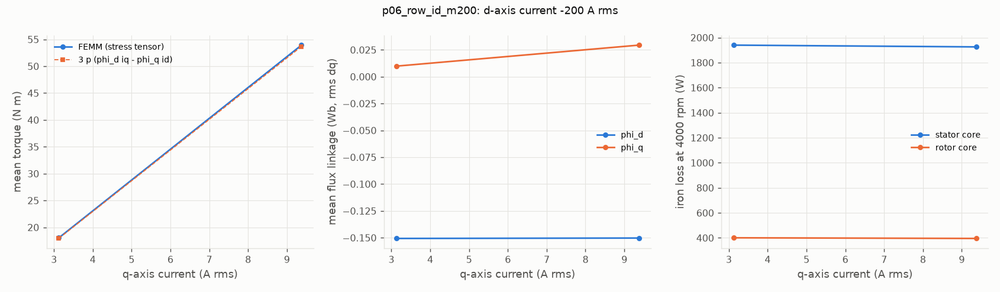

### p07_row_id_m175

Parameters: machine = Toyota_Prius_ORNL_rev5centre.json, speed_rpm = 1000, id_A = -175, iq_min_A = 3.125, iq_max_A = 9.375, iq_steps = 2, mesh_fineness = 2, steps_per_period = 48, angle_points = 2048, magnet_temperature_C = 20, iron_kh = 0.0202, iron_alpha = 1.791, iron_kc = 7.91e-05, iron_ke = 0.00037, slot_fill = 0.5345, slot_area_mm2 = 143, turns_per_slot = 9, scenario = row_id_m175

Derived: current_rms_max_A = 175.3

| Requirement | Result | Limit | Margin | Verdict | Evidence |
|---|---|---|---|---|---|
| REQ-M3 | 20.64 A/mm^2 | <= 25 | 4.36 | **PASS (unverified)** | [point.json](points/p07_row_id_m175/point.json) |

| Check | Description | Value | Tolerance | Status |
|---|---|---|---|---|
| power_balance | max over q-axis currents (|T| >= 5 N m) of |mean(sum i dphi/dt) - mean torque x omega_m| / (mean torque x omega_m) | 8.54e-03 | 2e-02 | PASS |
| dq_torque | max over q-axis currents (|T| >= 5 N m) of |3 p (phi_d i_q - phi_q i_d) - FEMM torque| / FEMM torque: the mean dq flux linkages the efficiency map interpolates reproduce the torque (model form: harmonics are left out of the dq means) | 8.54e-03 | 5e-03 | FAIL |
| current_amplitude | max |imposed phase current fundamental - sqrt(2) x requested rms| / peak | 2.30e-16 | 1e-03 | PASS |
| iron_coefficients_non_negative | min iron-loss coefficient over cores and currents (W), below 0 would be unphysical | -3.70e-03 | 0e+00 | PASS |
| time_resolution (validity) | 48 / steps per electrical period (below 1: at least 48) | 1.00e+00 | 1e+00 | PASS |

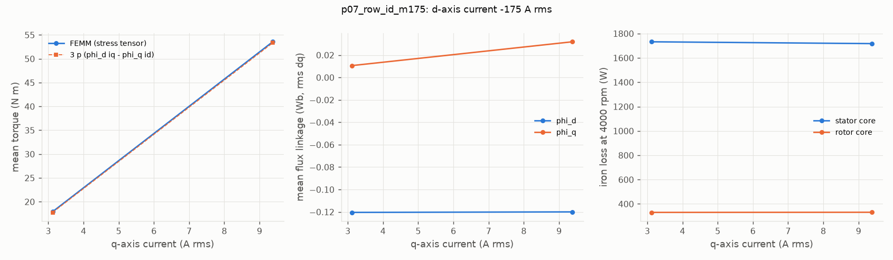

### p08_row_id_m150

Parameters: machine = Toyota_Prius_ORNL_rev5centre.json, speed_rpm = 1000, id_A = -150, iq_min_A = 3.125, iq_max_A = 9.375, iq_steps = 2, mesh_fineness = 2, steps_per_period = 48, angle_points = 2048, magnet_temperature_C = 20, iron_kh = 0.0202, iron_alpha = 1.791, iron_kc = 7.91e-05, iron_ke = 0.00037, slot_fill = 0.5345, slot_area_mm2 = 143, turns_per_slot = 9, scenario = row_id_m150

Derived: current_rms_max_A = 150.3

| Requirement | Result | Limit | Margin | Verdict | Evidence |
|---|---|---|---|---|---|
| REQ-M3 | 17.7 A/mm^2 | <= 25 | 7.3 | **PASS (unverified)** | [point.json](points/p08_row_id_m150/point.json) |

| Check | Description | Value | Tolerance | Status |
|---|---|---|---|---|
| power_balance | max over q-axis currents (|T| >= 5 N m) of |mean(sum i dphi/dt) - mean torque x omega_m| / (mean torque x omega_m) | 5.91e-03 | 2e-02 | PASS |
| dq_torque | max over q-axis currents (|T| >= 5 N m) of |3 p (phi_d i_q - phi_q i_d) - FEMM torque| / FEMM torque: the mean dq flux linkages the efficiency map interpolates reproduce the torque (model form: harmonics are left out of the dq means) | 5.91e-03 | 5e-03 | FAIL |
| current_amplitude | max |imposed phase current fundamental - sqrt(2) x requested rms| / peak | 4.01e-16 | 1e-03 | PASS |
| iron_coefficients_non_negative | min iron-loss coefficient over cores and currents (W), below 0 would be unphysical | -2.97e-03 | 0e+00 | PASS |
| time_resolution (validity) | 48 / steps per electrical period (below 1: at least 48) | 1.00e+00 | 1e+00 | PASS |

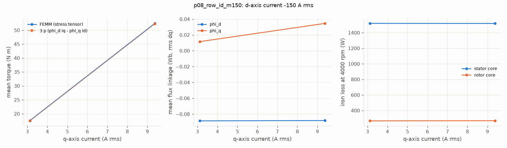

### p09_row_id_m125

Parameters: machine = Toyota_Prius_ORNL_rev5centre.json, speed_rpm = 1000, id_A = -125, iq_min_A = 3.125, iq_max_A = 9.375, iq_steps = 2, mesh_fineness = 2, steps_per_period = 48, angle_points = 2048, magnet_temperature_C = 20, iron_kh = 0.0202, iron_alpha = 1.791, iron_kc = 7.91e-05, iron_ke = 0.00037, slot_fill = 0.5345, slot_area_mm2 = 143, turns_per_slot = 9, scenario = row_id_m125

Derived: current_rms_max_A = 125.4

| Requirement | Result | Limit | Margin | Verdict | Evidence |
|---|---|---|---|---|---|
| REQ-M3 | 14.76 A/mm^2 | <= 25 | 10.2 | **PASS (unverified)** | [point.json](points/p09_row_id_m125/point.json) |

| Check | Description | Value | Tolerance | Status |
|---|---|---|---|---|
| power_balance | max over q-axis currents (|T| >= 5 N m) of |mean(sum i dphi/dt) - mean torque x omega_m| / (mean torque x omega_m) | 6.47e-03 | 2e-02 | PASS |
| dq_torque | max over q-axis currents (|T| >= 5 N m) of |3 p (phi_d i_q - phi_q i_d) - FEMM torque| / FEMM torque: the mean dq flux linkages the efficiency map interpolates reproduce the torque (model form: harmonics are left out of the dq means) | 6.47e-03 | 5e-03 | FAIL |
| current_amplitude | max |imposed phase current fundamental - sqrt(2) x requested rms| / peak | 3.21e-16 | 1e-03 | PASS |
| iron_coefficients_non_negative | min iron-loss coefficient over cores and currents (W), below 0 would be unphysical | -2.27e-03 | 0e+00 | PASS |
| time_resolution (validity) | 48 / steps per electrical period (below 1: at least 48) | 1.00e+00 | 1e+00 | PASS |

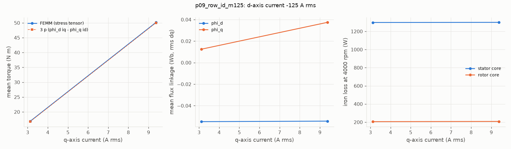

### p10_row_id_m100

Parameters: machine = Toyota_Prius_ORNL_rev5centre.json, speed_rpm = 1000, id_A = -100, iq_min_A = 3.125, iq_max_A = 9.375, iq_steps = 2, mesh_fineness = 2, steps_per_period = 48, angle_points = 2048, magnet_temperature_C = 20, iron_kh = 0.0202, iron_alpha = 1.791, iron_kc = 7.91e-05, iron_ke = 0.00037, slot_fill = 0.5345, slot_area_mm2 = 143, turns_per_slot = 9, scenario = row_id_m100

Derived: current_rms_max_A = 100.4

| Requirement | Result | Limit | Margin | Verdict | Evidence |
|---|---|---|---|---|---|
| REQ-M3 | 11.83 A/mm^2 | <= 25 | 13.2 | **PASS (unverified)** | [point.json](points/p10_row_id_m100/point.json) |

| Check | Description | Value | Tolerance | Status |
|---|---|---|---|---|
| power_balance | max over q-axis currents (|T| >= 5 N m) of |mean(sum i dphi/dt) - mean torque x omega_m| / (mean torque x omega_m) | 7.71e-03 | 2e-02 | PASS |
| dq_torque | max over q-axis currents (|T| >= 5 N m) of |3 p (phi_d i_q - phi_q i_d) - FEMM torque| / FEMM torque: the mean dq flux linkages the efficiency map interpolates reproduce the torque (model form: harmonics are left out of the dq means) | 7.71e-03 | 5e-03 | FAIL |
| current_amplitude | max |imposed phase current fundamental - sqrt(2) x requested rms| / peak | 2.01e-16 | 1e-03 | PASS |
| iron_coefficients_non_negative | min iron-loss coefficient over cores and currents (W), below 0 would be unphysical | -1.60e-03 | 0e+00 | PASS |
| time_resolution (validity) | 48 / steps per electrical period (below 1: at least 48) | 1.00e+00 | 1e+00 | PASS |

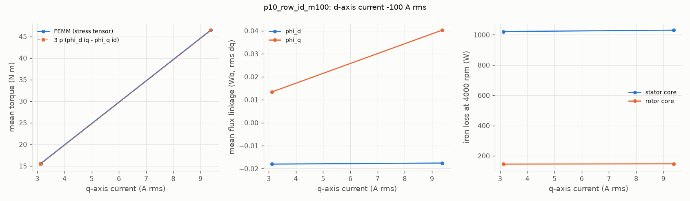

### p11_row_id_m75

Parameters: machine = Toyota_Prius_ORNL_rev5centre.json, speed_rpm = 1000, id_A = -75, iq_min_A = 3.125, iq_max_A = 9.375, iq_steps = 2, mesh_fineness = 2, steps_per_period = 48, angle_points = 2048, magnet_temperature_C = 20, iron_kh = 0.0202, iron_alpha = 1.791, iron_kc = 7.91e-05, iron_ke = 0.00037, slot_fill = 0.5345, slot_area_mm2 = 143, turns_per_slot = 9, scenario = row_id_m75

Derived: current_rms_max_A = 75.58

| Requirement | Result | Limit | Margin | Verdict | Evidence |
|---|---|---|---|---|---|
| REQ-M3 | 8.9 A/mm^2 | <= 25 | 16.1 | **PASS** | [point.json](points/p11_row_id_m75/point.json) |

| Check | Description | Value | Tolerance | Status |
|---|---|---|---|---|
| power_balance | max over q-axis currents (|T| >= 5 N m) of |mean(sum i dphi/dt) - mean torque x omega_m| / (mean torque x omega_m) | 1.74e-03 | 2e-02 | PASS |
| dq_torque | max over q-axis currents (|T| >= 5 N m) of |3 p (phi_d i_q - phi_q i_d) - FEMM torque| / FEMM torque: the mean dq flux linkages the efficiency map interpolates reproduce the torque (model form: harmonics are left out of the dq means) | 1.74e-03 | 5e-03 | PASS |
| current_amplitude | max |imposed phase current fundamental - sqrt(2) x requested rms| / peak | 2.68e-16 | 1e-03 | PASS |
| iron_coefficients_non_negative | min iron-loss coefficient over cores and currents (W), below 0 would be unphysical | -1.02e-03 | 0e+00 | PASS |
| time_resolution (validity) | 48 / steps per electrical period (below 1: at least 48) | 1.00e+00 | 1e+00 | PASS |

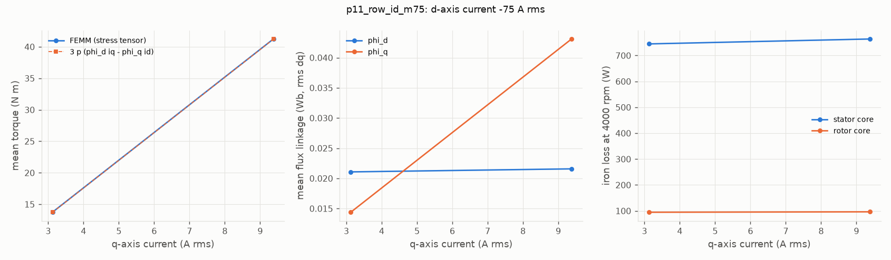

### p12_row_id_m50

Parameters: machine = Toyota_Prius_ORNL_rev5centre.json, speed_rpm = 1000, id_A = -50, iq_min_A = 3.125, iq_max_A = 9.375, iq_steps = 2, mesh_fineness = 2, steps_per_period = 48, angle_points = 2048, magnet_temperature_C = 20, iron_kh = 0.0202, iron_alpha = 1.791, iron_kc = 7.91e-05, iron_ke = 0.00037, slot_fill = 0.5345, slot_area_mm2 = 143, turns_per_slot = 9, scenario = row_id_m50

Derived: current_rms_max_A = 50.87

| Requirement | Result | Limit | Margin | Verdict | Evidence |
|---|---|---|---|---|---|
| REQ-M3 | 5.99 A/mm^2 | <= 25 | 19 | **PASS** | [point.json](points/p12_row_id_m50/point.json) |

| Check | Description | Value | Tolerance | Status |
|---|---|---|---|---|
| power_balance | max over q-axis currents (|T| >= 5 N m) of |mean(sum i dphi/dt) - mean torque x omega_m| / (mean torque x omega_m) | 9.81e-04 | 2e-02 | PASS |
| dq_torque | max over q-axis currents (|T| >= 5 N m) of |3 p (phi_d i_q - phi_q i_d) - FEMM torque| / FEMM torque: the mean dq flux linkages the efficiency map interpolates reproduce the torque (model form: harmonics are left out of the dq means) | 9.81e-04 | 5e-03 | PASS |
| current_amplitude | max |imposed phase current fundamental - sqrt(2) x requested rms| / peak | 2.01e-16 | 1e-03 | PASS |
| iron_coefficients_non_negative | min iron-loss coefficient over cores and currents (W), below 0 would be unphysical | -5.47e-04 | 0e+00 | PASS |
| time_resolution (validity) | 48 / steps per electrical period (below 1: at least 48) | 1.00e+00 | 1e+00 | PASS |

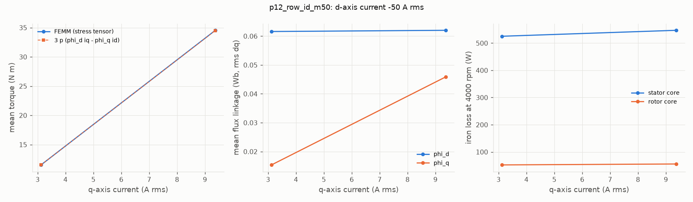

### p13_row_id_m37p5

Parameters: machine = Toyota_Prius_ORNL_rev5centre.json, speed_rpm = 1000, id_A = -37.5, iq_min_A = 3.125, iq_max_A = 9.375, iq_steps = 2, mesh_fineness = 2, steps_per_period = 48, angle_points = 2048, magnet_temperature_C = 20, iron_kh = 0.0202, iron_alpha = 1.791, iron_kc = 7.91e-05, iron_ke = 0.00037, slot_fill = 0.5345, slot_area_mm2 = 143, turns_per_slot = 9, scenario = row_id_m37p5

Derived: current_rms_max_A = 38.65

| Requirement | Result | Limit | Margin | Verdict | Evidence |
|---|---|---|---|---|---|
| REQ-M3 | 4.551 A/mm^2 | <= 25 | 20.4 | **PASS** | [point.json](points/p13_row_id_m37p5/point.json) |

| Check | Description | Value | Tolerance | Status |
|---|---|---|---|---|
| power_balance | max over q-axis currents (|T| >= 5 N m) of |mean(sum i dphi/dt) - mean torque x omega_m| / (mean torque x omega_m) | 1.50e-03 | 2e-02 | PASS |
| dq_torque | max over q-axis currents (|T| >= 5 N m) of |3 p (phi_d i_q - phi_q i_d) - FEMM torque| / FEMM torque: the mean dq flux linkages the efficiency map interpolates reproduce the torque (model form: harmonics are left out of the dq means) | 1.50e-03 | 5e-03 | PASS |
| current_amplitude | max |imposed phase current fundamental - sqrt(2) x requested rms| / peak | 2.67e-16 | 1e-03 | PASS |
| iron_coefficients_non_negative | min iron-loss coefficient over cores and currents (W), below 0 would be unphysical | -3.76e-04 | 0e+00 | PASS |
| time_resolution (validity) | 48 / steps per electrical period (below 1: at least 48) | 1.00e+00 | 1e+00 | PASS |

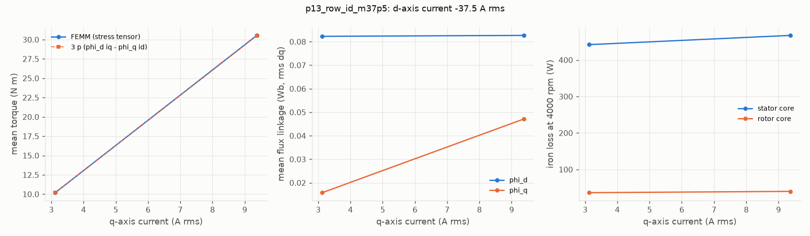

### p14_row_id_m25

Parameters: machine = Toyota_Prius_ORNL_rev5centre.json, speed_rpm = 1000, id_A = -25, iq_min_A = 3.125, iq_max_A = 9.375, iq_steps = 2, mesh_fineness = 2, steps_per_period = 48, angle_points = 2048, magnet_temperature_C = 20, iron_kh = 0.0202, iron_alpha = 1.791, iron_kc = 7.91e-05, iron_ke = 0.00037, slot_fill = 0.5345, slot_area_mm2 = 143, turns_per_slot = 9, scenario = row_id_m25

Derived: current_rms_max_A = 26.7

| Requirement | Result | Limit | Margin | Verdict | Evidence |
|---|---|---|---|---|---|
| REQ-M3 | 3.144 A/mm^2 | <= 25 | 21.9 | **PASS** | [point.json](points/p14_row_id_m25/point.json) |

| Check | Description | Value | Tolerance | Status |
|---|---|---|---|---|
| power_balance | max over q-axis currents (|T| >= 5 N m) of |mean(sum i dphi/dt) - mean torque x omega_m| / (mean torque x omega_m) | 1.83e-03 | 2e-02 | PASS |
| dq_torque | max over q-axis currents (|T| >= 5 N m) of |3 p (phi_d i_q - phi_q i_d) - FEMM torque| / FEMM torque: the mean dq flux linkages the efficiency map interpolates reproduce the torque (model form: harmonics are left out of the dq means) | 1.83e-03 | 5e-03 | PASS |
| current_amplitude | max |imposed phase current fundamental - sqrt(2) x requested rms| / peak | 1.99e-16 | 1e-03 | PASS |
| iron_coefficients_non_negative | min iron-loss coefficient over cores and currents (W), below 0 would be unphysical | -2.59e-04 | 0e+00 | PASS |
| time_resolution (validity) | 48 / steps per electrical period (below 1: at least 48) | 1.00e+00 | 1e+00 | PASS |

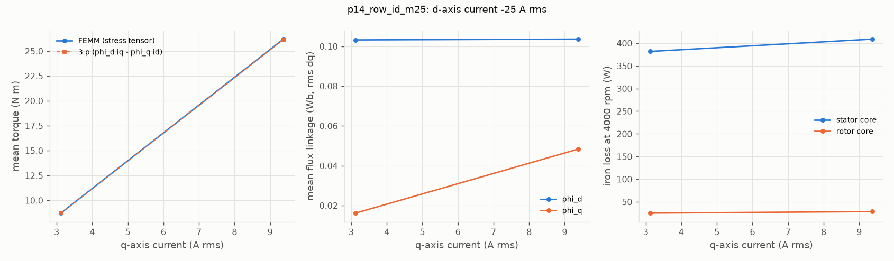

### p15_row_id_0

Parameters: machine = Toyota_Prius_ORNL_rev5centre.json, speed_rpm = 1000, id_A = 0, iq_min_A = 3.125, iq_max_A = 9.375, iq_steps = 2, mesh_fineness = 2, steps_per_period = 48, angle_points = 2048, magnet_temperature_C = 20, iron_kh = 0.0202, iron_alpha = 1.791, iron_kc = 7.91e-05, iron_ke = 0.00037, slot_fill = 0.5345, slot_area_mm2 = 143, turns_per_slot = 9, scenario = row_id_0

Derived: current_rms_max_A = 9.375

| Requirement | Result | Limit | Margin | Verdict | Evidence |
|---|---|---|---|---|---|
| REQ-M3 | 1.104 A/mm^2 | <= 25 | 23.9 | **PASS** | [point.json](points/p15_row_id_0/point.json) |

| Check | Description | Value | Tolerance | Status |
|---|---|---|---|---|
| power_balance | max over q-axis currents (|T| >= 5 N m) of |mean(sum i dphi/dt) - mean torque x omega_m| / (mean torque x omega_m) | 2.24e-03 | 2e-02 | PASS |
| dq_torque | max over q-axis currents (|T| >= 5 N m) of |3 p (phi_d i_q - phi_q i_d) - FEMM torque| / FEMM torque: the mean dq flux linkages the efficiency map interpolates reproduce the torque (model form: harmonics are left out of the dq means) | 2.24e-03 | 5e-03 | PASS |
| current_amplitude | max |imposed phase current fundamental - sqrt(2) x requested rms| / peak | 2.68e-16 | 1e-03 | PASS |
| iron_coefficients_non_negative | min iron-loss coefficient over cores and currents (W), below 0 would be unphysical | -1.94e-04 | 0e+00 | PASS |
| time_resolution (validity) | 48 / steps per electrical period (below 1: at least 48) | 1.00e+00 | 1e+00 | PASS |

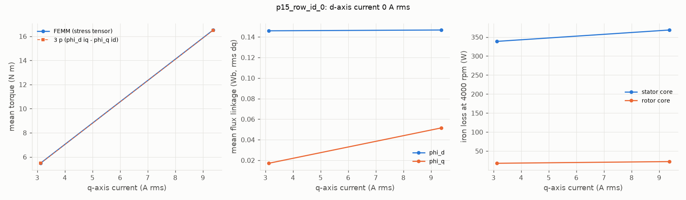

## Limitations

- No test data in this case: the ORNL comparison is a separate, blind step at the end of the study.
- The loss fit covers 0.1-1.8 T at 50-2500 Hz; deep-saturation regions (tooth tips at load) extrapolate it.
- No magnet eddy-current loss, no AC copper loss (proximity, skin), no mechanical loss.
- A converged solver run that matches an analytical reference shows that the equations were solved correctly. It does not show that the equations represent real hardware.

## Engineering acceptance

Pending human review. This report does not accept or reject the design.
