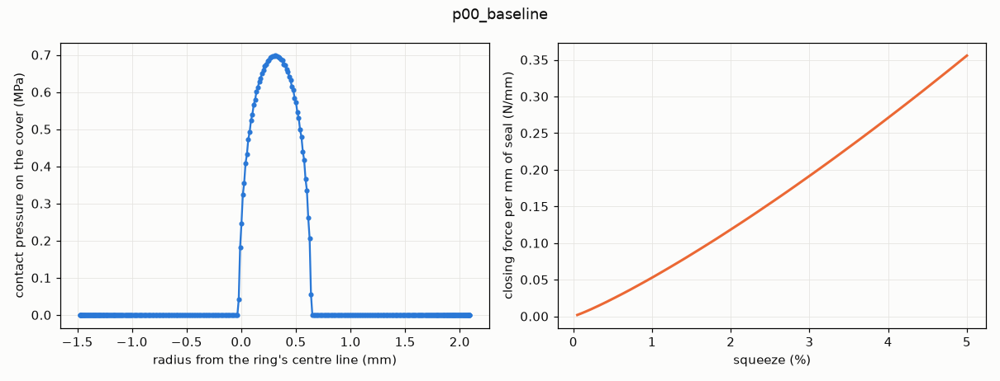

# Engineering review report: oring_free_hertz

- **Run:** `20261124-100617_oring_free_hertz`
- **Generated:** 2026-11-24T15:43:38+00:00
- **Case file SHA-256:** `13b2ee70b157059ac253a6870bbf5228b141dba867bcbc14b7738385cc4f4417`
- **Environment:** Python 3.14.10, numpy 2.5.5, scipy 1.18.1, matplotlib 3.11.2, cadquery 2.8.0; Windows-11-10.0.26100-SP0
- **Tools:** CalculiX This is Version 2.22; gmsh 4.15.0
- **Code version:** git `19cd5f58820a6b7f9759e6ef56fdf30949314bbf`
- **Simulation status:** completed
- **Verification status:** FAIL

> **Warning:** verification did not pass for every point. Requirement verdicts marked *(unverified)* are not supported by evidence and must not be used for acceptance.

## Scope

O-ring 3.53 mm, 70 Shore A, laterally unrestrained, 5 % squeeze, fine contact mesh: peak pressure and contact width against Hertz line contact at the model's own force (reference case).

**Assumptions**

- Axisymmetric; the mid-plane is a symmetry plane (flat groove bottom and cover, frictionless contact, quasi-static), so the upper half of the cross-section is modelled.
- Neo-Hookean rubber, E from Shore A by Gent's relation (synthetic compound; the hardness tolerance carries the material uncertainty), near-incompressible (K = 1000 G; checked: volume conservation).
- Steel cover and groove walls (E 200 GPa, effectively rigid against the rubber).
- Installed against the groove's outer wall (internal pressure); the ring's ID follows the cross-section so its OD equals the groove OD at every corner.
- Unpressurised installation: the 0.3 MPa sealed pressure enters only through REQ-E2's 2 x rule, not as a load.

## Requirements

| ID | Requirement | Metric | Limit |
|---|---|---|---|
| REQ-R1a | Validation: the closing force at 5 % squeeze shall be at least the lower end of Parker's measured 70 Shore A band for the 0.139 in cross-section (ORD 5700 Fig. 2-6; 0.169 N/mm). | `force_per_length_N_per_mm` | >= 0.169 N/mm |
| REQ-R1b | Validation: the closing force at 5 % squeeze shall not exceed the upper end of that band (1.113 N/mm). | `force_per_length_N_per_mm` | <= 1.113 N/mm |

## Summary across points

| Point | REQ-R1a | REQ-R1b | Checks |
|---|---|---|---|
| p00_baseline | 0.3557 N/mm: **PASS (unverified)** | 0.3557 N/mm: **PASS (unverified)** | 5/6 FAIL |

## Point details

### p00_baseline

Parameters: cross_section_mm = 3.53, ring_inner_diameter_mm = 50, groove_depth_mm = 3.353, groove_width_mm = 4.8, groove_outer_diameter_mm = 57.06, groove_walls = 0, shore_a = 70, bulk_to_shear = 1000, contact_element_size_mm = 0.025, far_element_size_mm = 0.15, penalty_factor = 10

Derived: squeeze = 0.05, youngs_modulus_MPa = 5.521, groove_fill_hand = 0.608

| Requirement | Result | Limit | Margin | Verdict | Evidence |
|---|---|---|---|---|---|
| REQ-R1a | 0.3557 N/mm | >= 0.169 | 0.187 | **PASS (unverified)** | [point.json](points/p00_baseline/point.json) |
| REQ-R1b | 0.3557 N/mm | <= 1.113 | 0.757 | **PASS (unverified)** | [point.json](points/p00_baseline/point.json) |

| Check | Description | Value | Tolerance | Status |
|---|---|---|---|---|
| volume_conservation | |deformed / initial ring volume - 1| (near-incompressible: J about 1) | 2.81e-05 | 1e-03 | PASS |
| contact_force_balance | |integral of the contact pressure over the cover / cover reaction - 1| | 3.08e-02 | 3e-02 | FAIL |
| equilibrium | |cover reaction - symmetry-plane reaction| / cover reaction (walls frictionless) | 0.00e+00 | 1e-03 | PASS |
| penalty_penetration | max overclosure of the ring into the cover / cover travel | 4.66e-03 | 2e-02 | PASS |
| hertz_peak_pressure | |peak contact pressure - Hertz p0 at the FE's force| / p0 | 1.58e-02 | 1e-01 | PASS |
| hertz_contact_width | |contact width - Hertz 2b at the FE's force| / 2b | 3.36e-03 | 1e-01 | PASS |

## Limitations

- No friction, no compression set or stress relaxation over time, no temperature effects on the compound.
- Lindley's relation is empirical and its exponents are not yet confirmed from a second source; Parker's band is wide (a factor of about 6.6).
- No physical test data.
- A converged solver run that matches an analytical reference shows that the equations were solved correctly. It does not show that the equations represent real hardware.

## Engineering acceptance

Pending human review. This report does not accept or reject the design.
