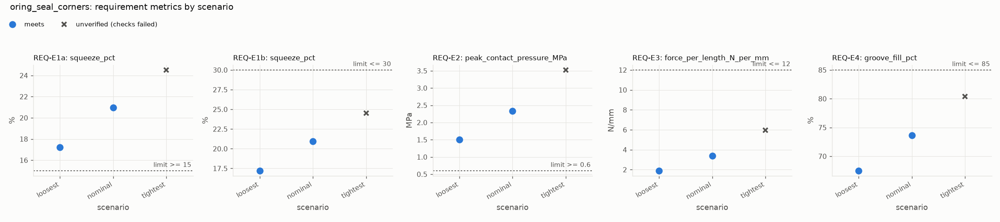
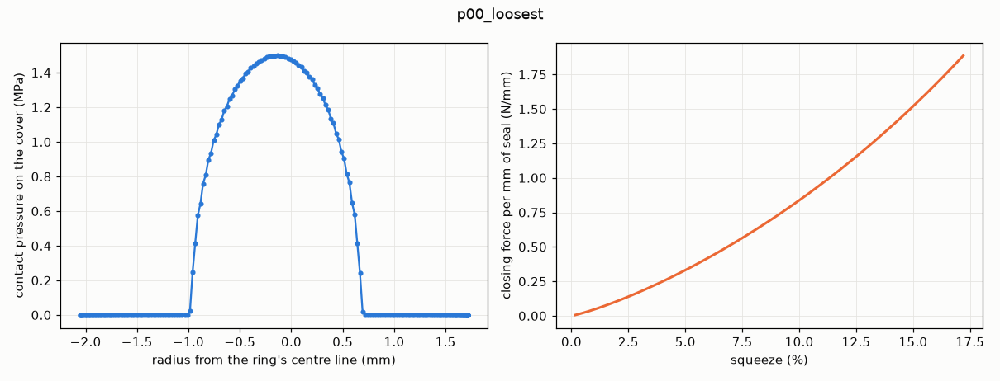
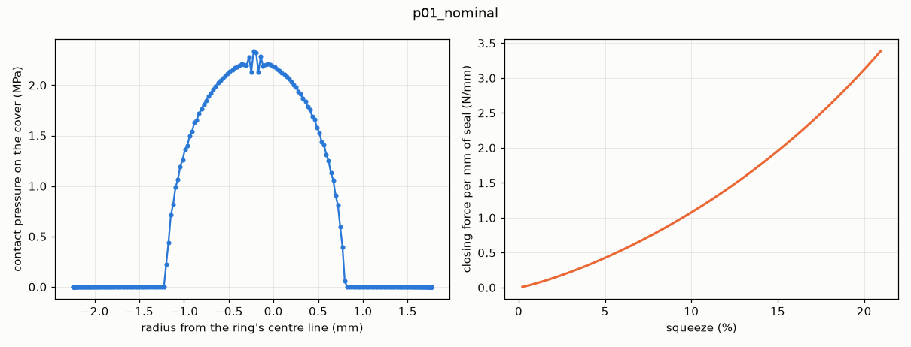
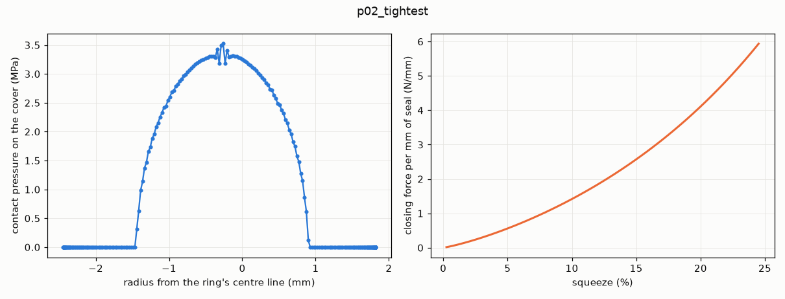

# Engineering review report: oring_seal_corners

- **Run:** `20261124-100619_oring_seal_corners`
- **Generated:** 2026-11-24T16:38:10+00:00
- **Case file SHA-256:** `6becc0d8887c337d089764bbf226fb3a85f1faad64ca4e5e9107ae01e3a593cb`
- **Environment:** Python 3.14.10, numpy 2.5.5, scipy 1.18.1, matplotlib 3.11.2, cadquery 2.8.0; Windows-11-10.0.26100-SP0
- **Tools:** CalculiX This is Version 2.22; gmsh 4.15.0
- **Code version:** git `19cd5f58820a6b7f9759e6ef56fdf30949314bbf`
- **Simulation status:** completed
- **Verification status:** FAIL

> **Warning:** verification did not pass for every point. Requirement verdicts marked *(unverified)* are not supported by evidence and must not be used for acceptance.

## Scope

O-ring face seal, 3.53 mm NBR in a 2.79 x 4.80 mm groove against its outer wall, squeezed by a cover: the loosest, nominal and tightest corners of the tolerance stack (cross-section, groove depth and width, hardness 65 / 70 / 75 Shore A) against squeeze, contact pressure, closing force and fill requirements.

**Assumptions**

- Axisymmetric; the mid-plane is a symmetry plane (flat groove bottom and cover, frictionless contact, quasi-static), so the upper half of the cross-section is modelled.
- Neo-Hookean rubber, E from Shore A by Gent's relation (synthetic compound; the hardness tolerance carries the material uncertainty), near-incompressible (K = 1000 G; checked: volume conservation).
- Steel cover and groove walls (E 200 GPa, effectively rigid against the rubber).
- Installed against the groove's outer wall (internal pressure); the ring's ID follows the cross-section so its OD equals the groove OD at every corner.
- Unpressurised installation: the 0.3 MPa sealed pressure enters only through REQ-E2's 2 x rule, not as a load.

## Requirements

| ID | Requirement | Metric | Limit |
|---|---|---|---|
| REQ-E1a | The squeeze shall be at least 15 % at the loosest stack (cross-section and groove depth tolerances). | `squeeze_pct` | >= 15 % |
| REQ-E1b | The squeeze shall not exceed 30 % at the tightest stack. | `squeeze_pct` | <= 30 % |
| REQ-E2 | The peak contact pressure on the cover shall be at least 2 x the 0.3 MPa sealed pressure (0.6 MPa) at every stack (the loosest governs). | `peak_contact_pressure_MPa` | >= 0.6 MPa |
| REQ-E3 | The closing force shall not exceed the cover's bolt budget of 12 N per mm of seal length at every stack (the tightest governs). | `force_per_length_N_per_mm` | <= 12 N/mm |
| REQ-E4 | The installed ring shall fill no more than 85 % of the groove's cross-section (deformed area over groove area) at every stack. | `groove_fill_pct` | <= 85 % |

## Summary across points

| Point | scenario | REQ-E1a | REQ-E1b | REQ-E2 | REQ-E3 | REQ-E4 | Checks |
|---|---|---|---|---|---|---|---|
| p00_loosest | loosest | 17.2 %: **PASS** | 17.2 %: **PASS** | 1.498 MPa: **PASS** | 1.887 N/mm: **PASS** | 67.48 %: **PASS** | 6/6 PASS |
| p01_nominal | nominal | 20.96 %: **PASS** | 20.96 %: **PASS** | 2.338 MPa: **PASS** | 3.386 N/mm: **PASS** | 73.65 %: **PASS** | 6/6 PASS |
| p02_tightest | tightest | 24.52 %: **PASS (unverified)** | 24.52 %: **PASS (unverified)** | 3.524 MPa: **PASS (unverified)** | 5.939 N/mm: **PASS (unverified)** | 80.35 %: **PASS (unverified)** | 5/6 FAIL |

## Point details

### p00_loosest

Parameters: cross_section_mm = 3.43, ring_inner_diameter_mm = 50.2, groove_depth_mm = 2.84, groove_width_mm = 4.85, groove_outer_diameter_mm = 57.06, groove_walls = 1, shore_a = 65, bulk_to_shear = 1000, contact_element_size_mm = 0.05, far_element_size_mm = 0.2, penalty_factor = 10, scenario = loosest

Derived: squeeze = 0.172, youngs_modulus_MPa = 4.426, groove_fill_hand = 0.6708

| Requirement | Result | Limit | Margin | Verdict | Evidence |
|---|---|---|---|---|---|
| REQ-E1a | 17.2 % | >= 15 | 2.2 | **PASS** | [point.json](points/p00_loosest/point.json) |
| REQ-E1b | 17.2 % | <= 30 | 12.8 | **PASS** | [point.json](points/p00_loosest/point.json) |
| REQ-E2 | 1.498 MPa | >= 0.6 | 0.898 | **PASS** | [point.json](points/p00_loosest/point.json) |
| REQ-E3 | 1.887 N/mm | <= 12 | 10.1 | **PASS** | [point.json](points/p00_loosest/point.json) |
| REQ-E4 | 67.48 % | <= 85 | 17.5 | **PASS** | [point.json](points/p00_loosest/point.json) |

| Check | Description | Value | Tolerance | Status |
|---|---|---|---|---|
| volume_conservation | \|deformed / initial ring volume - 1\| (near-incompressible: J about 1) | 2.86e-04 | 0.001 | PASS |
| contact_force_balance | \|integral of the contact pressure over the cover / cover reaction - 1\| | 2.00e-02 | 0.03 | PASS |
| equilibrium | \|cover reaction - symmetry-plane reaction\| / cover reaction (walls frictionless) | 0.00e+00 | 0.001 | PASS |
| penalty_penetration | max overclosure of the ring into the cover / cover travel | 7.44e-03 | 0.02 | PASS |
| groove_fill_hand | \|groove fill from the deformed area - hand fill (volume conserved, ring against the outer wall)\| / hand | 5.88e-03 | 0.01 | PASS |
| in_groove (validity) | ring beyond the groove walls (mm, inner or outer; penalty overclosure allowed up to the tolerance; validity) | 6.39e-03 | 0.03 | PASS |

### p01_nominal

Parameters: cross_section_mm = 3.53, ring_inner_diameter_mm = 50, groove_depth_mm = 2.79, groove_width_mm = 4.8, groove_outer_diameter_mm = 57.06, groove_walls = 1, shore_a = 70, bulk_to_shear = 1000, contact_element_size_mm = 0.05, far_element_size_mm = 0.2, penalty_factor = 10, scenario = nominal

Derived: squeeze = 0.2096, youngs_modulus_MPa = 5.521, groove_fill_hand = 0.7308

| Requirement | Result | Limit | Margin | Verdict | Evidence |
|---|---|---|---|---|---|
| REQ-E1a | 20.96 % | >= 15 | 5.96 | **PASS** | [point.json](points/p01_nominal/point.json) |
| REQ-E1b | 20.96 % | <= 30 | 9.04 | **PASS** | [point.json](points/p01_nominal/point.json) |
| REQ-E2 | 2.338 MPa | >= 0.6 | 1.74 | **PASS** | [point.json](points/p01_nominal/point.json) |
| REQ-E3 | 3.386 N/mm | <= 12 | 8.61 | **PASS** | [point.json](points/p01_nominal/point.json) |
| REQ-E4 | 73.65 % | <= 85 | 11.3 | **PASS** | [point.json](points/p01_nominal/point.json) |

| Check | Description | Value | Tolerance | Status |
|---|---|---|---|---|
| volume_conservation | \|deformed / initial ring volume - 1\| (near-incompressible: J about 1) | 3.82e-04 | 0.001 | PASS |
| contact_force_balance | \|integral of the contact pressure over the cover / cover reaction - 1\| | 1.64e-02 | 0.03 | PASS |
| equilibrium | \|cover reaction - symmetry-plane reaction\| / cover reaction (walls frictionless) | 0.00e+00 | 0.001 | PASS |
| penalty_penetration | max overclosure of the ring into the cover / cover travel | 6.91e-03 | 0.02 | PASS |
| groove_fill_hand | \|groove fill from the deformed area - hand fill (volume conserved, ring against the outer wall)\| / hand | 7.86e-03 | 0.01 | PASS |
| in_groove (validity) | ring beyond the groove walls (mm, inner or outer; penalty overclosure allowed up to the tolerance; validity) | 7.65e-03 | 0.03 | PASS |

### p02_tightest

Parameters: cross_section_mm = 3.63, ring_inner_diameter_mm = 49.8, groove_depth_mm = 2.74, groove_width_mm = 4.75, groove_outer_diameter_mm = 57.06, groove_walls = 1, shore_a = 75, bulk_to_shear = 1000, contact_element_size_mm = 0.05, far_element_size_mm = 0.2, penalty_factor = 10, scenario = tightest

Derived: squeeze = 0.2452, youngs_modulus_MPa = 7.053, groove_fill_hand = 0.7952

| Requirement | Result | Limit | Margin | Verdict | Evidence |
|---|---|---|---|---|---|
| REQ-E1a | 24.52 % | >= 15 | 9.52 | **PASS (unverified)** | [point.json](points/p02_tightest/point.json) |
| REQ-E1b | 24.52 % | <= 30 | 5.48 | **PASS (unverified)** | [point.json](points/p02_tightest/point.json) |
| REQ-E2 | 3.524 MPa | >= 0.6 | 2.92 | **PASS (unverified)** | [point.json](points/p02_tightest/point.json) |
| REQ-E3 | 5.939 N/mm | <= 12 | 6.06 | **PASS (unverified)** | [point.json](points/p02_tightest/point.json) |
| REQ-E4 | 80.35 % | <= 85 | 4.65 | **PASS (unverified)** | [point.json](points/p02_tightest/point.json) |

| Check | Description | Value | Tolerance | Status |
|---|---|---|---|---|
| volume_conservation | \|deformed / initial ring volume - 1\| (near-incompressible: J about 1) | 4.96e-04 | 0.001 | PASS |
| contact_force_balance | \|integral of the contact pressure over the cover / cover reaction - 1\| | 1.44e-02 | 0.03 | PASS |
| equilibrium | \|cover reaction - symmetry-plane reaction\| / cover reaction (walls frictionless) | 0.00e+00 | 0.001 | PASS |
| penalty_penetration | max overclosure of the ring into the cover / cover travel | 6.82e-03 | 0.02 | PASS |
| groove_fill_hand | \|groove fill from the deformed area - hand fill (volume conserved, ring against the outer wall)\| / hand | 1.05e-02 | 0.01 | FAIL |
| in_groove (validity) | ring beyond the groove walls (mm, inner or outer; penalty overclosure allowed up to the tolerance; validity) | 9.03e-03 | 0.03 | PASS |

## Limitations

- No friction, no compression set or stress relaxation over time, no temperature effects on the compound.
- Lindley's relation is empirical and its exponents are not yet confirmed from a second source; Parker's band is wide (a factor of about 6.6).
- No physical test data.
- A converged solver run that matches an analytical reference shows that the equations were solved correctly. It does not show that the equations represent real hardware.

## Engineering acceptance

Pending human review. This report does not accept or reject the design.
