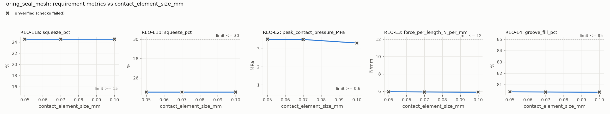
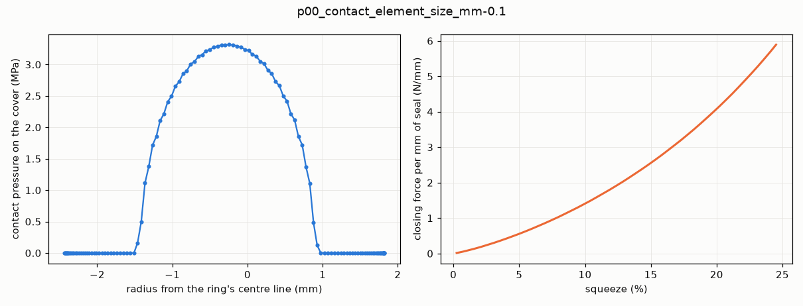
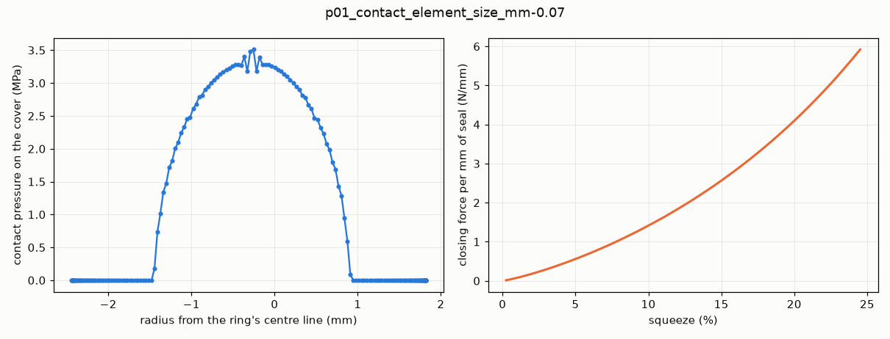
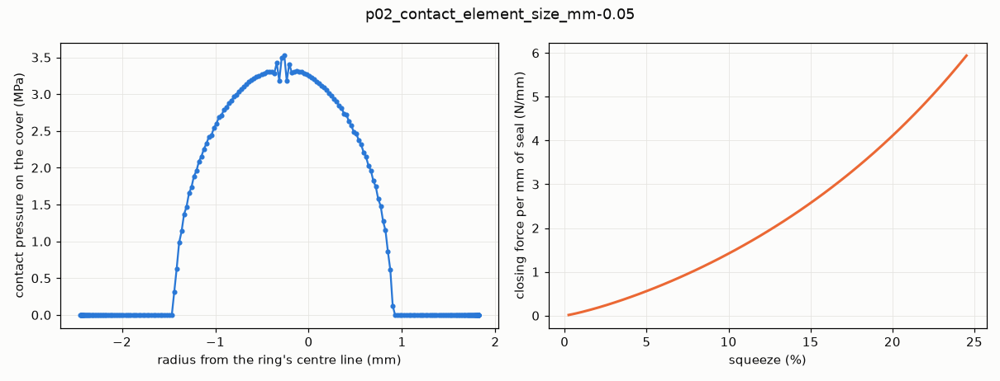

# Engineering review report: oring_seal_mesh

- **Run:** `20261124-100621_oring_seal_mesh`
- **Generated:** 2026-11-24T16:38:18+00:00
- **Case file SHA-256:** `c892f7b330f6d560ca71a067bf451f67c10f740a12850fd18b789b837fe2815a`
- **Environment:** Python 3.14.10, numpy 2.5.5, scipy 1.18.1, matplotlib 3.11.2, cadquery 2.8.0; Windows-11-10.0.26100-SP0
- **Tools:** CalculiX This is Version 2.22; gmsh 4.15.0
- **Code version:** git `19cd5f58820a6b7f9759e6ef56fdf30949314bbf`
- **Simulation status:** completed
- **Verification status:** FAIL

> **Warning:** verification did not pass for every point. Requirement verdicts marked *(unverified)* are not supported by evidence and must not be used for acceptance.

## Scope

O-ring face seal at the tightest corner of the stack (3.63 mm, 75 Shore A, 2.74 x 4.75 mm groove): contact element size 0.1 / 0.07 / 0.05 mm, the mesh study for the requirement metrics.

**Assumptions**

- Axisymmetric; the mid-plane is a symmetry plane (flat groove bottom and cover, frictionless contact, quasi-static), so the upper half of the cross-section is modelled.
- Neo-Hookean rubber, E from Shore A by Gent's relation (synthetic compound; the hardness tolerance carries the material uncertainty), near-incompressible (K = 1000 G; checked: volume conservation).
- Steel cover and groove walls (E 200 GPa, effectively rigid against the rubber).
- Installed against the groove's outer wall (internal pressure); the ring's ID follows the cross-section so its OD equals the groove OD at every corner.
- Unpressurised installation: the 0.3 MPa sealed pressure enters only through REQ-E2's 2 x rule, not as a load.

## Requirements

| ID | Requirement | Metric | Limit |
|---|---|---|---|
| REQ-E1a | The squeeze shall be at least 15 % at the loosest stack (cross-section and groove depth tolerances). | `squeeze_pct` | >= 15 % |
| REQ-E1b | The squeeze shall not exceed 30 % at the tightest stack. | `squeeze_pct` | <= 30 % |
| REQ-E2 | The peak contact pressure on the cover shall be at least 2 x the 0.3 MPa sealed pressure (0.6 MPa) at every stack (the loosest governs). | `peak_contact_pressure_MPa` | >= 0.6 MPa |
| REQ-E3 | The closing force shall not exceed the cover's bolt budget of 12 N per mm of seal length at every stack (the tightest governs). | `force_per_length_N_per_mm` | <= 12 N/mm |
| REQ-E4 | The installed ring shall fill no more than 85 % of the groove's cross-section (deformed area over groove area) at every stack. | `groove_fill_pct` | <= 85 % |

## Summary across points

| Point | contact_element_size_mm | REQ-E1a | REQ-E1b | REQ-E2 | REQ-E3 | REQ-E4 | Checks |
|---|---|---|---|---|---|---|---|
| p00_contact_element_size_mm-0.1 | 0.1 | 24.52 %: **PASS (unverified)** | 24.52 %: **PASS (unverified)** | 3.316 MPa: **PASS (unverified)** | 5.892 N/mm: **PASS (unverified)** | 80.32 %: **PASS (unverified)** | 5/6 FAIL |
| p01_contact_element_size_mm-0.07 | 0.07 | 24.52 %: **PASS (unverified)** | 24.52 %: **PASS (unverified)** | 3.511 MPa: **PASS (unverified)** | 5.92 N/mm: **PASS (unverified)** | 80.34 %: **PASS (unverified)** | 5/6 FAIL |
| p02_contact_element_size_mm-0.05 | 0.05 | 24.52 %: **PASS (unverified)** | 24.52 %: **PASS (unverified)** | 3.524 MPa: **PASS (unverified)** | 5.939 N/mm: **PASS (unverified)** | 80.35 %: **PASS (unverified)** | 5/6 FAIL |

## Run-level checks

Checks that use several points together (for example mesh convergence).

| Check | Description | Value | Tolerance | Status |
|---|---|---|---|---|
| discretization_force_per_length_N_per_mm | relative discretization uncertainty of force_per_length_N_per_mm, monotone (R = 0.687): GCI_fine, observed order 0.91, extrapolated 5.99251 | 0.0112 | 0.05 | PASS |
| discretization_groove_fill_pct | relative discretization uncertainty of groove_fill_pct, monotone (R = 0.551): GCI_fine, observed order 1.55, extrapolated 80.3677 | 0.000239 | 0.05 | PASS |
| discretization_peak_contact_pressure_MPa | relative discretization uncertainty of peak_contact_pressure_MPa, monotone (R = 0.068): GCI_fine, observed order 7.49, extrapolated 3.52527 | 0.000414 | 0.05 | PASS |

## Point details

### p00_contact_element_size_mm-0.1

Parameters: cross_section_mm = 3.63, ring_inner_diameter_mm = 49.8, groove_depth_mm = 2.74, groove_width_mm = 4.75, groove_outer_diameter_mm = 57.06, groove_walls = 1, shore_a = 75, bulk_to_shear = 1000, contact_element_size_mm = 0.1, far_element_size_mm = 0.2, penalty_factor = 10

Derived: squeeze = 0.2452, youngs_modulus_MPa = 7.053, groove_fill_hand = 0.7952

| Requirement | Result | Limit | Margin | Verdict | Evidence |
|---|---|---|---|---|---|
| REQ-E1a | 24.52 % | >= 15 | 9.52 | **PASS (unverified)** | [point.json](points/p00_contact_element_size_mm-0.1/point.json) |
| REQ-E1b | 24.52 % | <= 30 | 5.48 | **PASS (unverified)** | [point.json](points/p00_contact_element_size_mm-0.1/point.json) |
| REQ-E2 | 3.316 MPa | >= 0.6 | 2.72 | **PASS (unverified)** | [point.json](points/p00_contact_element_size_mm-0.1/point.json) |
| REQ-E3 | 5.892 N/mm | <= 12 | 6.11 | **PASS (unverified)** | [point.json](points/p00_contact_element_size_mm-0.1/point.json) |
| REQ-E4 | 80.32 % | <= 85 | 4.68 | **PASS (unverified)** | [point.json](points/p00_contact_element_size_mm-0.1/point.json) |

| Check | Description | Value | Tolerance | Status |
|---|---|---|---|---|
| volume_conservation | \|deformed / initial ring volume - 1\| (near-incompressible: J about 1) | 5.95e-04 | 0.001 | PASS |
| contact_force_balance | \|integral of the contact pressure over the cover / cover reaction - 1\| | 1.36e-02 | 0.03 | PASS |
| equilibrium | \|cover reaction - symmetry-plane reaction\| / cover reaction (walls frictionless) | 0.00e+00 | 0.001 | PASS |
| penalty_penetration | max overclosure of the ring into the cover / cover travel | 1.37e-02 | 0.02 | PASS |
| groove_fill_hand | \|groove fill from the deformed area - hand fill (volume conserved, ring against the outer wall)\| / hand | 1.01e-02 | 0.01 | FAIL |
| in_groove (validity) | ring beyond the groove walls (mm, inner or outer; penalty overclosure allowed up to the tolerance; validity) | 1.77e-02 | 0.03 | PASS |

### p01_contact_element_size_mm-0.07

Parameters: cross_section_mm = 3.63, ring_inner_diameter_mm = 49.8, groove_depth_mm = 2.74, groove_width_mm = 4.75, groove_outer_diameter_mm = 57.06, groove_walls = 1, shore_a = 75, bulk_to_shear = 1000, contact_element_size_mm = 0.07, far_element_size_mm = 0.2, penalty_factor = 10

Derived: squeeze = 0.2452, youngs_modulus_MPa = 7.053, groove_fill_hand = 0.7952

| Requirement | Result | Limit | Margin | Verdict | Evidence |
|---|---|---|---|---|---|
| REQ-E1a | 24.52 % | >= 15 | 9.52 | **PASS (unverified)** | [point.json](points/p01_contact_element_size_mm-0.07/point.json) |
| REQ-E1b | 24.52 % | <= 30 | 5.48 | **PASS (unverified)** | [point.json](points/p01_contact_element_size_mm-0.07/point.json) |
| REQ-E2 | 3.511 MPa | >= 0.6 | 2.91 | **PASS (unverified)** | [point.json](points/p01_contact_element_size_mm-0.07/point.json) |
| REQ-E3 | 5.92 N/mm | <= 12 | 6.08 | **PASS (unverified)** | [point.json](points/p01_contact_element_size_mm-0.07/point.json) |
| REQ-E4 | 80.34 % | <= 85 | 4.66 | **PASS (unverified)** | [point.json](points/p01_contact_element_size_mm-0.07/point.json) |

| Check | Description | Value | Tolerance | Status |
|---|---|---|---|---|
| volume_conservation | \|deformed / initial ring volume - 1\| (near-incompressible: J about 1) | 5.29e-04 | 0.001 | PASS |
| contact_force_balance | \|integral of the contact pressure over the cover / cover reaction - 1\| | 1.40e-02 | 0.03 | PASS |
| equilibrium | \|cover reaction - symmetry-plane reaction\| / cover reaction (walls frictionless) | 0.00e+00 | 0.001 | PASS |
| penalty_penetration | max overclosure of the ring into the cover / cover travel | 9.42e-03 | 0.02 | PASS |
| groove_fill_hand | \|groove fill from the deformed area - hand fill (volume conserved, ring against the outer wall)\| / hand | 1.04e-02 | 0.01 | FAIL |
| in_groove (validity) | ring beyond the groove walls (mm, inner or outer; penalty overclosure allowed up to the tolerance; validity) | 1.25e-02 | 0.03 | PASS |

### p02_contact_element_size_mm-0.05

Parameters: cross_section_mm = 3.63, ring_inner_diameter_mm = 49.8, groove_depth_mm = 2.74, groove_width_mm = 4.75, groove_outer_diameter_mm = 57.06, groove_walls = 1, shore_a = 75, bulk_to_shear = 1000, contact_element_size_mm = 0.05, far_element_size_mm = 0.2, penalty_factor = 10

Derived: squeeze = 0.2452, youngs_modulus_MPa = 7.053, groove_fill_hand = 0.7952

| Requirement | Result | Limit | Margin | Verdict | Evidence |
|---|---|---|---|---|---|
| REQ-E1a | 24.52 % | >= 15 | 9.52 | **PASS (unverified)** | [point.json](points/p02_contact_element_size_mm-0.05/point.json) |
| REQ-E1b | 24.52 % | <= 30 | 5.48 | **PASS (unverified)** | [point.json](points/p02_contact_element_size_mm-0.05/point.json) |
| REQ-E2 | 3.524 MPa | >= 0.6 | 2.92 | **PASS (unverified)** | [point.json](points/p02_contact_element_size_mm-0.05/point.json) |
| REQ-E3 | 5.939 N/mm | <= 12 | 6.06 | **PASS (unverified)** | [point.json](points/p02_contact_element_size_mm-0.05/point.json) |
| REQ-E4 | 80.35 % | <= 85 | 4.65 | **PASS (unverified)** | [point.json](points/p02_contact_element_size_mm-0.05/point.json) |

| Check | Description | Value | Tolerance | Status |
|---|---|---|---|---|
| volume_conservation | \|deformed / initial ring volume - 1\| (near-incompressible: J about 1) | 4.96e-04 | 0.001 | PASS |
| contact_force_balance | \|integral of the contact pressure over the cover / cover reaction - 1\| | 1.44e-02 | 0.03 | PASS |
| equilibrium | \|cover reaction - symmetry-plane reaction\| / cover reaction (walls frictionless) | 0.00e+00 | 0.001 | PASS |
| penalty_penetration | max overclosure of the ring into the cover / cover travel | 6.82e-03 | 0.02 | PASS |
| groove_fill_hand | \|groove fill from the deformed area - hand fill (volume conserved, ring against the outer wall)\| / hand | 1.05e-02 | 0.01 | FAIL |
| in_groove (validity) | ring beyond the groove walls (mm, inner or outer; penalty overclosure allowed up to the tolerance; validity) | 9.03e-03 | 0.03 | PASS |

## Limitations

- No friction, no compression set or stress relaxation over time, no temperature effects on the compound.
- Lindley's relation is empirical and its exponents are not yet confirmed from a second source; Parker's band is wide (a factor of about 6.6).
- No physical test data.
- A converged solver run that matches an analytical reference shows that the equations were solved correctly. It does not show that the equations represent real hardware.

## Engineering acceptance

Pending human review. This report does not accept or reject the design.
