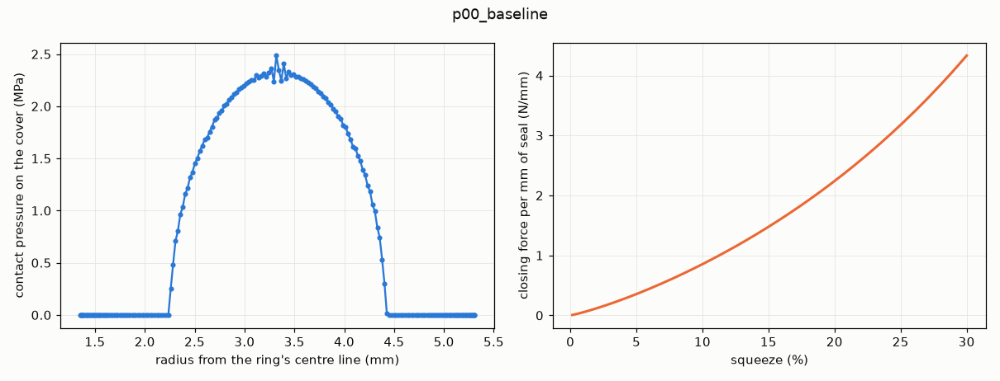

# Engineering review report: oring_free_lindley

- **Run:** `20261124-105309_oring_free_lindley`
- **Generated:** 2026-11-24T16:23:33+00:00
- **Case file SHA-256:** `c8ca5267d3a9cc03dcd1ede0c596395e4b88deb0d66c8de0657597edb40bc176`
- **Environment:** Python 3.14.10, numpy 2.5.5, scipy 1.18.1, matplotlib 3.11.2, cadquery 2.8.0; Windows-11-10.0.26100-SP0
- **Tools:** CalculiX This is Version 2.22; gmsh 4.15.0
- **Code version:** git `82472a91ca873e4d023cabb520e00554435be8ee` (uncommitted changes present)
- **Simulation status:** completed
- **Verification status:** PASS

## Scope

O-ring 3.53 mm, 70 Shore A, laterally unrestrained (no groove walls) between flat plates to 30 % squeeze; force against squeeze over the run against Lindley's relation and Parker's measured band (reference case).

**Assumptions**

- Axisymmetric; the mid-plane is a symmetry plane (flat groove bottom and cover, frictionless contact, quasi-static), so the upper half of the cross-section is modelled.
- Neo-Hookean rubber, E from Shore A by Gent's relation (synthetic compound; the hardness tolerance carries the material uncertainty), near-incompressible (K = 1000 G; checked: volume conservation).
- Steel cover and groove walls (E 200 GPa, effectively rigid against the rubber).
- Installed against the groove's outer wall (internal pressure); the ring's ID follows the cross-section so its OD equals the groove OD at every corner.
- Unpressurised installation: the 0.3 MPa sealed pressure enters only through REQ-E2's 2 x rule, not as a load.

## Requirements

| ID | Requirement | Metric | Limit |
|---|---|---|---|
| REQ-R1a | Validation: the closing force at 30 % squeeze shall be at least the lower end of Parker's measured 70 Shore A band for the 0.139 in cross-section (ORD 5700 Fig. 2-6; 1.891 N/mm). | `force_per_length_N_per_mm` | >= 1.891 N/mm |
| REQ-R1b | Validation: the closing force at 30 % squeeze shall not exceed the upper end of that band (12.999 N/mm). | `force_per_length_N_per_mm` | <= 12.999 N/mm |

## Summary across points

| Point | REQ-R1a | REQ-R1b | Checks |
|---|---|---|---|
| p00_baseline | 4.332 N/mm: **PASS** | 4.332 N/mm: **PASS** | 10/10 PASS |

## Point details

### p00_baseline

Parameters: cross_section_mm = 3.53, ring_inner_diameter_mm = 50, groove_depth_mm = 2.471, groove_width_mm = 4.8, groove_outer_diameter_mm = 57.06, groove_walls = 0, shore_a = 70, bulk_to_shear = 1000, contact_element_size_mm = 0.05, far_element_size_mm = 0.2, penalty_factor = 10, first_increment = 0.005, max_increment = 0.005, max_increments = 4000

Derived: squeeze = 0.3, youngs_modulus_MPa = 5.521, groove_fill_hand = 0.8251

| Requirement | Result | Limit | Margin | Verdict | Evidence |
|---|---|---|---|---|---|
| REQ-R1a | 4.332 N/mm | >= 1.891 | 2.44 | **PASS** | [point.json](points/p00_baseline/point.json) |
| REQ-R1b | 4.332 N/mm | <= 12.999 | 8.67 | **PASS** | [point.json](points/p00_baseline/point.json) |

| Check | Description | Value | Tolerance | Status |
|---|---|---|---|---|
| volume_conservation | |deformed / initial ring volume - 1| (near-incompressible: J about 1) | 2.99e-04 | 1e-03 | PASS |
| contact_force_balance | |integral of the contact pressure over the cover / cover reaction - 1| | 1.56e-02 | 3e-02 | PASS |
| equilibrium | |cover reaction - symmetry-plane reaction| / cover reaction (walls frictionless) | 0.00e+00 | 1e-03 | PASS |
| penalty_penetration | max overclosure of the ring into the cover / cover travel | 5.03e-03 | 2e-02 | PASS |
| lindley_10pct | |FE force - Lindley| / Lindley at 10 % squeeze (unrestrained ring) | 1.06e-01 | 1e-01 | PASS |
| parker_band_10pct | FE force outside Parker's 70 Shore A band at 10 % (0.356-2.524 N/mm; 0 = inside) | 0.00e+00 | 0e+00 | PASS |
| lindley_20pct | |FE force - Lindley| / Lindley at 20 % squeeze (unrestrained ring) | 4.88e-04 | 1e-01 | PASS |
| parker_band_20pct | FE force outside Parker's 70 Shore A band at 20 % (0.793-5.119 N/mm; 0 = inside) | 0.00e+00 | 0e+00 | PASS |
| lindley_30pct | |FE force - Lindley| / Lindley at 30 % squeeze (unrestrained ring) | 8.09e-02 | 1e-01 | PASS |
| parker_band_30pct | FE force outside Parker's 70 Shore A band at 30 % (1.891-12.999 N/mm; 0 = inside) | 0.00e+00 | 0e+00 | PASS |

## Limitations

- No friction, no compression set or stress relaxation over time, no temperature effects on the compound.
- Lindley's relation is empirical and its exponents are not yet confirmed from a second source; Parker's band is wide (a factor of about 6.6).
- No physical test data.
- A converged solver run that matches an analytical reference shows that the equations were solved correctly. It does not show that the equations represent real hardware.

## Engineering acceptance

Pending human review. This report does not accept or reject the design.
