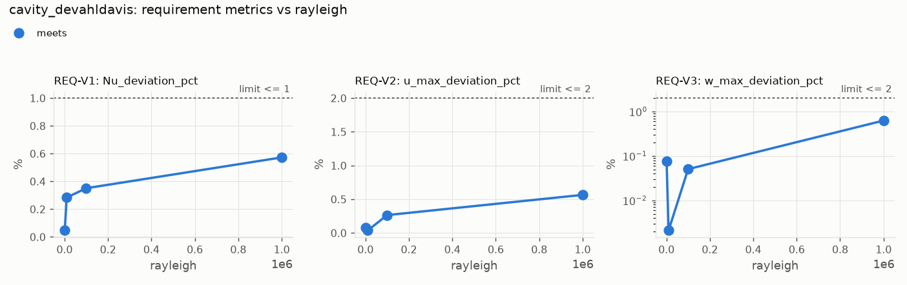
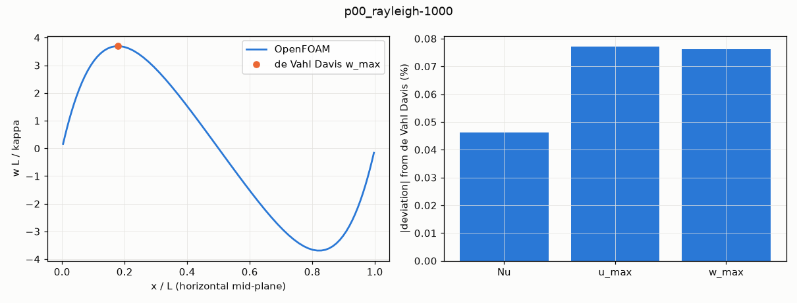
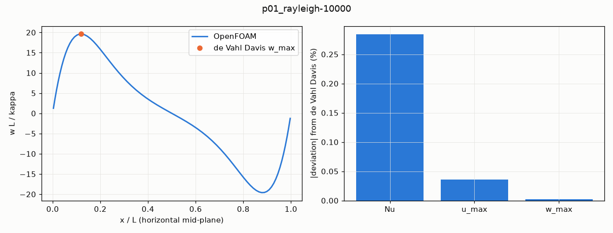
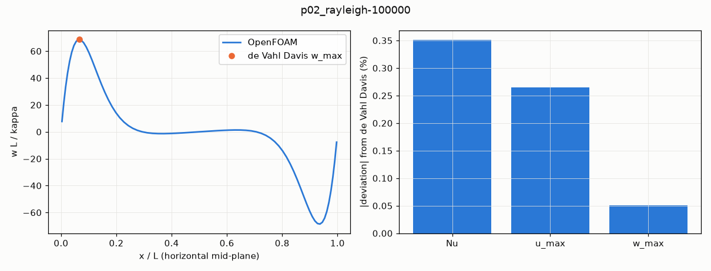
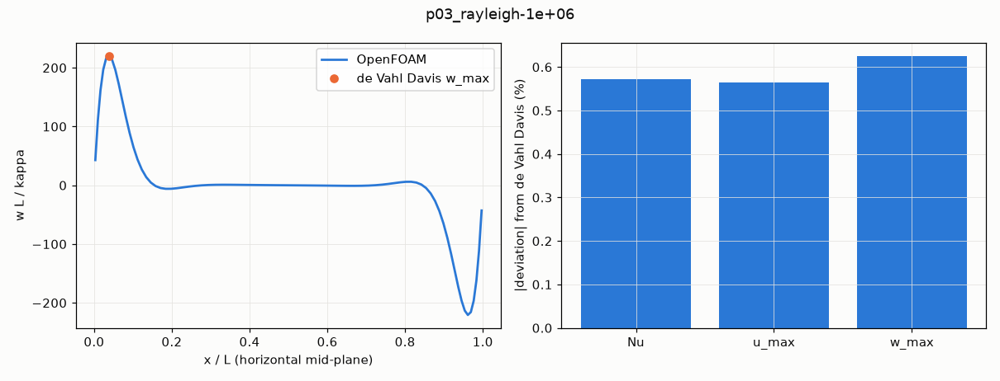

# Engineering review report: cavity_devahldavis

- **Run:** `20261124-105442_cavity_devahldavis`
- **Generated:** 2026-11-24T16:57:12+00:00
- **Case file SHA-256:** `7f44d39de31abec4a8654572d2962e183f8afa314bff883669c2ddc31776a3a6`
- **Environment:** Python 3.14.10, numpy 2.5.5, scipy 1.18.1, matplotlib 3.11.2, cadquery 2.8.0; Windows-11-10.0.26100-SP0
- **Code version:** git `b14ec939f7359bd9f46d67a7919cb7fb45cb47fe`
- **Simulation status:** completed
- **Verification status:** PASS

## Scope

Square cavity, air (Pr 0.71), Ra 1e3 / 1e4 / 1e5 / 1e6 on a 72 x 72 graded mesh: hot-wall Nusselt number, u_max and w_max on the mid-planes against de Vahl Davis (1983).

**Assumptions**

- 2D, laminar, steady; Boussinesq (beta dT 3.3e-4; checked); constant properties; Pr 0.71.
- Top and bottom adiabatic, vertical walls isothermal, no slip (the bench mark's problem).

## Requirements

| ID | Requirement | Metric | Limit |
|---|---|---|---|
| REQ-V1 | Validation: the hot wall's average Nusselt number shall be within 1 % of de Vahl Davis (1983) Table V (Nu_0). | `Nu_deviation_pct` | <= 1 % |
| REQ-V2 | Validation: the largest horizontal velocity on the vertical mid-plane shall be within 2 % of the bench mark's u_max. | `u_max_deviation_pct` | <= 2 % |
| REQ-V3 | Validation: the largest vertical velocity on the horizontal mid-plane shall be within 2 % of the bench mark's w_max. | `w_max_deviation_pct` | <= 2 % |

## Summary across points

| Point | rayleigh | REQ-V1 | REQ-V2 | REQ-V3 | Checks |
|---|---|---|---|---|---|
| p00_rayleigh-1000 | 1000 | 0.04629 %: **PASS** | 0.07716 %: **PASS** | 0.07615 %: **PASS** | 3/3 PASS |
| p01_rayleigh-10000 | 1e+04 | 0.284 %: **PASS** | 0.03631 %: **PASS** | 0.002104 %: **PASS** | 3/3 PASS |
| p02_rayleigh-100000 | 1e+05 | 0.3509 %: **PASS** | 0.2649 %: **PASS** | 0.05055 %: **PASS** | 3/3 PASS |
| p03_rayleigh-1e+06 | 1e+06 | 0.5726 %: **PASS** | 0.5646 %: **PASS** | 0.6248 %: **PASS** | 3/3 PASS |

## Point details

### p00_rayleigh-1000

Parameters: rayleigh = 1000, prandtl = 0.71, cells = 72, wall_grading = 4, side_m = 0.1, delta_T_K = 0.1, max_iterations = 2e+04

Derived: g_m_per_s2 = 1.369

| Requirement | Result | Limit | Margin | Verdict | Evidence |
|---|---|---|---|---|---|
| REQ-V1 | 0.04629 % | <= 1 | 0.954 | **PASS** | [point.json](points/p00_rayleigh-1000/point.json) |
| REQ-V2 | 0.07716 % | <= 2 | 1.92 | **PASS** | [point.json](points/p00_rayleigh-1000/point.json) |
| REQ-V3 | 0.07615 % | <= 2 | 1.92 | **PASS** | [point.json](points/p00_rayleigh-1000/point.json) |

| Check | Description | Value | Tolerance | Status |
|---|---|---|---|---|
| energy_balance | |hot-wall Nu - cold-wall Nu| / hot-wall Nu (steady: the heat in leaves) | 1.68e-04 | 2e-03 | PASS |
| converged | largest final initial residual of U and h | 7.10e-07 | 1e-05 | PASS |
| boussinesq (validity) | beta x temperature difference (OpenFOAM's Boussinesq density enters every term; validity) | 3.33e-04 | 1e-03 | PASS |

### p01_rayleigh-10000

Parameters: rayleigh = 1e+04, prandtl = 0.71, cells = 72, wall_grading = 4, side_m = 0.1, delta_T_K = 0.1, max_iterations = 2e+04

Derived: g_m_per_s2 = 13.69

| Requirement | Result | Limit | Margin | Verdict | Evidence |
|---|---|---|---|---|---|
| REQ-V1 | 0.284 % | <= 1 | 0.716 | **PASS** | [point.json](points/p01_rayleigh-10000/point.json) |
| REQ-V2 | 0.03631 % | <= 2 | 1.96 | **PASS** | [point.json](points/p01_rayleigh-10000/point.json) |
| REQ-V3 | 0.002104 % | <= 2 | 2 | **PASS** | [point.json](points/p01_rayleigh-10000/point.json) |

| Check | Description | Value | Tolerance | Status |
|---|---|---|---|---|
| energy_balance | |hot-wall Nu - cold-wall Nu| / hot-wall Nu (steady: the heat in leaves) | 1.68e-04 | 2e-03 | PASS |
| converged | largest final initial residual of U and h | 8.96e-08 | 1e-05 | PASS |
| boussinesq (validity) | beta x temperature difference (OpenFOAM's Boussinesq density enters every term; validity) | 3.33e-04 | 1e-03 | PASS |

### p02_rayleigh-100000

Parameters: rayleigh = 1e+05, prandtl = 0.71, cells = 72, wall_grading = 4, side_m = 0.1, delta_T_K = 0.1, max_iterations = 2e+04

Derived: g_m_per_s2 = 136.9

| Requirement | Result | Limit | Margin | Verdict | Evidence |
|---|---|---|---|---|---|
| REQ-V1 | 0.3509 % | <= 1 | 0.649 | **PASS** | [point.json](points/p02_rayleigh-100000/point.json) |
| REQ-V2 | 0.2649 % | <= 2 | 1.74 | **PASS** | [point.json](points/p02_rayleigh-100000/point.json) |
| REQ-V3 | 0.05055 % | <= 2 | 1.95 | **PASS** | [point.json](points/p02_rayleigh-100000/point.json) |

| Check | Description | Value | Tolerance | Status |
|---|---|---|---|---|
| energy_balance | |hot-wall Nu - cold-wall Nu| / hot-wall Nu (steady: the heat in leaves) | 4.68e-04 | 2e-03 | PASS |
| converged | largest final initial residual of U and h | 9.99e-08 | 1e-05 | PASS |
| boussinesq (validity) | beta x temperature difference (OpenFOAM's Boussinesq density enters every term; validity) | 3.33e-04 | 1e-03 | PASS |

### p03_rayleigh-1e+06

Parameters: rayleigh = 1e+06, prandtl = 0.71, cells = 72, wall_grading = 4, side_m = 0.1, delta_T_K = 0.1, max_iterations = 2e+04

Derived: g_m_per_s2 = 1369

| Requirement | Result | Limit | Margin | Verdict | Evidence |
|---|---|---|---|---|---|
| REQ-V1 | 0.5726 % | <= 1 | 0.427 | **PASS** | [point.json](points/p03_rayleigh-1e+06/point.json) |
| REQ-V2 | 0.5646 % | <= 2 | 1.44 | **PASS** | [point.json](points/p03_rayleigh-1e+06/point.json) |
| REQ-V3 | 0.6248 % | <= 2 | 1.38 | **PASS** | [point.json](points/p03_rayleigh-1e+06/point.json) |

| Check | Description | Value | Tolerance | Status |
|---|---|---|---|---|
| energy_balance | |hot-wall Nu - cold-wall Nu| / hot-wall Nu (steady: the heat in leaves) | 3.70e-04 | 2e-03 | PASS |
| converged | largest final initial residual of U and h | 1.00e-07 | 1e-05 | PASS |
| boussinesq (validity) | beta x temperature difference (OpenFOAM's Boussinesq density enters every term; validity) | 3.33e-04 | 1e-03 | PASS |

## Limitations

- The bench mark is itself numerical (Richardson-extrapolated finite differences), stated accurate to 0.1-1 %.
- No physical test data in this stage.
- A converged solver run that matches an analytical reference shows that the equations were solved correctly. It does not show that the equations represent real hardware.

## Engineering acceptance

Pending human review. This report does not accept or reject the design.
