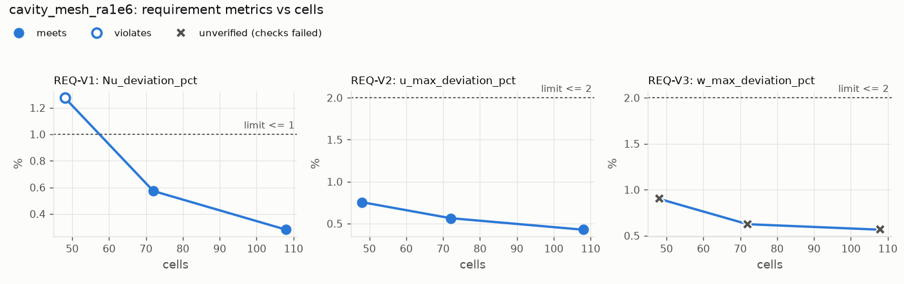
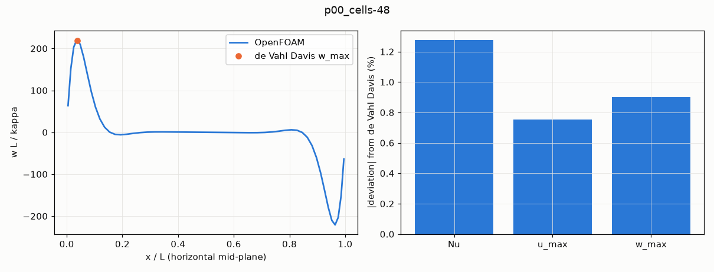
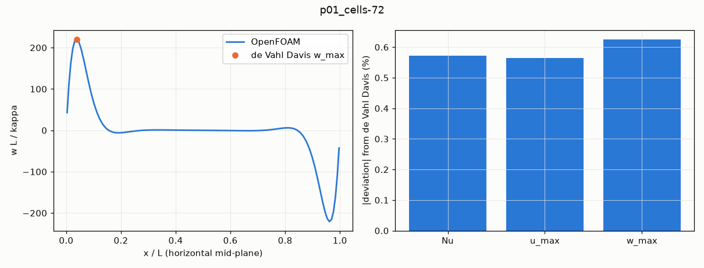
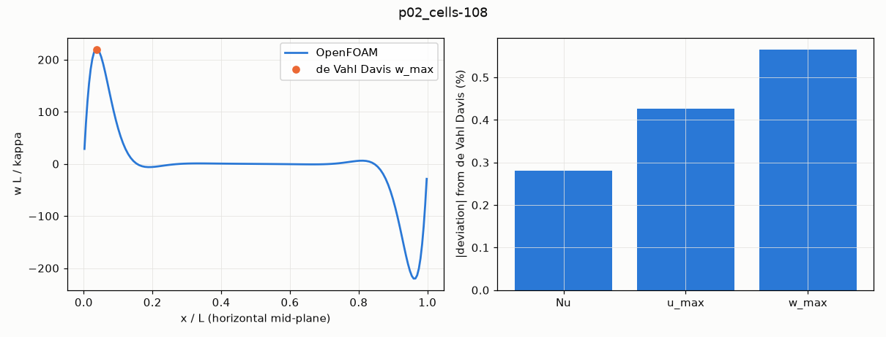

# Engineering review report: cavity_mesh_ra1e6

- **Run:** `20261124-105444_cavity_mesh_ra1e6`
- **Generated:** 2026-11-24T16:29:58+00:00
- **Case file SHA-256:** `a8a13a2a961b5be6dc5cb91f999f67b96c7c6ec95df16da6041a23d993cf6c62`
- **Environment:** Python 3.14.10, numpy 2.5.5, scipy 1.18.1, matplotlib 3.11.2, cadquery 2.8.0; Windows-11-10.0.26100-SP0
- **Code version:** git `b14ec939f7359bd9f46d67a7919cb7fb45cb47fe`
- **Simulation status:** completed
- **Verification status:** FAIL

> **Warning:** verification did not pass for every point. Requirement verdicts marked *(unverified)* are not supported by evidence and must not be used for acceptance.

## Scope

Square cavity, air, Ra 1e6, 48 / 72 / 108 cells (graded): the mesh study for Nu, u_max and w_max.

**Assumptions**

- 2D, laminar, steady; Boussinesq (beta dT 3.3e-4; checked); constant properties; Pr 0.71.
- Top and bottom adiabatic, vertical walls isothermal, no slip (the bench mark's problem).

## Requirements

| ID | Requirement | Metric | Limit |
|---|---|---|---|
| REQ-V1 | Validation: the hot wall's average Nusselt number shall be within 1 % of de Vahl Davis (1983) Table V (Nu_0). | `Nu_deviation_pct` | <= 1 % |
| REQ-V2 | Validation: the largest horizontal velocity on the vertical mid-plane shall be within 2 % of the bench mark's u_max. | `u_max_deviation_pct` | <= 2 % |
| REQ-V3 | Validation: the largest vertical velocity on the horizontal mid-plane shall be within 2 % of the bench mark's w_max. | `w_max_deviation_pct` | <= 2 % |

## Summary across points

| Point | cells | REQ-V1 | REQ-V2 | REQ-V3 | Checks |
|---|---|---|---|---|---|
| p00_cells-48 | 48 | 1.276 %: **FAIL** | 0.7551 %: **PASS** | 0.9004 %: **PASS (unverified)** | 3/3 PASS |
| p01_cells-72 | 72 | 0.5726 %: **PASS** | 0.5646 %: **PASS** | 0.6248 %: **PASS (unverified)** | 3/3 PASS |
| p02_cells-108 | 108 | 0.2809 %: **PASS** | 0.4271 %: **PASS** | 0.5649 %: **PASS (unverified)** | 3/3 PASS |

## Run-level checks

Checks that use several points together (for example mesh convergence).

| Check | Description | Value | Tolerance | Status |
|---|---|---|---|---|
| discretization_Nu_hot | relative discretization uncertainty of Nu_hot, monotone (R = 0.415): GCI_fine, observed order 2.17, extrapolated 8.82351 | 0.00258 | 0.01 | PASS |
| discretization_u_max | relative discretization uncertainty of u_max, monotone (R = 0.722): GCI_fine, observed order 0.80, extrapolated 64.6752 | 0.00445 | 0.01 | PASS |
| discretization_w_max | relative discretization uncertainty of w_max, anomalous: observed order 3.77 is far above the design order 2, so the solutions are not in the asymptotic range (singularity or coincidence); no estimate | inf | 0.01 | FAIL |

A failed run-level check withholds the verdicts of requirements on `w_max_deviation_pct` at every point: they are marked *(unverified)* in the table above.

## Point details

### p00_cells-48

Parameters: rayleigh = 1e+06, prandtl = 0.71, cells = 48, wall_grading = 4, side_m = 0.1, delta_T_K = 0.1, max_iterations = 2e+04

Derived: g_m_per_s2 = 1369

| Requirement | Result | Limit | Margin | Verdict | Evidence |
|---|---|---|---|---|---|
| REQ-V1 | 1.276 % | <= 1 | -0.276 | **FAIL** | [point.json](points/p00_cells-48/point.json) |
| REQ-V2 | 0.7551 % | <= 2 | 1.24 | **PASS** | [point.json](points/p00_cells-48/point.json) |
| REQ-V3 | 0.9004 % | <= 2 | 1.1 | **PASS (unverified)** | [point.json](points/p00_cells-48/point.json) |

| Check | Description | Value | Tolerance | Status |
|---|---|---|---|---|
| energy_balance | |hot-wall Nu - cold-wall Nu| / hot-wall Nu (steady: the heat in leaves) | 3.27e-04 | 2e-03 | PASS |
| converged | largest final initial residual of U and h | 9.96e-08 | 1e-05 | PASS |
| boussinesq (validity) | beta x temperature difference (OpenFOAM's Boussinesq density enters every term; validity) | 3.33e-04 | 1e-03 | PASS |

### p01_cells-72

Parameters: rayleigh = 1e+06, prandtl = 0.71, cells = 72, wall_grading = 4, side_m = 0.1, delta_T_K = 0.1, max_iterations = 2e+04

Derived: g_m_per_s2 = 1369

| Requirement | Result | Limit | Margin | Verdict | Evidence |
|---|---|---|---|---|---|
| REQ-V1 | 0.5726 % | <= 1 | 0.427 | **PASS** | [point.json](points/p01_cells-72/point.json) |
| REQ-V2 | 0.5646 % | <= 2 | 1.44 | **PASS** | [point.json](points/p01_cells-72/point.json) |
| REQ-V3 | 0.6248 % | <= 2 | 1.38 | **PASS (unverified)** | [point.json](points/p01_cells-72/point.json) |

| Check | Description | Value | Tolerance | Status |
|---|---|---|---|---|
| energy_balance | |hot-wall Nu - cold-wall Nu| / hot-wall Nu (steady: the heat in leaves) | 3.70e-04 | 2e-03 | PASS |
| converged | largest final initial residual of U and h | 1.00e-07 | 1e-05 | PASS |
| boussinesq (validity) | beta x temperature difference (OpenFOAM's Boussinesq density enters every term; validity) | 3.33e-04 | 1e-03 | PASS |

### p02_cells-108

Parameters: rayleigh = 1e+06, prandtl = 0.71, cells = 108, wall_grading = 4, side_m = 0.1, delta_T_K = 0.1, max_iterations = 2e+04

Derived: g_m_per_s2 = 1369

| Requirement | Result | Limit | Margin | Verdict | Evidence |
|---|---|---|---|---|---|
| REQ-V1 | 0.2809 % | <= 1 | 0.719 | **PASS** | [point.json](points/p02_cells-108/point.json) |
| REQ-V2 | 0.4271 % | <= 2 | 1.57 | **PASS** | [point.json](points/p02_cells-108/point.json) |
| REQ-V3 | 0.5649 % | <= 2 | 1.44 | **PASS (unverified)** | [point.json](points/p02_cells-108/point.json) |

| Check | Description | Value | Tolerance | Status |
|---|---|---|---|---|
| energy_balance | |hot-wall Nu - cold-wall Nu| / hot-wall Nu (steady: the heat in leaves) | 4.68e-04 | 2e-03 | PASS |
| converged | largest final initial residual of U and h | 9.99e-08 | 1e-05 | PASS |
| boussinesq (validity) | beta x temperature difference (OpenFOAM's Boussinesq density enters every term; validity) | 3.33e-04 | 1e-03 | PASS |

## Limitations

- The bench mark is itself numerical (Richardson-extrapolated finite differences), stated accurate to 0.1-1 %.
- No physical test data in this stage.
- A converged solver run that matches an analytical reference shows that the equations were solved correctly. It does not show that the equations represent real hardware.

## Engineering acceptance

Pending human review. This report does not accept or reject the design.
