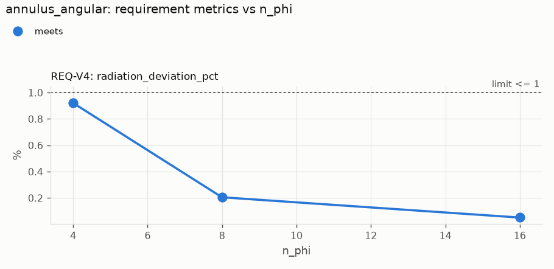

# Engineering review report: annulus_angular

- **Run:** `20261124-110740_annulus_angular`
- **Generated:** 2026-11-24T16:10:36+00:00
- **Case file SHA-256:** `a3e7abcea90e78907053679d879de55a13168b254f84faced9ce3506ec4bffd0`
- **Environment:** Python 3.14.10, numpy 2.5.5, scipy 1.18.1, matplotlib 3.11.2, cadquery 2.8.0; Windows-11-10.0.26100-SP0
- **Code version:** git `a92bb36c10e32399d8e4172cd9a3b8025accc7bb`
- **Simulation status:** completed
- **Verification status:** PASS

## Scope

Radiation between concentric cylinders (r 20 / 50 mm, 400 / 300 K, emissivities 0.5 / 0.8) through a transparent gas, fvDOM with 4 / 8 / 16 directions per quarter: against the exact two-surface exchange.

**Assumptions**

- 2D (long cylinders), grey diffuse walls, transparent still gas (absorptivity 0, no gravity).
- Constant density and properties (rhoConst; see the header for why not Boussinesq here).

## Requirements

| ID | Requirement | Metric | Limit |
|---|---|---|---|
| REQ-V4 | Validation: the radiated heat between the cylinders shall be within 1 % of the exact two-surface exchange for grey diffuse walls. | `radiation_deviation_pct` | <= 1 % |

## Summary across points

| Point | n_phi | REQ-V4 | Checks |
|---|---|---|---|
| p00_n_phi-4 | 4 | 0.9209 %: **PASS** | 3/3 PASS |
| p01_n_phi-8 | 8 | 0.205 %: **PASS** | 3/3 PASS |
| p02_n_phi-16 | 16 | 0.05084 %: **PASS** | 3/3 PASS |

## Run-level checks

Checks that use several points together (for example mesh convergence).

| Check | Description | Value | Tolerance | Status |
|---|---|---|---|---|
| discretization_radiation | angular discretization uncertainty of the radiated heat, monotone (R = 0.215): GCI_fine, observed order 2.22, extrapolated 59.3749 | 0.000529 | 0.01 | PASS |

## Point details

### p00_n_phi-4

Parameters: r_inner_m = 0.02, r_outer_m = 0.05, T_inner_K = 400, T_outer_K = 300, eps_inner = 0.5, eps_outer = 0.8, cells_radial = 20, cells_per_quarter = 20, n_phi = 4, max_iterations = 3000

Derived: radiation = 59.38, conduction = 17.38

| Requirement | Result | Limit | Margin | Verdict | Evidence |
|---|---|---|---|---|---|
| REQ-V4 | 0.9209 % | <= 1 | 0.0791 | **PASS** | [point.json](points/p00_n_phi-4/point.json) |

| Check | Description | Value | Tolerance | Status |
|---|---|---|---|---|
| radiation_balance | |radiation leaving the inner wall - reaching the outer| / leaving | 3.51e-11 | 1e-03 | PASS |
| conduction_exact | |conducted heat - 2 pi k dT / ln(r2 / r1)| / exact (no flow, transparent gas) | 4.80e-04 | 1e-02 | PASS |
| converged | final initial residual of h | 8.94e-10 | 1e-06 | PASS |

### p01_n_phi-8

Parameters: r_inner_m = 0.02, r_outer_m = 0.05, T_inner_K = 400, T_outer_K = 300, eps_inner = 0.5, eps_outer = 0.8, cells_radial = 20, cells_per_quarter = 20, n_phi = 8, max_iterations = 3000

Derived: radiation = 59.38, conduction = 17.38

| Requirement | Result | Limit | Margin | Verdict | Evidence |
|---|---|---|---|---|---|
| REQ-V4 | 0.205 % | <= 1 | 0.795 | **PASS** | [point.json](points/p01_n_phi-8/point.json) |

| Check | Description | Value | Tolerance | Status |
|---|---|---|---|---|
| radiation_balance | |radiation leaving the inner wall - reaching the outer| / leaving | 1.36e-10 | 1e-03 | PASS |
| conduction_exact | |conducted heat - 2 pi k dT / ln(r2 / r1)| / exact (no flow, transparent gas) | 4.80e-04 | 1e-02 | PASS |
| converged | final initial residual of h | 8.94e-10 | 1e-06 | PASS |

### p02_n_phi-16

Parameters: r_inner_m = 0.02, r_outer_m = 0.05, T_inner_K = 400, T_outer_K = 300, eps_inner = 0.5, eps_outer = 0.8, cells_radial = 20, cells_per_quarter = 20, n_phi = 16, max_iterations = 3000

Derived: radiation = 59.38, conduction = 17.38

| Requirement | Result | Limit | Margin | Verdict | Evidence |
|---|---|---|---|---|---|
| REQ-V4 | 0.05084 % | <= 1 | 0.949 | **PASS** | [point.json](points/p02_n_phi-16/point.json) |

| Check | Description | Value | Tolerance | Status |
|---|---|---|---|---|
| radiation_balance | |radiation leaving the inner wall - reaching the outer| / leaving | 8.81e-10 | 1e-03 | PASS |
| conduction_exact | |conducted heat - 2 pi k dT / ln(r2 / r1)| / exact (no flow, transparent gas) | 4.80e-04 | 1e-02 | PASS |
| converged | final initial residual of h | 8.94e-10 | 1e-06 | PASS |

## Limitations

- fvDOM in 2D: in-plane directions only, as the 2D problem needs; ray effects shrink with the number of directions.
- No physical test data in this stage.
- A converged solver run that matches an analytical reference shows that the equations were solved correctly. It does not show that the equations represent real hardware.

## Engineering acceptance

Pending human review. This report does not accept or reject the design.
