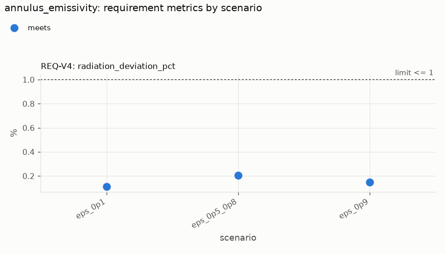

# Engineering review report: annulus_emissivity

- **Run:** `20261124-110742_annulus_emissivity`
- **Generated:** 2026-11-24T16:10:31+00:00
- **Case file SHA-256:** `d37a3e4edb0c839ccb130d1f4a6937e803dcd7c4f0b2a0299350def26116b29f`
- **Environment:** Python 3.14.10, numpy 2.5.5, scipy 1.18.1, matplotlib 3.11.2, cadquery 2.8.0; Windows-11-10.0.26100-SP0
- **Code version:** git `a92bb36c10e32399d8e4172cd9a3b8025accc7bb`
- **Simulation status:** completed
- **Verification status:** PASS

## Scope

Radiation between concentric cylinders, fvDOM with 8 directions per quarter, emissivities 0.1 / 0.1, 0.5 / 0.8, 0.9 / 0.9: against the exact two-surface exchange.

**Assumptions**

- 2D (long cylinders), grey diffuse walls, transparent still gas (absorptivity 0, no gravity).
- Constant density and properties (rhoConst; see the header for why not Boussinesq here).

## Requirements

| ID | Requirement | Metric | Limit |
|---|---|---|---|
| REQ-V4 | Validation: the radiated heat between the cylinders shall be within 1 % of the exact two-surface exchange for grey diffuse walls. | `radiation_deviation_pct` | <= 1 % |

## Summary across points

| Point | scenario | REQ-V4 | Checks |
|---|---|---|---|
| p00_eps_0p1 | eps_0p1 | 0.1127 %: **PASS** | 3/3 PASS |
| p01_eps_0p5_0p8 | eps_0p5_0p8 | 0.205 %: **PASS** | 3/3 PASS |
| p02_eps_0p9 | eps_0p9 | 0.1475 %: **PASS** | 3/3 PASS |

## Point details

### p00_eps_0p1

Parameters: r_inner_m = 0.02, r_outer_m = 0.05, T_inner_K = 400, T_outer_K = 300, eps_inner = 0.1, eps_outer = 0.1, cells_radial = 20, cells_per_quarter = 20, n_phi = 8, max_iterations = 3000, scenario = eps_0p1

Derived: radiation = 9.169, conduction = 17.38

| Requirement | Result | Limit | Margin | Verdict | Evidence |
|---|---|---|---|---|---|
| REQ-V4 | 0.1127 % | <= 1 | 0.887 | **PASS** | [point.json](points/p00_eps_0p1/point.json) |

| Check | Description | Value | Tolerance | Status |
|---|---|---|---|---|
| radiation_balance | |radiation leaving the inner wall - reaching the outer| / leaving | 1.51e-08 | 1e-03 | PASS |
| conduction_exact | |conducted heat - 2 pi k dT / ln(r2 / r1)| / exact (no flow, transparent gas) | 4.80e-04 | 1e-02 | PASS |
| converged | final initial residual of h | 8.94e-10 | 1e-06 | PASS |

### p01_eps_0p5_0p8

Parameters: r_inner_m = 0.02, r_outer_m = 0.05, T_inner_K = 400, T_outer_K = 300, eps_inner = 0.5, eps_outer = 0.8, cells_radial = 20, cells_per_quarter = 20, n_phi = 8, max_iterations = 3000, scenario = eps_0p5_0p8

Derived: radiation = 59.38, conduction = 17.38

| Requirement | Result | Limit | Margin | Verdict | Evidence |
|---|---|---|---|---|---|
| REQ-V4 | 0.205 % | <= 1 | 0.795 | **PASS** | [point.json](points/p01_eps_0p5_0p8/point.json) |

| Check | Description | Value | Tolerance | Status |
|---|---|---|---|---|
| radiation_balance | |radiation leaving the inner wall - reaching the outer| / leaving | 1.36e-10 | 1e-03 | PASS |
| conduction_exact | |conducted heat - 2 pi k dT / ln(r2 / r1)| / exact (no flow, transparent gas) | 4.80e-04 | 1e-02 | PASS |
| converged | final initial residual of h | 8.94e-10 | 1e-06 | PASS |

### p02_eps_0p9

Parameters: r_inner_m = 0.02, r_outer_m = 0.05, T_inner_K = 400, T_outer_K = 300, eps_inner = 0.9, eps_outer = 0.9, cells_radial = 20, cells_per_quarter = 20, n_phi = 8, max_iterations = 3000, scenario = eps_0p9

Derived: radiation = 107.9, conduction = 17.38

| Requirement | Result | Limit | Margin | Verdict | Evidence |
|---|---|---|---|---|---|
| REQ-V4 | 0.1475 % | <= 1 | 0.853 | **PASS** | [point.json](points/p02_eps_0p9/point.json) |

| Check | Description | Value | Tolerance | Status |
|---|---|---|---|---|
| radiation_balance | |radiation leaving the inner wall - reaching the outer| / leaving | 4.16e-13 | 1e-03 | PASS |
| conduction_exact | |conducted heat - 2 pi k dT / ln(r2 / r1)| / exact (no flow, transparent gas) | 4.80e-04 | 1e-02 | PASS |
| converged | final initial residual of h | 8.94e-10 | 1e-06 | PASS |

## Limitations

- fvDOM in 2D: in-plane directions only, as the 2D problem needs; ray effects shrink with the number of directions.
- No physical test data in this stage.
- A converged solver run that matches an analytical reference shows that the equations were solved correctly. It does not show that the equations represent real hardware.

## Engineering acceptance

Pending human review. This report does not accept or reject the design.
