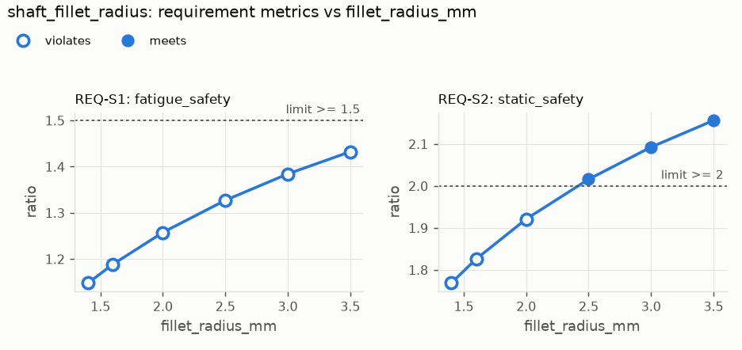
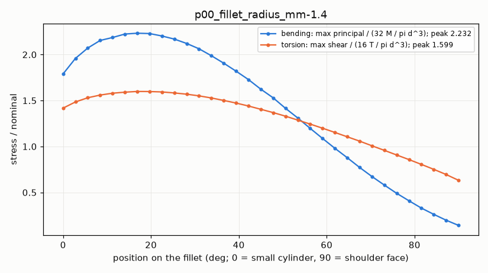
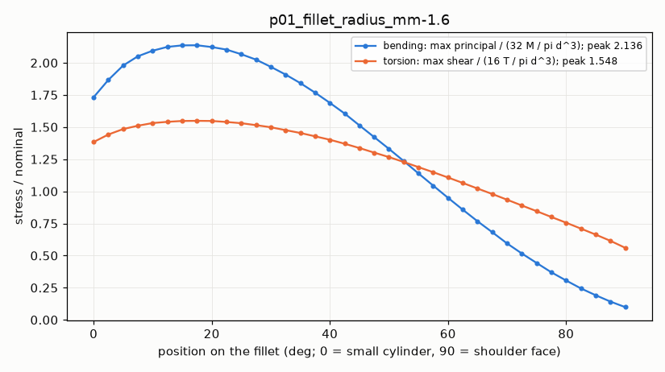
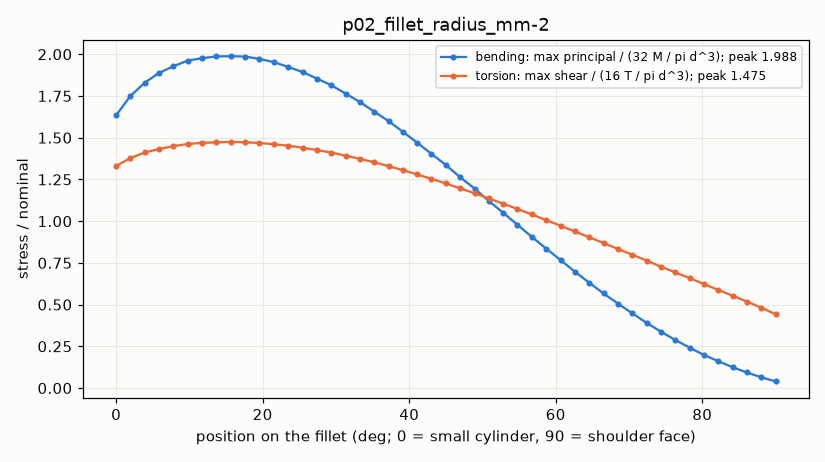
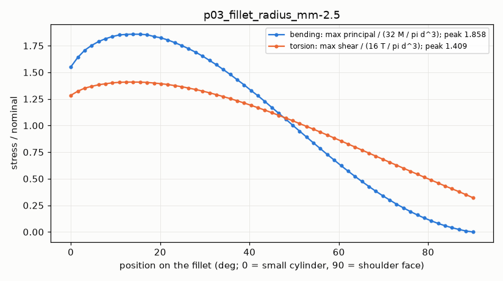
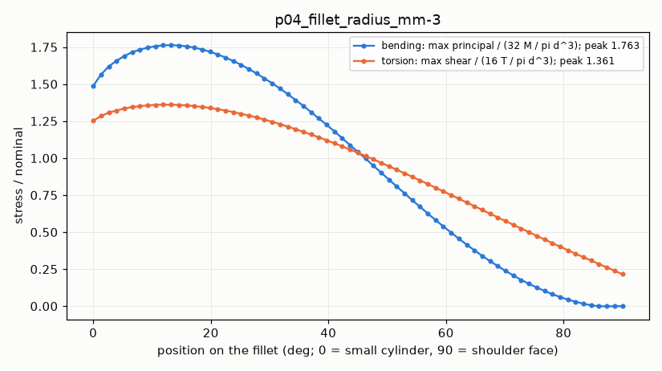
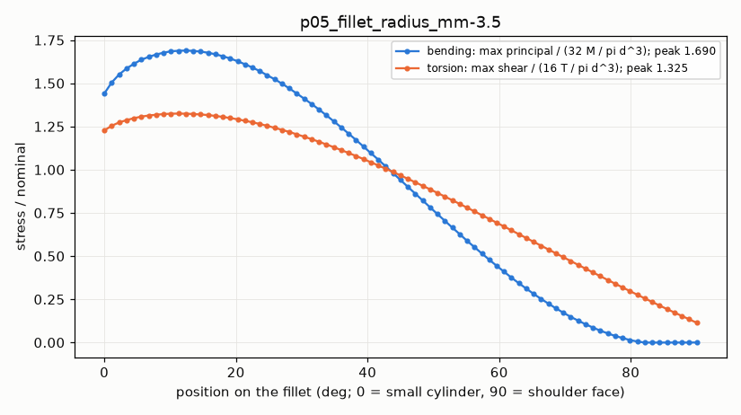

# Engineering review report: shaft_fillet_radius

- **Run:** `20261124-152828_shaft_fillet_radius`
- **Generated:** 2026-11-24T20:51:16+00:00
- **Case file SHA-256:** `d3a4fa6265a54a2c3ee10964395f6b2cc5d2d14079b80ac048f51499b1921849`
- **Environment:** Python 3.14.10, numpy 2.5.5, scipy 1.18.1, matplotlib 3.11.2, cadquery 2.8.0; Windows-11-10.0.26100-SP0
- **Tools:** CalculiX This is Version 2.22; gmsh 4.15.0
- **Code version:** git `162e627783fad9a4f206e24d7e7358b17584c619` (uncommitted changes present)
- **Simulation status:** partial
- **Verification status:** FAIL

> **Warning:** verification did not pass for every point. Requirement verdicts marked *(unverified)* are not supported by evidence and must not be used for acceptance.

## Scope

Gearbox intermediate shaft, 42CrMo4 Q&T, shoulder D 40 -> d 32 mm, rotating bending 300 N m and steady torque 500 N m: fillet radius 1.4 / 1.6 / 2.0 mm (the tolerance band) and 2.5 to 3.9 mm (below the 4 mm shoulder height) for REQ-S3, the smallest radius meeting REQ-S1; fillet elements 0.14 mm.

**Assumptions**

- Linear elastic steel (E 210 GPa, nu 0.3); the stress concentration factors are elastic, from a half model (the profile revolved by 180 degrees) with symmetry for bending and antisymmetry for torsion.
- Rotating bending is fully reversed at the fillet; the torque is steady (no torsional alternation); no axial load.
- Shigley's endurance limit: machined surface (ka, 11th edition), size factor from d, kc = 1 with von Mises combined stresses, no temperature or reliability factor (kd = ke = 1: the mean endurance limit).
- Notch sensitivity from Neuber's constant for steels (Shigley's curve fits, eqs 6-35 and 6-36), at the fillet radius.
- The yield check applies Kf and Kfs to the 1.5 x overload stresses (Shigley chapter 7's conservative form); the overload scales both the moment and the torque.
- Material values are catalogue values (Rm 1000, Re 750 MPa), not test certificates.

## Requirements

| ID | Requirement | Metric | Limit |
|---|---|---|---|
| REQ-S1 | The fatigue safety at the shoulder fillet (modified Goodman, Shigley's method) shall be at least 1.5. | `fatigue_safety` | >= 1.5 - |
| REQ-S2 | The first-cycle yield safety at a 1.5 x overload of moment and torque shall be at least 2.0. | `static_safety` | >= 2 - |

## Summary across points

| Point | fillet_radius_mm | REQ-S1 | REQ-S2 | Checks |
|---|---|---|---|---|
| p00_fillet_radius_mm-1.4 | 1.4 | 1.148 -: **FAIL** | 1.769 -: **FAIL** | 10/10 PASS |
| p01_fillet_radius_mm-1.6 | 1.6 | 1.189 -: **FAIL** | 1.826 -: **FAIL** | 10/10 PASS |
| p02_fillet_radius_mm-2 | 2 | 1.258 -: **FAIL** | 1.921 -: **FAIL** | 10/10 PASS |
| p03_fillet_radius_mm-2.5 | 2.5 | 1.327 -: **FAIL** | 2.016 -: **PASS** | 10/10 PASS |
| p04_fillet_radius_mm-3 | 3 | 1.384 -: **FAIL** | 2.093 -: **PASS** | 10/10 PASS |
| p05_fillet_radius_mm-3.5 | 3.5 | 1.432 -: **FAIL** | 2.156 -: **PASS** | 10/10 PASS |
| p06_fillet_radius_mm-3.9 | 3.9 | - -: **NO RESULT** | - -: **NO RESULT** | 0/0 NOT_RUN |

## Point details

### p00_fillet_radius_mm-1.4

Parameters: D_mm = 40, d_mm = 32, fillet_radius_mm = 1.4, small_length_mm = 80, large_length_mm = 80, bending_moment_Nm = 300, torque_Nm = 500, youngs_modulus_MPa = 2.1e+05, poisson_ratio = 0.3, ultimate_MPa = 1000, yield_MPa = 750, overload_factor = 1.5, element_size_fillet_mm = 0.14, element_size_far_mm = 4, refine_radius_mm = 0.5, refine_halfwidth_mm = 3, mesh_growth = 0.25

Derived: h_over_r = 2.857, r_over_d = 0.04375, kt_bending_fit = 2.096, kt_torsion_fit = 1.642, fatigue_safety_hand = 1.193, static_safety_hand = 1.791

| Requirement | Result | Limit | Margin | Verdict | Evidence |
|---|---|---|---|---|---|
| REQ-S1 | 1.148 - | >= 1.5 | -0.352 | **FAIL** | [point.json](points/p00_fillet_radius_mm-1.4/point.json) |
| REQ-S2 | 1.769 - | >= 2 | -0.231 | **FAIL** | [point.json](points/p00_fillet_radius_mm-1.4/point.json) |

| Check | Description | Value | Tolerance | Status |
|---|---|---|---|---|
| equilibrium_bending | \|clamp reaction moment - applied\| / applied (bending) | 6.27e-08 | 0.001 | PASS |
| end_load_bending | \|applied end moment (consistent nodal forces) - half the moment\| / half (bending, half model; magnitudes: the torsion tractions turn the end in the negative sense) | 1.42e-05 | 0.001 | PASS |
| beam_theory_bending | max \|surface stress / beam theory - 1\| in the small section (30-70 % of its length, plane y = 0, 32 nodes; bending) | 4.70e-03 | 0.01 | PASS |
| peak_off_plane_bending | \|peak off the plane y = 0 (y 0.5-3 mm, cos-corrected) / peak on it - 1\| (bending; nodal-stress scatter) | 5.90e-03 | 0.02 | PASS |
| equilibrium_torsion | \|clamp reaction moment - applied\| / applied (torsion) | 1.62e-07 | 0.001 | PASS |
| end_load_torsion | \|applied end moment (consistent nodal forces) - half the torque\| / half (torsion, half model; magnitudes: the torsion tractions turn the end in the negative sense) | 1.42e-05 | 0.001 | PASS |
| beam_theory_torsion | max \|surface stress / beam theory - 1\| in the small section (30-70 % of its length, plane y = 0, 32 nodes; torsion) | 5.25e-03 | 0.01 | PASS |
| peak_off_plane_torsion | \|peak off the plane y = 0 (y 0.5-3 mm) / peak on it - 1\| (torsion; nodal-stress scatter) | 1.05e-03 | 0.02 | PASS |
| kt_fit_bending | \|FE Kt - Pilkey fit 2.096\| / fit (h/r = 2.86) | 6.53e-02 | 0.1 | PASS |
| kt_fit_torsion | \|FE Kts - Pilkey fit 1.642\| / fit (h/r = 2.86) | 2.61e-02 | 0.1 | PASS |

### p01_fillet_radius_mm-1.6

Parameters: D_mm = 40, d_mm = 32, fillet_radius_mm = 1.6, small_length_mm = 80, large_length_mm = 80, bending_moment_Nm = 300, torque_Nm = 500, youngs_modulus_MPa = 2.1e+05, poisson_ratio = 0.3, ultimate_MPa = 1000, yield_MPa = 750, overload_factor = 1.5, element_size_fillet_mm = 0.14, element_size_far_mm = 4, refine_radius_mm = 0.5, refine_halfwidth_mm = 3, mesh_growth = 0.25

Derived: h_over_r = 2.5, r_over_d = 0.05, kt_bending_fit = 2.013, kt_torsion_fit = 1.59, fatigue_safety_hand = 1.232, static_safety_hand = 1.846

| Requirement | Result | Limit | Margin | Verdict | Evidence |
|---|---|---|---|---|---|
| REQ-S1 | 1.189 - | >= 1.5 | -0.311 | **FAIL** | [point.json](points/p01_fillet_radius_mm-1.6/point.json) |
| REQ-S2 | 1.826 - | >= 2 | -0.174 | **FAIL** | [point.json](points/p01_fillet_radius_mm-1.6/point.json) |

| Check | Description | Value | Tolerance | Status |
|---|---|---|---|---|
| equilibrium_bending | \|clamp reaction moment - applied\| / applied (bending) | 3.93e-08 | 0.001 | PASS |
| end_load_bending | \|applied end moment (consistent nodal forces) - half the moment\| / half (bending, half model; magnitudes: the torsion tractions turn the end in the negative sense) | 1.42e-05 | 0.001 | PASS |
| beam_theory_bending | max \|surface stress / beam theory - 1\| in the small section (30-70 % of its length, plane y = 0, 32 nodes; bending) | 4.15e-03 | 0.01 | PASS |
| peak_off_plane_bending | \|peak off the plane y = 0 (y 0.5-3 mm, cos-corrected) / peak on it - 1\| (bending; nodal-stress scatter) | 6.83e-03 | 0.02 | PASS |
| equilibrium_torsion | \|clamp reaction moment - applied\| / applied (torsion) | 1.59e-07 | 0.001 | PASS |
| end_load_torsion | \|applied end moment (consistent nodal forces) - half the torque\| / half (torsion, half model; magnitudes: the torsion tractions turn the end in the negative sense) | 1.42e-05 | 0.001 | PASS |
| beam_theory_torsion | max \|surface stress / beam theory - 1\| in the small section (30-70 % of its length, plane y = 0, 32 nodes; torsion) | 4.10e-03 | 0.01 | PASS |
| peak_off_plane_torsion | \|peak off the plane y = 0 (y 0.5-3 mm) / peak on it - 1\| (torsion; nodal-stress scatter) | 2.26e-03 | 0.02 | PASS |
| kt_fit_bending | \|FE Kt - Pilkey fit 2.013\| / fit (h/r = 2.50) | 6.11e-02 | 0.1 | PASS |
| kt_fit_torsion | \|FE Kts - Pilkey fit 1.590\| / fit (h/r = 2.50) | 2.60e-02 | 0.1 | PASS |

### p02_fillet_radius_mm-2

Parameters: D_mm = 40, d_mm = 32, fillet_radius_mm = 2, small_length_mm = 80, large_length_mm = 80, bending_moment_Nm = 300, torque_Nm = 500, youngs_modulus_MPa = 2.1e+05, poisson_ratio = 0.3, ultimate_MPa = 1000, yield_MPa = 750, overload_factor = 1.5, element_size_fillet_mm = 0.14, element_size_far_mm = 4, refine_radius_mm = 0.5, refine_halfwidth_mm = 3, mesh_growth = 0.25

Derived: h_over_r = 2, r_over_d = 0.0625, kt_bending_fit = 1.883, kt_torsion_fit = 1.511, fatigue_safety_hand = 1.299, static_safety_hand = 1.939

| Requirement | Result | Limit | Margin | Verdict | Evidence |
|---|---|---|---|---|---|
| REQ-S1 | 1.258 - | >= 1.5 | -0.242 | **FAIL** | [point.json](points/p02_fillet_radius_mm-2/point.json) |
| REQ-S2 | 1.921 - | >= 2 | -0.0789 | **FAIL** | [point.json](points/p02_fillet_radius_mm-2/point.json) |

| Check | Description | Value | Tolerance | Status |
|---|---|---|---|---|
| equilibrium_bending | \|clamp reaction moment - applied\| / applied (bending) | 9.12e-08 | 0.001 | PASS |
| end_load_bending | \|applied end moment (consistent nodal forces) - half the moment\| / half (bending, half model; magnitudes: the torsion tractions turn the end in the negative sense) | 1.42e-05 | 0.001 | PASS |
| beam_theory_bending | max \|surface stress / beam theory - 1\| in the small section (30-70 % of its length, plane y = 0, 32 nodes; bending) | 3.75e-03 | 0.01 | PASS |
| peak_off_plane_bending | \|peak off the plane y = 0 (y 0.5-3 mm, cos-corrected) / peak on it - 1\| (bending; nodal-stress scatter) | 6.75e-03 | 0.02 | PASS |
| equilibrium_torsion | \|clamp reaction moment - applied\| / applied (torsion) | 2.00e-07 | 0.001 | PASS |
| end_load_torsion | \|applied end moment (consistent nodal forces) - half the torque\| / half (torsion, half model; magnitudes: the torsion tractions turn the end in the negative sense) | 1.42e-05 | 0.001 | PASS |
| beam_theory_torsion | max \|surface stress / beam theory - 1\| in the small section (30-70 % of its length, plane y = 0, 32 nodes; torsion) | 3.77e-03 | 0.01 | PASS |
| peak_off_plane_torsion | \|peak off the plane y = 0 (y 0.5-3 mm) / peak on it - 1\| (torsion; nodal-stress scatter) | 1.86e-03 | 0.02 | PASS |
| kt_fit_bending | \|FE Kt - Pilkey fit 1.883\| / fit (h/r = 2.00) | 5.59e-02 | 0.1 | PASS |
| kt_fit_torsion | \|FE Kts - Pilkey fit 1.511\| / fit (h/r = 2.00) | 2.40e-02 | 0.1 | PASS |

### p03_fillet_radius_mm-2.5

Parameters: D_mm = 40, d_mm = 32, fillet_radius_mm = 2.5, small_length_mm = 80, large_length_mm = 80, bending_moment_Nm = 300, torque_Nm = 500, youngs_modulus_MPa = 2.1e+05, poisson_ratio = 0.3, ultimate_MPa = 1000, yield_MPa = 750, overload_factor = 1.5, element_size_fillet_mm = 0.14, element_size_far_mm = 4, refine_radius_mm = 0.5, refine_halfwidth_mm = 3, mesh_growth = 0.25

Derived: h_over_r = 1.6, r_over_d = 0.07812, kt_bending_fit = 1.782, kt_torsion_fit = 1.441, fatigue_safety_hand = 1.36, static_safety_hand = 2.026

| Requirement | Result | Limit | Margin | Verdict | Evidence |
|---|---|---|---|---|---|
| REQ-S1 | 1.327 - | >= 1.5 | -0.173 | **FAIL** | [point.json](points/p03_fillet_radius_mm-2.5/point.json) |
| REQ-S2 | 2.016 - | >= 2 | 0.016 | **PASS** | [point.json](points/p03_fillet_radius_mm-2.5/point.json) |

| Check | Description | Value | Tolerance | Status |
|---|---|---|---|---|
| equilibrium_bending | \|clamp reaction moment - applied\| / applied (bending) | 1.06e-07 | 0.001 | PASS |
| end_load_bending | \|applied end moment (consistent nodal forces) - half the moment\| / half (bending, half model; magnitudes: the torsion tractions turn the end in the negative sense) | 1.42e-05 | 0.001 | PASS |
| beam_theory_bending | max \|surface stress / beam theory - 1\| in the small section (30-70 % of its length, plane y = 0, 32 nodes; bending) | 2.92e-03 | 0.01 | PASS |
| peak_off_plane_bending | \|peak off the plane y = 0 (y 0.5-3 mm, cos-corrected) / peak on it - 1\| (bending; nodal-stress scatter) | 4.32e-03 | 0.02 | PASS |
| equilibrium_torsion | \|clamp reaction moment - applied\| / applied (torsion) | 9.83e-08 | 0.001 | PASS |
| end_load_torsion | \|applied end moment (consistent nodal forces) - half the torque\| / half (torsion, half model; magnitudes: the torsion tractions turn the end in the negative sense) | 1.42e-05 | 0.001 | PASS |
| beam_theory_torsion | max \|surface stress / beam theory - 1\| in the small section (30-70 % of its length, plane y = 0, 32 nodes; torsion) | 3.19e-03 | 0.01 | PASS |
| peak_off_plane_torsion | \|peak off the plane y = 0 (y 0.5-3 mm) / peak on it - 1\| (torsion; nodal-stress scatter) | 9.82e-04 | 0.02 | PASS |
| kt_fit_bending | \|FE Kt - Pilkey fit 1.782\| / fit (h/r = 1.60) | 4.27e-02 | 0.1 | PASS |
| kt_fit_torsion | \|FE Kts - Pilkey fit 1.441\| / fit (h/r = 1.60) | 2.23e-02 | 0.1 | PASS |

### p04_fillet_radius_mm-3

Parameters: D_mm = 40, d_mm = 32, fillet_radius_mm = 3, small_length_mm = 80, large_length_mm = 80, bending_moment_Nm = 300, torque_Nm = 500, youngs_modulus_MPa = 2.1e+05, poisson_ratio = 0.3, ultimate_MPa = 1000, yield_MPa = 750, overload_factor = 1.5, element_size_fillet_mm = 0.14, element_size_far_mm = 4, refine_radius_mm = 0.5, refine_halfwidth_mm = 3, mesh_growth = 0.25

Derived: h_over_r = 1.333, r_over_d = 0.09375, kt_bending_fit = 1.709, kt_torsion_fit = 1.389, fatigue_safety_hand = 1.408, static_safety_hand = 2.095

| Requirement | Result | Limit | Margin | Verdict | Evidence |
|---|---|---|---|---|---|
| REQ-S1 | 1.384 - | >= 1.5 | -0.116 | **FAIL** | [point.json](points/p04_fillet_radius_mm-3/point.json) |
| REQ-S2 | 2.093 - | >= 2 | 0.0926 | **PASS** | [point.json](points/p04_fillet_radius_mm-3/point.json) |

| Check | Description | Value | Tolerance | Status |
|---|---|---|---|---|
| equilibrium_bending | \|clamp reaction moment - applied\| / applied (bending) | 8.49e-08 | 0.001 | PASS |
| end_load_bending | \|applied end moment (consistent nodal forces) - half the moment\| / half (bending, half model; magnitudes: the torsion tractions turn the end in the negative sense) | 1.42e-05 | 0.001 | PASS |
| beam_theory_bending | max \|surface stress / beam theory - 1\| in the small section (30-70 % of its length, plane y = 0, 33 nodes; bending) | 4.32e-03 | 0.01 | PASS |
| peak_off_plane_bending | \|peak off the plane y = 0 (y 0.5-3 mm, cos-corrected) / peak on it - 1\| (bending; nodal-stress scatter) | 4.17e-03 | 0.02 | PASS |
| equilibrium_torsion | \|clamp reaction moment - applied\| / applied (torsion) | 2.43e-08 | 0.001 | PASS |
| end_load_torsion | \|applied end moment (consistent nodal forces) - half the torque\| / half (torsion, half model; magnitudes: the torsion tractions turn the end in the negative sense) | 1.42e-05 | 0.001 | PASS |
| beam_theory_torsion | max \|surface stress / beam theory - 1\| in the small section (30-70 % of its length, plane y = 0, 33 nodes; torsion) | 4.49e-03 | 0.01 | PASS |
| peak_off_plane_torsion | \|peak off the plane y = 0 (y 0.5-3 mm) / peak on it - 1\| (torsion; nodal-stress scatter) | 6.95e-04 | 0.02 | PASS |
| kt_fit_bending | \|FE Kt - Pilkey fit 1.709\| / fit (h/r = 1.33) | 3.17e-02 | 0.1 | PASS |
| kt_fit_torsion | \|FE Kts - Pilkey fit 1.389\| / fit (h/r = 1.33) | 2.06e-02 | 0.1 | PASS |

### p05_fillet_radius_mm-3.5

Parameters: D_mm = 40, d_mm = 32, fillet_radius_mm = 3.5, small_length_mm = 80, large_length_mm = 80, bending_moment_Nm = 300, torque_Nm = 500, youngs_modulus_MPa = 2.1e+05, poisson_ratio = 0.3, ultimate_MPa = 1000, yield_MPa = 750, overload_factor = 1.5, element_size_fillet_mm = 0.14, element_size_far_mm = 4, refine_radius_mm = 0.5, refine_halfwidth_mm = 3, mesh_growth = 0.25

Derived: h_over_r = 1.143, r_over_d = 0.1094, kt_bending_fit = 1.652, kt_torsion_fit = 1.35, fatigue_safety_hand = 1.448, static_safety_hand = 2.153

| Requirement | Result | Limit | Margin | Verdict | Evidence |
|---|---|---|---|---|---|
| REQ-S1 | 1.432 - | >= 1.5 | -0.0677 | **FAIL** | [point.json](points/p05_fillet_radius_mm-3.5/point.json) |
| REQ-S2 | 2.156 - | >= 2 | 0.156 | **PASS** | [point.json](points/p05_fillet_radius_mm-3.5/point.json) |

| Check | Description | Value | Tolerance | Status |
|---|---|---|---|---|
| equilibrium_bending | \|clamp reaction moment - applied\| / applied (bending) | 1.15e-07 | 0.001 | PASS |
| end_load_bending | \|applied end moment (consistent nodal forces) - half the moment\| / half (bending, half model; magnitudes: the torsion tractions turn the end in the negative sense) | 1.42e-05 | 0.001 | PASS |
| beam_theory_bending | max \|surface stress / beam theory - 1\| in the small section (30-70 % of its length, plane y = 0, 33 nodes; bending) | 4.42e-03 | 0.01 | PASS |
| peak_off_plane_bending | \|peak off the plane y = 0 (y 0.5-3 mm, cos-corrected) / peak on it - 1\| (bending; nodal-stress scatter) | 1.98e-03 | 0.02 | PASS |
| equilibrium_torsion | \|clamp reaction moment - applied\| / applied (torsion) | 2.02e-08 | 0.001 | PASS |
| end_load_torsion | \|applied end moment (consistent nodal forces) - half the torque\| / half (torsion, half model; magnitudes: the torsion tractions turn the end in the negative sense) | 1.42e-05 | 0.001 | PASS |
| beam_theory_torsion | max \|surface stress / beam theory - 1\| in the small section (30-70 % of its length, plane y = 0, 33 nodes; torsion) | 4.54e-03 | 0.01 | PASS |
| peak_off_plane_torsion | \|peak off the plane y = 0 (y 0.5-3 mm) / peak on it - 1\| (torsion; nodal-stress scatter) | 4.31e-04 | 0.02 | PASS |
| kt_fit_bending | \|FE Kt - Pilkey fit 1.652\| / fit (h/r = 1.14) | 2.26e-02 | 0.1 | PASS |
| kt_fit_torsion | \|FE Kts - Pilkey fit 1.350\| / fit (h/r = 1.14) | 1.88e-02 | 0.1 | PASS |

### p06_fillet_radius_mm-3.9

Parameters: D_mm = 40, d_mm = 32, fillet_radius_mm = 3.9, small_length_mm = 80, large_length_mm = 80, bending_moment_Nm = 300, torque_Nm = 500, youngs_modulus_MPa = 2.1e+05, poisson_ratio = 0.3, ultimate_MPa = 1000, yield_MPa = 750, overload_factor = 1.5, element_size_fillet_mm = 0.14, element_size_far_mm = 4, refine_radius_mm = 0.5, refine_halfwidth_mm = 3, mesh_growth = 0.25

Derived: h_over_r = 1.026, r_over_d = 0.1219, kt_bending_fit = 1.615, kt_torsion_fit = 1.324, fatigue_safety_hand = 1.476, static_safety_hand = 2.193

| Requirement | Result | Limit | Margin | Verdict | Evidence |
|---|---|---|---|---|---|
| REQ-S1 | - - | >= 1.5 | - | **NO RESULT** | [point.json](points/p06_fillet_radius_mm-3.9/point.json) |
| REQ-S2 | - - | >= 2 | - | **NO RESULT** | [point.json](points/p06_fillet_radius_mm-3.9/point.json) |

No verification checks recorded (status: NOT_RUN).

## Limitations

- No DIN 743 assessment (a paid standard); Shigley's method is the agreed basis.
- No residual stresses, surface treatment (rolling, shot peening) or corrosion; no fretting or press-fit stress from a hub or bearing seated at the shoulder.
- The Kt fits come from Peterson's charts (photoelastic data), which recent finite-element work finds low in bending; the FE value is used for the verdicts and the fit is a cross-check.
- Neuber's constant and the Marin factors are empirical curve fits with scatter; the 10th-edition surface factor gives a 6.5 % higher endurance limit (reported).
- No physical test data.
- A converged solver run that matches an analytical reference shows that the equations were solved correctly. It does not show that the equations represent real hardware.

## Engineering acceptance

Pending human review. This report does not accept or reject the design.
