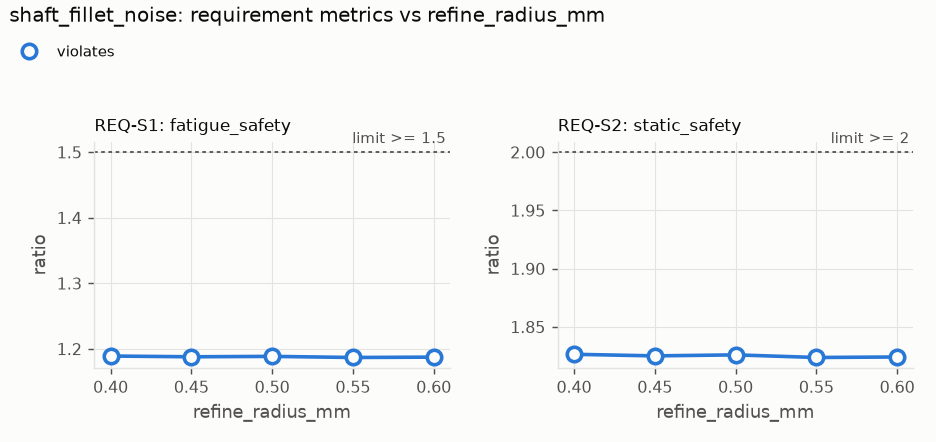
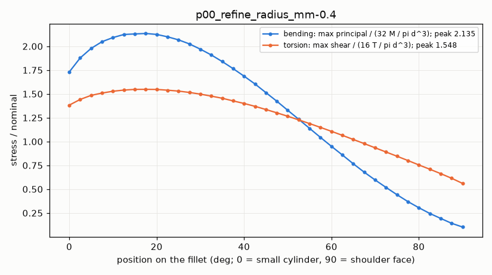
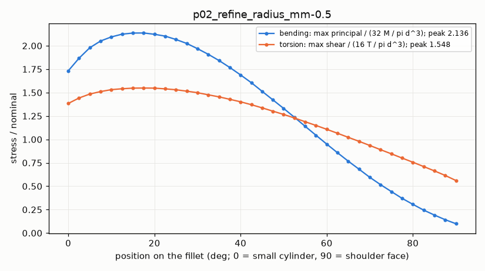
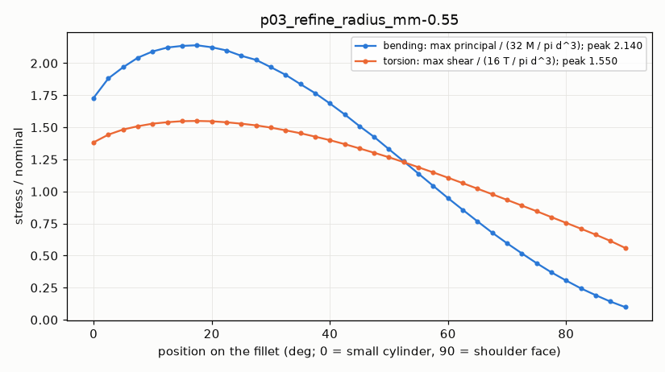
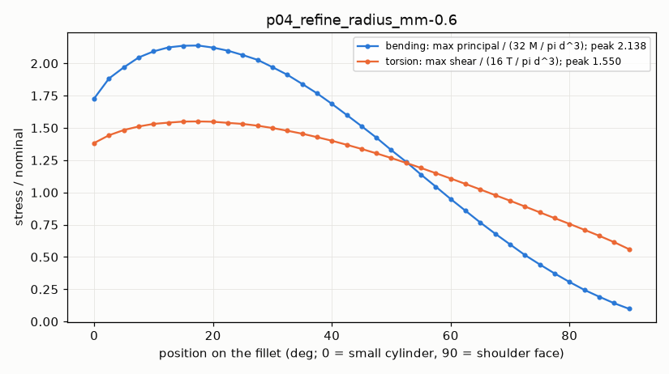

# Engineering review report: shaft_fillet_noise

- **Run:** `20261124-154527_shaft_fillet_noise`
- **Generated:** 2026-11-24T21:09:47+00:00
- **Case file SHA-256:** `755760dbf600b9881f87244ff1ac706cfb191934e4f8e94e61482df5e8275583`
- **Environment:** Python 3.14.10, numpy 2.5.5, scipy 1.18.1, matplotlib 3.11.2, cadquery 2.8.0; Windows-11-10.0.26100-SP0
- **Tools:** CalculiX This is Version 2.22; gmsh 4.15.0
- **Code version:** git `75e51982d11734b30238766549e56107392e0a15` (uncommitted changes present)
- **Simulation status:** completed
- **Verification status:** PASS

## Scope

Mesh noise floor for the shaft mesh study: five perturbed meshes at one fillet element size (0.14 mm), the refined core radius 0.4 / 0.45 / 0.5 / 0.55 / 0.6 mm; the peak-to-peak spread of each metric.

**Assumptions**

- Linear elastic steel (E 210 GPa, nu 0.3); the stress concentration factors are elastic, from a half model (the profile revolved by 180 degrees) with symmetry for bending and antisymmetry for torsion.
- Rotating bending is fully reversed at the fillet; the torque is steady (no torsional alternation); no axial load.
- Shigley's endurance limit: machined surface (ka, 11th edition), size factor from d, kc = 1 with von Mises combined stresses, no temperature or reliability factor (kd = ke = 1: the mean endurance limit).
- Notch sensitivity from Neuber's constant for steels (Shigley's curve fits, eqs 6-35 and 6-36), at the fillet radius.
- The yield check applies Kf and Kfs to the 1.5 x overload stresses (Shigley chapter 7's conservative form); the overload scales both the moment and the torque.
- Material values are catalogue values (Rm 1000, Re 750 MPa), not test certificates.

## Requirements

| ID | Requirement | Metric | Limit |
|---|---|---|---|
| REQ-S1 | The fatigue safety at the shoulder fillet (modified Goodman, Shigley's method) shall be at least 1.5. | `fatigue_safety` | >= 1.5 - |
| REQ-S2 | The first-cycle yield safety at a 1.5 x overload of moment and torque shall be at least 2.0. | `static_safety` | >= 2 - |

## Summary across points

| Point | refine_radius_mm | REQ-S1 | REQ-S2 | Checks |
|---|---|---|---|---|
| p00_refine_radius_mm-0.4 | 0.4 | 1.189 -: **FAIL** | 1.826 -: **FAIL** | 10/10 PASS |
| p01_refine_radius_mm-0.45 | 0.45 | 1.188 -: **FAIL** | 1.825 -: **FAIL** | 10/10 PASS |
| p02_refine_radius_mm-0.5 | 0.5 | 1.189 -: **FAIL** | 1.826 -: **FAIL** | 10/10 PASS |
| p03_refine_radius_mm-0.55 | 0.55 | 1.187 -: **FAIL** | 1.824 -: **FAIL** | 10/10 PASS |
| p04_refine_radius_mm-0.6 | 0.6 | 1.187 -: **FAIL** | 1.824 -: **FAIL** | 10/10 PASS |

## Point details

### p00_refine_radius_mm-0.4

Parameters: D_mm = 40, d_mm = 32, fillet_radius_mm = 1.6, small_length_mm = 80, large_length_mm = 80, bending_moment_Nm = 300, torque_Nm = 500, youngs_modulus_MPa = 2.1e+05, poisson_ratio = 0.3, ultimate_MPa = 1000, yield_MPa = 750, overload_factor = 1.5, element_size_fillet_mm = 0.14, element_size_far_mm = 4, refine_radius_mm = 0.4, refine_halfwidth_mm = 3, mesh_growth = 0.25

Derived: h_over_r = 2.5, r_over_d = 0.05, kt_bending_fit = 2.013, kt_torsion_fit = 1.59, fatigue_safety_hand = 1.232, static_safety_hand = 1.846

| Requirement | Result | Limit | Margin | Verdict | Evidence |
|---|---|---|---|---|---|
| REQ-S1 | 1.189 - | >= 1.5 | -0.311 | **FAIL** | [point.json](points/p00_refine_radius_mm-0.4/point.json) |
| REQ-S2 | 1.826 - | >= 2 | -0.174 | **FAIL** | [point.json](points/p00_refine_radius_mm-0.4/point.json) |

| Check | Description | Value | Tolerance | Status |
|---|---|---|---|---|
| equilibrium_bending | \|clamp reaction moment - applied\| / applied (bending) | 1.04e-07 | 0.001 | PASS |
| end_load_bending | \|applied end moment (consistent nodal forces) - half the moment\| / half (bending, half model; magnitudes: the torsion tractions turn the end in the negative sense) | 1.42e-05 | 0.001 | PASS |
| beam_theory_bending | max \|surface stress / beam theory - 1\| in the small section (30-70 % of its length, plane y = 0, 32 nodes; bending) | 3.82e-03 | 0.01 | PASS |
| peak_off_plane_bending | \|peak off the plane y = 0 (y 0.5-3 mm, cos-corrected) / peak on it - 1\| (bending; nodal-stress scatter) | 1.06e-02 | 0.02 | PASS |
| equilibrium_torsion | \|clamp reaction moment - applied\| / applied (torsion) | 1.83e-07 | 0.001 | PASS |
| end_load_torsion | \|applied end moment (consistent nodal forces) - half the torque\| / half (torsion, half model; magnitudes: the torsion tractions turn the end in the negative sense) | 1.42e-05 | 0.001 | PASS |
| beam_theory_torsion | max \|surface stress / beam theory - 1\| in the small section (30-70 % of its length, plane y = 0, 32 nodes; torsion) | 3.88e-03 | 0.01 | PASS |
| peak_off_plane_torsion | \|peak off the plane y = 0 (y 0.5-3 mm) / peak on it - 1\| (torsion; nodal-stress scatter) | 2.52e-03 | 0.02 | PASS |
| kt_fit_bending | \|FE Kt - Pilkey fit 2.013\| / fit (h/r = 2.50) | 6.04e-02 | 0.1 | PASS |
| kt_fit_torsion | \|FE Kts - Pilkey fit 1.590\| / fit (h/r = 2.50) | 2.60e-02 | 0.1 | PASS |

### p01_refine_radius_mm-0.45

Parameters: D_mm = 40, d_mm = 32, fillet_radius_mm = 1.6, small_length_mm = 80, large_length_mm = 80, bending_moment_Nm = 300, torque_Nm = 500, youngs_modulus_MPa = 2.1e+05, poisson_ratio = 0.3, ultimate_MPa = 1000, yield_MPa = 750, overload_factor = 1.5, element_size_fillet_mm = 0.14, element_size_far_mm = 4, refine_radius_mm = 0.45, refine_halfwidth_mm = 3, mesh_growth = 0.25

Derived: h_over_r = 2.5, r_over_d = 0.05, kt_bending_fit = 2.013, kt_torsion_fit = 1.59, fatigue_safety_hand = 1.232, static_safety_hand = 1.846

| Requirement | Result | Limit | Margin | Verdict | Evidence |
|---|---|---|---|---|---|
| REQ-S1 | 1.188 - | >= 1.5 | -0.312 | **FAIL** | [point.json](points/p01_refine_radius_mm-0.45/point.json) |
| REQ-S2 | 1.825 - | >= 2 | -0.175 | **FAIL** | [point.json](points/p01_refine_radius_mm-0.45/point.json) |

| Check | Description | Value | Tolerance | Status |
|---|---|---|---|---|
| equilibrium_bending | \|clamp reaction moment - applied\| / applied (bending) | 6.62e-08 | 0.001 | PASS |
| end_load_bending | \|applied end moment (consistent nodal forces) - half the moment\| / half (bending, half model; magnitudes: the torsion tractions turn the end in the negative sense) | 1.42e-05 | 0.001 | PASS |
| beam_theory_bending | max \|surface stress / beam theory - 1\| in the small section (30-70 % of its length, plane y = 0, 32 nodes; bending) | 4.48e-03 | 0.01 | PASS |
| peak_off_plane_bending | \|peak off the plane y = 0 (y 0.5-3 mm, cos-corrected) / peak on it - 1\| (bending; nodal-stress scatter) | 7.46e-03 | 0.02 | PASS |
| equilibrium_torsion | \|clamp reaction moment - applied\| / applied (torsion) | 1.90e-07 | 0.001 | PASS |
| end_load_torsion | \|applied end moment (consistent nodal forces) - half the torque\| / half (torsion, half model; magnitudes: the torsion tractions turn the end in the negative sense) | 1.42e-05 | 0.001 | PASS |
| beam_theory_torsion | max \|surface stress / beam theory - 1\| in the small section (30-70 % of its length, plane y = 0, 32 nodes; torsion) | 4.68e-03 | 0.01 | PASS |
| peak_off_plane_torsion | \|peak off the plane y = 0 (y 0.5-3 mm) / peak on it - 1\| (torsion; nodal-stress scatter) | 2.95e-03 | 0.02 | PASS |
| kt_fit_bending | \|FE Kt - Pilkey fit 2.013\| / fit (h/r = 2.50) | 6.18e-02 | 0.1 | PASS |
| kt_fit_torsion | \|FE Kts - Pilkey fit 1.590\| / fit (h/r = 2.50) | 2.56e-02 | 0.1 | PASS |

### p02_refine_radius_mm-0.5

Parameters: D_mm = 40, d_mm = 32, fillet_radius_mm = 1.6, small_length_mm = 80, large_length_mm = 80, bending_moment_Nm = 300, torque_Nm = 500, youngs_modulus_MPa = 2.1e+05, poisson_ratio = 0.3, ultimate_MPa = 1000, yield_MPa = 750, overload_factor = 1.5, element_size_fillet_mm = 0.14, element_size_far_mm = 4, refine_radius_mm = 0.5, refine_halfwidth_mm = 3, mesh_growth = 0.25

Derived: h_over_r = 2.5, r_over_d = 0.05, kt_bending_fit = 2.013, kt_torsion_fit = 1.59, fatigue_safety_hand = 1.232, static_safety_hand = 1.846

| Requirement | Result | Limit | Margin | Verdict | Evidence |
|---|---|---|---|---|---|
| REQ-S1 | 1.189 - | >= 1.5 | -0.311 | **FAIL** | [point.json](points/p02_refine_radius_mm-0.5/point.json) |
| REQ-S2 | 1.826 - | >= 2 | -0.174 | **FAIL** | [point.json](points/p02_refine_radius_mm-0.5/point.json) |

| Check | Description | Value | Tolerance | Status |
|---|---|---|---|---|
| equilibrium_bending | \|clamp reaction moment - applied\| / applied (bending) | 3.93e-08 | 0.001 | PASS |
| end_load_bending | \|applied end moment (consistent nodal forces) - half the moment\| / half (bending, half model; magnitudes: the torsion tractions turn the end in the negative sense) | 1.42e-05 | 0.001 | PASS |
| beam_theory_bending | max \|surface stress / beam theory - 1\| in the small section (30-70 % of its length, plane y = 0, 32 nodes; bending) | 4.15e-03 | 0.01 | PASS |
| peak_off_plane_bending | \|peak off the plane y = 0 (y 0.5-3 mm, cos-corrected) / peak on it - 1\| (bending; nodal-stress scatter) | 6.83e-03 | 0.02 | PASS |
| equilibrium_torsion | \|clamp reaction moment - applied\| / applied (torsion) | 1.59e-07 | 0.001 | PASS |
| end_load_torsion | \|applied end moment (consistent nodal forces) - half the torque\| / half (torsion, half model; magnitudes: the torsion tractions turn the end in the negative sense) | 1.42e-05 | 0.001 | PASS |
| beam_theory_torsion | max \|surface stress / beam theory - 1\| in the small section (30-70 % of its length, plane y = 0, 32 nodes; torsion) | 4.10e-03 | 0.01 | PASS |
| peak_off_plane_torsion | \|peak off the plane y = 0 (y 0.5-3 mm) / peak on it - 1\| (torsion; nodal-stress scatter) | 2.26e-03 | 0.02 | PASS |
| kt_fit_bending | \|FE Kt - Pilkey fit 2.013\| / fit (h/r = 2.50) | 6.11e-02 | 0.1 | PASS |
| kt_fit_torsion | \|FE Kts - Pilkey fit 1.590\| / fit (h/r = 2.50) | 2.60e-02 | 0.1 | PASS |

### p03_refine_radius_mm-0.55

Parameters: D_mm = 40, d_mm = 32, fillet_radius_mm = 1.6, small_length_mm = 80, large_length_mm = 80, bending_moment_Nm = 300, torque_Nm = 500, youngs_modulus_MPa = 2.1e+05, poisson_ratio = 0.3, ultimate_MPa = 1000, yield_MPa = 750, overload_factor = 1.5, element_size_fillet_mm = 0.14, element_size_far_mm = 4, refine_radius_mm = 0.55, refine_halfwidth_mm = 3, mesh_growth = 0.25

Derived: h_over_r = 2.5, r_over_d = 0.05, kt_bending_fit = 2.013, kt_torsion_fit = 1.59, fatigue_safety_hand = 1.232, static_safety_hand = 1.846

| Requirement | Result | Limit | Margin | Verdict | Evidence |
|---|---|---|---|---|---|
| REQ-S1 | 1.187 - | >= 1.5 | -0.313 | **FAIL** | [point.json](points/p03_refine_radius_mm-0.55/point.json) |
| REQ-S2 | 1.824 - | >= 2 | -0.176 | **FAIL** | [point.json](points/p03_refine_radius_mm-0.55/point.json) |

| Check | Description | Value | Tolerance | Status |
|---|---|---|---|---|
| equilibrium_bending | \|clamp reaction moment - applied\| / applied (bending) | 1.45e-07 | 0.001 | PASS |
| end_load_bending | \|applied end moment (consistent nodal forces) - half the moment\| / half (bending, half model; magnitudes: the torsion tractions turn the end in the negative sense) | 1.42e-05 | 0.001 | PASS |
| beam_theory_bending | max \|surface stress / beam theory - 1\| in the small section (30-70 % of its length, plane y = 0, 32 nodes; bending) | 3.96e-03 | 0.01 | PASS |
| peak_off_plane_bending | \|peak off the plane y = 0 (y 0.5-3 mm, cos-corrected) / peak on it - 1\| (bending; nodal-stress scatter) | 6.22e-03 | 0.02 | PASS |
| equilibrium_torsion | \|clamp reaction moment - applied\| / applied (torsion) | 1.84e-08 | 0.001 | PASS |
| end_load_torsion | \|applied end moment (consistent nodal forces) - half the torque\| / half (torsion, half model; magnitudes: the torsion tractions turn the end in the negative sense) | 1.42e-05 | 0.001 | PASS |
| beam_theory_torsion | max \|surface stress / beam theory - 1\| in the small section (30-70 % of its length, plane y = 0, 32 nodes; torsion) | 4.05e-03 | 0.01 | PASS |
| peak_off_plane_torsion | \|peak off the plane y = 0 (y 0.5-3 mm) / peak on it - 1\| (torsion; nodal-stress scatter) | 2.29e-03 | 0.02 | PASS |
| kt_fit_bending | \|FE Kt - Pilkey fit 2.013\| / fit (h/r = 2.50) | 6.29e-02 | 0.1 | PASS |
| kt_fit_torsion | \|FE Kts - Pilkey fit 1.590\| / fit (h/r = 2.50) | 2.51e-02 | 0.1 | PASS |

### p04_refine_radius_mm-0.6

Parameters: D_mm = 40, d_mm = 32, fillet_radius_mm = 1.6, small_length_mm = 80, large_length_mm = 80, bending_moment_Nm = 300, torque_Nm = 500, youngs_modulus_MPa = 2.1e+05, poisson_ratio = 0.3, ultimate_MPa = 1000, yield_MPa = 750, overload_factor = 1.5, element_size_fillet_mm = 0.14, element_size_far_mm = 4, refine_radius_mm = 0.6, refine_halfwidth_mm = 3, mesh_growth = 0.25

Derived: h_over_r = 2.5, r_over_d = 0.05, kt_bending_fit = 2.013, kt_torsion_fit = 1.59, fatigue_safety_hand = 1.232, static_safety_hand = 1.846

| Requirement | Result | Limit | Margin | Verdict | Evidence |
|---|---|---|---|---|---|
| REQ-S1 | 1.187 - | >= 1.5 | -0.313 | **FAIL** | [point.json](points/p04_refine_radius_mm-0.6/point.json) |
| REQ-S2 | 1.824 - | >= 2 | -0.176 | **FAIL** | [point.json](points/p04_refine_radius_mm-0.6/point.json) |

| Check | Description | Value | Tolerance | Status |
|---|---|---|---|---|
| equilibrium_bending | \|clamp reaction moment - applied\| / applied (bending) | 4.96e-08 | 0.001 | PASS |
| end_load_bending | \|applied end moment (consistent nodal forces) - half the moment\| / half (bending, half model; magnitudes: the torsion tractions turn the end in the negative sense) | 1.42e-05 | 0.001 | PASS |
| beam_theory_bending | max \|surface stress / beam theory - 1\| in the small section (30-70 % of its length, plane y = 0, 32 nodes; bending) | 3.23e-03 | 0.01 | PASS |
| peak_off_plane_bending | \|peak off the plane y = 0 (y 0.5-3 mm, cos-corrected) / peak on it - 1\| (bending; nodal-stress scatter) | 6.77e-03 | 0.02 | PASS |
| equilibrium_torsion | \|clamp reaction moment - applied\| / applied (torsion) | 1.77e-07 | 0.001 | PASS |
| end_load_torsion | \|applied end moment (consistent nodal forces) - half the torque\| / half (torsion, half model; magnitudes: the torsion tractions turn the end in the negative sense) | 1.42e-05 | 0.001 | PASS |
| beam_theory_torsion | max \|surface stress / beam theory - 1\| in the small section (30-70 % of its length, plane y = 0, 32 nodes; torsion) | 3.21e-03 | 0.01 | PASS |
| peak_off_plane_torsion | \|peak off the plane y = 0 (y 0.5-3 mm) / peak on it - 1\| (torsion; nodal-stress scatter) | 1.75e-03 | 0.02 | PASS |
| kt_fit_bending | \|FE Kt - Pilkey fit 2.013\| / fit (h/r = 2.50) | 6.22e-02 | 0.1 | PASS |
| kt_fit_torsion | \|FE Kts - Pilkey fit 1.590\| / fit (h/r = 2.50) | 2.49e-02 | 0.1 | PASS |

## Limitations

- No DIN 743 assessment (a paid standard); Shigley's method is the agreed basis.
- No residual stresses, surface treatment (rolling, shot peening) or corrosion; no fretting or press-fit stress from a hub or bearing seated at the shoulder.
- The Kt fits come from Peterson's charts (photoelastic data), which recent finite-element work finds low in bending; the FE value is used for the verdicts and the fit is a cross-check.
- Neuber's constant and the Marin factors are empirical curve fits with scatter; the 10th-edition surface factor gives a 6.5 % higher endurance limit (reported).
- No physical test data.
- A converged solver run that matches an analytical reference shows that the equations were solved correctly. It does not show that the equations represent real hardware.

## Engineering acceptance

Pending human review. This report does not accept or reject the design.
