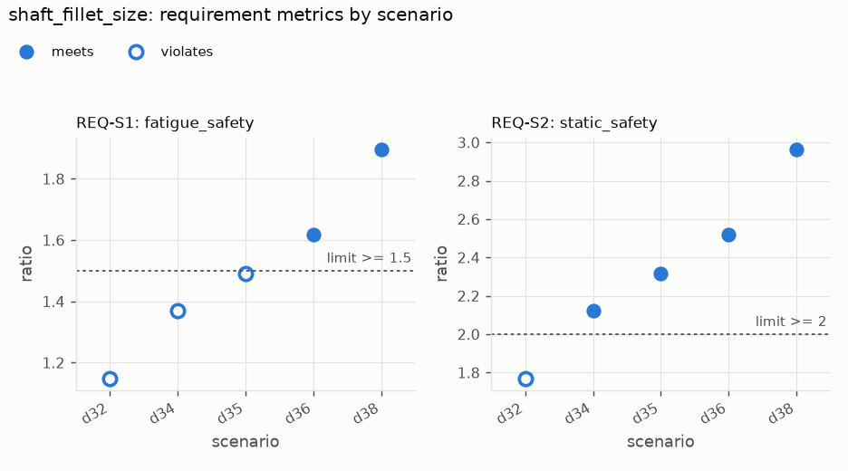
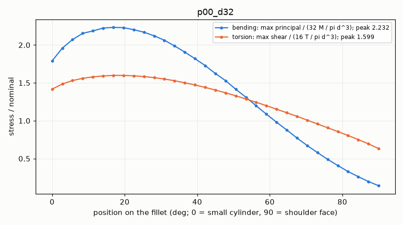
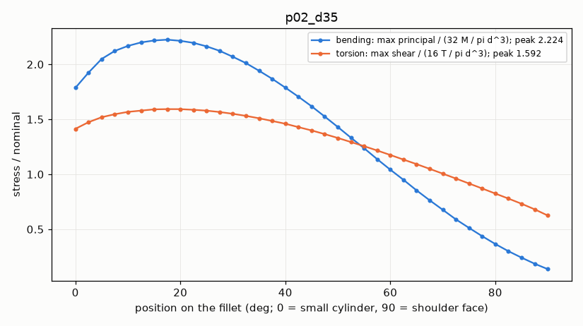
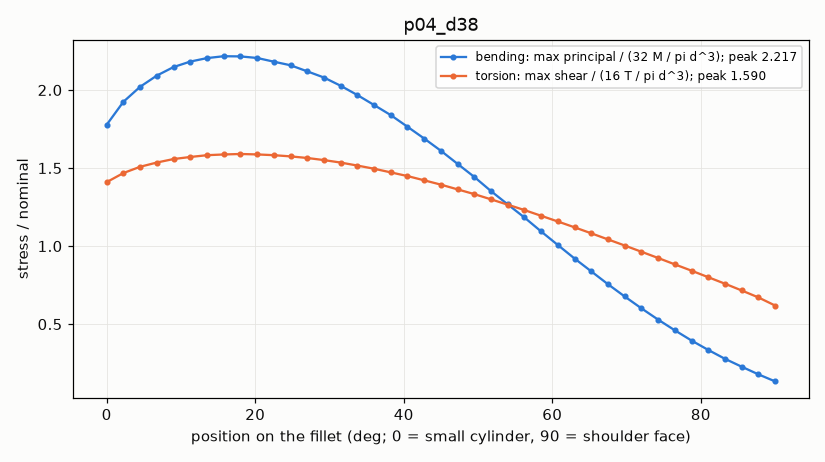

# Engineering review report: shaft_fillet_size

- **Run:** `20261124-155125_shaft_fillet_size`
- **Generated:** 2026-11-24T21:10:13+00:00
- **Case file SHA-256:** `fc93e4fb17dc8dbd0fac8513765ad1c87399bde9bb7604ec8e87bfe2178eba66`
- **Environment:** Python 3.14.10, numpy 2.5.5, scipy 1.18.1, matplotlib 3.11.2, cadquery 2.8.0; Windows-11-10.0.26100-SP0
- **Tools:** CalculiX This is Version 2.22; gmsh 4.15.0
- **Code version:** git `b6017e7bbb53a799bd1ca56c0fe8298472388521` (uncommitted changes present)
- **Simulation status:** completed
- **Verification status:** PASS

## Scope

Sizing the step for the client: gearbox intermediate shaft, 42CrMo4 Q&T, rotating bending 300 N m and steady torque 500 N m; the step scaled with the small diameter d (D = 1.25 d) and the fillet at its lower tolerance (0.05 d - 0.2 mm), d 32 / 34 / 35 / 36 / 38 mm; the smallest d meeting REQ-S1 and REQ-S2.

**Assumptions**

- Linear elastic steel (E 210 GPa, nu 0.3); the stress concentration factors are elastic, from a half model (the profile revolved by 180 degrees) with symmetry for bending and antisymmetry for torsion.
- Rotating bending is fully reversed at the fillet; the torque is steady (no torsional alternation); no axial load.
- Shigley's endurance limit: machined surface (ka, 11th edition), size factor from d, kc = 1 with von Mises combined stresses, no temperature or reliability factor (kd = ke = 1: the mean endurance limit).
- Notch sensitivity from Neuber's constant for steels (Shigley's curve fits, eqs 6-35 and 6-36), at the fillet radius.
- The yield check applies Kf and Kfs to the 1.5 x overload stresses (Shigley chapter 7's conservative form); the overload scales both the moment and the torque.
- Material values are catalogue values (Rm 1000, Re 750 MPa), not test certificates.

## Requirements

| ID | Requirement | Metric | Limit |
|---|---|---|---|
| REQ-S1 | The fatigue safety at the shoulder fillet (modified Goodman, Shigley's method) shall be at least 1.5. | `fatigue_safety` | >= 1.5 - |
| REQ-S2 | The first-cycle yield safety at a 1.5 x overload of moment and torque shall be at least 2.0. | `static_safety` | >= 2 - |

## Summary across points

| Point | scenario | REQ-S1 | REQ-S2 | Checks |
|---|---|---|---|---|
| p00_d32 | d32 | 1.148 -: **FAIL** | 1.769 -: **FAIL** | 10/10 PASS |
| p01_d34 | d34 | 1.369 -: **FAIL** | 2.121 -: **PASS** | 10/10 PASS |
| p02_d35 | d35 | 1.492 -: **FAIL** | 2.316 -: **PASS** | 10/10 PASS |
| p03_d36 | d36 | 1.618 -: **PASS** | 2.519 -: **PASS** | 10/10 PASS |
| p04_d38 | d38 | 1.897 -: **PASS** | 2.965 -: **PASS** | 10/10 PASS |

## Point details

### p00_d32

Parameters: D_mm = 40, d_mm = 32, fillet_radius_mm = 1.4, small_length_mm = 80, large_length_mm = 80, bending_moment_Nm = 300, torque_Nm = 500, youngs_modulus_MPa = 2.1e+05, poisson_ratio = 0.3, ultimate_MPa = 1000, yield_MPa = 750, overload_factor = 1.5, element_size_fillet_mm = 0.14, element_size_far_mm = 4, refine_radius_mm = 0.5, refine_halfwidth_mm = 3, mesh_growth = 0.25, scenario = d32

Derived: h_over_r = 2.857, r_over_d = 0.04375, kt_bending_fit = 2.096, kt_torsion_fit = 1.642, fatigue_safety_hand = 1.193, static_safety_hand = 1.791

| Requirement | Result | Limit | Margin | Verdict | Evidence |
|---|---|---|---|---|---|
| REQ-S1 | 1.148 - | >= 1.5 | -0.352 | **FAIL** | [point.json](points/p00_d32/point.json) |
| REQ-S2 | 1.769 - | >= 2 | -0.231 | **FAIL** | [point.json](points/p00_d32/point.json) |

| Check | Description | Value | Tolerance | Status |
|---|---|---|---|---|
| equilibrium_bending | \|clamp reaction moment - applied\| / applied (bending) | 6.27e-08 | 0.001 | PASS |
| end_load_bending | \|applied end moment (consistent nodal forces) - half the moment\| / half (bending, half model; magnitudes: the torsion tractions turn the end in the negative sense) | 1.42e-05 | 0.001 | PASS |
| beam_theory_bending | max \|surface stress / beam theory - 1\| in the small section (30-70 % of its length, plane y = 0, 32 nodes; bending) | 4.70e-03 | 0.01 | PASS |
| peak_off_plane_bending | \|peak off the plane y = 0 (y 0.5-3 mm, cos-corrected) / peak on it - 1\| (bending; nodal-stress scatter) | 5.90e-03 | 0.02 | PASS |
| equilibrium_torsion | \|clamp reaction moment - applied\| / applied (torsion) | 1.62e-07 | 0.001 | PASS |
| end_load_torsion | \|applied end moment (consistent nodal forces) - half the torque\| / half (torsion, half model; magnitudes: the torsion tractions turn the end in the negative sense) | 1.42e-05 | 0.001 | PASS |
| beam_theory_torsion | max \|surface stress / beam theory - 1\| in the small section (30-70 % of its length, plane y = 0, 32 nodes; torsion) | 5.25e-03 | 0.01 | PASS |
| peak_off_plane_torsion | \|peak off the plane y = 0 (y 0.5-3 mm) / peak on it - 1\| (torsion; nodal-stress scatter) | 1.05e-03 | 0.02 | PASS |
| kt_fit_bending | \|FE Kt - Pilkey fit 2.096\| / fit (h/r = 2.86) | 6.53e-02 | 0.1 | PASS |
| kt_fit_torsion | \|FE Kts - Pilkey fit 1.642\| / fit (h/r = 2.86) | 2.61e-02 | 0.1 | PASS |

### p01_d34

Parameters: D_mm = 42.5, d_mm = 34, fillet_radius_mm = 1.5, small_length_mm = 80, large_length_mm = 80, bending_moment_Nm = 300, torque_Nm = 500, youngs_modulus_MPa = 2.1e+05, poisson_ratio = 0.3, ultimate_MPa = 1000, yield_MPa = 750, overload_factor = 1.5, element_size_fillet_mm = 0.14, element_size_far_mm = 4, refine_radius_mm = 0.5, refine_halfwidth_mm = 3, mesh_growth = 0.25, scenario = d34

Derived: h_over_r = 2.833, r_over_d = 0.04412, kt_bending_fit = 2.09, kt_torsion_fit = 1.638, fatigue_safety_hand = 1.425, static_safety_hand = 2.149

| Requirement | Result | Limit | Margin | Verdict | Evidence |
|---|---|---|---|---|---|
| REQ-S1 | 1.369 - | >= 1.5 | -0.131 | **FAIL** | [point.json](points/p01_d34/point.json) |
| REQ-S2 | 2.121 - | >= 2 | 0.121 | **PASS** | [point.json](points/p01_d34/point.json) |

| Check | Description | Value | Tolerance | Status |
|---|---|---|---|---|
| equilibrium_bending | \|clamp reaction moment - applied\| / applied (bending) | 2.68e-07 | 0.001 | PASS |
| end_load_bending | \|applied end moment (consistent nodal forces) - half the moment\| / half (bending, half model; magnitudes: the torsion tractions turn the end in the negative sense) | 1.06e-05 | 0.001 | PASS |
| beam_theory_bending | max \|surface stress / beam theory - 1\| in the small section (30-70 % of its length, plane y = 0, 32 nodes; bending) | 4.23e-03 | 0.01 | PASS |
| peak_off_plane_bending | \|peak off the plane y = 0 (y 0.5-3 mm, cos-corrected) / peak on it - 1\| (bending; nodal-stress scatter) | 6.12e-03 | 0.02 | PASS |
| equilibrium_torsion | \|clamp reaction moment - applied\| / applied (torsion) | 1.99e-07 | 0.001 | PASS |
| end_load_torsion | \|applied end moment (consistent nodal forces) - half the torque\| / half (torsion, half model; magnitudes: the torsion tractions turn the end in the negative sense) | 1.06e-05 | 0.001 | PASS |
| beam_theory_torsion | max \|surface stress / beam theory - 1\| in the small section (30-70 % of its length, plane y = 0, 32 nodes; torsion) | 4.32e-03 | 0.01 | PASS |
| peak_off_plane_torsion | \|peak off the plane y = 0 (y 0.5-3 mm) / peak on it - 1\| (torsion; nodal-stress scatter) | 1.25e-03 | 0.02 | PASS |
| kt_fit_bending | \|FE Kt - Pilkey fit 2.090\| / fit (h/r = 2.83) | 6.66e-02 | 0.1 | PASS |
| kt_fit_torsion | \|FE Kts - Pilkey fit 1.638\| / fit (h/r = 2.83) | 2.58e-02 | 0.1 | PASS |

### p02_d35

Parameters: D_mm = 43.75, d_mm = 35, fillet_radius_mm = 1.55, small_length_mm = 80, large_length_mm = 80, bending_moment_Nm = 300, torque_Nm = 500, youngs_modulus_MPa = 2.1e+05, poisson_ratio = 0.3, ultimate_MPa = 1000, yield_MPa = 750, overload_factor = 1.5, element_size_fillet_mm = 0.14, element_size_far_mm = 4, refine_radius_mm = 0.5, refine_halfwidth_mm = 3, mesh_growth = 0.25, scenario = d35

Derived: h_over_r = 2.823, r_over_d = 0.04429, kt_bending_fit = 2.088, kt_torsion_fit = 1.637, fatigue_safety_hand = 1.551, static_safety_hand = 2.345

| Requirement | Result | Limit | Margin | Verdict | Evidence |
|---|---|---|---|---|---|
| REQ-S1 | 1.492 - | >= 1.5 | -0.00819 | **FAIL** | [point.json](points/p02_d35/point.json) |
| REQ-S2 | 2.316 - | >= 2 | 0.316 | **PASS** | [point.json](points/p02_d35/point.json) |

| Check | Description | Value | Tolerance | Status |
|---|---|---|---|---|
| equilibrium_bending | \|clamp reaction moment - applied\| / applied (bending) | 3.73e-07 | 0.001 | PASS |
| end_load_bending | \|applied end moment (consistent nodal forces) - half the moment\| / half (bending, half model; magnitudes: the torsion tractions turn the end in the negative sense) | 1.06e-05 | 0.001 | PASS |
| beam_theory_bending | max \|surface stress / beam theory - 1\| in the small section (30-70 % of its length, plane y = 0, 32 nodes; bending) | 3.09e-03 | 0.01 | PASS |
| peak_off_plane_bending | \|peak off the plane y = 0 (y 0.5-3 mm, cos-corrected) / peak on it - 1\| (bending; nodal-stress scatter) | 7.87e-03 | 0.02 | PASS |
| equilibrium_torsion | \|clamp reaction moment - applied\| / applied (torsion) | 3.63e-07 | 0.001 | PASS |
| end_load_torsion | \|applied end moment (consistent nodal forces) - half the torque\| / half (torsion, half model; magnitudes: the torsion tractions turn the end in the negative sense) | 1.06e-05 | 0.001 | PASS |
| beam_theory_torsion | max \|surface stress / beam theory - 1\| in the small section (30-70 % of its length, plane y = 0, 32 nodes; torsion) | 3.92e-03 | 0.01 | PASS |
| peak_off_plane_torsion | \|peak off the plane y = 0 (y 0.5-3 mm) / peak on it - 1\| (torsion; nodal-stress scatter) | 2.34e-03 | 0.02 | PASS |
| kt_fit_bending | \|FE Kt - Pilkey fit 2.088\| / fit (h/r = 2.82) | 6.53e-02 | 0.1 | PASS |
| kt_fit_torsion | \|FE Kts - Pilkey fit 1.637\| / fit (h/r = 2.82) | 2.71e-02 | 0.1 | PASS |

### p03_d36

Parameters: D_mm = 45, d_mm = 36, fillet_radius_mm = 1.6, small_length_mm = 80, large_length_mm = 80, bending_moment_Nm = 300, torque_Nm = 500, youngs_modulus_MPa = 2.1e+05, poisson_ratio = 0.3, ultimate_MPa = 1000, yield_MPa = 750, overload_factor = 1.5, element_size_fillet_mm = 0.14, element_size_far_mm = 4, refine_radius_mm = 0.5, refine_halfwidth_mm = 3, mesh_growth = 0.25, scenario = d36

Derived: h_over_r = 2.812, r_over_d = 0.04444, kt_bending_fit = 2.086, kt_torsion_fit = 1.635, fatigue_safety_hand = 1.684, static_safety_hand = 2.552

| Requirement | Result | Limit | Margin | Verdict | Evidence |
|---|---|---|---|---|---|
| REQ-S1 | 1.618 - | >= 1.5 | 0.118 | **PASS** | [point.json](points/p03_d36/point.json) |
| REQ-S2 | 2.519 - | >= 2 | 0.519 | **PASS** | [point.json](points/p03_d36/point.json) |

| Check | Description | Value | Tolerance | Status |
|---|---|---|---|---|
| equilibrium_bending | \|clamp reaction moment - applied\| / applied (bending) | 2.04e-09 | 0.001 | PASS |
| end_load_bending | \|applied end moment (consistent nodal forces) - half the moment\| / half (bending, half model; magnitudes: the torsion tractions turn the end in the negative sense) | 8.01e-06 | 0.001 | PASS |
| beam_theory_bending | max \|surface stress / beam theory - 1\| in the small section (30-70 % of its length, plane y = 0, 32 nodes; bending) | 2.77e-03 | 0.01 | PASS |
| peak_off_plane_bending | \|peak off the plane y = 0 (y 0.5-3 mm, cos-corrected) / peak on it - 1\| (bending; nodal-stress scatter) | 7.96e-03 | 0.02 | PASS |
| equilibrium_torsion | \|clamp reaction moment - applied\| / applied (torsion) | 1.24e-07 | 0.001 | PASS |
| end_load_torsion | \|applied end moment (consistent nodal forces) - half the torque\| / half (torsion, half model; magnitudes: the torsion tractions turn the end in the negative sense) | 8.01e-06 | 0.001 | PASS |
| beam_theory_torsion | max \|surface stress / beam theory - 1\| in the small section (30-70 % of its length, plane y = 0, 32 nodes; torsion) | 3.66e-03 | 0.01 | PASS |
| peak_off_plane_torsion | \|peak off the plane y = 0 (y 0.5-3 mm) / peak on it - 1\| (torsion; nodal-stress scatter) | 1.72e-03 | 0.02 | PASS |
| kt_fit_bending | \|FE Kt - Pilkey fit 2.086\| / fit (h/r = 2.81) | 6.66e-02 | 0.1 | PASS |
| kt_fit_torsion | \|FE Kts - Pilkey fit 1.635\| / fit (h/r = 2.81) | 2.63e-02 | 0.1 | PASS |

### p04_d38

Parameters: D_mm = 47.5, d_mm = 38, fillet_radius_mm = 1.7, small_length_mm = 80, large_length_mm = 80, bending_moment_Nm = 300, torque_Nm = 500, youngs_modulus_MPa = 2.1e+05, poisson_ratio = 0.3, ultimate_MPa = 1000, yield_MPa = 750, overload_factor = 1.5, element_size_fillet_mm = 0.14, element_size_far_mm = 4, refine_radius_mm = 0.5, refine_halfwidth_mm = 3, mesh_growth = 0.25, scenario = d38

Derived: h_over_r = 2.794, r_over_d = 0.04474, kt_bending_fit = 2.082, kt_torsion_fit = 1.633, fatigue_safety_hand = 1.972, static_safety_hand = 3.002

| Requirement | Result | Limit | Margin | Verdict | Evidence |
|---|---|---|---|---|---|
| REQ-S1 | 1.897 - | >= 1.5 | 0.397 | **PASS** | [point.json](points/p04_d38/point.json) |
| REQ-S2 | 2.965 - | >= 2 | 0.965 | **PASS** | [point.json](points/p04_d38/point.json) |

| Check | Description | Value | Tolerance | Status |
|---|---|---|---|---|
| equilibrium_bending | \|clamp reaction moment - applied\| / applied (bending) | 7.47e-10 | 0.001 | PASS |
| end_load_bending | \|applied end moment (consistent nodal forces) - half the moment\| / half (bending, half model; magnitudes: the torsion tractions turn the end in the negative sense) | 8.01e-06 | 0.001 | PASS |
| beam_theory_bending | max \|surface stress / beam theory - 1\| in the small section (30-70 % of its length, plane y = 0, 32 nodes; bending) | 3.24e-03 | 0.01 | PASS |
| peak_off_plane_bending | \|peak off the plane y = 0 (y 0.5-3 mm, cos-corrected) / peak on it - 1\| (bending; nodal-stress scatter) | 7.85e-03 | 0.02 | PASS |
| equilibrium_torsion | \|clamp reaction moment - applied\| / applied (torsion) | 8.01e-08 | 0.001 | PASS |
| end_load_torsion | \|applied end moment (consistent nodal forces) - half the torque\| / half (torsion, half model; magnitudes: the torsion tractions turn the end in the negative sense) | 8.01e-06 | 0.001 | PASS |
| beam_theory_torsion | max \|surface stress / beam theory - 1\| in the small section (30-70 % of its length, plane y = 0, 32 nodes; torsion) | 3.33e-03 | 0.01 | PASS |
| peak_off_plane_torsion | \|peak off the plane y = 0 (y 0.5-3 mm) / peak on it - 1\| (torsion; nodal-stress scatter) | 9.08e-04 | 0.02 | PASS |
| kt_fit_bending | \|FE Kt - Pilkey fit 2.082\| / fit (h/r = 2.79) | 6.48e-02 | 0.1 | PASS |
| kt_fit_torsion | \|FE Kts - Pilkey fit 1.633\| / fit (h/r = 2.79) | 2.61e-02 | 0.1 | PASS |

## Limitations

- No DIN 743 assessment (a paid standard); Shigley's method is the agreed basis.
- No residual stresses, surface treatment (rolling, shot peening) or corrosion; no fretting or press-fit stress from a hub or bearing seated at the shoulder.
- The Kt fits come from Peterson's charts (photoelastic data), which recent finite-element work finds low in bending; the FE value is used for the verdicts and the fit is a cross-check.
- Neuber's constant and the Marin factors are empirical curve fits with scatter; the 10th-edition surface factor gives a 6.5 % higher endurance limit (reported).
- No physical test data.
- A converged solver run that matches an analytical reference shows that the equations were solved correctly. It does not show that the equations represent real hardware.

## Engineering acceptance

Pending human review. This report does not accept or reject the design.
