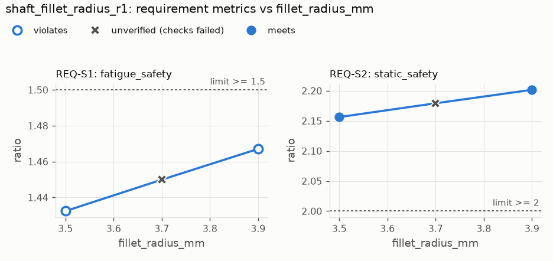
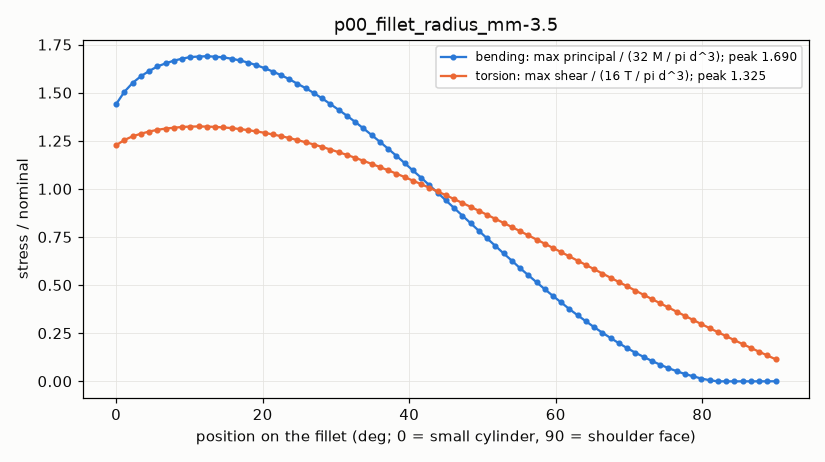
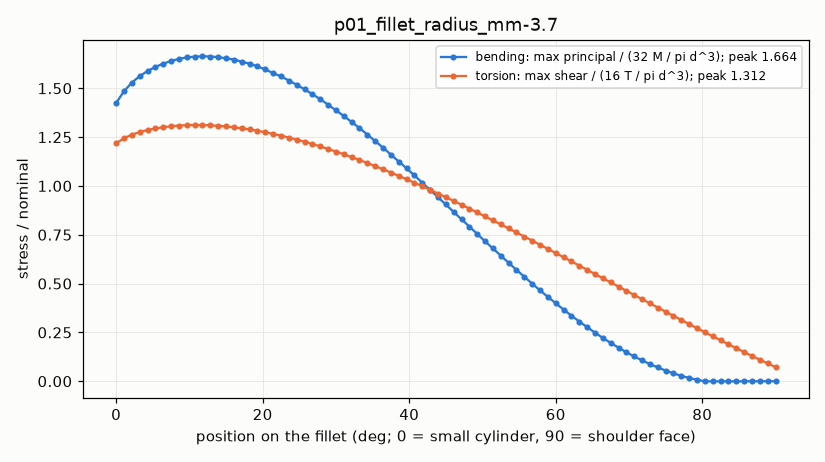
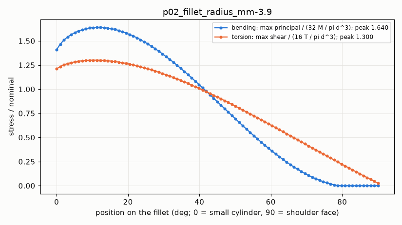

# Engineering review report: shaft_fillet_radius_r1

- **Run:** `20261124-160916_shaft_fillet_radius_r1`
- **Generated:** 2026-11-24T21:22:25+00:00
- **Case file SHA-256:** `0c3562c55f544f49668d6d2094f15320714c8477e0e3db9708818d69a2978b2c`
- **Environment:** Python 3.14.10, numpy 2.5.5, scipy 1.18.1, matplotlib 3.11.2, cadquery 2.8.0; Windows-11-10.0.26100-SP0
- **Tools:** CalculiX This is Version 2.22; gmsh 4.15.0
- **Code version:** git `d350cf5f71a0716e6ad78cbcc54d47ccb507623d` (uncommitted changes present)
- **Simulation status:** completed
- **Verification status:** FAIL

> **Warning:** verification did not pass for every point. Requirement verdicts marked *(unverified)* are not supported by evidence and must not be used for acceptance.

## Scope

Gearbox intermediate shaft, 42CrMo4 Q&T, shoulder D 40 -> d 32 mm: fillet radius 3.5 / 3.7 / 3.9 mm with Gmsh's high-order mesh optimisation (revision 1: the 3.9 mm mesh inverted without it), completing REQ-S3 up to the shoulder height; fillet elements 0.14 mm.

**Assumptions**

- Linear elastic steel (E 210 GPa, nu 0.3); the stress concentration factors are elastic, from a half model (the profile revolved by 180 degrees) with symmetry for bending and antisymmetry for torsion.
- Rotating bending is fully reversed at the fillet; the torque is steady (no torsional alternation); no axial load.
- Shigley's endurance limit: machined surface (ka, 11th edition), size factor from d, kc = 1 with von Mises combined stresses, no temperature or reliability factor (kd = ke = 1: the mean endurance limit).
- Notch sensitivity from Neuber's constant for steels (Shigley's curve fits, eqs 6-35 and 6-36), at the fillet radius.
- The yield check applies Kf and Kfs to the 1.5 x overload stresses (Shigley chapter 7's conservative form); the overload scales both the moment and the torque.
- Material values are catalogue values (Rm 1000, Re 750 MPa), not test certificates.

## Requirements

| ID | Requirement | Metric | Limit |
|---|---|---|---|
| REQ-S1 | The fatigue safety at the shoulder fillet (modified Goodman, Shigley's method) shall be at least 1.5. | `fatigue_safety` | >= 1.5 - |
| REQ-S2 | The first-cycle yield safety at a 1.5 x overload of moment and torque shall be at least 2.0. | `static_safety` | >= 2 - |

## Summary across points

| Point | fillet_radius_mm | REQ-S1 | REQ-S2 | Checks |
|---|---|---|---|---|
| p00_fillet_radius_mm-3.5 | 3.5 | 1.432 -: **FAIL** | 2.156 -: **PASS** | 11/11 PASS |
| p01_fillet_radius_mm-3.7 | 3.7 | 1.45 -: **FAIL (unverified)** | 2.179 -: **PASS (unverified)** | 10/11 FAIL |
| p02_fillet_radius_mm-3.9 | 3.9 | 1.467 -: **FAIL** | 2.201 -: **PASS** | 11/11 PASS |

## Point details

### p00_fillet_radius_mm-3.5

Parameters: D_mm = 40, d_mm = 32, fillet_radius_mm = 3.5, small_length_mm = 80, large_length_mm = 80, bending_moment_Nm = 300, torque_Nm = 500, youngs_modulus_MPa = 2.1e+05, poisson_ratio = 0.3, ultimate_MPa = 1000, yield_MPa = 750, overload_factor = 1.5, element_size_fillet_mm = 0.14, element_size_far_mm = 4, refine_radius_mm = 0.5, refine_halfwidth_mm = 3, mesh_growth = 0.25, high_order_optimize = 1

Derived: h_over_r = 1.143, r_over_d = 0.1094, kt_bending_fit = 1.652, kt_torsion_fit = 1.35, fatigue_safety_hand = 1.448, static_safety_hand = 2.153

| Requirement | Result | Limit | Margin | Verdict | Evidence |
|---|---|---|---|---|---|
| REQ-S1 | 1.432 - | >= 1.5 | -0.0677 | **FAIL** | [point.json](points/p00_fillet_radius_mm-3.5/point.json) |
| REQ-S2 | 2.156 - | >= 2 | 0.156 | **PASS** | [point.json](points/p00_fillet_radius_mm-3.5/point.json) |

| Check | Description | Value | Tolerance | Status |
|---|---|---|---|---|
| equilibrium_bending | \|clamp reaction moment - applied\| / applied (bending) | 8.25e-08 | 0.001 | PASS |
| end_load_bending | \|applied end moment (consistent nodal forces) - half the moment\| / half (bending, half model; magnitudes: the torsion tractions turn the end in the negative sense) | 1.42e-05 | 0.001 | PASS |
| beam_theory_bending | max \|surface stress / beam theory - 1\| in the small section (30-70 % of its length, plane y = 0, 33 nodes; bending) | 3.56e-03 | 0.01 | PASS |
| peak_off_plane_bending | \|peak off the plane y = 0 (y 0.5-3 mm, cos-corrected) / peak on it - 1\| (bending; nodal-stress scatter) | 2.03e-03 | 0.02 | PASS |
| equilibrium_torsion | \|clamp reaction moment - applied\| / applied (torsion) | 9.95e-09 | 0.001 | PASS |
| end_load_torsion | \|applied end moment (consistent nodal forces) - half the torque\| / half (torsion, half model; magnitudes: the torsion tractions turn the end in the negative sense) | 1.42e-05 | 0.001 | PASS |
| beam_theory_torsion | max \|surface stress / beam theory - 1\| in the small section (30-70 % of its length, plane y = 0, 33 nodes; torsion) | 3.50e-03 | 0.01 | PASS |
| peak_off_plane_torsion | \|peak off the plane y = 0 (y 0.5-3 mm) / peak on it - 1\| (torsion; nodal-stress scatter) | 4.29e-04 | 0.02 | PASS |
| element_quality (validity) | elements below the minimum scaled Jacobian (validity; the mesh's minimum 0.226, 1 = ideal, <= 0 inverted) | 0.00e+00 | 0 | PASS |
| kt_fit_bending | \|FE Kt - Pilkey fit 1.652\| / fit (h/r = 1.14) | 2.26e-02 | 0.1 | PASS |
| kt_fit_torsion | \|FE Kts - Pilkey fit 1.350\| / fit (h/r = 1.14) | 1.88e-02 | 0.1 | PASS |

### p01_fillet_radius_mm-3.7

Parameters: D_mm = 40, d_mm = 32, fillet_radius_mm = 3.7, small_length_mm = 80, large_length_mm = 80, bending_moment_Nm = 300, torque_Nm = 500, youngs_modulus_MPa = 2.1e+05, poisson_ratio = 0.3, ultimate_MPa = 1000, yield_MPa = 750, overload_factor = 1.5, element_size_fillet_mm = 0.14, element_size_far_mm = 4, refine_radius_mm = 0.5, refine_halfwidth_mm = 3, mesh_growth = 0.25, high_order_optimize = 1

Derived: h_over_r = 1.081, r_over_d = 0.1156, kt_bending_fit = 1.633, kt_torsion_fit = 1.336, fatigue_safety_hand = 1.463, static_safety_hand = 2.174

| Requirement | Result | Limit | Margin | Verdict | Evidence |
|---|---|---|---|---|---|
| REQ-S1 | 1.45 - | >= 1.5 | -0.0501 | **FAIL (unverified)** | [point.json](points/p01_fillet_radius_mm-3.7/point.json) |
| REQ-S2 | 2.179 - | >= 2 | 0.179 | **PASS (unverified)** | [point.json](points/p01_fillet_radius_mm-3.7/point.json) |

| Check | Description | Value | Tolerance | Status |
|---|---|---|---|---|
| equilibrium_bending | \|clamp reaction moment - applied\| / applied (bending) | 1.14e-07 | 0.001 | PASS |
| end_load_bending | \|applied end moment (consistent nodal forces) - half the moment\| / half (bending, half model; magnitudes: the torsion tractions turn the end in the negative sense) | 1.42e-05 | 0.001 | PASS |
| beam_theory_bending | max \|surface stress / beam theory - 1\| in the small section (30-70 % of its length, plane y = 0, 33 nodes; bending) | 3.89e-03 | 0.01 | PASS |
| peak_off_plane_bending | \|peak off the plane y = 0 (y 0.5-3 mm, cos-corrected) / peak on it - 1\| (bending; nodal-stress scatter) | 2.18e-03 | 0.02 | PASS |
| equilibrium_torsion | \|clamp reaction moment - applied\| / applied (torsion) | 1.65e-07 | 0.001 | PASS |
| end_load_torsion | \|applied end moment (consistent nodal forces) - half the torque\| / half (torsion, half model; magnitudes: the torsion tractions turn the end in the negative sense) | 1.42e-05 | 0.001 | PASS |
| beam_theory_torsion | max \|surface stress / beam theory - 1\| in the small section (30-70 % of its length, plane y = 0, 33 nodes; torsion) | 3.63e-03 | 0.01 | PASS |
| peak_off_plane_torsion | \|peak off the plane y = 0 (y 0.5-3 mm) / peak on it - 1\| (torsion; nodal-stress scatter) | 2.74e-04 | 0.02 | PASS |
| element_quality (validity) | elements below the minimum scaled Jacobian (validity; the mesh's minimum 0.065, 1 = ideal, <= 0 inverted) | 3.50e-02 | 0 | FAIL |
| kt_fit_bending | \|FE Kt - Pilkey fit 1.633\| / fit (h/r = 1.08) | 1.91e-02 | 0.1 | PASS |
| kt_fit_torsion | \|FE Kts - Pilkey fit 1.336\| / fit (h/r = 1.08) | 1.81e-02 | 0.1 | PASS |

### p02_fillet_radius_mm-3.9

Parameters: D_mm = 40, d_mm = 32, fillet_radius_mm = 3.9, small_length_mm = 80, large_length_mm = 80, bending_moment_Nm = 300, torque_Nm = 500, youngs_modulus_MPa = 2.1e+05, poisson_ratio = 0.3, ultimate_MPa = 1000, yield_MPa = 750, overload_factor = 1.5, element_size_fillet_mm = 0.14, element_size_far_mm = 4, refine_radius_mm = 0.5, refine_halfwidth_mm = 3, mesh_growth = 0.25, high_order_optimize = 1

Derived: h_over_r = 1.026, r_over_d = 0.1219, kt_bending_fit = 1.615, kt_torsion_fit = 1.324, fatigue_safety_hand = 1.476, static_safety_hand = 2.193

| Requirement | Result | Limit | Margin | Verdict | Evidence |
|---|---|---|---|---|---|
| REQ-S1 | 1.467 - | >= 1.5 | -0.033 | **FAIL** | [point.json](points/p02_fillet_radius_mm-3.9/point.json) |
| REQ-S2 | 2.201 - | >= 2 | 0.201 | **PASS** | [point.json](points/p02_fillet_radius_mm-3.9/point.json) |

| Check | Description | Value | Tolerance | Status |
|---|---|---|---|---|
| equilibrium_bending | \|clamp reaction moment - applied\| / applied (bending) | 2.06e-08 | 0.001 | PASS |
| end_load_bending | \|applied end moment (consistent nodal forces) - half the moment\| / half (bending, half model; magnitudes: the torsion tractions turn the end in the negative sense) | 1.42e-05 | 0.001 | PASS |
| beam_theory_bending | max \|surface stress / beam theory - 1\| in the small section (30-70 % of its length, plane y = 0, 33 nodes; bending) | 4.07e-03 | 0.01 | PASS |
| peak_off_plane_bending | \|peak off the plane y = 0 (y 0.5-3 mm, cos-corrected) / peak on it - 1\| (bending; nodal-stress scatter) | 2.31e-03 | 0.02 | PASS |
| equilibrium_torsion | \|clamp reaction moment - applied\| / applied (torsion) | 1.52e-07 | 0.001 | PASS |
| end_load_torsion | \|applied end moment (consistent nodal forces) - half the torque\| / half (torsion, half model; magnitudes: the torsion tractions turn the end in the negative sense) | 1.42e-05 | 0.001 | PASS |
| beam_theory_torsion | max \|surface stress / beam theory - 1\| in the small section (30-70 % of its length, plane y = 0, 33 nodes; torsion) | 3.57e-03 | 0.01 | PASS |
| peak_off_plane_torsion | \|peak off the plane y = 0 (y 0.5-3 mm) / peak on it - 1\| (torsion; nodal-stress scatter) | 5.01e-04 | 0.02 | PASS |
| element_quality (validity) | elements below the minimum scaled Jacobian (validity; the mesh's minimum 0.435, 1 = ideal, <= 0 inverted) | 0.00e+00 | 0 | PASS |
| kt_fit_bending | \|FE Kt - Pilkey fit 1.615\| / fit (h/r = 1.03) | 1.54e-02 | 0.1 | PASS |
| kt_fit_torsion | \|FE Kts - Pilkey fit 1.324\| / fit (h/r = 1.03) | 1.78e-02 | 0.1 | PASS |

## Limitations

- No DIN 743 assessment (a paid standard); Shigley's method is the agreed basis.
- No residual stresses, surface treatment (rolling, shot peening) or corrosion; no fretting or press-fit stress from a hub or bearing seated at the shoulder.
- The Kt fits come from Peterson's charts (photoelastic data), which recent finite-element work finds low in bending; the FE value is used for the verdicts and the fit is a cross-check.
- Neuber's constant and the Marin factors are empirical curve fits with scatter; the 10th-edition surface factor gives a 6.5 % higher endurance limit (reported).
- No physical test data.
- A converged solver run that matches an analytical reference shows that the equations were solved correctly. It does not show that the equations represent real hardware.

## Engineering acceptance

Pending human review. This report does not accept or reject the design.
