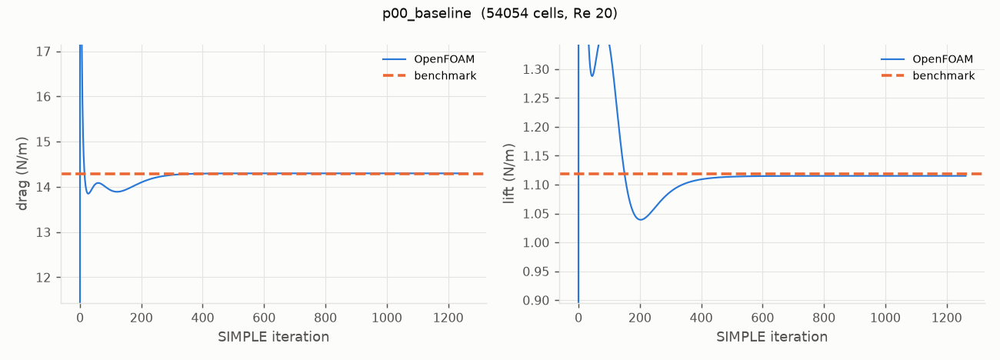

# Engineering review report: turek_hron_cfd1_noise_b

- **Run:** `20261125-154328_turek_hron_cfd1_noise_b`
- **Generated:** 2026-11-25T20:51:13+00:00
- **Case file SHA-256:** `936cdcfb53f703d09d95880214e128e29cd790da102b9b7e10e168051a2d0e53`
- **Environment:** Python 3.14.10, numpy 2.5.5, scipy 1.18.1, matplotlib 3.11.2, cadquery 2.8.0; Windows-11-10.0.26100-SP0
- **Tools:** openfoam_bashrc /opt/openfoam14/etc/bashrc; gmsh 4.15.0; openfoam_version 14; openfoam_package openfoam14 20261008; linux Ubuntu 22.04.5 LTS
- **Code version:** git `dc930377fa9314cb6ed84402976429a373558690` (uncommitted changes present)
- **Simulation status:** completed
- **Verification status:** PASS

## Scope

Turek-Hron CFD1: steady laminar flow (Re 20) in a 2.5 x 0.41 m channel round a cylinder (r 0.05 m) with a rigid 0.35 x 0.02 m flag; OpenFOAM 14 on a Gmsh quad-dominant mesh, body cell size 1.23 mm (mesh-noise case b); drag and lift against the published benchmark.

**Assumptions**

- 2D (one cell deep, empty front and back), as the benchmark defines it.
- Steady flow: at Re 20 the wake is steady; the SIMPLE residual targets and the settled force history check it.
- The flag is rigid and fixed (the CFD tests make it so by a huge stiffness and density).
- Inflow: the benchmark's parabolic profile at the full mean velocity (the steady tests have no time ramp).

## Requirements

| ID | Requirement | Metric | Limit |
|---|---|---|---|
| REQ-F1 | Before it is coupled to the solid, the fluid model shall reproduce the Turek-Hron CFD1 drag within 1 %. | `drag_deviation_pct` | <= 1 % |
| REQ-F2 | It shall reproduce the CFD1 lift within 2 % (lift is a small difference of large pressure forces, about 8 % of the drag). | `lift_deviation_pct` | <= 2 % |

## Summary across points

| Point | REQ-F1 | REQ-F2 | Checks |
|---|---|---|---|
| p00_baseline | 0.04239 %: **PASS** | 0.3504 %: **PASS** | 8/8 PASS |

## Point details

### p00_baseline

Parameters: mean_velocity_m_per_s = 0.2, kinematic_viscosity_m2_per_s = 0.001, density_kg_per_m3 = 1000, flag_length_m = 0.35, cell_size_m = 0.00123, benchmark_drag_N_per_m = 14.29, benchmark_lift_N_per_m = 1.119

Derived: reynolds_D = 20, dynamic_pressure_times_D_N_per_m = 2

| Requirement | Result | Limit | Margin | Verdict | Evidence |
|---|---|---|---|---|---|
| REQ-F1 | 0.04239 % | <= 1 | 0.958 | **PASS** | [point.json](points/p00_baseline/point.json) |
| REQ-F2 | 0.3504 % | <= 2 | 1.65 | **PASS** | [point.json](points/p00_baseline/point.json) |

| Check | Description | Value | Tolerance | Status |
|---|---|---|---|---|
| mesh | checkMesh reports Mesh OK (1 = failed) | 0.00e+00 | 0.5 | PASS |
| flag_cells | largest interior angle (deg) of the fluid cells touching the flag, at (0.5233, 0.1894) m (a cell wrapped around a tip corner reads near 180) | 1.22e+02 | 140 | PASS |
| converged | SIMPLE met its residual targets (1 = stopped at the iteration limit) | 0.00e+00 | 0.5 | PASS |
| forces_settled | max over drag and lift of the spread over the last 10 % of iterations / final value | 2.10e-07 | 1e-06 | PASS |
| inflow_profile | max over inlet faces \|U - benchmark parabola at the face centre\| / (1.5 U_mean) | 6.25e-08 | 1e-06 | PASS |
| flow_rate | \|inlet flow - U_mean H depth\| / (U_mean H depth) (midpoint sampling of the parabola on the inlet faces; shrinks with the mesh) | 7.33e-05 | 0.005 | PASS |
| mass_conservation | \|outlet flow - inlet flow\| / inlet flow | 7.40e-15 | 1e-06 | PASS |
| laminar (validity) | Reynolds number (D) / 200 (the benchmark's steady laminar range) | 1.00e-01 | 1 | PASS |

## Limitations

- A solver-qualification case: it shows that the fluid participant reproduces the published fluid-only forces, not that the coupled result is right.
- Pressure outlet at 2.5 m as in the benchmark; no separate domain-length study.
- A converged solver run that matches an analytical reference shows that the equations were solved correctly. It does not show that the equations represent real hardware.

## Engineering acceptance

Pending human review. This report does not accept or reject the design.
