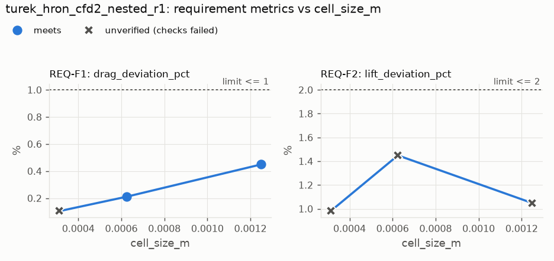
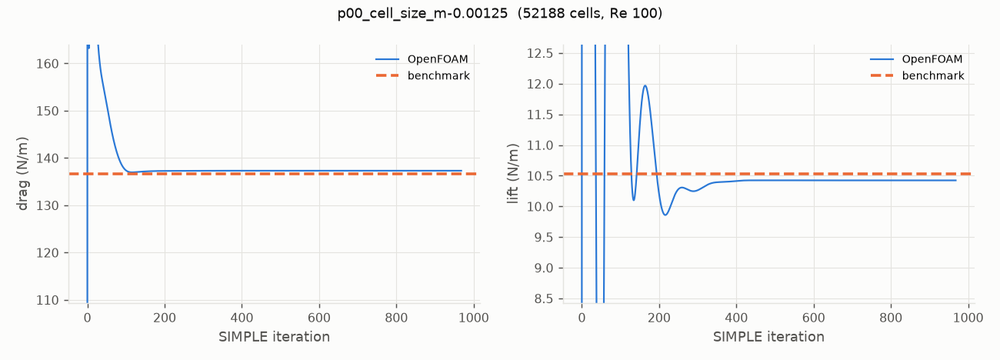
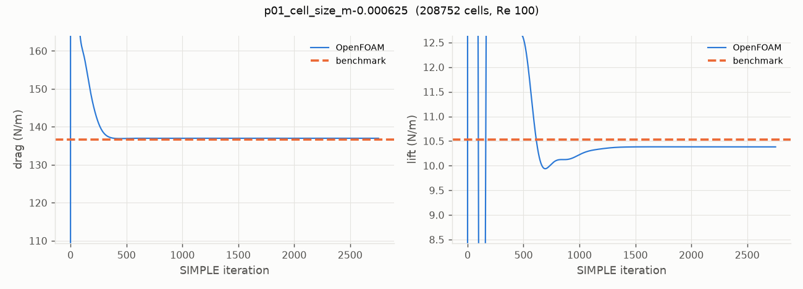
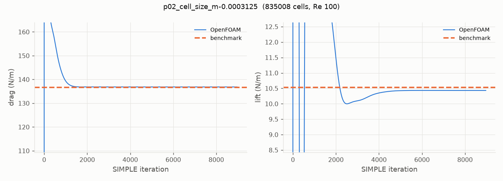

# Engineering review report: turek_hron_cfd2_nested_r1

- **Run:** `20261125-193110_turek_hron_cfd2_nested_r1`
- **Generated:** 2026-11-26T09:37:46+00:00
- **Case file SHA-256:** `5d3f846767b396b3cc8093cb1fdbae7cf9823a48ce9bff6ad1157683f0263517`
- **Environment:** Python 3.14.10, numpy 2.5.5, scipy 1.18.1, matplotlib 3.11.2, cadquery 2.8.0; Windows-11-10.0.26100-SP0
- **Tools:** openfoam_bashrc /opt/openfoam14/etc/bashrc; gmsh 4.15.0; openfoam_version 14; openfoam_package openfoam14 20261008; linux Ubuntu 22.04.5 LTS
- **Code version:** git `78adc4a0087c59eb7f584b0d905c2ee2f954eda6` (uncommitted changes present)
- **Simulation status:** completed
- **Verification status:** FAIL

> **Warning:** verification did not pass for every point. Requirement verdicts marked *(unverified)* are not supported by evidence and must not be used for acceptance.

## Scope

Turek-Hron CFD2: steady laminar flow (Re 100) in a 2.5 x 0.41 m channel round a cylinder (r 0.05 m) with a rigid 0.35 x 0.02 m flag; OpenFOAM 14 on NESTED Gmsh quad meshes (one 2.5 mm base split uniformly), body cell size 1.25 / 0.625 / 0.3125 mm; drag and lift against the published benchmark.

**Assumptions**

- 2D (one cell deep, empty front and back), as the benchmark defines it.
- Steady flow: the benchmark treats CFD2 (Re 100) as steady (the flag acts as a splitter plate); the SIMPLE residual targets and the settled force history check it.
- The flag is rigid and fixed (the CFD tests make it so by a huge stiffness and density).
- Inflow: the benchmark's parabolic profile at the full mean velocity (the steady tests have no time ramp).

## Requirements

| ID | Requirement | Metric | Limit |
|---|---|---|---|
| REQ-F1 | Before it is coupled to the solid, the fluid model shall reproduce the Turek-Hron CFD2 drag within 1 %. | `drag_deviation_pct` | <= 1 % |
| REQ-F2 | It shall reproduce the CFD2 lift within 2 % (lift is a small difference of large pressure forces, about 8 % of the drag). | `lift_deviation_pct` | <= 2 % |

## Summary across points

| Point | cell_size_m | REQ-F1 | REQ-F2 | Checks |
|---|---|---|---|---|
| p00_cell_size_m-0.00125 | 0.00125 | 0.4491 %: **PASS** | 1.048 %: **PASS (unverified)** | 8/8 PASS |
| p01_cell_size_m-0.000625 | 0.000625 | 0.2106 %: **PASS** | 1.449 %: **PASS (unverified)** | 8/8 PASS |
| p02_cell_size_m-0.0003125 | 0.0003125 | 0.1043 %: **PASS (unverified)** | 0.9805 %: **PASS (unverified)** | 7/8 FAIL |

## Run-level checks

Checks that use several points together (for example mesh convergence).

| Check | Description | Value | Tolerance | Status |
|---|---|---|---|---|
| discretization_drag_N_per_m | relative discretization uncertainty of drag_N_per_m, monotone (R = 0.446): GCI_fine, observed order 1.16, extrapolated 136.725 | 0.00107 | 0.01 | PASS |
| discretization_lift_N_per_m | relative discretization uncertainty of lift_N_per_m, divergent (oscillating, growing) (R = -1.168): no estimate | inf | 0.01 | FAIL |

A failed run-level check withholds the verdicts of requirements on `lift_deviation_pct` at every point: they are marked *(unverified)* in the table above.

## Point details

### p00_cell_size_m-0.00125

Parameters: mean_velocity_m_per_s = 1, kinematic_viscosity_m2_per_s = 0.001, density_kg_per_m3 = 1000, flag_length_m = 0.35, cell_size_m = 0.00125, benchmark_drag_N_per_m = 136.7, benchmark_lift_N_per_m = 10.53

Derived: reynolds_D = 100, dynamic_pressure_times_D_N_per_m = 50

| Requirement | Result | Limit | Margin | Verdict | Evidence |
|---|---|---|---|---|---|
| REQ-F1 | 0.4491 % | <= 1 | 0.551 | **PASS** | [point.json](points/p00_cell_size_m-0.00125/point.json) |
| REQ-F2 | 1.048 % | <= 2 | 0.952 | **PASS (unverified)** | [point.json](points/p00_cell_size_m-0.00125/point.json) |

| Check | Description | Value | Tolerance | Status |
|---|---|---|---|---|
| mesh | checkMesh reports Mesh OK (1 = failed) | 0.00e+00 | 0.5 | PASS |
| flag_cells | largest interior angle (deg) of the fluid cells touching the flag, at (0.3497, 0.2106) m (a cell wrapped around a tip corner reads near 180) | 1.16e+02 | 140 | PASS |
| converged | SIMPLE met its residual targets (1 = stopped at the iteration limit) | 0.00e+00 | 0.5 | PASS |
| forces_settled | max over drag and lift of the spread over the last 10 % of iterations / final value | 6.35e-08 | 1e-06 | PASS |
| inflow_profile | max over inlet faces \|U - benchmark parabola at the face centre\| / (1.5 U_mean) | 6.25e-08 | 1e-06 | PASS |
| flow_rate | \|inlet flow - U_mean H depth\| / (U_mean H depth) (midpoint sampling of the parabola on the inlet faces; shrinks with the mesh) | 7.33e-05 | 0.005 | PASS |
| mass_conservation | \|outlet flow - inlet flow\| / inlet flow | 1.51e-13 | 1e-06 | PASS |
| laminar (validity) | Reynolds number (D) / 200 (the benchmark's steady laminar range) | 5.00e-01 | 1 | PASS |

### p01_cell_size_m-0.000625

Parameters: mean_velocity_m_per_s = 1, kinematic_viscosity_m2_per_s = 0.001, density_kg_per_m3 = 1000, flag_length_m = 0.35, cell_size_m = 0.000625, benchmark_drag_N_per_m = 136.7, benchmark_lift_N_per_m = 10.53

Derived: reynolds_D = 100, dynamic_pressure_times_D_N_per_m = 50

| Requirement | Result | Limit | Margin | Verdict | Evidence |
|---|---|---|---|---|---|
| REQ-F1 | 0.2106 % | <= 1 | 0.789 | **PASS** | [point.json](points/p01_cell_size_m-0.000625/point.json) |
| REQ-F2 | 1.449 % | <= 2 | 0.551 | **PASS (unverified)** | [point.json](points/p01_cell_size_m-0.000625/point.json) |

| Check | Description | Value | Tolerance | Status |
|---|---|---|---|---|
| mesh | checkMesh reports Mesh OK (1 = failed) | 0.00e+00 | 0.5 | PASS |
| flag_cells | largest interior angle (deg) of the fluid cells touching the flag, at (0.3495, 0.2103) m (a cell wrapped around a tip corner reads near 180) | 1.16e+02 | 140 | PASS |
| converged | SIMPLE met its residual targets (1 = stopped at the iteration limit) | 0.00e+00 | 0.5 | PASS |
| forces_settled | max over drag and lift of the spread over the last 10 % of iterations / final value | 2.22e-07 | 1e-06 | PASS |
| inflow_profile | max over inlet faces \|U - benchmark parabola at the face centre\| / (1.5 U_mean) | 6.25e-08 | 1e-06 | PASS |
| flow_rate | \|inlet flow - U_mean H depth\| / (U_mean H depth) (midpoint sampling of the parabola on the inlet faces; shrinks with the mesh) | 1.83e-05 | 0.005 | PASS |
| mass_conservation | \|outlet flow - inlet flow\| / inlet flow | 1.07e-13 | 1e-06 | PASS |
| laminar (validity) | Reynolds number (D) / 200 (the benchmark's steady laminar range) | 5.00e-01 | 1 | PASS |

### p02_cell_size_m-0.0003125

Parameters: mean_velocity_m_per_s = 1, kinematic_viscosity_m2_per_s = 0.001, density_kg_per_m3 = 1000, flag_length_m = 0.35, cell_size_m = 0.0003125, benchmark_drag_N_per_m = 136.7, benchmark_lift_N_per_m = 10.53

Derived: reynolds_D = 100, dynamic_pressure_times_D_N_per_m = 50

| Requirement | Result | Limit | Margin | Verdict | Evidence |
|---|---|---|---|---|---|
| REQ-F1 | 0.1043 % | <= 1 | 0.896 | **PASS (unverified)** | [point.json](points/p02_cell_size_m-0.0003125/point.json) |
| REQ-F2 | 0.9805 % | <= 2 | 1.02 | **PASS (unverified)** | [point.json](points/p02_cell_size_m-0.0003125/point.json) |

| Check | Description | Value | Tolerance | Status |
|---|---|---|---|---|
| mesh | checkMesh reports Mesh OK (1 = failed) | 0.00e+00 | 0.5 | PASS |
| flag_cells | largest interior angle (deg) of the fluid cells touching the flag, at (0.3494, 0.2101) m (a cell wrapped around a tip corner reads near 180) | 1.16e+02 | 140 | PASS |
| converged | SIMPLE met its residual targets (1 = stopped at the iteration limit) | 0.00e+00 | 0.5 | PASS |
| forces_settled | max over drag and lift of the spread over the last 10 % of iterations / final value | 2.38e-06 | 1e-06 | FAIL |
| inflow_profile | max over inlet faces \|U - benchmark parabola at the face centre\| / (1.5 U_mean) | 6.25e-08 | 1e-06 | PASS |
| flow_rate | \|inlet flow - U_mean H depth\| / (U_mean H depth) (midpoint sampling of the parabola on the inlet faces; shrinks with the mesh) | 4.52e-06 | 0.005 | PASS |
| mass_conservation | \|outlet flow - inlet flow\| / inlet flow | 7.17e-14 | 1e-06 | PASS |
| laminar (validity) | Reynolds number (D) / 200 (the benchmark's steady laminar range) | 5.00e-01 | 1 | PASS |

## Limitations

- A solver-qualification case: it shows that the fluid participant reproduces the published fluid-only forces, not that the coupled result is right.
- Pressure outlet at 2.5 m as in the benchmark; no separate domain-length study.
- A converged solver run that matches an analytical reference shows that the equations were solved correctly. It does not show that the equations represent real hardware.

## Engineering acceptance

Pending human review. This report does not accept or reject the design.
