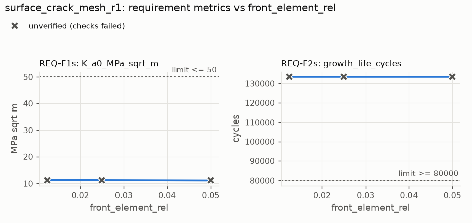
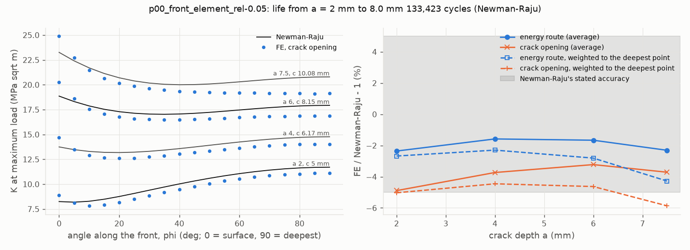
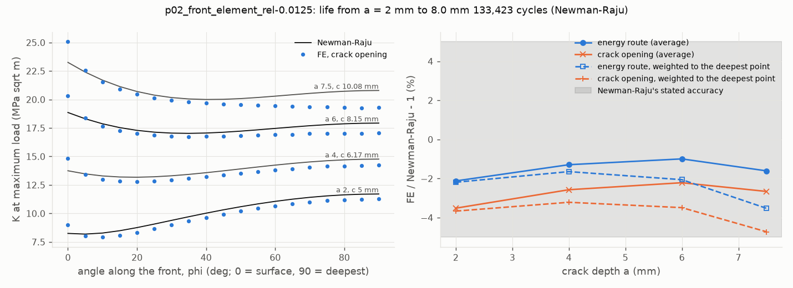

# Engineering review report: surface_crack_mesh_r1

- **Run:** `20261126-204858_surface_crack_mesh_r1`
- **Generated:** 2026-11-27T02:06:15+00:00
- **Case file SHA-256:** `c0681a48209249d325ce801dfc586330892fdff55e44523048b3da64a2605223`
- **Environment:** Python 3.14.10, numpy 2.5.5, scipy 1.18.1, matplotlib 3.11.2, cadquery 2.8.0; Windows-11-10.0.26100-SP0
- **Tools:** gmsh (Python API) 4.15.0; calculix This is Version 2.22
- **Code version:** git `4517c5249b53109a4d76f0515360a5304f12a35a` (uncommitted changes present)
- **Simulation status:** completed
- **Verification status:** FAIL

> **Warning:** verification did not pass for every point. Requirement verdicts marked *(unverified)* are not supported by evidence and must not be used for acceptance.

## Scope

Semi-elliptical surface crack in the S355 plate of part 1 (100 mm wide, 10 mm thick, 150 MPa maximum, R = 0.1): K along the crack front by 3D FE (CalculiX, Gmsh quarter model, quadratic tetrahedra refined at the front; energy release and crack opening) on four shapes of the growth path against Newman-Raju (BS 7910); growth life from the detectable flaw (2 mm deep, 10 mm long) to 0.8 t by the BS 7910 two-point procedure; front element size 0.05 / 0.025 / 0.0125 of the crack depth; revision 1: energy derivatives for a alone and c alone.

**Assumptions**

- Linear elastic fracture mechanics; plane strain along the front for K from the crack opening and for G = K^2 (1 - nu^2) / E (not at the free surface, where the surface point is reported, not checked). [model form]
- Uniform remote tension on the plate's ends, free to rotate, as in Newman and Raju's solution; quarter model by symmetry (crack plane and the crack's mid-plane), half height 100 mm (2 x the half width).
- Detectable flaw: 2 mm deep, 10 mm surface length (a/2c = 0.2) [synthetic: a client's inspection procedure would give the detectable length and the depth to assume].
- Crack growth by the BS 7910 / IIW simplified law for steels in air, as part 1, at the deepest and the surface point (BS 7910's two-point procedure); the crack stays semi-elliptical.
- Newman and Raju (1981), Engineering Fracture Mechanics 15, 185-192: K = sigma sqrt(pi a / Q) F, stated accuracy +-5 % for a/c <= 1, a/t < 0.8. [published]

## Requirements

| ID | Requirement | Metric | Limit |
|---|---|---|---|
| REQ-F1s | At the detectable surface flaw the maximum stress intensity (deepest point) shall not exceed half the fracture toughness (Kmat / 2 = 50 MPa sqrt m). | `K_a0_MPa_sqrt_m` | <= 50 MPa sqrt m |
| REQ-F2s | The crack growth life from the detectable surface flaw shall be at least twice the planned inspection interval of 40,000 cycles (lower bound: to a = 0.8 t). | `growth_life_cycles` | >= 80000 cycles |

## Summary across points

| Point | front_element_rel | REQ-F1s | REQ-F2s | Checks |
|---|---|---|---|---|
| p00_front_element_rel-0.05 | 0.05 | 11.13 MPa sqrt m: **PASS (unverified)** | 1.334e+05 cycles: **PASS (unverified)** | 11/12 FAIL |
| p01_front_element_rel-0.025 | 0.025 | 11.25 MPa sqrt m: **PASS (unverified)** | 1.334e+05 cycles: **PASS (unverified)** | 11/12 FAIL |
| p02_front_element_rel-0.0125 | 0.0125 | 11.27 MPa sqrt m: **PASS (unverified)** | 1.334e+05 cycles: **PASS (unverified)** | 11/12 FAIL |

## Run-level checks

Checks that use several points together (for example mesh convergence).

| Check | Description | Value | Tolerance | Status |
|---|---|---|---|---|
| discretization_K_a0_MPa_sqrt_m | relative discretization uncertainty of K_a0_MPa_sqrt_m, monotone (R = 0.133): GCI_fine, observed order 2.91, extrapolated 11.2731 | 0.000284 | 0.01 | PASS |
| discretization_energy_ratio_min | relative discretization uncertainty of energy_ratio_min, converged to within the noise floor (spread 2.4e-03 <= 0.0024) | 0.00147 | 0.01 | PASS |
| discretization_growth_life_fe_cycles | relative discretization uncertainty of growth_life_fe_cycles, monotone (R = 0.645): GCI_fine, observed order 0.63, extrapolated 138512 | 0.0105 | 0.01 | FAIL |
| discretization_deep_energy_ratio_min | relative discretization uncertainty of deep_energy_ratio_min, converged to within the noise floor (spread 7.8e-03 <= 0.0085) | 0.00486 | 0.01 | PASS |

A failed run-level check withholds the verdicts of requirements on `growth_life_fe_cycles` at every point: they are marked *(unverified)* in the table above.

## Point details

### p00_front_element_rel-0.05

Parameters: half_width_mm = 50, half_height_mm = 100, thickness_mm = 10, sigma_max_MPa = 150, stress_ratio = 0.1, youngs_modulus_MPa = 2.1e+05, poisson_ratio = 0.3, k_mat_MPa_sqrt_m = 100, paris_C = 5.21e-13, paris_m = 3, dK_threshold = 63, initial_depth_mm = 2, initial_half_length_mm = 5, end_depth_ratio = 0.8, front_element_rel = 0.05, far_element_size_mm = 5, edge_crack_life_cycles = 9.196e+04

| Requirement | Result | Limit | Margin | Verdict | Evidence |
|---|---|---|---|---|---|
| REQ-F1s | 11.13 MPa sqrt m | <= 50 | 38.9 | **PASS (unverified)** | [point.json](points/p00_front_element_rel-0.05/point.json) |
| REQ-F2s | 1.334e+05 cycles | >= 80000 | 5.34e+04 | **PASS (unverified)** | [point.json](points/p00_front_element_rel-0.05/point.json) |

| Check | Description | Value | Tolerance | Status |
|---|---|---|---|---|
| newman_raju | max \|K (FE energy route, front average) / Newman-Raju - 1\| over the crack shapes (Newman-Raju's stated accuracy 5 %) | 2.36e-02 | 0.05 | PASS |
| profile_shape | max over shapes of (max / min - 1) of K (crack opening) / Newman-Raju for phi >= 15.0 deg: the shape of K along the front | 6.10e-02 | 0.03 | FAIL |
| k_routes | max \|front-average K, crack opening / energy - 1\| over the shapes | 2.60e-02 | 0.03 | PASS |
| equilibrium | max \|ligament reaction + applied load\| / applied load | 0.00e+00 | 1e-06 | PASS |
| load_area | max \|sum of nodal loads / (sigma x loaded area) - 1\| | 0.00e+00 | 1e-06 | PASS |
| energy_step | \|K (energy, eps) / K (eps / 2) - 1\| at a = 2 mm (step and mesh noise) | 7.44e-04 | 0.005 | PASS |
| life_integral | \|life by DOP853 - by LSODA\| / DOP853 | 2.06e-09 | 0.0001 | PASS |
| nr_range (validity) | largest a/c on the path (Newman-Raju's equations used here hold for a/c <= 1) | 7.45e-01 | 1 | PASS |
| no_fracture_before_end (validity) | max K at the end depth / Kmat (below 1: the crack reaches 0.8 t before fracture, so the life to 0.8 t is a lower bound) | 2.49e-01 | 1 | PASS |
| energy_additivity | max \|dU/deps (a alone) + (c alone) - (a and c together)\| / together over the shapes (first-order consistency of the energy route, mesh noise included) | 5.96e-03 | 0.01 | PASS |
| deep_routes | max \|depth-weighted K (sin^2 phi), crack opening / energy - 1\| over the shapes: the opening route's profile towards the deepest point against an energy route | 2.42e-02 | 0.03 | PASS |
| equilibrium_weighted | max equilibrium error of the a-alone and c-alone solves | 0.00e+00 | 1e-06 | PASS |

### p01_front_element_rel-0.025

Parameters: half_width_mm = 50, half_height_mm = 100, thickness_mm = 10, sigma_max_MPa = 150, stress_ratio = 0.1, youngs_modulus_MPa = 2.1e+05, poisson_ratio = 0.3, k_mat_MPa_sqrt_m = 100, paris_C = 5.21e-13, paris_m = 3, dK_threshold = 63, initial_depth_mm = 2, initial_half_length_mm = 5, end_depth_ratio = 0.8, front_element_rel = 0.025, far_element_size_mm = 5, edge_crack_life_cycles = 9.196e+04

| Requirement | Result | Limit | Margin | Verdict | Evidence |
|---|---|---|---|---|---|
| REQ-F1s | 11.25 MPa sqrt m | <= 50 | 38.7 | **PASS (unverified)** | [point.json](points/p01_front_element_rel-0.025/point.json) |
| REQ-F2s | 1.334e+05 cycles | >= 80000 | 5.34e+04 | **PASS (unverified)** | [point.json](points/p01_front_element_rel-0.025/point.json) |

| Check | Description | Value | Tolerance | Status |
|---|---|---|---|---|
| newman_raju | max \|K (FE energy route, front average) / Newman-Raju - 1\| over the crack shapes (Newman-Raju's stated accuracy 5 %) | 2.26e-02 | 0.05 | PASS |
| profile_shape | max over shapes of (max / min - 1) of K (crack opening) / Newman-Raju for phi >= 15.0 deg: the shape of K along the front | 6.27e-02 | 0.03 | FAIL |
| k_routes | max \|front-average K, crack opening / energy - 1\| over the shapes | 1.77e-02 | 0.03 | PASS |
| equilibrium | max \|ligament reaction + applied load\| / applied load | 0.00e+00 | 1e-06 | PASS |
| load_area | max \|sum of nodal loads / (sigma x loaded area) - 1\| | 0.00e+00 | 1e-06 | PASS |
| energy_step | \|K (energy, eps) / K (eps / 2) - 1\| at a = 2 mm (step and mesh noise) | 2.34e-03 | 0.005 | PASS |
| life_integral | \|life by DOP853 - by LSODA\| / DOP853 | 2.06e-09 | 0.0001 | PASS |
| nr_range (validity) | largest a/c on the path (Newman-Raju's equations used here hold for a/c <= 1) | 7.45e-01 | 1 | PASS |
| no_fracture_before_end (validity) | max K at the end depth / Kmat (below 1: the crack reaches 0.8 t before fracture, so the life to 0.8 t is a lower bound) | 2.49e-01 | 1 | PASS |
| energy_additivity | max \|dU/deps (a alone) + (c alone) - (a and c together)\| / together over the shapes (first-order consistency of the energy route, mesh noise included) | 1.93e-03 | 0.01 | PASS |
| deep_routes | max \|depth-weighted K (sin^2 phi), crack opening / energy - 1\| over the shapes: the opening route's profile towards the deepest point against an energy route | 1.85e-02 | 0.03 | PASS |
| equilibrium_weighted | max equilibrium error of the a-alone and c-alone solves | 0.00e+00 | 1e-06 | PASS |

### p02_front_element_rel-0.0125

Parameters: half_width_mm = 50, half_height_mm = 100, thickness_mm = 10, sigma_max_MPa = 150, stress_ratio = 0.1, youngs_modulus_MPa = 2.1e+05, poisson_ratio = 0.3, k_mat_MPa_sqrt_m = 100, paris_C = 5.21e-13, paris_m = 3, dK_threshold = 63, initial_depth_mm = 2, initial_half_length_mm = 5, end_depth_ratio = 0.8, front_element_rel = 0.0125, far_element_size_mm = 5, edge_crack_life_cycles = 9.196e+04

| Requirement | Result | Limit | Margin | Verdict | Evidence |
|---|---|---|---|---|---|
| REQ-F1s | 11.27 MPa sqrt m | <= 50 | 38.7 | **PASS (unverified)** | [point.json](points/p02_front_element_rel-0.0125/point.json) |
| REQ-F2s | 1.334e+05 cycles | >= 80000 | 5.34e+04 | **PASS (unverified)** | [point.json](points/p02_front_element_rel-0.0125/point.json) |

| Check | Description | Value | Tolerance | Status |
|---|---|---|---|---|
| newman_raju | max \|K (FE energy route, front average) / Newman-Raju - 1\| over the crack shapes (Newman-Raju's stated accuracy 5 %) | 2.13e-02 | 0.05 | PASS |
| profile_shape | max over shapes of (max / min - 1) of K (crack opening) / Newman-Raju for phi >= 15.0 deg: the shape of K along the front | 6.71e-02 | 0.03 | FAIL |
| k_routes | max \|front-average K, crack opening / energy - 1\| over the shapes | 1.42e-02 | 0.03 | PASS |
| equilibrium | max \|ligament reaction + applied load\| / applied load | 0.00e+00 | 1e-06 | PASS |
| load_area | max \|sum of nodal loads / (sigma x loaded area) - 1\| | 0.00e+00 | 1e-06 | PASS |
| energy_step | \|K (energy, eps) / K (eps / 2) - 1\| at a = 2 mm (step and mesh noise) | 3.30e-04 | 0.005 | PASS |
| life_integral | \|life by DOP853 - by LSODA\| / DOP853 | 2.06e-09 | 0.0001 | PASS |
| nr_range (validity) | largest a/c on the path (Newman-Raju's equations used here hold for a/c <= 1) | 7.45e-01 | 1 | PASS |
| no_fracture_before_end (validity) | max K at the end depth / Kmat (below 1: the crack reaches 0.8 t before fracture, so the life to 0.8 t is a lower bound) | 2.49e-01 | 1 | PASS |
| energy_additivity | max \|dU/deps (a alone) + (c alone) - (a and c together)\| / together over the shapes (first-order consistency of the energy route, mesh noise included) | 2.12e-03 | 0.01 | PASS |
| deep_routes | max \|depth-weighted K (sin^2 phi), crack opening / energy - 1\| over the shapes: the opening route's profile towards the deepest point against an energy route | 1.60e-02 | 0.03 | PASS |
| equilibrium_weighted | max equilibrium error of the a-alone and c-alone solves | 0.00e+00 | 1e-06 | PASS |

## Limitations

- The life stops at a = 0.8 t (end of Newman-Raju's range): breakthrough and the through crack's growth are left out, so it is a lower bound.
- No crack closure, sequence effects or environment; no residual stress (a weld toe would need it).
- The FE checks Newman-Raju at four shapes on the path; between them the ratio is interpolated linearly in a.
- A converged solver run that matches an analytical reference shows that the equations were solved correctly. It does not show that the equations represent real hardware.

## Engineering acceptance

Pending human review. This report does not accept or reject the design.
