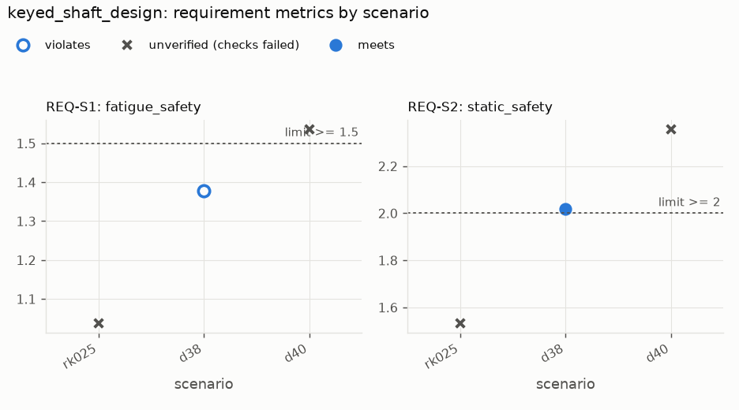

# Engineering review report: keyed_shaft_design

- **Run:** `20261127-000418_keyed_shaft_design`
- **Generated:** 2026-11-27T05:27:56+00:00
- **Case file SHA-256:** `9346c7e6c0c3b6d81a81af3668faea4df89763d3481c944481ed2f8079865784`
- **Environment:** Python 3.14.10, numpy 2.5.5, scipy 1.18.1, matplotlib 3.11.2, cadquery 2.8.0; Windows-11-10.0.26100-SP0
- **Tools:** cadquery 2.8.0; gmsh (Python API) 4.15.0; calculix This is Version 2.22
- **Code version:** git `79df3dae3bed8ed11eb3f92ceeb03a8a98c612fb` (uncommitted changes present)
- **Simulation status:** completed
- **Verification status:** FAIL

> **Warning:** verification did not pass for every point. Requirement verdicts marked *(unverified)* are not supported by evidence and must not be used for acceptance.

## Scope

Keyed gear seat (study 26 part 2): the keyway's lower corner radius (0.25 mm) on the 36 mm seat, and the seats that might pass with their DIN keyways: 38 mm (10 x 8, D 47.5) and 40 mm (12 x 8, D 50), fillet at the lower tolerance (0.05 d - 0.2 mm), as part 1 scaled the step; mesh scale 0.8.

**Assumptions**

- Linear elastic, small strain; Kt from gross nominal stresses at the small diameter; the fatigue and overload checks of part 1 (Shigley: Marin factors, Neuber notch sensitivity with each feature's own radius, von Mises combination, modified Goodman; Kf applied to the overload).
- Rotating bending 300 N m (fully reversed) and steady torque 500 N m act at the keyway as at the fillet (the keyway's end is 2 mm from the fillet; conservative).
- The key's bearing pressure on the keyway wall and any press fit of the gear are not modelled (Shigley's practice for keyseat factors).
- DIN 6885 form A keyway dimensions from published reproductions of the table (the current DIN 6885-1:2021 was not read); corner radius 0.25-0.40 mm.

## Requirements

| ID | Requirement | Metric | Limit |
|---|---|---|---|
| REQ-S1 | The fatigue safety factor (modified Goodman, Shigley's method) shall be at least 1.5 at the shoulder fillet and at the keyway. | `fatigue_safety` | >= 1.5  |
| REQ-S2 | The first-cycle yield safety factor at a 1.5 x overload shall be at least 2.0 at the shoulder fillet and at the keyway. | `static_safety` | >= 2  |

## Summary across points

| Point | scenario | REQ-S1 | REQ-S2 | Checks |
|---|---|---|---|---|
| p00_rk025 | rk025 | 1.038 : **FAIL (unverified)** | 1.533 : **FAIL (unverified)** | 6/7 FAIL |
| p01_d38 | d38 | 1.377 : **FAIL** | 2.017 : **PASS** | 7/7 PASS |
| p02_d40 | d40 | 1.535 : **PASS (unverified)** | 2.355 : **PASS (unverified)** | 6/7 FAIL |

## Point details

### p00_rk025

Parameters: D_mm = 45, d_mm = 36, fillet_radius_mm = 1.6, small_length_mm = 90, large_length_mm = 60, bending_moment_Nm = 300, torque_Nm = 500, youngs_modulus_MPa = 2.1e+05, poisson_ratio = 0.3, ultimate_MPa = 1000, yield_MPa = 750, overload_factor = 1.5, key_width_mm = 10, key_depth_mm = 5, key_corner_radius_mm = 0.25, key_gap_mm = 2, key_length_mm = 40, global_key_size_mm = 0.3, global_fillet_size_mm = 0.5, far_size_mm = 4, sub_key_size_rel = 0.333, sub_fillet_size_mm = 0.2, mesh_scale = 0.8, box_margin_mm = 3, kt_reference_bending = 0, kt_reference_torsion = 0, kt_key_reference_bending = 0, kt_key_reference_torsion = 0, scenario = rk025

| Requirement | Result | Limit | Margin | Verdict | Evidence |
|---|---|---|---|---|---|
| REQ-S1 | 1.038  | >= 1.5 | -0.462 | **FAIL (unverified)** | [point.json](points/p00_rk025/point.json) |
| REQ-S2 | 1.533  | >= 2 | -0.467 | **FAIL (unverified)** | [point.json](points/p00_rk025/point.json) |

| Check | Description | Value | Tolerance | Status |
|---|---|---|---|---|
| equilibrium_bending | global model: \|clamp reaction moment - applied\| / target (bending) | 5.78e-08 | 1e-06 | PASS |
| equilibrium_torsion | global model: \|clamp reaction moment - applied\| / target (torsion) | 1.32e-07 | 1e-06 | PASS |
| load_bending | \|applied end moment\| against the target (bending; the end face's moment is -T about z by the outward normal, so magnitudes are compared; 7-point rule on curved faces) | 8.01e-06 | 0.0001 | PASS |
| load_torsion | \|applied end moment\| against the target (torsion; the end face's moment is -T about z by the outward normal, so magnitudes are compared; 7-point rule on curved faces) | 8.01e-06 | 0.0001 | PASS |
| global_vs_sub_fillet_bending | fillet Kt, global model against its submodel (bending): the global mesh resolves the fillet, so the two must agree | 5.56e-03 | 0.02 | PASS |
| global_vs_sub_fillet_torsion | fillet Kt, global model against its submodel (torsion): the global mesh resolves the fillet, so the two must agree | 1.52e-02 | 0.02 | PASS |
| mesh_quality (validity) | 0.1 - the smallest scaled Jacobian over the global and submodel meshes (at or below 0: every element above the threshold) | 2.81e-01 | 0 | FAIL |

### p01_d38

Parameters: D_mm = 47.5, d_mm = 38, fillet_radius_mm = 1.7, small_length_mm = 90, large_length_mm = 60, bending_moment_Nm = 300, torque_Nm = 500, youngs_modulus_MPa = 2.1e+05, poisson_ratio = 0.3, ultimate_MPa = 1000, yield_MPa = 750, overload_factor = 1.5, key_width_mm = 10, key_depth_mm = 5, key_corner_radius_mm = 0.4, key_gap_mm = 2, key_length_mm = 40, global_key_size_mm = 0.3, global_fillet_size_mm = 0.5, far_size_mm = 4, sub_key_size_rel = 0.333, sub_fillet_size_mm = 0.2, mesh_scale = 0.8, box_margin_mm = 3, kt_reference_bending = 0, kt_reference_torsion = 0, kt_key_reference_bending = 0, kt_key_reference_torsion = 0, scenario = d38

| Requirement | Result | Limit | Margin | Verdict | Evidence |
|---|---|---|---|---|---|
| REQ-S1 | 1.377  | >= 1.5 | -0.123 | **FAIL** | [point.json](points/p01_d38/point.json) |
| REQ-S2 | 2.017  | >= 2 | 0.017 | **PASS** | [point.json](points/p01_d38/point.json) |

| Check | Description | Value | Tolerance | Status |
|---|---|---|---|---|
| equilibrium_bending | global model: \|clamp reaction moment - applied\| / target (bending) | 1.20e-07 | 1e-06 | PASS |
| equilibrium_torsion | global model: \|clamp reaction moment - applied\| / target (torsion) | 1.10e-07 | 1e-06 | PASS |
| load_bending | \|applied end moment\| against the target (bending; the end face's moment is -T about z by the outward normal, so magnitudes are compared; 7-point rule on curved faces) | 8.01e-06 | 0.0001 | PASS |
| load_torsion | \|applied end moment\| against the target (torsion; the end face's moment is -T about z by the outward normal, so magnitudes are compared; 7-point rule on curved faces) | 8.01e-06 | 0.0001 | PASS |
| global_vs_sub_fillet_bending | fillet Kt, global model against its submodel (bending): the global mesh resolves the fillet, so the two must agree | 9.74e-03 | 0.02 | PASS |
| global_vs_sub_fillet_torsion | fillet Kt, global model against its submodel (torsion): the global mesh resolves the fillet, so the two must agree | 8.01e-03 | 0.02 | PASS |
| mesh_quality (validity) | 0.1 - the smallest scaled Jacobian over the global and submodel meshes (at or below 0: every element above the threshold) | -3.41e-01 | 0 | PASS |

### p02_d40

Parameters: D_mm = 50, d_mm = 40, fillet_radius_mm = 1.8, small_length_mm = 90, large_length_mm = 60, bending_moment_Nm = 300, torque_Nm = 500, youngs_modulus_MPa = 2.1e+05, poisson_ratio = 0.3, ultimate_MPa = 1000, yield_MPa = 750, overload_factor = 1.5, key_width_mm = 12, key_depth_mm = 5, key_corner_radius_mm = 0.4, key_gap_mm = 2, key_length_mm = 40, global_key_size_mm = 0.3, global_fillet_size_mm = 0.5, far_size_mm = 4, sub_key_size_rel = 0.333, sub_fillet_size_mm = 0.2, mesh_scale = 0.8, box_margin_mm = 3, kt_reference_bending = 0, kt_reference_torsion = 0, kt_key_reference_bending = 0, kt_key_reference_torsion = 0, scenario = d40

| Requirement | Result | Limit | Margin | Verdict | Evidence |
|---|---|---|---|---|---|
| REQ-S1 | 1.535  | >= 1.5 | 0.0355 | **PASS (unverified)** | [point.json](points/p02_d40/point.json) |
| REQ-S2 | 2.355  | >= 2 | 0.355 | **PASS (unverified)** | [point.json](points/p02_d40/point.json) |

| Check | Description | Value | Tolerance | Status |
|---|---|---|---|---|
| equilibrium_bending | global model: \|clamp reaction moment - applied\| / target (bending) | 9.03e-08 | 1e-06 | PASS |
| equilibrium_torsion | global model: \|clamp reaction moment - applied\| / target (torsion) | 7.26e-08 | 1e-06 | PASS |
| load_bending | \|applied end moment\| against the target (bending; the end face's moment is -T about z by the outward normal, so magnitudes are compared; 7-point rule on curved faces) | 6.19e-06 | 0.0001 | PASS |
| load_torsion | \|applied end moment\| against the target (torsion; the end face's moment is -T about z by the outward normal, so magnitudes are compared; 7-point rule on curved faces) | 6.19e-06 | 0.0001 | PASS |
| global_vs_sub_fillet_bending | fillet Kt, global model against its submodel (bending): the global mesh resolves the fillet, so the two must agree | 5.72e-03 | 0.02 | PASS |
| global_vs_sub_fillet_torsion | fillet Kt, global model against its submodel (torsion): the global mesh resolves the fillet, so the two must agree | 6.44e-02 | 0.02 | FAIL |
| mesh_quality (validity) | 0.1 - the smallest scaled Jacobian over the global and submodel meshes (at or below 0: every element above the threshold) | -3.25e-01 | 0 | PASS |

## Limitations

- Submodels driven by a coarse global model; their boxes keep 3 mm (or more) of material between the keyway's corners and the cut faces.
- Stress at nodes (CalculiX's extrapolation, averaged), as part 1.
- A converged solver run that matches an analytical reference shows that the equations were solved correctly. It does not show that the equations represent real hardware.

## Engineering acceptance

Pending human review. This report does not accept or reject the design.
