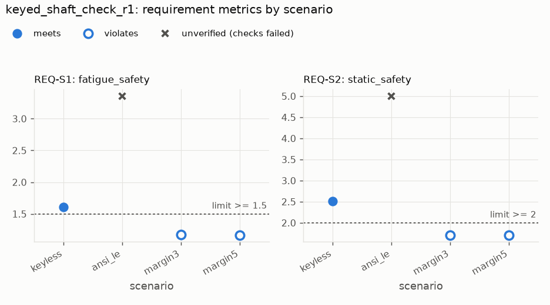

# Engineering review report: keyed_shaft_check_r1

- **Run:** `20261127-015248_keyed_shaft_check_r1`
- **Generated:** 2026-11-27T07:11:41+00:00
- **Case file SHA-256:** `72a376f1ab08c85d1f24d7486eb398f0e46d3158d548c5c8c60ad92a0c541657`
- **Environment:** Python 3.14.10, numpy 2.5.5, scipy 1.18.1, matplotlib 3.11.2, cadquery 2.8.0; Windows-11-10.0.26100-SP0
- **Tools:** cadquery 2.8.0; gmsh (Python API) 4.15.0; calculix This is Version 2.22
- **Code version:** git `036a12042c0e44fe8fad68bdd9fd0ec399b5dc6f` (uncommitted changes present)
- **Simulation status:** completed
- **Verification status:** FAIL

> **Warning:** verification did not pass for every point. Requirement verdicts marked *(unverified)* are not supported by evidence and must not be used for acceptance.

## Scope

Checks of the keyed-shaft model, r1 (study 26 part 2): the keyless 36 mm shaft through the global-submodel path against part 1's verified fillet Kt; Le and Le's isolated ANSI profile keyseat (principal and axial bending stress); the DIN keyed shaft with boxes 3 and 5 mm clear.

**Assumptions**

- Linear elastic, small strain; Kt from gross nominal stresses at the small diameter; the fatigue and overload checks of part 1 (Shigley: Marin factors, Neuber notch sensitivity with each feature's own radius, von Mises combination, modified Goodman; Kf applied to the overload).
- Rotating bending 300 N m (fully reversed) and steady torque 500 N m act at the keyway as at the fillet (the keyway's end is 2 mm from the fillet; conservative).
- The key's bearing pressure on the keyway wall and any press fit of the gear are not modelled (Shigley's practice for keyseat factors).
- DIN 6885 form A keyway dimensions from published reproductions of the table (the current DIN 6885-1:2021 was not read); corner radius 0.25-0.40 mm.

## Requirements

| ID | Requirement | Metric | Limit |
|---|---|---|---|
| REQ-S1 | The fatigue safety factor (modified Goodman, Shigley's method) shall be at least 1.5 at the shoulder fillet and at the keyway. | `fatigue_safety` | >= 1.5  |
| REQ-S2 | The first-cycle yield safety factor at a 1.5 x overload shall be at least 2.0 at the shoulder fillet and at the keyway. | `static_safety` | >= 2  |

## Summary across points

| Point | scenario | REQ-S1 | REQ-S2 | Checks |
|---|---|---|---|---|
| p00_keyless | keyless | 1.612 : **PASS** | 2.509 : **PASS** | 9/9 PASS |
| p01_ansi_le | ansi_le | 3.355 : **PASS (unverified)** | 5.001 : **PASS (unverified)** | 8/9 FAIL |
| p02_margin3 | margin3 | 1.174 : **FAIL** | 1.713 : **FAIL** | 7/7 PASS |
| p03_margin5 | margin5 | 1.168 : **FAIL** | 1.712 : **FAIL** | 7/7 PASS |

## Point details

### p00_keyless

Parameters: D_mm = 45, d_mm = 36, fillet_radius_mm = 1.6, small_length_mm = 90, large_length_mm = 60, bending_moment_Nm = 300, torque_Nm = 500, youngs_modulus_MPa = 2.1e+05, poisson_ratio = 0.3, ultimate_MPa = 1000, yield_MPa = 750, overload_factor = 1.5, key_width_mm = 0, key_depth_mm = 5, key_corner_radius_mm = 0.4, key_gap_mm = 2, key_length_mm = 40, global_key_size_mm = 0.3, global_fillet_size_mm = 0.5, far_size_mm = 4, sub_key_size_rel = 0.333, sub_fillet_size_mm = 0.2, mesh_scale = 0.5, box_margin_mm = 3, sub_far_size_mm = 1.5, kt_reference_bending = 2.225, kt_reference_torsion = 1.592, kt_key_reference_bending = 0, kt_key_reference_torsion = 0, scenario = keyless

| Requirement | Result | Limit | Margin | Verdict | Evidence |
|---|---|---|---|---|---|
| REQ-S1 | 1.612  | >= 1.5 | 0.112 | **PASS** | [point.json](points/p00_keyless/point.json) |
| REQ-S2 | 2.509  | >= 2 | 0.509 | **PASS** | [point.json](points/p00_keyless/point.json) |

| Check | Description | Value | Tolerance | Status |
|---|---|---|---|---|
| equilibrium_bending | global model: \|clamp reaction moment - applied\| / target (bending) | 9.92e-09 | 1e-06 | PASS |
| equilibrium_torsion | global model: \|clamp reaction moment - applied\| / target (torsion) | 1.19e-07 | 1e-06 | PASS |
| load_bending | \|applied end moment\| against the target (bending; the end face's moment is -T about z by the outward normal, so magnitudes are compared; 7-point rule on curved faces) | 8.01e-06 | 0.0001 | PASS |
| load_torsion | \|applied end moment\| against the target (torsion; the end face's moment is -T about z by the outward normal, so magnitudes are compared; 7-point rule on curved faces) | 8.01e-06 | 0.0001 | PASS |
| global_vs_sub_fillet_bending | fillet Kt, global model against its submodel (bending): the global mesh resolves the fillet, so the two must agree | 4.31e-04 | 0.02 | PASS |
| global_vs_sub_fillet_torsion | fillet Kt, global model against its submodel (torsion): the global mesh resolves the fillet, so the two must agree | 1.59e-02 | 0.02 | PASS |
| mesh_quality (validity) | 0.1 - the smallest scaled Jacobian over the global and submodel meshes (at or below 0: every element above the threshold) | -6.47e-01 | 0 | PASS |
| part1_bending | fillet Kt against part 1's verified value (bending) | 3.89e-03 | 0.01 | PASS |
| part1_torsion | fillet Kt against part 1's verified value (torsion) | 4.40e-03 | 0.01 | PASS |

### p01_ansi_le

Parameters: D_mm = 63.5, d_mm = 50.8, fillet_radius_mm = 2.54, small_length_mm = 180, large_length_mm = 60, bending_moment_Nm = 300, torque_Nm = 500, youngs_modulus_MPa = 2.1e+05, poisson_ratio = 0.3, ultimate_MPa = 1000, yield_MPa = 750, overload_factor = 1.5, key_width_mm = 12.7, key_depth_mm = 6.35, key_corner_radius_mm = 0.635, key_gap_mm = 20, key_length_mm = 50.8, global_key_size_mm = 0.45, global_fillet_size_mm = 0.7, far_size_mm = 4, sub_key_size_rel = 0.333, sub_fillet_size_mm = 0.3, mesh_scale = 0.8, box_margin_mm = 3, sub_far_size_mm = 1.5, kt_reference_bending = 0, kt_reference_torsion = 0, kt_key_reference_bending = 2.56, kt_key_reference_torsion = 2.511, scenario = ansi_le

| Requirement | Result | Limit | Margin | Verdict | Evidence |
|---|---|---|---|---|---|
| REQ-S1 | 3.355  | >= 1.5 | 1.86 | **PASS (unverified)** | [point.json](points/p01_ansi_le/point.json) |
| REQ-S2 | 5.001  | >= 2 | 3 | **PASS (unverified)** | [point.json](points/p01_ansi_le/point.json) |

| Check | Description | Value | Tolerance | Status |
|---|---|---|---|---|
| equilibrium_bending | global model: \|clamp reaction moment - applied\| / target (bending) | 3.24e-08 | 1e-06 | PASS |
| equilibrium_torsion | global model: \|clamp reaction moment - applied\| / target (torsion) | 3.35e-08 | 1e-06 | PASS |
| load_bending | \|applied end moment\| against the target (bending; the end face's moment is -T about z by the outward normal, so magnitudes are compared; 7-point rule on curved faces) | 2.54e-06 | 0.0001 | PASS |
| load_torsion | \|applied end moment\| against the target (torsion; the end face's moment is -T about z by the outward normal, so magnitudes are compared; 7-point rule on curved faces) | 2.54e-06 | 0.0001 | PASS |
| global_vs_sub_fillet_bending | fillet Kt, global model against its submodel (bending): the global mesh resolves the fillet, so the two must agree | 9.85e-03 | 0.02 | PASS |
| global_vs_sub_fillet_torsion | fillet Kt, global model against its submodel (torsion): the global mesh resolves the fillet, so the two must agree | 1.61e-03 | 0.02 | PASS |
| mesh_quality (validity) | 0.1 - the smallest scaled Jacobian over the global and submodel meshes (at or below 0: every element above the threshold) | -4.23e-01 | 0 | PASS |
| keyseat_reference_bending | kt_key_bending_far against Le and Le's FE value (bending) | 1.40e-01 | 0.05 | FAIL |
| keyseat_reference_torsion | kt_key_torsion_middle against Le and Le's FE value (torsion) | 4.17e-02 | 0.05 | PASS |

### p02_margin3

Parameters: D_mm = 45, d_mm = 36, fillet_radius_mm = 1.6, small_length_mm = 90, large_length_mm = 60, bending_moment_Nm = 300, torque_Nm = 500, youngs_modulus_MPa = 2.1e+05, poisson_ratio = 0.3, ultimate_MPa = 1000, yield_MPa = 750, overload_factor = 1.5, key_width_mm = 10, key_depth_mm = 5, key_corner_radius_mm = 0.4, key_gap_mm = 2, key_length_mm = 40, global_key_size_mm = 0.3, global_fillet_size_mm = 0.5, far_size_mm = 4, sub_key_size_rel = 0.333, sub_fillet_size_mm = 0.2, mesh_scale = 1, box_margin_mm = 3, sub_far_size_mm = 1.5, kt_reference_bending = 0, kt_reference_torsion = 0, kt_key_reference_bending = 0, kt_key_reference_torsion = 0, scenario = margin3

| Requirement | Result | Limit | Margin | Verdict | Evidence |
|---|---|---|---|---|---|
| REQ-S1 | 1.174  | >= 1.5 | -0.326 | **FAIL** | [point.json](points/p02_margin3/point.json) |
| REQ-S2 | 1.713  | >= 2 | -0.287 | **FAIL** | [point.json](points/p02_margin3/point.json) |

| Check | Description | Value | Tolerance | Status |
|---|---|---|---|---|
| equilibrium_bending | global model: \|clamp reaction moment - applied\| / target (bending) | 1.65e-08 | 1e-06 | PASS |
| equilibrium_torsion | global model: \|clamp reaction moment - applied\| / target (torsion) | 1.25e-07 | 1e-06 | PASS |
| load_bending | \|applied end moment\| against the target (bending; the end face's moment is -T about z by the outward normal, so magnitudes are compared; 7-point rule on curved faces) | 8.01e-06 | 0.0001 | PASS |
| load_torsion | \|applied end moment\| against the target (torsion; the end face's moment is -T about z by the outward normal, so magnitudes are compared; 7-point rule on curved faces) | 8.01e-06 | 0.0001 | PASS |
| global_vs_sub_fillet_bending | fillet Kt, global model against its submodel (bending): the global mesh resolves the fillet, so the two must agree | 2.11e-03 | 0.02 | PASS |
| global_vs_sub_fillet_torsion | fillet Kt, global model against its submodel (torsion): the global mesh resolves the fillet, so the two must agree | 3.01e-03 | 0.02 | PASS |
| mesh_quality (validity) | 0.1 - the smallest scaled Jacobian over the global and submodel meshes (at or below 0: every element above the threshold) | -3.27e-01 | 0 | PASS |

### p03_margin5

Parameters: D_mm = 45, d_mm = 36, fillet_radius_mm = 1.6, small_length_mm = 90, large_length_mm = 60, bending_moment_Nm = 300, torque_Nm = 500, youngs_modulus_MPa = 2.1e+05, poisson_ratio = 0.3, ultimate_MPa = 1000, yield_MPa = 750, overload_factor = 1.5, key_width_mm = 10, key_depth_mm = 5, key_corner_radius_mm = 0.4, key_gap_mm = 2, key_length_mm = 40, global_key_size_mm = 0.3, global_fillet_size_mm = 0.5, far_size_mm = 4, sub_key_size_rel = 0.333, sub_fillet_size_mm = 0.2, mesh_scale = 1, box_margin_mm = 5, sub_far_size_mm = 1.5, kt_reference_bending = 0, kt_reference_torsion = 0, kt_key_reference_bending = 0, kt_key_reference_torsion = 0, scenario = margin5

| Requirement | Result | Limit | Margin | Verdict | Evidence |
|---|---|---|---|---|---|
| REQ-S1 | 1.168  | >= 1.5 | -0.332 | **FAIL** | [point.json](points/p03_margin5/point.json) |
| REQ-S2 | 1.712  | >= 2 | -0.288 | **FAIL** | [point.json](points/p03_margin5/point.json) |

| Check | Description | Value | Tolerance | Status |
|---|---|---|---|---|
| equilibrium_bending | global model: \|clamp reaction moment - applied\| / target (bending) | 1.65e-08 | 1e-06 | PASS |
| equilibrium_torsion | global model: \|clamp reaction moment - applied\| / target (torsion) | 1.25e-07 | 1e-06 | PASS |
| load_bending | \|applied end moment\| against the target (bending; the end face's moment is -T about z by the outward normal, so magnitudes are compared; 7-point rule on curved faces) | 8.01e-06 | 0.0001 | PASS |
| load_torsion | \|applied end moment\| against the target (torsion; the end face's moment is -T about z by the outward normal, so magnitudes are compared; 7-point rule on curved faces) | 8.01e-06 | 0.0001 | PASS |
| global_vs_sub_fillet_bending | fillet Kt, global model against its submodel (bending): the global mesh resolves the fillet, so the two must agree | 9.35e-04 | 0.02 | PASS |
| global_vs_sub_fillet_torsion | fillet Kt, global model against its submodel (torsion): the global mesh resolves the fillet, so the two must agree | 3.56e-03 | 0.02 | PASS |
| mesh_quality (validity) | 0.1 - the smallest scaled Jacobian over the global and submodel meshes (at or below 0: every element above the threshold) | -3.27e-01 | 0 | PASS |

## Limitations

- Submodels driven by a coarse global model; their boxes keep 3 mm (or more) of material between the keyway's corners and the cut faces.
- Stress at nodes (CalculiX's extrapolation, averaged), as part 1.
- A converged solver run that matches an analytical reference shows that the equations were solved correctly. It does not show that the equations represent real hardware.

## Engineering acceptance

Pending human review. This report does not accept or reject the design.
