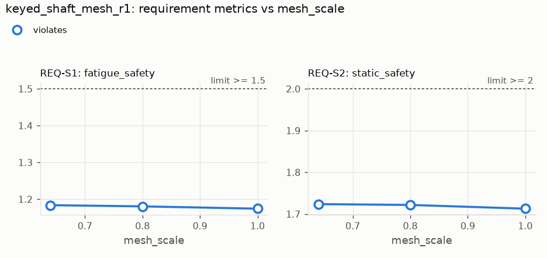

# Engineering review report: keyed_shaft_mesh_r1

- **Run:** `20261127-031958_keyed_shaft_mesh_r1`
- **Generated:** 2026-11-27T08:58:02+00:00
- **Case file SHA-256:** `343138bd8c377f68e67bf847325e98519b51f47948aee876b5fcf64b8ebe491f`
- **Environment:** Python 3.14.10, numpy 2.5.5, scipy 1.18.1, matplotlib 3.11.2, cadquery 2.8.0; Windows-11-10.0.26100-SP0
- **Tools:** cadquery 2.8.0; gmsh (Python API) 4.15.0; calculix This is Version 2.22
- **Code version:** git `48397d0afa59b4e7bf8052719049fa23f95072cc` (uncommitted changes present)
- **Simulation status:** completed
- **Verification status:** PASS

## Scope

Keyed gear seat (study 26 part 2, r1): the mesh study with the half-ring fillet submodels; submodel mesh scale 1.0 / 0.8 / 0.64 against the measured noise floors.

**Assumptions**

- Linear elastic, small strain; Kt from gross nominal stresses at the small diameter; the fatigue and overload checks of part 1 (Shigley: Marin factors, Neuber notch sensitivity with each feature's own radius, von Mises combination, modified Goodman; Kf applied to the overload).
- Rotating bending 300 N m (fully reversed) and steady torque 500 N m act at the keyway as at the fillet (the keyway's end is 2 mm from the fillet; conservative).
- The key's bearing pressure on the keyway wall and any press fit of the gear are not modelled (Shigley's practice for keyseat factors).
- DIN 6885 form A keyway dimensions from published reproductions of the table (the current DIN 6885-1:2021 was not read); corner radius 0.25-0.40 mm.

## Requirements

| ID | Requirement | Metric | Limit |
|---|---|---|---|
| REQ-S1 | The fatigue safety factor (modified Goodman, Shigley's method) shall be at least 1.5 at the shoulder fillet and at the keyway. | `fatigue_safety` | >= 1.5  |
| REQ-S2 | The first-cycle yield safety factor at a 1.5 x overload shall be at least 2.0 at the shoulder fillet and at the keyway. | `static_safety` | >= 2  |

## Summary across points

| Point | mesh_scale | REQ-S1 | REQ-S2 | Checks |
|---|---|---|---|---|
| p00_mesh_scale-1 | 1 | 1.174 : **FAIL** | 1.713 : **FAIL** | 7/7 PASS |
| p01_mesh_scale-0.8 | 0.8 | 1.18 : **FAIL** | 1.722 : **FAIL** | 7/7 PASS |
| p02_mesh_scale-0.64 | 0.64 | 1.184 : **FAIL** | 1.724 : **FAIL** | 7/7 PASS |

## Run-level checks

Checks that use several points together (for example mesh convergence).

| Check | Description | Value | Tolerance | Status |
|---|---|---|---|---|
| discretization_kt_key_bending | relative discretization uncertainty of kt_key_bending, converged to within the noise floor (spread 1.0e-02 <= 0.018) | 0.00639 | 0.01 | PASS |
| discretization_kt_key_torsion | relative discretization uncertainty of kt_key_torsion, oscillatory (R = -0.097): 1.25 x half-range of the 3 finest solutions | 0.00345 | 0.01 | PASS |
| discretization_kt_fillet_bending | relative discretization uncertainty of kt_fillet_bending, converged to within the noise floor (spread 3.9e-03 <= 0.0046) | 0.00241 | 0.01 | PASS |
| discretization_fatigue_safety | relative discretization uncertainty of fatigue_safety, converged to within the noise floor (spread 8.0e-03 <= 0.012) | 0.00501 | 0.01 | PASS |
| discretization_static_safety | relative discretization uncertainty of static_safety, converged to within the noise floor (spread 6.3e-03 <= 0.0073) | 0.00396 | 0.01 | PASS |

## Point details

### p00_mesh_scale-1

Parameters: D_mm = 45, d_mm = 36, fillet_radius_mm = 1.6, small_length_mm = 90, large_length_mm = 60, bending_moment_Nm = 300, torque_Nm = 500, youngs_modulus_MPa = 2.1e+05, poisson_ratio = 0.3, ultimate_MPa = 1000, yield_MPa = 750, overload_factor = 1.5, key_width_mm = 10, key_depth_mm = 5, key_corner_radius_mm = 0.4, key_gap_mm = 2, key_length_mm = 40, global_key_size_mm = 0.3, global_fillet_size_mm = 0.5, far_size_mm = 4, sub_key_size_rel = 0.333, sub_fillet_size_mm = 0.2, mesh_scale = 1, box_margin_mm = 3, sub_far_size_mm = 1.5, kt_reference_bending = 0, kt_reference_torsion = 0, kt_key_reference_bending = 0, kt_key_reference_torsion = 0

| Requirement | Result | Limit | Margin | Verdict | Evidence |
|---|---|---|---|---|---|
| REQ-S1 | 1.174  | >= 1.5 | -0.326 | **FAIL** | [point.json](points/p00_mesh_scale-1/point.json) |
| REQ-S2 | 1.713  | >= 2 | -0.287 | **FAIL** | [point.json](points/p00_mesh_scale-1/point.json) |

| Check | Description | Value | Tolerance | Status |
|---|---|---|---|---|
| equilibrium_bending | global model: \|clamp reaction moment - applied\| / target (bending) | 1.65e-08 | 1e-06 | PASS |
| equilibrium_torsion | global model: \|clamp reaction moment - applied\| / target (torsion) | 1.25e-07 | 1e-06 | PASS |
| load_bending | \|applied end moment\| against the target (bending; the end face's moment is -T about z by the outward normal, so magnitudes are compared; 7-point rule on curved faces) | 8.01e-06 | 0.0001 | PASS |
| load_torsion | \|applied end moment\| against the target (torsion; the end face's moment is -T about z by the outward normal, so magnitudes are compared; 7-point rule on curved faces) | 8.01e-06 | 0.0001 | PASS |
| global_vs_sub_fillet_bending | fillet Kt, global model against its submodel (bending): the global mesh resolves the fillet, so the two must agree | 2.11e-03 | 0.02 | PASS |
| global_vs_sub_fillet_torsion | fillet Kt, global model against its submodel (torsion): the global mesh resolves the fillet, so the two must agree | 3.01e-03 | 0.02 | PASS |
| mesh_quality (validity) | 0.1 - the smallest scaled Jacobian over the global and submodel meshes (at or below 0: every element above the threshold) | -3.27e-01 | 0 | PASS |

### p01_mesh_scale-0.8

Parameters: D_mm = 45, d_mm = 36, fillet_radius_mm = 1.6, small_length_mm = 90, large_length_mm = 60, bending_moment_Nm = 300, torque_Nm = 500, youngs_modulus_MPa = 2.1e+05, poisson_ratio = 0.3, ultimate_MPa = 1000, yield_MPa = 750, overload_factor = 1.5, key_width_mm = 10, key_depth_mm = 5, key_corner_radius_mm = 0.4, key_gap_mm = 2, key_length_mm = 40, global_key_size_mm = 0.3, global_fillet_size_mm = 0.5, far_size_mm = 4, sub_key_size_rel = 0.333, sub_fillet_size_mm = 0.2, mesh_scale = 0.8, box_margin_mm = 3, sub_far_size_mm = 1.5, kt_reference_bending = 0, kt_reference_torsion = 0, kt_key_reference_bending = 0, kt_key_reference_torsion = 0

| Requirement | Result | Limit | Margin | Verdict | Evidence |
|---|---|---|---|---|---|
| REQ-S1 | 1.18  | >= 1.5 | -0.32 | **FAIL** | [point.json](points/p01_mesh_scale-0.8/point.json) |
| REQ-S2 | 1.722  | >= 2 | -0.278 | **FAIL** | [point.json](points/p01_mesh_scale-0.8/point.json) |

| Check | Description | Value | Tolerance | Status |
|---|---|---|---|---|
| equilibrium_bending | global model: \|clamp reaction moment - applied\| / target (bending) | 1.65e-08 | 1e-06 | PASS |
| equilibrium_torsion | global model: \|clamp reaction moment - applied\| / target (torsion) | 1.25e-07 | 1e-06 | PASS |
| load_bending | \|applied end moment\| against the target (bending; the end face's moment is -T about z by the outward normal, so magnitudes are compared; 7-point rule on curved faces) | 8.01e-06 | 0.0001 | PASS |
| load_torsion | \|applied end moment\| against the target (torsion; the end face's moment is -T about z by the outward normal, so magnitudes are compared; 7-point rule on curved faces) | 8.01e-06 | 0.0001 | PASS |
| global_vs_sub_fillet_bending | fillet Kt, global model against its submodel (bending): the global mesh resolves the fillet, so the two must agree | 2.92e-04 | 0.02 | PASS |
| global_vs_sub_fillet_torsion | fillet Kt, global model against its submodel (torsion): the global mesh resolves the fillet, so the two must agree | 5.23e-03 | 0.02 | PASS |
| mesh_quality (validity) | 0.1 - the smallest scaled Jacobian over the global and submodel meshes (at or below 0: every element above the threshold) | -3.27e-01 | 0 | PASS |

### p02_mesh_scale-0.64

Parameters: D_mm = 45, d_mm = 36, fillet_radius_mm = 1.6, small_length_mm = 90, large_length_mm = 60, bending_moment_Nm = 300, torque_Nm = 500, youngs_modulus_MPa = 2.1e+05, poisson_ratio = 0.3, ultimate_MPa = 1000, yield_MPa = 750, overload_factor = 1.5, key_width_mm = 10, key_depth_mm = 5, key_corner_radius_mm = 0.4, key_gap_mm = 2, key_length_mm = 40, global_key_size_mm = 0.3, global_fillet_size_mm = 0.5, far_size_mm = 4, sub_key_size_rel = 0.333, sub_fillet_size_mm = 0.2, mesh_scale = 0.64, box_margin_mm = 3, sub_far_size_mm = 1.5, kt_reference_bending = 0, kt_reference_torsion = 0, kt_key_reference_bending = 0, kt_key_reference_torsion = 0

| Requirement | Result | Limit | Margin | Verdict | Evidence |
|---|---|---|---|---|---|
| REQ-S1 | 1.184  | >= 1.5 | -0.316 | **FAIL** | [point.json](points/p02_mesh_scale-0.64/point.json) |
| REQ-S2 | 1.724  | >= 2 | -0.276 | **FAIL** | [point.json](points/p02_mesh_scale-0.64/point.json) |

| Check | Description | Value | Tolerance | Status |
|---|---|---|---|---|
| equilibrium_bending | global model: \|clamp reaction moment - applied\| / target (bending) | 1.65e-08 | 1e-06 | PASS |
| equilibrium_torsion | global model: \|clamp reaction moment - applied\| / target (torsion) | 1.25e-07 | 1e-06 | PASS |
| load_bending | \|applied end moment\| against the target (bending; the end face's moment is -T about z by the outward normal, so magnitudes are compared; 7-point rule on curved faces) | 8.01e-06 | 0.0001 | PASS |
| load_torsion | \|applied end moment\| against the target (torsion; the end face's moment is -T about z by the outward normal, so magnitudes are compared; 7-point rule on curved faces) | 8.01e-06 | 0.0001 | PASS |
| global_vs_sub_fillet_bending | fillet Kt, global model against its submodel (bending): the global mesh resolves the fillet, so the two must agree | 4.15e-03 | 0.02 | PASS |
| global_vs_sub_fillet_torsion | fillet Kt, global model against its submodel (torsion): the global mesh resolves the fillet, so the two must agree | 5.33e-03 | 0.02 | PASS |
| mesh_quality (validity) | 0.1 - the smallest scaled Jacobian over the global and submodel meshes (at or below 0: every element above the threshold) | -3.27e-01 | 0 | PASS |

## Limitations

- Submodels driven by a coarse global model; their boxes keep 3 mm (or more) of material between the keyway's corners and the cut faces.
- Stress at nodes (CalculiX's extrapolation, averaged), as part 1.
- A converged solver run that matches an analytical reference shows that the equations were solved correctly. It does not show that the equations represent real hardware.

## Engineering acceptance

Pending human review. This report does not accept or reject the design.
