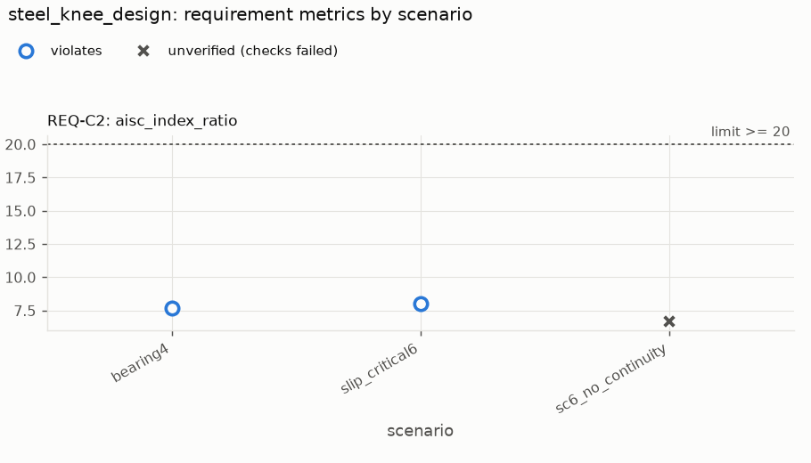

# Engineering review report: steel_knee_design

- **Run:** `20261127-105017_steel_knee_design`
- **Generated:** 2026-11-27T15:52:53+00:00
- **Case file SHA-256:** `4cb809cb9b168c7fd1067ad0efa52052e12fec5e096e9c55f32f377d93ba449f`
- **Environment:** Python 3.14.10, numpy 2.5.5, scipy 1.18.1, matplotlib 3.11.2, cadquery 2.8.0; Windows-11-10.0.26100-SP0
- **Tools:** cadquery 2.8.0; gmsh (Python API) 4.15.0; calculix This is Version 2.22
- **Code version:** git `33c62ee9eafb46a4e0632a76d67184eb10ec8f75` (uncommitted changes present)
- **Simulation status:** completed
- **Verification status:** FAIL

> **Warning:** verification did not pass for every point. Requirement verdicts marked *(unverified)* are not supported by evidence and must not be used for acceptance.

## Scope

Portal knee (study 28 part 2): stiffness of the two bolt designs (bearing-type, 4 bolts per flange; slip-critical, 6) and of the slip-critical design without its continuity plates; mesh scale 0.8.

**Assumptions**

- Linear elastic; every contact bonded: bolts neither slip nor deform (a slip-critical joint below its slip load); welds not modelled (parts fused along their weld lines); bolt holes not cut.
- Half model about the plane of both webs (exact for in-plane loading); the single shear tab as two half-thickness tabs, one each side of the beam web (same in-plane stiffness, symmetric).
- W-shape root fillets r = kdes - tf (reproduces the tabulated area within 0.5 %; the section's own Ix is 0.3-0.8 % below the tabulated one, and beam theory against the solid uses the solid's).
- Column stub 1.2 m below the joint, clamped; beam stub 1.5 m from the column face, shear load at its tip: the knee carries moment, the beam's shear as column axial force, as in the frame. Linear, so the stiffness does not depend on the load.

## Requirements

| ID | Requirement | Metric | Limit |
|---|---|---|---|
| REQ-C2 | The knee may be analysed as fully restrained (rigid), as part 1 did, only if its secant stiffness meets AISC 360-22 Commentary B3.4b: Ks L / EI >= 20 (L and EI the beam's). | `aisc_index_ratio` | >= 20  |

## Summary across points

| Point | scenario | REQ-C2 | Checks |
|---|---|---|---|
| p00_bearing4 | bearing4 | 7.678 : **FAIL** | 7/7 PASS |
| p01_slip_critical6 | slip_critical6 | 7.999 : **FAIL** | 7/7 PASS |
| p02_sc6_no_continuity | sc6_no_continuity | 6.658 : **FAIL (unverified)** | 6/7 FAIL |

## Point details

### p00_bearing4

Parameters: column_shape = W10X33, beam_shape = W14X30, youngs_modulus_MPa = 2e+05, poisson_ratio = 0.3, plate_thickness_mm = 12.7, plate_width_mm = 152.4, plate_length_mm = 165.1, setback_mm = 12.7, tab_width_mm = 88.9, tab_height_mm = 228.6, tab_thickness_mm = 9.525, continuity_plate_thickness_mm = 12.7, column_length_mm = 1200, beam_length_mm = 1500, tip_load_kN = 10, bay_span_mm = 6000, joint_size_mm = 11, far_size_mm = 16.5, mesh_scale = 0.8, station_near_mm = 300, station_far_mm = 700, scenario = bearing4

| Requirement | Result | Limit | Margin | Verdict | Evidence |
|---|---|---|---|---|---|
| REQ-C2 | 7.678  | >= 20 | -12.3 | **FAIL** | [point.json](points/p00_bearing4/point.json) |

| Check | Description | Value | Tolerance | Status |
|---|---|---|---|---|
| cad_volume | \|CAD volume / hand volume - 1\| (stubs, plates, tab, continuity plates) | 1.55e-15 | 1e-09 | PASS |
| beam_theory_beam | beam: rotation between its near and far sections against beam theory with the solid's own section Ix | 7.39e-04 | 0.005 | PASS |
| beam_theory_column | column: rotation between its near and far sections against beam theory with the solid's own section Ix | 1.19e-04 | 0.005 | PASS |
| equilibrium_force | \|base reaction - tip load\| / tip load | 3.86e-08 | 1e-06 | PASS |
| equilibrium_moment | \|base reaction moment - tip load x lever\| / that moment | 2.22e-07 | 1e-06 | PASS |
| stations_agree | k L / EI from the near against the far pair of sections (the joint's extra rotation is local, so both must give it) | 2.57e-04 | 0.03 | PASS |
| mesh_quality (validity) | 0.1 - the smallest scaled Jacobian (at or below 0: every element above the threshold) | -1.63e-02 | 0 | PASS |

### p01_slip_critical6

Parameters: column_shape = W10X33, beam_shape = W14X30, youngs_modulus_MPa = 2e+05, poisson_ratio = 0.3, plate_thickness_mm = 12.7, plate_width_mm = 152.4, plate_length_mm = 241.3, setback_mm = 12.7, tab_width_mm = 88.9, tab_height_mm = 228.6, tab_thickness_mm = 9.525, continuity_plate_thickness_mm = 12.7, column_length_mm = 1200, beam_length_mm = 1500, tip_load_kN = 10, bay_span_mm = 6000, joint_size_mm = 11, far_size_mm = 16.5, mesh_scale = 0.8, station_near_mm = 300, station_far_mm = 700, scenario = slip_critical6

| Requirement | Result | Limit | Margin | Verdict | Evidence |
|---|---|---|---|---|---|
| REQ-C2 | 7.999  | >= 20 | -12 | **FAIL** | [point.json](points/p01_slip_critical6/point.json) |

| Check | Description | Value | Tolerance | Status |
|---|---|---|---|---|
| cad_volume | \|CAD volume / hand volume - 1\| (stubs, plates, tab, continuity plates) | 2.22e-16 | 1e-09 | PASS |
| beam_theory_beam | beam: rotation between its near and far sections against beam theory with the solid's own section Ix | 1.80e-03 | 0.005 | PASS |
| beam_theory_column | column: rotation between its near and far sections against beam theory with the solid's own section Ix | 1.89e-04 | 0.005 | PASS |
| equilibrium_force | \|base reaction - tip load\| / tip load | 7.91e-08 | 1e-06 | PASS |
| equilibrium_moment | \|base reaction moment - tip load x lever\| / that moment | 2.17e-07 | 1e-06 | PASS |
| stations_agree | k L / EI from the near against the far pair of sections (the joint's extra rotation is local, so both must give it) | 8.33e-04 | 0.03 | PASS |
| mesh_quality (validity) | 0.1 - the smallest scaled Jacobian (at or below 0: every element above the threshold) | -3.53e-02 | 0 | PASS |

### p02_sc6_no_continuity

Parameters: column_shape = W10X33, beam_shape = W14X30, youngs_modulus_MPa = 2e+05, poisson_ratio = 0.3, plate_thickness_mm = 12.7, plate_width_mm = 152.4, plate_length_mm = 241.3, setback_mm = 12.7, tab_width_mm = 88.9, tab_height_mm = 228.6, tab_thickness_mm = 9.525, continuity_plate_thickness_mm = 0, column_length_mm = 1200, beam_length_mm = 1500, tip_load_kN = 10, bay_span_mm = 6000, joint_size_mm = 11, far_size_mm = 16.5, mesh_scale = 0.8, station_near_mm = 300, station_far_mm = 700, scenario = sc6_no_continuity

| Requirement | Result | Limit | Margin | Verdict | Evidence |
|---|---|---|---|---|---|
| REQ-C2 | 6.658  | >= 20 | -13.3 | **FAIL (unverified)** | [point.json](points/p02_sc6_no_continuity/point.json) |

| Check | Description | Value | Tolerance | Status |
|---|---|---|---|---|
| cad_volume | \|CAD volume / hand volume - 1\| (stubs, plates, tab, continuity plates) | 1.78e-15 | 1e-09 | PASS |
| beam_theory_beam | beam: rotation between its near and far sections against beam theory with the solid's own section Ix | 1.65e-03 | 0.005 | PASS |
| beam_theory_column | column: rotation between its near and far sections against beam theory with the solid's own section Ix | 1.20e-04 | 0.005 | PASS |
| equilibrium_force | \|base reaction - tip load\| / tip load | 1.33e-07 | 1e-06 | PASS |
| equilibrium_moment | \|base reaction moment - tip load x lever\| / that moment | 2.29e-07 | 1e-06 | PASS |
| stations_agree | k L / EI from the near against the far pair of sections (the joint's extra rotation is local, so both must give it) | 5.87e-04 | 0.03 | PASS |
| mesh_quality (validity) | 0.1 - the smallest scaled Jacobian (at or below 0: every element above the threshold) | 2.95e-02 | 0 | FAIL |

## Limitations

- No bolt slip, bolt deformation or bearing deformation at holes: an upper bound for a bearing-type joint (its slip into bearing is a separate, hand-calculated rotation in the frame case).
- Elastic: the stiffness at service load, as the Commentary's index; no strength from the solid (strength is the Chapter J design).
- Synthetic client and loads (part 1).
- A converged solver run that matches an analytical reference shows that the equations were solved correctly. It does not show that the equations represent real hardware.

## Engineering acceptance

Pending human review. This report does not accept or reject the design.
