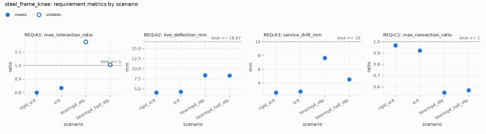

# Engineering review report: steel_frame_knee

- **Run:** `20261127-105635_steel_frame_knee`
- **Generated:** 2026-11-27T15:56:35+00:00
- **Case file SHA-256:** `d42221efc1c3c96924c8eb70e5884e7461e106dddb45e825f4ec1c611cbefdb9`
- **Environment:** Python 3.14.10, numpy 2.5.5, scipy 1.18.1, matplotlib 3.11.2, cadquery 2.8.0; Windows-11-10.0.26100-SP0
- **Code version:** git `52552a1516cd1cf121cf00e65ad9866030322289` (uncommitted changes present)
- **Simulation status:** completed
- **Verification status:** PASS

## Scope

The portal (study 28 part 2) with its knees as designed: the flange-plated connection checked to AISC 360-22 Chapter J at both knees, and the knees' measured stiffness (and bolt slip, for bearing-type bolts) in the Direct Analysis Method.

**Assumptions**

- Plane frame; fixed bases; knees as rotational springs at the beam's ends, k L / EI from the knee solid (runs 20261127-104729 and -105017), x 0.8 in the factored cases (C2.3); rigid in the first scenario.
- Bolt slip (bearing-type bolts, snug-tight, standard holes): 1/16 in. at each flange plate (the hole clearance, bolts centred at fit-up), a knee rotation of 2 x 1.5875 / (350.5 + 12.7) = 8.741 mrad before the spring engages; gap then spring, monotonic loading from zero.
- Connection forces at each knee from each factored case: the beam's end moment and axial force, the column's axial force (the beam's shear) and shear.
- Direct Analysis Method (C2): second-order analysis with P-Delta and P-delta (exact stability functions), all stiffnesses x 0.8, tau_b = 1 (checked: alpha Pr / Pns under 0.5), notional loads 0.002 Y in the lateral direction.
- Effective length = unbraced length (C3). Columns braced out of plane at base and beam only (4.0 m); beam laterally unbraced over its 6.0 m span (conservative; the client has not specified the bracing).
- Cb from each member's own second-order moment diagram (Eq. F1-1).
- Factored loads as given by the client (LRFD); serviceability with nominal stiffness: live-load deflection first order, drift second order with the service live load on the beam.
- Section properties from the AISC Shapes Database v16.0; ASTM A992 Fy 345 MPa, E 200,000 MPa.

## Requirements

| ID | Requirement | Metric | Limit |
|---|---|---|---|
| REQ-A1 | Every member's combined axial and flexural ratio by AISC 360-22 Eq. H1-1 (LRFD, Direct Analysis Method) shall be at most 1.0. | `max_interaction_ratio` | <= 1 - |
| REQ-A2 | The beam's live-load deflection shall be at most L/360 (6,000 / 360 = 16.7 mm). | `live_deflection_mm` | <= 16.67 mm |
| REQ-A3 | The frame's drift under the service lateral load shall be at most H/400 (4,000 / 400 = 10.0 mm). | `service_drift_mm` | <= 10 mm |
| REQ-C1 | Every limit state of the knee connection (AISC 360-22 Chapter J and J10, LRFD) at both knees in both factored load cases shall have a ratio of at most 1.0. | `max_connection_ratio` | <= 1 - |

## Summary across points

| Point | scenario | REQ-A1 | REQ-A2 | REQ-A3 | REQ-C1 | Checks |
|---|---|---|---|---|---|---|
| p00_rigid_sc6 | rigid_sc6 | 0.8006 -: **PASS** | 4.1 mm: **PASS** | 2.613 mm: **PASS** | 0.9675 -: **PASS** | 7/7 PASS |
| p01_sc6 | sc6 | 0.8345 -: **PASS** | 4.318 mm: **PASS** | 2.768 mm: **PASS** | 0.9222 -: **PASS** | 7/7 PASS |
| p02_bearing4_slip | bearing4_slip | 1.174 -: **FAIL** | 8.359 mm: **PASS** | 7.617 mm: **PASS** | 0.5487 -: **PASS** | 7/7 PASS |
| p03_bearing4_half_slip | bearing4_half_slip | 1.006 -: **FAIL** | 8.281 mm: **PASS** | 4.524 mm: **PASS** | 0.5683 -: **PASS** | 7/7 PASS |

## Point details

### p00_rigid_sc6

Parameters: frame_height_m = 4, bay_span_m = 6, column_shape = W10X33, beam_shape = W14X30, youngs_modulus_MPa = 2e+05, yield_strength_MPa = 345, base = fixed, factored_gravity_kN_per_m = 35, factored_lateral_kN = 15, service_live_kN_per_m = 12, service_lateral_kN = 10, beam_unbraced_length_m = 6, column_unbraced_length_weak_m = 4, knee_stiffness_ratio = 0, knee_slip_mrad = 0, knee_connection = slip_critical6, scenario = rigid_sc6

| Requirement | Result | Limit | Margin | Verdict | Evidence |
|---|---|---|---|---|---|
| REQ-A1 | 0.8006 - | <= 1 | 0.199 | **PASS** | [point.json](points/p00_rigid_sc6/point.json) |
| REQ-A2 | 4.1 mm | <= 16.67 | 12.6 | **PASS** | [point.json](points/p00_rigid_sc6/point.json) |
| REQ-A3 | 2.613 mm | <= 10 | 7.39 | **PASS** | [point.json](points/p00_rigid_sc6/point.json) |
| REQ-C1 | 0.9675 - | <= 1 | 0.0325 | **PASS** | [point.json](points/p00_rigid_sc6/point.json) |

| Check | Description | Value | Tolerance | Status |
|---|---|---|---|---|
| benchmarks_aisc | largest relative miss against the AISC Design Examples: C.1A drift (scaled to its 2 % tolerance) and moments, E.1D, F.1-3B, H.1B | 9.11e-03 | 0.01 | PASS |
| closed_form_portal | first-order knee moment (UDL) and base moment (lateral) against Kleinlogel's closed forms, axially rigid | 3.59e-09 | 1e-06 | PASS |
| equilibrium | largest \|sum of reactions + applied loads\| / total gravity, both load cases | 3.31e-14 | 1e-09 | PASS |
| b1b2_vs_exact | \|Appendix 8 B1-B2 amplified moment - exact second-order moment\| / exact, right column top, gravity + lateral | 4.75e-04 | 0.02 | PASS |
| segments | right column top moment with 2 against 8 members per span (exact at nodes: should agree to round-off) | 2.92e-10 | 1e-06 | PASS |
| tau_b (validity) | largest alpha Pr / Pns (C2.3: tau_b = 1 and the 0.8 reduction alone apply up to 0.5) | 5.06e-02 | 0.5 | PASS |
| drift_ratio (validity) | second- to first-order drift ratio (Commentary C1 recommends at most 2.5; above 1.7 notional loads go into every load case) | 1.02e+00 | 2.5 | PASS |

### p01_sc6

Parameters: frame_height_m = 4, bay_span_m = 6, column_shape = W10X33, beam_shape = W14X30, youngs_modulus_MPa = 2e+05, yield_strength_MPa = 345, base = fixed, factored_gravity_kN_per_m = 35, factored_lateral_kN = 15, service_live_kN_per_m = 12, service_lateral_kN = 10, beam_unbraced_length_m = 6, column_unbraced_length_weak_m = 4, knee_stiffness_ratio = 23.69, knee_slip_mrad = 0, knee_connection = slip_critical6, scenario = sc6

| Requirement | Result | Limit | Margin | Verdict | Evidence |
|---|---|---|---|---|---|
| REQ-A1 | 0.8345 - | <= 1 | 0.166 | **PASS** | [point.json](points/p01_sc6/point.json) |
| REQ-A2 | 4.318 mm | <= 16.67 | 12.4 | **PASS** | [point.json](points/p01_sc6/point.json) |
| REQ-A3 | 2.768 mm | <= 10 | 7.23 | **PASS** | [point.json](points/p01_sc6/point.json) |
| REQ-C1 | 0.9222 - | <= 1 | 0.0778 | **PASS** | [point.json](points/p01_sc6/point.json) |

| Check | Description | Value | Tolerance | Status |
|---|---|---|---|---|
| benchmarks_aisc | largest relative miss against the AISC Design Examples: C.1A drift (scaled to its 2 % tolerance) and moments, E.1D, F.1-3B, H.1B | 9.11e-03 | 0.01 | PASS |
| closed_form_portal | first-order knee moment (UDL) and base moment (lateral) against Kleinlogel's closed forms, axially rigid | 3.59e-09 | 1e-06 | PASS |
| equilibrium | largest \|sum of reactions + applied loads\| / total gravity, both load cases | 3.37e-14 | 1e-09 | PASS |
| b1b2_vs_exact | \|Appendix 8 B1-B2 amplified moment - exact second-order moment\| / exact, right column top, gravity + lateral | 6.18e-04 | 0.02 | PASS |
| segments | right column top moment with 2 against 8 members per span (exact at nodes: should agree to round-off) | 1.27e-10 | 1e-06 | PASS |
| tau_b (validity) | largest alpha Pr / Pns (C2.3: tau_b = 1 and the 0.8 reduction alone apply up to 0.5) | 5.06e-02 | 0.5 | PASS |
| drift_ratio (validity) | second- to first-order drift ratio (Commentary C1 recommends at most 2.5; above 1.7 notional loads go into every load case) | 1.02e+00 | 2.5 | PASS |

### p02_bearing4_slip

Parameters: frame_height_m = 4, bay_span_m = 6, column_shape = W10X33, beam_shape = W14X30, youngs_modulus_MPa = 2e+05, yield_strength_MPa = 345, base = fixed, factored_gravity_kN_per_m = 35, factored_lateral_kN = 15, service_live_kN_per_m = 12, service_lateral_kN = 10, beam_unbraced_length_m = 6, column_unbraced_length_weak_m = 4, knee_stiffness_ratio = 21.33, knee_slip_mrad = 8.741, knee_connection = bearing4, scenario = bearing4_slip

| Requirement | Result | Limit | Margin | Verdict | Evidence |
|---|---|---|---|---|---|
| REQ-A1 | 1.174 - | <= 1 | -0.174 | **FAIL** | [point.json](points/p02_bearing4_slip/point.json) |
| REQ-A2 | 8.359 mm | <= 16.67 | 8.31 | **PASS** | [point.json](points/p02_bearing4_slip/point.json) |
| REQ-A3 | 7.617 mm | <= 10 | 2.38 | **PASS** | [point.json](points/p02_bearing4_slip/point.json) |
| REQ-C1 | 0.5487 - | <= 1 | 0.451 | **PASS** | [point.json](points/p02_bearing4_slip/point.json) |

| Check | Description | Value | Tolerance | Status |
|---|---|---|---|---|
| benchmarks_aisc | largest relative miss against the AISC Design Examples: C.1A drift (scaled to its 2 % tolerance) and moments, E.1D, F.1-3B, H.1B | 9.11e-03 | 0.01 | PASS |
| closed_form_portal | first-order knee moment (UDL) and base moment (lateral) against Kleinlogel's closed forms, axially rigid | 3.59e-09 | 1e-06 | PASS |
| equilibrium | largest \|sum of reactions + applied loads\| / total gravity, both load cases | 6.01e-14 | 1e-09 | PASS |
| b1b2_vs_exact | \|Appendix 8 B1-B2 amplified moment - exact second-order moment\| / exact, right column top, gravity + lateral | 1.07e-03 | 0.02 | PASS |
| segments | right column top moment with 2 against 8 members per span (exact at nodes: should agree to round-off) | 4.11e-10 | 1e-06 | PASS |
| tau_b (validity) | largest alpha Pr / Pns (C2.3: tau_b = 1 and the 0.8 reduction alone apply up to 0.5) | 5.06e-02 | 0.5 | PASS |
| drift_ratio (validity) | second- to first-order drift ratio (Commentary C1 recommends at most 2.5; above 1.7 notional loads go into every load case) | 1.02e+00 | 2.5 | PASS |

### p03_bearing4_half_slip

Parameters: frame_height_m = 4, bay_span_m = 6, column_shape = W10X33, beam_shape = W14X30, youngs_modulus_MPa = 2e+05, yield_strength_MPa = 345, base = fixed, factored_gravity_kN_per_m = 35, factored_lateral_kN = 15, service_live_kN_per_m = 12, service_lateral_kN = 10, beam_unbraced_length_m = 6, column_unbraced_length_weak_m = 4, knee_stiffness_ratio = 21.33, knee_slip_mrad = 4.371, knee_connection = bearing4, scenario = bearing4_half_slip

| Requirement | Result | Limit | Margin | Verdict | Evidence |
|---|---|---|---|---|---|
| REQ-A1 | 1.006 - | <= 1 | -0.00627 | **FAIL** | [point.json](points/p03_bearing4_half_slip/point.json) |
| REQ-A2 | 8.281 mm | <= 16.67 | 8.39 | **PASS** | [point.json](points/p03_bearing4_half_slip/point.json) |
| REQ-A3 | 4.524 mm | <= 10 | 5.48 | **PASS** | [point.json](points/p03_bearing4_half_slip/point.json) |
| REQ-C1 | 0.5683 - | <= 1 | 0.432 | **PASS** | [point.json](points/p03_bearing4_half_slip/point.json) |

| Check | Description | Value | Tolerance | Status |
|---|---|---|---|---|
| benchmarks_aisc | largest relative miss against the AISC Design Examples: C.1A drift (scaled to its 2 % tolerance) and moments, E.1D, F.1-3B, H.1B | 9.11e-03 | 0.01 | PASS |
| closed_form_portal | first-order knee moment (UDL) and base moment (lateral) against Kleinlogel's closed forms, axially rigid | 3.59e-09 | 1e-06 | PASS |
| equilibrium | largest \|sum of reactions + applied loads\| / total gravity, both load cases | 4.05e-14 | 1e-09 | PASS |
| b1b2_vs_exact | \|Appendix 8 B1-B2 amplified moment - exact second-order moment\| / exact, right column top, gravity + lateral | 9.91e-04 | 0.02 | PASS |
| segments | right column top moment with 2 against 8 members per span (exact at nodes: should agree to round-off) | 5.69e-10 | 1e-06 | PASS |
| tau_b (validity) | largest alpha Pr / Pns (C2.3: tau_b = 1 and the 0.8 reduction alone apply up to 0.5) | 5.06e-02 | 0.5 | PASS |
| drift_ratio (validity) | second- to first-order drift ratio (Commentary C1 recommends at most 2.5; above 1.7 notional loads go into every load case) | 1.02e+00 | 2.5 | PASS |

## Limitations

- Base plates and anchorage not designed; the knee's strength by Chapter J (validation/flange_plated.py), its stiffness from an elastic solid with bonded parts.
- Service checks from zero load, the live load alone (as part 1): with slip, the dead load would close part of the gap first, so the live deflection and drift of the slipping knees are upper bounds.
- The worst-case slip is 1/8 in. per flange (holes offset the other way at fit-up): not run; it is worse than the case shown.
- Out-of-plane stability of the frame (bracing members) not checked.
- No dynamic or fatigue assessment of the equipment loads.
- Synthetic client and loads.
- A converged solver run that matches an analytical reference shows that the equations were solved correctly. It does not show that the equations represent real hardware.

## Engineering acceptance

Pending human review. This report does not accept or reject the design.
