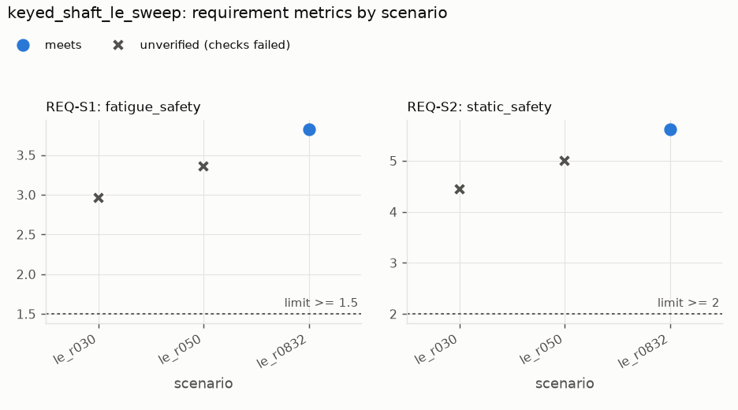

# Engineering review report: keyed_shaft_le_sweep

- **Run:** `20261127-110904_keyed_shaft_le_sweep`
- **Generated:** 2026-11-27T16:35:17+00:00
- **Case file SHA-256:** `fa54c32c63f8f50755a9b54afea3d590c957fc8b5ca057b4b455a4e78cf9b72f`
- **Environment:** Python 3.14.10, numpy 2.5.5, scipy 1.18.1, matplotlib 3.11.2, cadquery 2.8.0; Windows-11-10.0.26100-SP0
- **Tools:** cadquery 2.8.0; gmsh (Python API) 4.15.0; calculix This is Version 2.22
- **Code version:** git `aafbcfc9e898fa04f8ce1a5c419d48d772e0655e` (uncommitted changes present)
- **Simulation status:** completed
- **Verification status:** FAIL

> **Warning:** verification did not pass for every point. Requirement verdicts marked *(unverified)* are not supported by evidence and must not be used for acceptance.

## Scope

Le and Le's isolated profile keyseat (ASEE 2013, Table 2: 2 in. shaft, 1/2 x 1/2 in. key) at r/B 0.03, 0.05 and 0.0832 (study 26 part 2): is the 5 % gap to their bending factor a constant offset or does it vary?

**Assumptions**

- Linear elastic, small strain; Kt from gross nominal stresses at the small diameter; the fatigue and overload checks of part 1 (Shigley: Marin factors, Neuber notch sensitivity with each feature's own radius, von Mises combination, modified Goodman; Kf applied to the overload).
- Rotating bending 300 N m (fully reversed) and steady torque 500 N m act at the keyway as at the fillet (the keyway's end is 2 mm from the fillet; conservative).
- The key's bearing pressure on the keyway wall and any press fit of the gear are not modelled (Shigley's practice for keyseat factors).
- DIN 6885 form A keyway dimensions from published reproductions of the table (the current DIN 6885-1:2021 was not read); corner radius 0.25-0.40 mm.

## Requirements

| ID | Requirement | Metric | Limit |
|---|---|---|---|
| REQ-S1 | The fatigue safety factor (modified Goodman, Shigley's method) shall be at least 1.5 at the shoulder fillet and at the keyway. | `fatigue_safety` | >= 1.5  |
| REQ-S2 | The first-cycle yield safety factor at a 1.5 x overload shall be at least 2.0 at the shoulder fillet and at the keyway. | `static_safety` | >= 2  |

## Summary across points

| Point | scenario | REQ-S1 | REQ-S2 | Checks |
|---|---|---|---|---|
| p00_le_r030 | le_r030 | 2.963 : **PASS (unverified)** | 4.447 : **PASS (unverified)** | 10/11 FAIL |
| p01_le_r050 | le_r050 | 3.355 : **PASS (unverified)** | 5.001 : **PASS (unverified)** | 10/11 FAIL |
| p02_le_r0832 | le_r0832 | 3.826 : **PASS** | 5.619 : **PASS** | 11/11 PASS |

## Point details

### p00_le_r030

Parameters: D_mm = 63.5, d_mm = 50.8, fillet_radius_mm = 2.54, small_length_mm = 180, large_length_mm = 60, bending_moment_Nm = 300, torque_Nm = 500, youngs_modulus_MPa = 2.1e+05, poisson_ratio = 0.3, ultimate_MPa = 1000, yield_MPa = 750, overload_factor = 1.5, key_width_mm = 12.7, key_depth_mm = 6.35, key_corner_radius_mm = 0.381, key_gap_mm = 20, key_length_mm = 50.8, global_key_size_mm = 0.45, global_fillet_size_mm = 0.7, far_size_mm = 4, sub_key_size_rel = 0.333, sub_fillet_size_mm = 0.3, mesh_scale = 0.8, box_margin_mm = 3, sub_far_size_mm = 1.5, kt_reference_bending = 0, kt_reference_torsion = 0, kt_key_reference_bending = 2.981, kt_key_reference_torsion = 2.888, scenario = le_r030

| Requirement | Result | Limit | Margin | Verdict | Evidence |
|---|---|---|---|---|---|
| REQ-S1 | 2.963  | >= 1.5 | 1.46 | **PASS (unverified)** | [point.json](points/p00_le_r030/point.json) |
| REQ-S2 | 4.447  | >= 2 | 2.45 | **PASS (unverified)** | [point.json](points/p00_le_r030/point.json) |

| Check | Description | Value | Tolerance | Status |
|---|---|---|---|---|
| equilibrium_bending | global model: \|clamp reaction moment - applied\| / target (bending) | 1.04e-08 | 1e-06 | PASS |
| equilibrium_torsion | global model: \|clamp reaction moment - applied\| / target (torsion) | 3.15e-08 | 1e-06 | PASS |
| load_bending | \|applied end moment\| against the target (bending; the end face's moment is -T about z by the outward normal, so magnitudes are compared; 7-point rule on curved faces) | 2.54e-06 | 0.0001 | PASS |
| load_torsion | \|applied end moment\| against the target (torsion; the end face's moment is -T about z by the outward normal, so magnitudes are compared; 7-point rule on curved faces) | 2.54e-06 | 0.0001 | PASS |
| global_vs_sub_fillet_bending | fillet Kt, global model against its submodel (bending): the global mesh resolves the fillet, so the two must agree (peaks 3.9 mm apart) | 8.61e-03 | 0.02 | PASS |
| fillet_peak_covered_bending (validity) | the global model's fillet peak (bending) lies inside a fillet submodel, more than 1 mm from its driven faces (1 = outside every box: the submodels miss the peak) | 0.00e+00 | 0 | PASS |
| global_vs_sub_fillet_torsion | fillet Kt, global model against its submodel (torsion): the global mesh resolves the fillet, so the two must agree (peaks 50.9 mm apart) | 3.83e-03 | 0.02 | PASS |
| fillet_peak_covered_torsion (validity) | the global model's fillet peak (torsion) lies inside a fillet submodel, more than 1 mm from its driven faces (1 = outside every box: the submodels miss the peak) | 0.00e+00 | 0 | PASS |
| mesh_quality (validity) | 0.1 - the smallest scaled Jacobian over the global and submodel meshes (at or below 0: every element above the threshold) | -2.48e-01 | 0 | PASS |
| keyseat_reference_bending | kt_key_bending_far_axial against Le and Le's FE value (bending) | 8.73e-02 | 0.05 | FAIL |
| keyseat_reference_torsion | kt_key_torsion_middle against Le and Le's FE value (torsion) | 4.80e-02 | 0.05 | PASS |

### p01_le_r050

Parameters: D_mm = 63.5, d_mm = 50.8, fillet_radius_mm = 2.54, small_length_mm = 180, large_length_mm = 60, bending_moment_Nm = 300, torque_Nm = 500, youngs_modulus_MPa = 2.1e+05, poisson_ratio = 0.3, ultimate_MPa = 1000, yield_MPa = 750, overload_factor = 1.5, key_width_mm = 12.7, key_depth_mm = 6.35, key_corner_radius_mm = 0.635, key_gap_mm = 20, key_length_mm = 50.8, global_key_size_mm = 0.45, global_fillet_size_mm = 0.7, far_size_mm = 4, sub_key_size_rel = 0.333, sub_fillet_size_mm = 0.3, mesh_scale = 0.8, box_margin_mm = 3, sub_far_size_mm = 1.5, kt_reference_bending = 0, kt_reference_torsion = 0, kt_key_reference_bending = 2.56, kt_key_reference_torsion = 2.511, scenario = le_r050

| Requirement | Result | Limit | Margin | Verdict | Evidence |
|---|---|---|---|---|---|
| REQ-S1 | 3.355  | >= 1.5 | 1.86 | **PASS (unverified)** | [point.json](points/p01_le_r050/point.json) |
| REQ-S2 | 5.001  | >= 2 | 3 | **PASS (unverified)** | [point.json](points/p01_le_r050/point.json) |

| Check | Description | Value | Tolerance | Status |
|---|---|---|---|---|
| equilibrium_bending | global model: \|clamp reaction moment - applied\| / target (bending) | 3.24e-08 | 1e-06 | PASS |
| equilibrium_torsion | global model: \|clamp reaction moment - applied\| / target (torsion) | 3.35e-08 | 1e-06 | PASS |
| load_bending | \|applied end moment\| against the target (bending; the end face's moment is -T about z by the outward normal, so magnitudes are compared; 7-point rule on curved faces) | 2.54e-06 | 0.0001 | PASS |
| load_torsion | \|applied end moment\| against the target (torsion; the end face's moment is -T about z by the outward normal, so magnitudes are compared; 7-point rule on curved faces) | 2.54e-06 | 0.0001 | PASS |
| global_vs_sub_fillet_bending | fillet Kt, global model against its submodel (bending): the global mesh resolves the fillet, so the two must agree (peaks 3.9 mm apart) | 9.85e-03 | 0.02 | PASS |
| fillet_peak_covered_bending (validity) | the global model's fillet peak (bending) lies inside a fillet submodel, more than 1 mm from its driven faces (1 = outside every box: the submodels miss the peak) | 0.00e+00 | 0 | PASS |
| global_vs_sub_fillet_torsion | fillet Kt, global model against its submodel (torsion): the global mesh resolves the fillet, so the two must agree (peaks 49.5 mm apart) | 1.61e-03 | 0.02 | PASS |
| fillet_peak_covered_torsion (validity) | the global model's fillet peak (torsion) lies inside a fillet submodel, more than 1 mm from its driven faces (1 = outside every box: the submodels miss the peak) | 0.00e+00 | 0 | PASS |
| mesh_quality (validity) | 0.1 - the smallest scaled Jacobian over the global and submodel meshes (at or below 0: every element above the threshold) | -4.23e-01 | 0 | PASS |
| keyseat_reference_bending | kt_key_bending_far_axial against Le and Le's FE value (bending) | 5.47e-02 | 0.05 | FAIL |
| keyseat_reference_torsion | kt_key_torsion_middle against Le and Le's FE value (torsion) | 4.17e-02 | 0.05 | PASS |

### p02_le_r0832

Parameters: D_mm = 63.5, d_mm = 50.8, fillet_radius_mm = 2.54, small_length_mm = 180, large_length_mm = 60, bending_moment_Nm = 300, torque_Nm = 500, youngs_modulus_MPa = 2.1e+05, poisson_ratio = 0.3, ultimate_MPa = 1000, yield_MPa = 750, overload_factor = 1.5, key_width_mm = 12.7, key_depth_mm = 6.35, key_corner_radius_mm = 1.057, key_gap_mm = 20, key_length_mm = 50.8, global_key_size_mm = 0.45, global_fillet_size_mm = 0.7, far_size_mm = 4, sub_key_size_rel = 0.333, sub_fillet_size_mm = 0.3, mesh_scale = 0.8, box_margin_mm = 3, sub_far_size_mm = 1.5, kt_reference_bending = 0, kt_reference_torsion = 0, kt_key_reference_bending = 2.235, kt_key_reference_torsion = 2.258, scenario = le_r0832

| Requirement | Result | Limit | Margin | Verdict | Evidence |
|---|---|---|---|---|---|
| REQ-S1 | 3.826  | >= 1.5 | 2.33 | **PASS** | [point.json](points/p02_le_r0832/point.json) |
| REQ-S2 | 5.619  | >= 2 | 3.62 | **PASS** | [point.json](points/p02_le_r0832/point.json) |

| Check | Description | Value | Tolerance | Status |
|---|---|---|---|---|
| equilibrium_bending | global model: \|clamp reaction moment - applied\| / target (bending) | 5.97e-08 | 1e-06 | PASS |
| equilibrium_torsion | global model: \|clamp reaction moment - applied\| / target (torsion) | 2.28e-08 | 1e-06 | PASS |
| load_bending | \|applied end moment\| against the target (bending; the end face's moment is -T about z by the outward normal, so magnitudes are compared; 7-point rule on curved faces) | 2.54e-06 | 0.0001 | PASS |
| load_torsion | \|applied end moment\| against the target (torsion; the end face's moment is -T about z by the outward normal, so magnitudes are compared; 7-point rule on curved faces) | 2.54e-06 | 0.0001 | PASS |
| global_vs_sub_fillet_bending | fillet Kt, global model against its submodel (bending): the global mesh resolves the fillet, so the two must agree (peaks 0.3 mm apart) | 2.32e-03 | 0.02 | PASS |
| fillet_peak_covered_bending (validity) | the global model's fillet peak (bending) lies inside a fillet submodel, more than 1 mm from its driven faces (1 = outside every box: the submodels miss the peak) | 0.00e+00 | 0 | PASS |
| global_vs_sub_fillet_torsion | fillet Kt, global model against its submodel (torsion): the global mesh resolves the fillet, so the two must agree (peaks 51.0 mm apart) | 4.80e-03 | 0.02 | PASS |
| fillet_peak_covered_torsion (validity) | the global model's fillet peak (torsion) lies inside a fillet submodel, more than 1 mm from its driven faces (1 = outside every box: the submodels miss the peak) | 0.00e+00 | 0 | PASS |
| mesh_quality (validity) | 0.1 - the smallest scaled Jacobian over the global and submodel meshes (at or below 0: every element above the threshold) | -5.95e-01 | 0 | PASS |
| keyseat_reference_bending | kt_key_bending_far_axial against Le and Le's FE value (bending) | 3.48e-02 | 0.05 | PASS |
| keyseat_reference_torsion | kt_key_torsion_middle against Le and Le's FE value (torsion) | 1.71e-02 | 0.05 | PASS |

## Limitations

- Submodels driven by a coarse global model; their boxes keep 3 mm (or more) of material between the keyway's corners and the cut faces.
- Stress at nodes (CalculiX's extrapolation, averaged), as part 1.
- A converged solver run that matches an analytical reference shows that the equations were solved correctly. It does not show that the equations represent real hardware.

## Engineering acceptance

Pending human review. This report does not accept or reject the design.
