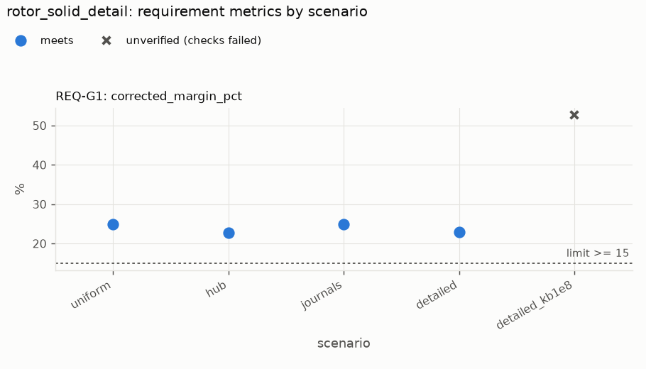

# Engineering review report: rotor_solid_detail

- **Run:** `20261127-120457_rotor_solid_detail`
- **Generated:** 2026-11-27T17:09:11+00:00
- **Case file SHA-256:** `77cf8ba1ad84ea1c7f63d70aebc71de0e552de4f4b45ad5ac800388081597427`
- **Environment:** Python 3.14.10, numpy 2.5.5, scipy 1.18.1, matplotlib 3.11.2, cadquery 2.8.0; Windows-11-10.0.26100-SP0
- **Tools:** cadquery 2.8.0; gmsh (Python API) 4.15.0; calculix This is Version 2.22; ross ERROR: Could not load REFPROP (REFPRP64.dll) due to: 126. Make sure the library is in your system search path. In case you run 64bit Windows and you have a REFPROP license, try installing the 64bit DLL from NIST.
- **Code version:** git `9e619537beffc5b02c1a7662c7089956d0854254` (uncommitted changes present)
- **Simulation status:** completed
- **Verification status:** FAIL

> **Warning:** verification did not pass for every point. Requirement verdicts marked *(unverified)* are not supported by evidence and must not be used for acceptance.

## Scope

Fan rotor (study 23 part 2): the real rotor's detail one feature at a time (hub, journals), the 3D solid against ROSS on each, and the corrected first critical speed.

**Assumptions**

- Linear elastic steel (E 205 GPa, density 7850 kg/m^3, Poisson 0.29), as part 1; every part bonded (a hub shrunk or tightly keyed on the shaft); the disc elastic in the solid, rigid in ROSS.
- Bearings as point springs at the shaft's end faces (rigid end faces on a reference node, free to rotate), stiffness 1e7 (soft) or 1e8 N/m, as part 1's band; damping left out (natural frequencies).
- Half model about a plane through the axis: its modes are the lateral bending modes in that plane (axisymmetric rotor: the other plane is the same).
- The solid is at rest; the gyroscopic stiffening at speed comes from ROSS, whose critical speed is scaled by the solid's ratio of first frequencies at rest.

## Requirements

| ID | Requirement | Metric | Limit |
|---|---|---|---|
| REQ-G1 | Every forward critical speed shall lie at least 15 % outside the 1000-3000 rpm operating range (part 1's REQ-G1): here the first forward critical, ROSS's corrected by the solid at rest. | `corrected_margin_pct` | >= 15 % |

## Summary across points

| Point | scenario | REQ-G1 | Checks |
|---|---|---|---|
| p00_uniform | uniform | 24.82 %: **PASS** | 3/3 PASS |
| p01_hub | hub | 22.78 %: **PASS** | 3/3 PASS |
| p02_journals | journals | 24.91 %: **PASS** | 3/3 PASS |
| p03_detailed | detailed | 22.86 %: **PASS** | 3/3 PASS |
| p04_detailed_kb1e8 | detailed_kb1e8 | 52.6 %: **PASS (unverified)** | 2/3 FAIL |

## Point details

### p00_uniform

Parameters: density_kg_per_m3 = 7850, youngs_modulus_Pa = 2.05e+11, poisson_ratio = 0.29, n_elements = 20, bearing_span_m = 1, shaft_diameter_m = 0.065, disc_width_m = 0.025, disc_diameter_m = 0.4, bearing_stiffness_N_per_m = 1e+07, bearing_damping_Ns_per_m = 500, speed_min_rpm = 1000, speed_max_rpm = 3000, campbell_max_rpm = 9000, campbell_points = 91, modes = 6, response_points = 41, hub_diameter_m = 0, hub_length_m = 0, journal_diameter_m = 0, journal_length_m = 0, element_size_mm = 10, mesh_scale = 0.8, scenario = uniform

| Requirement | Result | Limit | Margin | Verdict | Evidence |
|---|---|---|---|---|---|
| REQ-G1 | 24.82 % | >= 15 | 9.82 | **PASS** | [point.json](points/p00_uniform/point.json) |

| Check | Description | Value | Tolerance | Status |
|---|---|---|---|---|
| cad_volume | \|half solid's volume / hand volume - 1\| | 2.22e-16 | 1e-09 | PASS |
| mesh_quality (validity) | 0.1 - the smallest scaled Jacobian | -7.06e-01 | 0 | PASS |
| solid_vs_ross | \|solid's first lateral frequency at rest / ROSS's - 1\| (cross-tool: on the rotor ROSS idealises exactly, the beam model must agree) | 8.09e-03 | 0.02 | PASS |

### p01_hub

Parameters: density_kg_per_m3 = 7850, youngs_modulus_Pa = 2.05e+11, poisson_ratio = 0.29, n_elements = 20, bearing_span_m = 1, shaft_diameter_m = 0.065, disc_width_m = 0.025, disc_diameter_m = 0.4, bearing_stiffness_N_per_m = 1e+07, bearing_damping_Ns_per_m = 500, speed_min_rpm = 1000, speed_max_rpm = 3000, campbell_max_rpm = 9000, campbell_points = 91, modes = 6, response_points = 41, hub_diameter_m = 0.13, hub_length_m = 0.1, journal_diameter_m = 0, journal_length_m = 0, element_size_mm = 10, mesh_scale = 0.8, scenario = hub

| Requirement | Result | Limit | Margin | Verdict | Evidence |
|---|---|---|---|---|---|
| REQ-G1 | 22.78 % | >= 15 | 7.78 | **PASS** | [point.json](points/p01_hub/point.json) |

| Check | Description | Value | Tolerance | Status |
|---|---|---|---|---|
| cad_volume | \|half solid's volume / hand volume - 1\| | 2.22e-16 | 1e-09 | PASS |
| mesh_quality (validity) | 0.1 - the smallest scaled Jacobian | -7.53e-01 | 0 | PASS |
| solid_vs_ross | \|solid's first lateral frequency at rest / ROSS's - 1\| (cross-tool: on the rotor ROSS idealises exactly, the beam model must agree) | 1.93e-02 | 0.02 | PASS |

### p02_journals

Parameters: density_kg_per_m3 = 7850, youngs_modulus_Pa = 2.05e+11, poisson_ratio = 0.29, n_elements = 20, bearing_span_m = 1, shaft_diameter_m = 0.065, disc_width_m = 0.025, disc_diameter_m = 0.4, bearing_stiffness_N_per_m = 1e+07, bearing_damping_Ns_per_m = 500, speed_min_rpm = 1000, speed_max_rpm = 3000, campbell_max_rpm = 9000, campbell_points = 91, modes = 6, response_points = 41, hub_diameter_m = 0, hub_length_m = 0, journal_diameter_m = 0.055, journal_length_m = 0.05, element_size_mm = 10, mesh_scale = 0.8, scenario = journals

| Requirement | Result | Limit | Margin | Verdict | Evidence |
|---|---|---|---|---|---|
| REQ-G1 | 24.91 % | >= 15 | 9.91 | **PASS** | [point.json](points/p02_journals/point.json) |

| Check | Description | Value | Tolerance | Status |
|---|---|---|---|---|
| cad_volume | \|half solid's volume / hand volume - 1\| | 0.00e+00 | 1e-09 | PASS |
| mesh_quality (validity) | 0.1 - the smallest scaled Jacobian | -6.70e-01 | 0 | PASS |
| solid_vs_ross | \|solid's first lateral frequency at rest / ROSS's - 1\| (cross-tool: on the rotor ROSS idealises exactly, the beam model must agree) | 8.04e-03 | 0.02 | PASS |

### p03_detailed

Parameters: density_kg_per_m3 = 7850, youngs_modulus_Pa = 2.05e+11, poisson_ratio = 0.29, n_elements = 20, bearing_span_m = 1, shaft_diameter_m = 0.065, disc_width_m = 0.025, disc_diameter_m = 0.4, bearing_stiffness_N_per_m = 1e+07, bearing_damping_Ns_per_m = 500, speed_min_rpm = 1000, speed_max_rpm = 3000, campbell_max_rpm = 9000, campbell_points = 91, modes = 6, response_points = 41, hub_diameter_m = 0.13, hub_length_m = 0.1, journal_diameter_m = 0.055, journal_length_m = 0.05, element_size_mm = 10, mesh_scale = 0.8, scenario = detailed

| Requirement | Result | Limit | Margin | Verdict | Evidence |
|---|---|---|---|---|---|
| REQ-G1 | 22.86 % | >= 15 | 7.86 | **PASS** | [point.json](points/p03_detailed/point.json) |

| Check | Description | Value | Tolerance | Status |
|---|---|---|---|---|
| cad_volume | \|half solid's volume / hand volume - 1\| | 0.00e+00 | 1e-09 | PASS |
| mesh_quality (validity) | 0.1 - the smallest scaled Jacobian | -6.68e-01 | 0 | PASS |
| solid_vs_ross | \|solid's first lateral frequency at rest / ROSS's - 1\| (cross-tool: on the rotor ROSS idealises exactly, the beam model must agree) | 1.95e-02 | 0.02 | PASS |

### p04_detailed_kb1e8

Parameters: density_kg_per_m3 = 7850, youngs_modulus_Pa = 2.05e+11, poisson_ratio = 0.29, n_elements = 20, bearing_span_m = 1, shaft_diameter_m = 0.065, disc_width_m = 0.025, disc_diameter_m = 0.4, bearing_stiffness_N_per_m = 1e+08, bearing_damping_Ns_per_m = 500, speed_min_rpm = 1000, speed_max_rpm = 3000, campbell_max_rpm = 9000, campbell_points = 91, modes = 6, response_points = 41, hub_diameter_m = 0.13, hub_length_m = 0.1, journal_diameter_m = 0.055, journal_length_m = 0.05, element_size_mm = 10, mesh_scale = 0.8, scenario = detailed_kb1e8

| Requirement | Result | Limit | Margin | Verdict | Evidence |
|---|---|---|---|---|---|
| REQ-G1 | 52.6 % | >= 15 | 37.6 | **PASS (unverified)** | [point.json](points/p04_detailed_kb1e8/point.json) |

| Check | Description | Value | Tolerance | Status |
|---|---|---|---|---|
| cad_volume | \|half solid's volume / hand volume - 1\| | 0.00e+00 | 1e-09 | PASS |
| mesh_quality (validity) | 0.1 - the smallest scaled Jacobian | -6.68e-01 | 0 | PASS |
| solid_vs_ross | \|solid's first lateral frequency at rest / ROSS's - 1\| (cross-tool: on the rotor ROSS idealises exactly, the beam model must agree) | 3.09e-02 | 0.02 | FAIL |

## Limitations

- Hub and journal sizes are synthetic (a plausible layout, not a drawing); the keyway and key are left out of the solid (a tight key restores the section).
- No blades or aerodynamic loads; linear bearings, as part 1.
- A converged solver run that matches an analytical reference shows that the equations were solved correctly. It does not show that the equations represent real hardware.

## Engineering acceptance

Pending human review. This report does not accept or reject the design.
