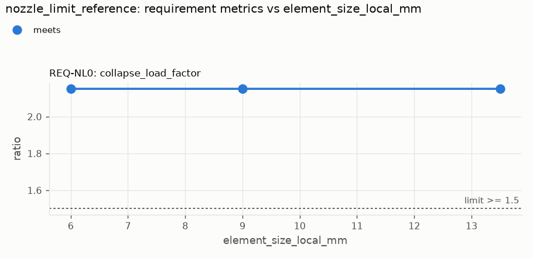
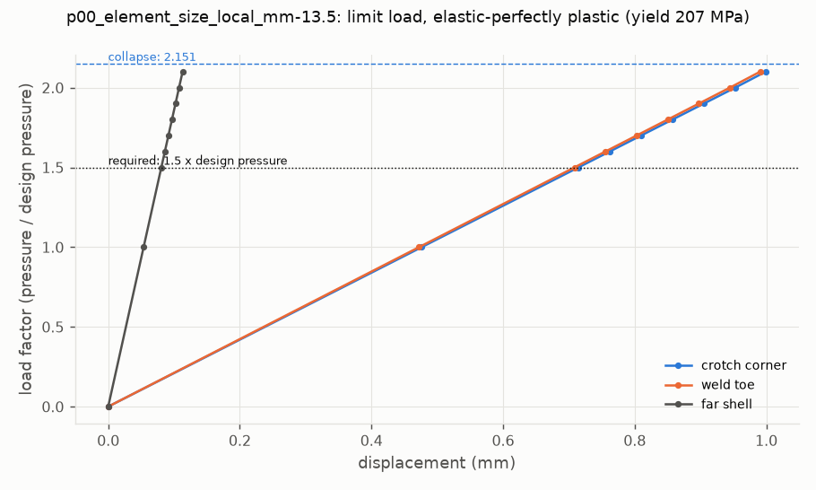
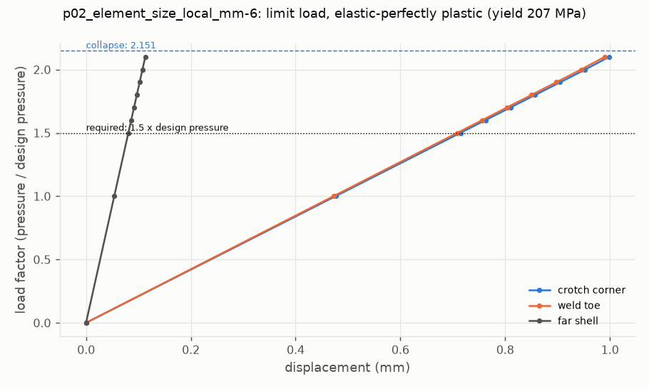

# Engineering review report: nozzle_limit_reference

- **Run:** `20261127-143302_nozzle_limit_reference`
- **Generated:** 2026-11-27T20:40:58+00:00
- **Case file SHA-256:** `95b9095f9fca8fee87ff9c1881d1ca4ab285048e76303eb3e0573c9da88bc0cd`
- **Environment:** Python 3.14.10, numpy 2.5.5, scipy 1.18.1, matplotlib 3.11.2, cadquery 2.8.0; Windows-11-10.0.26100-SP0
- **Tools:** cadquery 2.8.0; gmsh 4.15.0; CalculiX This is Version 2.22
- **Code version:** git `1f0cd13401bd0406f051705d637c5b095d772544` (uncommitted changes present)
- **Simulation status:** completed
- **Verification status:** PASS

## Scope

Limit load of the plain closed-end shell of study 18 (Ri 500 mm, t 16 mm, no nozzle), elastic-perfectly plastic at 1.5 S = 207 MPa, small displacement; pressure stepped 1, 1.5, then 0.1 apart to 2.4 times 3.5 MPa; three local mesh sizes as the nozzle cases use.

**Assumptions**

- Elastic-perfectly plastic steel, von Mises, yield 1.5 S = 207 MPa (the limit-load route's yield), E 200 GPa, nu 0.3; small displacement (NLGEOM off), as Part 5.2.3 specifies.
- Closed vessel: the end thrust applied as a uniform axial traction on the cut end, ramped with the pressure.
- The collapse load is the last converged increment's load factor; the minimum increment (1e-4 of a 0.1 load step) brackets it to 1e-5.
- Quarter model by symmetry, as part 1 (the same CAD route, here without the nozzle).

## Requirements

| ID | Requirement | Metric | Limit |
|---|---|---|---|
| REQ-NL0 | Reference: the plain shell carries 1.5 times the design pressure (Part 5.2.3 load case), collapse load factor >= 1.5. | `collapse_load_factor` | >= 1.5 - |

## Summary across points

| Point | element_size_local_mm | REQ-NL0 | Checks |
|---|---|---|---|
| p00_element_size_local_mm-13.5 | 13.5 | 2.151 -: **PASS** | 9/9 PASS |
| p01_element_size_local_mm-9 | 9 | 2.151 -: **PASS** | 9/9 PASS |
| p02_element_size_local_mm-6 | 6 | 2.151 -: **PASS** | 9/9 PASS |

## Run-level checks

Checks that use several points together (for example mesh convergence).

| Check | Description | Value | Tolerance | Status |
|---|---|---|---|---|
| discretization_collapse_load_factor | relative discretization uncertainty of collapse_load_factor, converged to within the noise floor (spread 1.9e-06 <= 0.003) | 1.19e-06 | 0.03 | PASS |

## Point details

### p00_element_size_local_mm-13.5

Parameters: shell_inner_radius_mm = 500, shell_thickness_mm = 16, shell_half_length_mm = 1000, nozzle_inner_radius_mm = 100, nozzle_thickness_mm = 12, nozzle_length_mm = 350, weld_fillet_radius_mm = 10, pressure_MPa = 3.5, youngs_modulus_MPa = 2e+05, poisson_ratio = 0.3, element_size_local_mm = 13.5, element_size_far_mm = 24, refine_radius_mm = 140, mesh_growth = 0.08, allowable_stress_MPa = 138, load_factor_max = 2.4, plain_shell = 1

Derived: yield_1p5S_MPa = 207, cylinder_collapse_pressure_MPa = 7.529, cylinder_collapse_load_factor = 2.151, required_load_factor = 1.5, schedule = [1.0, 1.5, 1.6, 1.7, 1.8, 1.9, 2.0, 2.1, 2.2, 2.3, 2.4]

| Requirement | Result | Limit | Margin | Verdict | Evidence |
|---|---|---|---|---|---|
| REQ-NL0 | 2.151 - | >= 1.5 | 0.651 | **PASS** | [point.json](points/p00_element_size_local_mm-13.5/point.json) |

| Check | Description | Value | Tolerance | Status |
|---|---|---|---|---|
| cad_valid | CadQuery B-rep valid (0 = yes) | 0.00e+00 | 0 | PASS |
| mesh_volume | \|mesh volume (straight-sided tets) - CAD volume\| / CAD volume | 9.91e-06 | 0.01 | PASS |
| equilibrium_y | max over the completed steps of \|reaction on y = 0 / (load factor x exact resultant) - 1\| | 6.02e-07 | 1e-05 | PASS |
| equilibrium_z | max over the completed steps of \|reaction on z = 0 / (load factor x exact resultant) - 1\| | 1.99e-07 | 1e-05 | PASS |
| self_balance_x | max over the completed steps of \|reaction at the single axial support\| / (load factor x quarter nozzle thrust) (a closed vessel: 0) | 5.01e-14 | 1e-05 | PASS |
| collapse_found (validity) | the analysis stopped on non-convergence below load_factor_max (0 = yes): the collapse load is bracketed | 0.00e+00 | 0 | PASS |
| passed_code_load (validity) | the step to load factor 1.5 completed (0 = yes) | 0.00e+00 | 0 | PASS |
| cylinder_exact | \|collapse pressure - exact closed-end cylinder (2 / sqrt 3) sigma_y ln(Ro / Ri)\| / exact | 5.77e-05 | 0.001 | PASS |
| cad_hand_volume | \|CAD volume - hand volume\| / hand volume (exact for the plain shell) | 5.00e-15 | 1e-09 | PASS |

### p01_element_size_local_mm-9

Parameters: shell_inner_radius_mm = 500, shell_thickness_mm = 16, shell_half_length_mm = 1000, nozzle_inner_radius_mm = 100, nozzle_thickness_mm = 12, nozzle_length_mm = 350, weld_fillet_radius_mm = 10, pressure_MPa = 3.5, youngs_modulus_MPa = 2e+05, poisson_ratio = 0.3, element_size_local_mm = 9, element_size_far_mm = 24, refine_radius_mm = 140, mesh_growth = 0.08, allowable_stress_MPa = 138, load_factor_max = 2.4, plain_shell = 1

Derived: yield_1p5S_MPa = 207, cylinder_collapse_pressure_MPa = 7.529, cylinder_collapse_load_factor = 2.151, required_load_factor = 1.5, schedule = [1.0, 1.5, 1.6, 1.7, 1.8, 1.9, 2.0, 2.1, 2.2, 2.3, 2.4]

| Requirement | Result | Limit | Margin | Verdict | Evidence |
|---|---|---|---|---|---|
| REQ-NL0 | 2.151 - | >= 1.5 | 0.651 | **PASS** | [point.json](points/p01_element_size_local_mm-9/point.json) |

| Check | Description | Value | Tolerance | Status |
|---|---|---|---|---|
| cad_valid | CadQuery B-rep valid (0 = yes) | 0.00e+00 | 0 | PASS |
| mesh_volume | \|mesh volume (straight-sided tets) - CAD volume\| / CAD volume | 7.15e-06 | 0.01 | PASS |
| equilibrium_y | max over the completed steps of \|reaction on y = 0 / (load factor x exact resultant) - 1\| | 2.86e-06 | 1e-05 | PASS |
| equilibrium_z | max over the completed steps of \|reaction on z = 0 / (load factor x exact resultant) - 1\| | 1.99e-07 | 1e-05 | PASS |
| self_balance_x | max over the completed steps of \|reaction at the single axial support\| / (load factor x quarter nozzle thrust) (a closed vessel: 0) | 2.15e-14 | 1e-05 | PASS |
| collapse_found (validity) | the analysis stopped on non-convergence below load_factor_max (0 = yes): the collapse load is bracketed | 0.00e+00 | 0 | PASS |
| passed_code_load (validity) | the step to load factor 1.5 completed (0 = yes) | 0.00e+00 | 0 | PASS |
| cylinder_exact | \|collapse pressure - exact closed-end cylinder (2 / sqrt 3) sigma_y ln(Ro / Ri)\| / exact | 5.96e-05 | 0.001 | PASS |
| cad_hand_volume | \|CAD volume - hand volume\| / hand volume (exact for the plain shell) | 5.00e-15 | 1e-09 | PASS |

### p02_element_size_local_mm-6

Parameters: shell_inner_radius_mm = 500, shell_thickness_mm = 16, shell_half_length_mm = 1000, nozzle_inner_radius_mm = 100, nozzle_thickness_mm = 12, nozzle_length_mm = 350, weld_fillet_radius_mm = 10, pressure_MPa = 3.5, youngs_modulus_MPa = 2e+05, poisson_ratio = 0.3, element_size_local_mm = 6, element_size_far_mm = 24, refine_radius_mm = 140, mesh_growth = 0.08, allowable_stress_MPa = 138, load_factor_max = 2.4, plain_shell = 1

Derived: yield_1p5S_MPa = 207, cylinder_collapse_pressure_MPa = 7.529, cylinder_collapse_load_factor = 2.151, required_load_factor = 1.5, schedule = [1.0, 1.5, 1.6, 1.7, 1.8, 1.9, 2.0, 2.1, 2.2, 2.3, 2.4]

| Requirement | Result | Limit | Margin | Verdict | Evidence |
|---|---|---|---|---|---|
| REQ-NL0 | 2.151 - | >= 1.5 | 0.651 | **PASS** | [point.json](points/p02_element_size_local_mm-6/point.json) |

| Check | Description | Value | Tolerance | Status |
|---|---|---|---|---|
| cad_valid | CadQuery B-rep valid (0 = yes) | 0.00e+00 | 0 | PASS |
| mesh_volume | \|mesh volume (straight-sided tets) - CAD volume\| / CAD volume | 1.68e-05 | 0.01 | PASS |
| equilibrium_y | max over the completed steps of \|reaction on y = 0 / (load factor x exact resultant) - 1\| | 1.61e-06 | 1e-05 | PASS |
| equilibrium_z | max over the completed steps of \|reaction on z = 0 / (load factor x exact resultant) - 1\| | 1.99e-07 | 1e-05 | PASS |
| self_balance_x | max over the completed steps of \|reaction at the single axial support\| / (load factor x quarter nozzle thrust) (a closed vessel: 0) | 4.78e-14 | 1e-05 | PASS |
| collapse_found (validity) | the analysis stopped on non-convergence below load_factor_max (0 = yes): the collapse load is bracketed | 0.00e+00 | 0 | PASS |
| passed_code_load (validity) | the step to load factor 1.5 completed (0 = yes) | 0.00e+00 | 0 | PASS |
| cylinder_exact | \|collapse pressure - exact closed-end cylinder (2 / sqrt 3) sigma_y ln(Ro / Ri)\| / exact | 5.77e-05 | 0.001 | PASS |
| cad_hand_volume | \|CAD volume - hand volume\| / hand volume (exact for the plain shell) | 5.00e-15 | 1e-09 | PASS |

## Limitations

- A reference for the method only: the plain shell has no nozzle.
- A converged solver run that matches an analytical reference shows that the equations were solved correctly. It does not show that the equations represent real hardware.

## Engineering acceptance

Pending human review. This report does not accept or reject the design.
