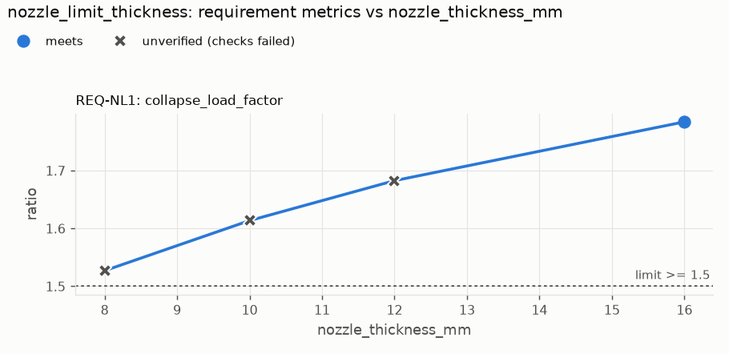
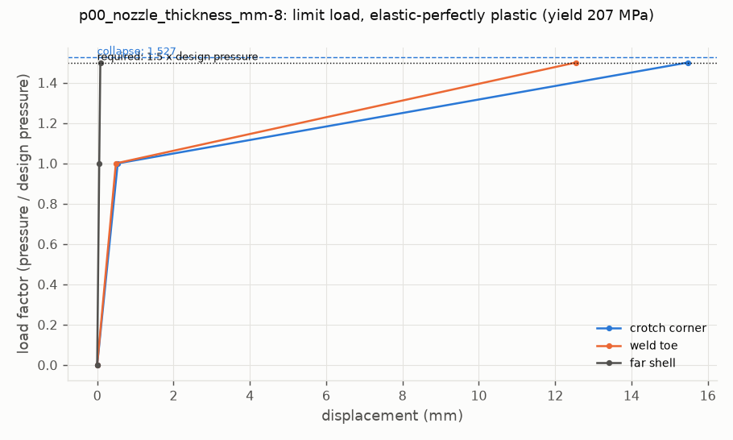
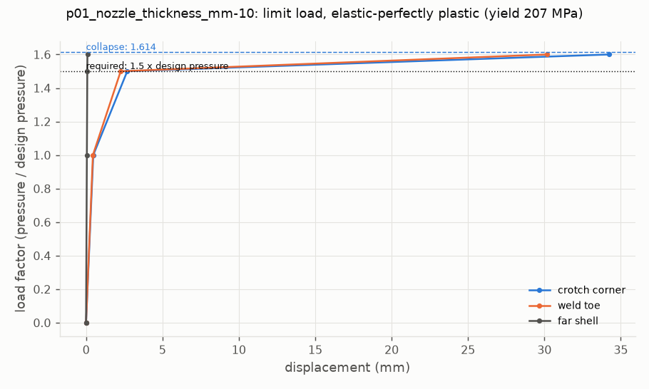
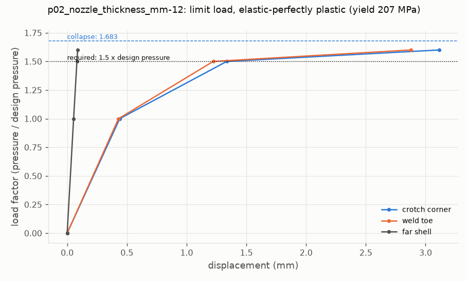
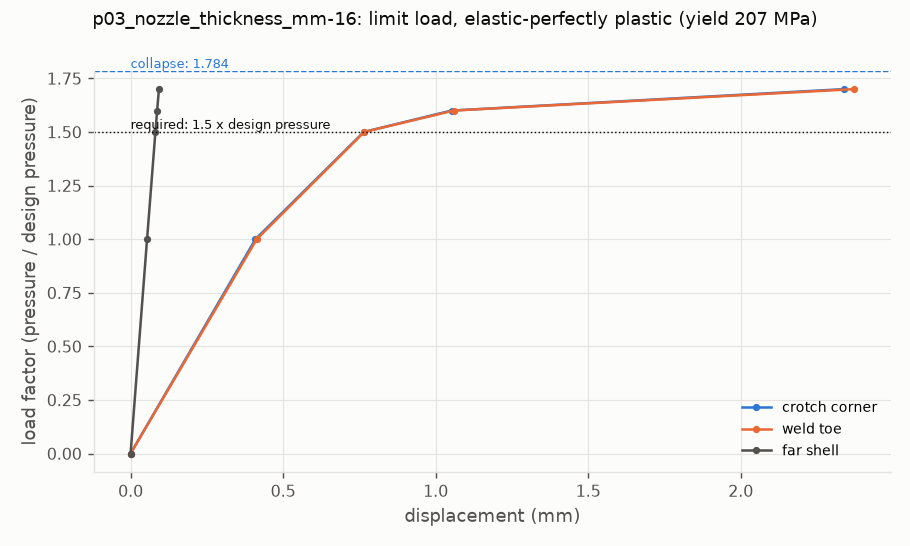

# Engineering review report: nozzle_limit_thickness

- **Run:** `20261127-143302_nozzle_limit_thickness`
- **Generated:** 2026-11-27T20:49:48+00:00
- **Case file SHA-256:** `d05049c2b7a86c4a73182924b18bb5bcd04fbb9af3f9f7c72619629bd3af0563`
- **Environment:** Python 3.14.10, numpy 2.5.5, scipy 1.18.1, matplotlib 3.11.2, cadquery 2.8.0; Windows-11-10.0.26100-SP0
- **Tools:** cadquery 2.8.0; gmsh 4.15.0; CalculiX This is Version 2.22
- **Code version:** git `1f0cd13401bd0406f051705d637c5b095d772544` (uncommitted changes present)
- **Simulation status:** completed
- **Verification status:** FAIL

> **Warning:** verification did not pass for every point. Requirement verdicts marked *(unverified)* are not supported by evidence and must not be used for acceptance.

## Scope

Limit load of the study-18 nozzle (shell Ri 500 x 16 mm, set-in nozzle ri 100 mm, 10 mm weld fillet, no pad) with nozzle walls of 8 / 10 / 12 / 16 mm; elastic-perfectly plastic at 1.5 S = 207 MPa, small displacement; pressure stepped to 2.4 times 3.5 MPa; local element size 9 mm.

**Assumptions**

- Elastic-perfectly plastic steel, von Mises, yield 1.5 S = 207 MPa, E 200 GPa, nu 0.3; small displacement (NLGEOM off), as Part 5.2.3 specifies.
- Closed vessel: end thrusts as uniform axial tractions on the cut ends, ramped with the pressure.
- The collapse load is the last converged increment's load factor (method checked on the exact plain cylinder, nozzle_limit_reference).
- Geometry as part 1: outer weld a 10 mm fillet at every wall, inner corner sharp; quarter model by symmetry.
- Allowable S = 138 MPa: synthetic, as part 1.

## Requirements

| ID | Requirement | Metric | Limit |
|---|---|---|---|
| REQ-NL1 | Protection against plastic collapse by limit load (the method of Part 5.2.3): the nozzle without a pad carries 1.5 times the design pressure (collapse load factor >= 1.5, yield 1.5 S). | `collapse_load_factor` | >= 1.5 - |

## Summary across points

| Point | nozzle_thickness_mm | REQ-NL1 | Checks |
|---|---|---|---|
| p00_nozzle_thickness_mm-8 | 8 | 1.527 -: **PASS (unverified)** | 6/7 FAIL |
| p01_nozzle_thickness_mm-10 | 10 | 1.614 -: **PASS (unverified)** | 6/7 FAIL |
| p02_nozzle_thickness_mm-12 | 12 | 1.683 -: **PASS (unverified)** | 6/7 FAIL |
| p03_nozzle_thickness_mm-16 | 16 | 1.784 -: **PASS** | 7/7 PASS |

## Point details

### p00_nozzle_thickness_mm-8

Parameters: shell_inner_radius_mm = 500, shell_thickness_mm = 16, shell_half_length_mm = 1000, nozzle_inner_radius_mm = 100, nozzle_thickness_mm = 8, nozzle_length_mm = 350, weld_fillet_radius_mm = 10, pressure_MPa = 3.5, youngs_modulus_MPa = 2e+05, poisson_ratio = 0.3, element_size_local_mm = 9, element_size_far_mm = 24, refine_radius_mm = 140, mesh_growth = 0.08, allowable_stress_MPa = 138, load_factor_max = 2.4

Derived: yield_1p5S_MPa = 207, cylinder_collapse_pressure_MPa = 7.529, cylinder_collapse_load_factor = 2.151, required_load_factor = 1.5, schedule = [1.0, 1.5, 1.6, 1.7, 1.8, 1.9, 2.0, 2.1, 2.2, 2.3, 2.4]

| Requirement | Result | Limit | Margin | Verdict | Evidence |
|---|---|---|---|---|---|
| REQ-NL1 | 1.527 - | >= 1.5 | 0.027 | **PASS (unverified)** | [point.json](points/p00_nozzle_thickness_mm-8/point.json) |

| Check | Description | Value | Tolerance | Status |
|---|---|---|---|---|
| cad_valid | CadQuery B-rep valid (0 = yes) | 0.00e+00 | 0 | PASS |
| mesh_volume | \|mesh volume (straight-sided tets) - CAD volume\| / CAD volume | 7.55e-05 | 0.01 | PASS |
| equilibrium_y | max over the completed steps of \|reaction on y = 0 / (load factor x exact resultant) - 1\| | 5.51e-07 | 1e-05 | PASS |
| equilibrium_z | max over the completed steps of \|reaction on z = 0 / (load factor x exact resultant) - 1\| | 2.96e-07 | 1e-05 | PASS |
| self_balance_x | max over the completed steps of \|reaction at the single axial support\| / (load factor x quarter nozzle thrust) (a closed vessel: 0) | 1.53e-05 | 1e-05 | FAIL |
| collapse_found (validity) | the analysis stopped on non-convergence below load_factor_max (0 = yes): the collapse load is bracketed | 0.00e+00 | 0 | PASS |
| passed_code_load (validity) | the step to load factor 1.5 completed (0 = yes) | 0.00e+00 | 0 | PASS |

### p01_nozzle_thickness_mm-10

Parameters: shell_inner_radius_mm = 500, shell_thickness_mm = 16, shell_half_length_mm = 1000, nozzle_inner_radius_mm = 100, nozzle_thickness_mm = 10, nozzle_length_mm = 350, weld_fillet_radius_mm = 10, pressure_MPa = 3.5, youngs_modulus_MPa = 2e+05, poisson_ratio = 0.3, element_size_local_mm = 9, element_size_far_mm = 24, refine_radius_mm = 140, mesh_growth = 0.08, allowable_stress_MPa = 138, load_factor_max = 2.4

Derived: yield_1p5S_MPa = 207, cylinder_collapse_pressure_MPa = 7.529, cylinder_collapse_load_factor = 2.151, required_load_factor = 1.5, schedule = [1.0, 1.5, 1.6, 1.7, 1.8, 1.9, 2.0, 2.1, 2.2, 2.3, 2.4]

| Requirement | Result | Limit | Margin | Verdict | Evidence |
|---|---|---|---|---|---|
| REQ-NL1 | 1.614 - | >= 1.5 | 0.114 | **PASS (unverified)** | [point.json](points/p01_nozzle_thickness_mm-10/point.json) |

| Check | Description | Value | Tolerance | Status |
|---|---|---|---|---|
| cad_valid | CadQuery B-rep valid (0 = yes) | 0.00e+00 | 0 | PASS |
| mesh_volume | \|mesh volume (straight-sided tets) - CAD volume\| / CAD volume | 5.94e-05 | 0.01 | PASS |
| equilibrium_y | max over the completed steps of \|reaction on y = 0 / (load factor x exact resultant) - 1\| | 5.51e-07 | 1e-05 | PASS |
| equilibrium_z | max over the completed steps of \|reaction on z = 0 / (load factor x exact resultant) - 1\| | 2.96e-07 | 1e-05 | PASS |
| self_balance_x | max over the completed steps of \|reaction at the single axial support\| / (load factor x quarter nozzle thrust) (a closed vessel: 0) | 1.26e-05 | 1e-05 | FAIL |
| collapse_found (validity) | the analysis stopped on non-convergence below load_factor_max (0 = yes): the collapse load is bracketed | 0.00e+00 | 0 | PASS |
| passed_code_load (validity) | the step to load factor 1.5 completed (0 = yes) | 0.00e+00 | 0 | PASS |

### p02_nozzle_thickness_mm-12

Parameters: shell_inner_radius_mm = 500, shell_thickness_mm = 16, shell_half_length_mm = 1000, nozzle_inner_radius_mm = 100, nozzle_thickness_mm = 12, nozzle_length_mm = 350, weld_fillet_radius_mm = 10, pressure_MPa = 3.5, youngs_modulus_MPa = 2e+05, poisson_ratio = 0.3, element_size_local_mm = 9, element_size_far_mm = 24, refine_radius_mm = 140, mesh_growth = 0.08, allowable_stress_MPa = 138, load_factor_max = 2.4

Derived: yield_1p5S_MPa = 207, cylinder_collapse_pressure_MPa = 7.529, cylinder_collapse_load_factor = 2.151, required_load_factor = 1.5, schedule = [1.0, 1.5, 1.6, 1.7, 1.8, 1.9, 2.0, 2.1, 2.2, 2.3, 2.4]

| Requirement | Result | Limit | Margin | Verdict | Evidence |
|---|---|---|---|---|---|
| REQ-NL1 | 1.683 - | >= 1.5 | 0.183 | **PASS (unverified)** | [point.json](points/p02_nozzle_thickness_mm-12/point.json) |

| Check | Description | Value | Tolerance | Status |
|---|---|---|---|---|
| cad_valid | CadQuery B-rep valid (0 = yes) | 0.00e+00 | 0 | PASS |
| mesh_volume | \|mesh volume (straight-sided tets) - CAD volume\| / CAD volume | 8.26e-05 | 0.01 | PASS |
| equilibrium_y | max over the completed steps of \|reaction on y = 0 / (load factor x exact resultant) - 1\| | 5.51e-07 | 1e-05 | PASS |
| equilibrium_z | max over the completed steps of \|reaction on z = 0 / (load factor x exact resultant) - 1\| | 2.96e-07 | 1e-05 | PASS |
| self_balance_x | max over the completed steps of \|reaction at the single axial support\| / (load factor x quarter nozzle thrust) (a closed vessel: 0) | 1.08e-05 | 1e-05 | FAIL |
| collapse_found (validity) | the analysis stopped on non-convergence below load_factor_max (0 = yes): the collapse load is bracketed | 0.00e+00 | 0 | PASS |
| passed_code_load (validity) | the step to load factor 1.5 completed (0 = yes) | 0.00e+00 | 0 | PASS |

### p03_nozzle_thickness_mm-16

Parameters: shell_inner_radius_mm = 500, shell_thickness_mm = 16, shell_half_length_mm = 1000, nozzle_inner_radius_mm = 100, nozzle_thickness_mm = 16, nozzle_length_mm = 350, weld_fillet_radius_mm = 10, pressure_MPa = 3.5, youngs_modulus_MPa = 2e+05, poisson_ratio = 0.3, element_size_local_mm = 9, element_size_far_mm = 24, refine_radius_mm = 140, mesh_growth = 0.08, allowable_stress_MPa = 138, load_factor_max = 2.4

Derived: yield_1p5S_MPa = 207, cylinder_collapse_pressure_MPa = 7.529, cylinder_collapse_load_factor = 2.151, required_load_factor = 1.5, schedule = [1.0, 1.5, 1.6, 1.7, 1.8, 1.9, 2.0, 2.1, 2.2, 2.3, 2.4]

| Requirement | Result | Limit | Margin | Verdict | Evidence |
|---|---|---|---|---|---|
| REQ-NL1 | 1.784 - | >= 1.5 | 0.284 | **PASS** | [point.json](points/p03_nozzle_thickness_mm-16/point.json) |

| Check | Description | Value | Tolerance | Status |
|---|---|---|---|---|
| cad_valid | CadQuery B-rep valid (0 = yes) | 0.00e+00 | 0 | PASS |
| mesh_volume | \|mesh volume (straight-sided tets) - CAD volume\| / CAD volume | 6.06e-05 | 0.01 | PASS |
| equilibrium_y | max over the completed steps of \|reaction on y = 0 / (load factor x exact resultant) - 1\| | 5.51e-07 | 1e-05 | PASS |
| equilibrium_z | max over the completed steps of \|reaction on z = 0 / (load factor x exact resultant) - 1\| | 2.96e-07 | 1e-05 | PASS |
| self_balance_x | max over the completed steps of \|reaction at the single axial support\| / (load factor x quarter nozzle thrust) (a closed vessel: 0) | 8.49e-06 | 1e-05 | PASS |
| collapse_found (validity) | the analysis stopped on non-convergence below load_factor_max (0 = yes): the collapse load is bracketed | 0.00e+00 | 0 | PASS |
| passed_code_load (validity) | the step to load factor 1.5 completed (0 = yes) | 0.00e+00 | 0 | PASS |

## Limitations

- Plastic collapse only (Part 5.2.3): local strain (5.3), ratcheting and fatigue are separate checks. A thinner nozzle raises the elastic P + Q at the junction; part 1 checked it at 12 mm and up only.
- Pressure only: no piping loads, which a thin nozzle carries less well.
- Mesh h_local 9 mm: its uncertainty comes from nozzle_limit_mesh at 12 mm.
- A converged solver run that matches an analytical reference shows that the equations were solved correctly. It does not show that the equations represent real hardware.

## Engineering acceptance

Pending human review. This report does not accept or reject the design.
