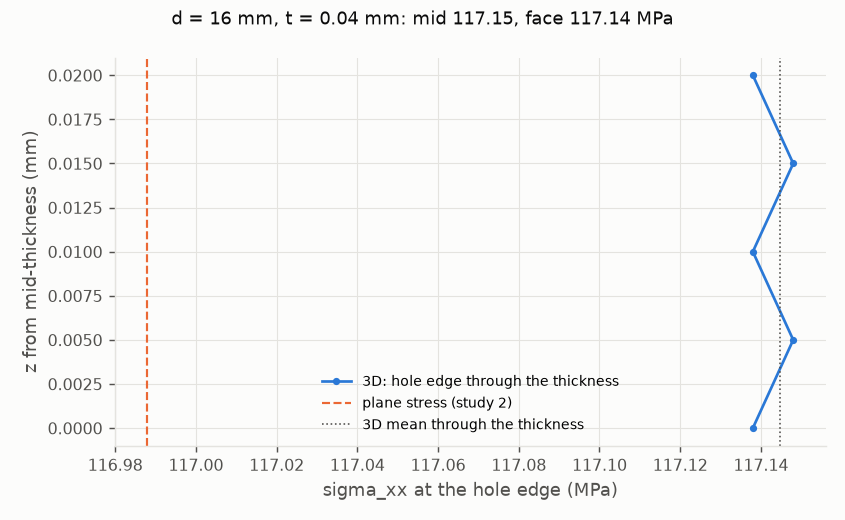

# Engineering review report: strap_3d_thin

- **Run:** `20261127-151903_strap_3d_thin`
- **Generated:** 2026-11-27T20:23:33+00:00
- **Case file SHA-256:** `96eac49bcdc8a406efa971be0022f2176ec49f0e0bce7d2e27fefd12380b7121`
- **Environment:** Python 3.14.10, numpy 2.5.5, scipy 1.18.1, matplotlib 3.11.2, cadquery 2.8.0; Windows-11-10.0.26100-SP0
- **Tools:** cadquery 2.8.0; gmsh 4.15.0; CalculiX This is Version 2.22
- **Code version:** git `7a9247e290fea5426430b32c1d0da1812dbb5d86` (uncommitted changes present)
- **Simulation status:** completed
- **Verification status:** FAIL

> **Warning:** verification did not pass for every point. Requirement verdicts marked *(unverified)* are not supported by evidence and must not be used for acceptance.

## Scope

Study 2's strap geometry in plan (160 x 40 mm, 16 mm hole) at 0.04 mm thickness with 50 N (the same stresses as 4 mm and 5 kN), as a 3D solid: the thin-plate limit of the 3D pipeline against study 2's plane stress.

**Assumptions**

- Linear elastic, E = 68.9 GPa, nu = 0.33; load scaled with the thickness so the stresses are those of the real strap.
- Two element layers through the half thickness: in the thin limit the stresses do not vary through it.

## Requirements

| ID | Requirement | Metric | Limit |
|---|---|---|---|
| REQ-H1 | Reference only: the hole-edge peak in the thin-plate limit stays under 120 MPa, as plane stress does. | `peak_hole_stress_MPa` | <= 120 MPa |

## Summary across points

| Point | REQ-H1 | Checks |
|---|---|---|
| p00_baseline | 117.1 MPa: **PASS (unverified)** | 9/10 FAIL |

## Point details

### p00_baseline

Parameters: length_mm = 160, width_mm = 40, thickness_mm = 0.04, hole_diameter_mm = 16, axial_load_N = 50, youngs_modulus_MPa = 6.89e+04, poisson_ratio = 0.33, yield_strength_MPa = 276, hole_element_size_mm = 0.267, far_element_size_mm = 4, z_layers = 2, z_ratio = 1, plane_stress_peak_MPa = 117

Derived: t_over_d = 0.0025, t_over_r = 0.005, net_stress_MPa = 52.08, kt_net_peterson = 2.236, peak_stress_peterson_MPa = 116.4, face_area_closed_form_mm2 = 1550

| Requirement | Result | Limit | Margin | Verdict | Evidence |
|---|---|---|---|---|---|
| REQ-H1 | 117.1 MPa | <= 120 | 2.85 | **PASS (unverified)** | [point.json](points/p00_baseline/point.json) |

| Check | Description | Value | Tolerance | Status |
|---|---|---|---|---|
| cad_area | \|face area from CadQuery - closed form\| / closed form | 1.47e-16 | 1e-09 | PASS |
| loaded_area | \|area of the loaded element faces - W t / 4\| / (W t / 4) | 1.11e-16 | 1e-09 | PASS |
| equilibrium | \|reaction on x = 0 + F / 4\| / (F / 4) | 0.00e+00 | 1e-06 | PASS |
| ligament_force | \|integral of sigma_xx over the ligament face - F / 4\| / (F / 4) | 6.05e-04 | 0.01 | PASS |
| far_field_uniform | max \|sigma_xx on the loaded end - F / (W t)\| / (F / (W t)) | 1.54e-04 | 0.001 | PASS |
| kt_mean_reference | \|Kt_net of the through-thickness mean - Peterson (plane stress)\| / Peterson (model form: the mean differs from plane stress by order (t / r)^2) | 6.04e-03 | 0.02 | PASS |
| mid_is_peak (validity) | the hole-edge peak is at mid-thickness (0 = yes) | 1.00e+00 | 0 | FAIL |
| linear_material (validity) | peak hole-edge stress / yield strength | 4.24e-01 | 1 | PASS |
| thin_plate_limit | \|mid-thickness hole stress - study 2's plane-stress value\| / plane stress (thin plate: the 3D solution tends to plane stress) | 1.28e-03 | 0.003 | PASS |
| thin_plate_uniform | \|face / mid-thickness hole stress - 1\| (thin plate: uniform through t) | 0.00e+00 | 0.003 | PASS |

## Limitations

- A reference for the 3D pipeline only.
- A converged solver run that matches an analytical reference shows that the equations were solved correctly. It does not show that the equations represent real hardware.

## Engineering acceptance

Pending human review. This report does not accept or reject the design.
