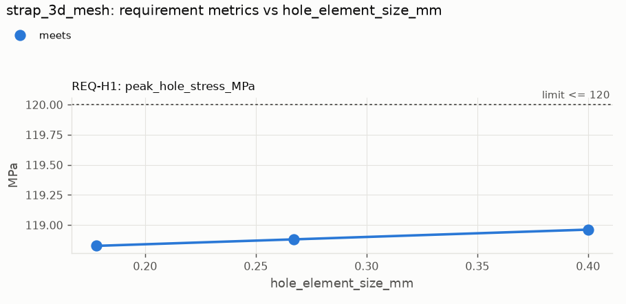
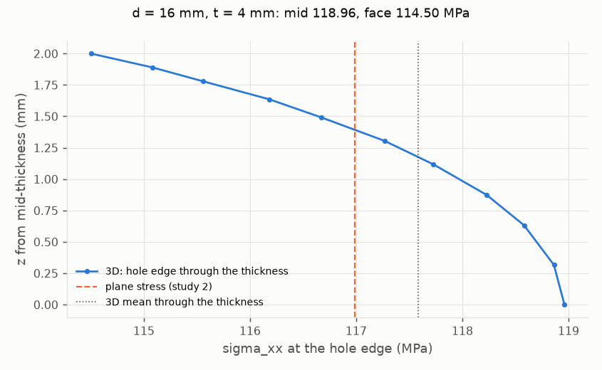
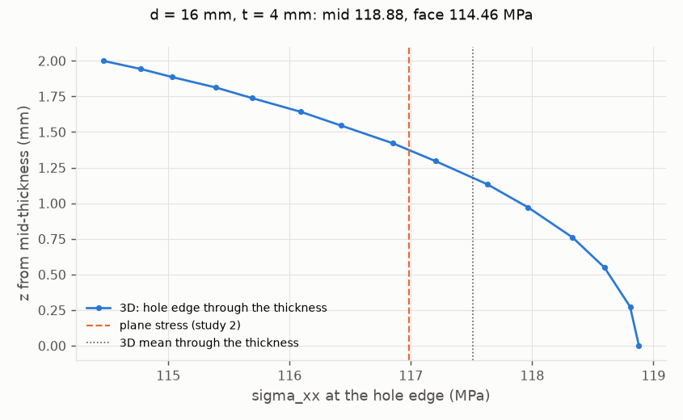
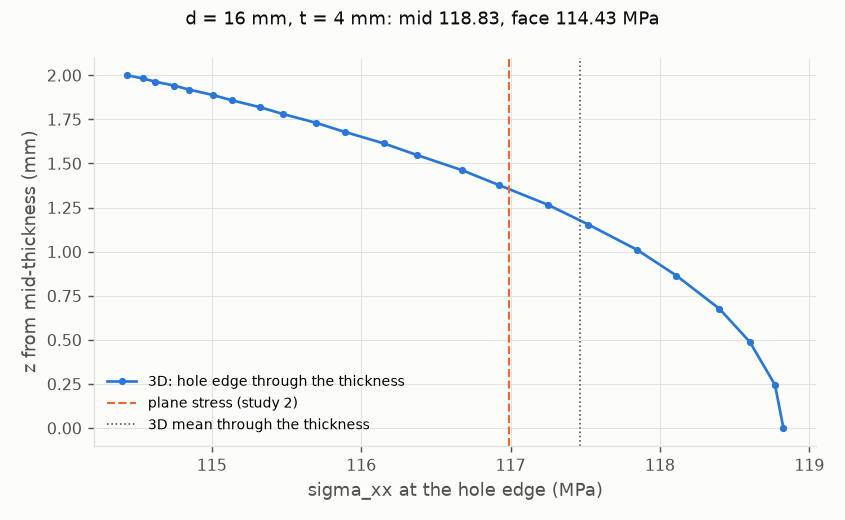

# Engineering review report: strap_3d_mesh

- **Run:** `20261127-151911_strap_3d_mesh`
- **Generated:** 2026-11-27T20:23:43+00:00
- **Case file SHA-256:** `d36d36aac2602be54373262c349ba1dd713b1c4e81ab4703ff6e486e8e97724e`
- **Environment:** Python 3.14.10, numpy 2.5.5, scipy 1.18.1, matplotlib 3.11.2, cadquery 2.8.0; Windows-11-10.0.26100-SP0
- **Tools:** cadquery 2.8.0; gmsh 4.15.0; CalculiX This is Version 2.22
- **Code version:** git `7a9247e290fea5426430b32c1d0da1812dbb5d86` (uncommitted changes present)
- **Simulation status:** completed
- **Verification status:** PASS

## Scope

Study 2's 6061-T6 strap (160 x 40 x 4 mm, 5 kN) with a 16 mm cable hole, as a 3D solid through its thickness (eighth model, C3D20); hole-edge element size 0.4 / 0.267 / 0.178 mm with the layers through the half thickness refined alongside (5 / 7 / 11, graded 1.3 to the face).

**Assumptions**

- Linear elastic, isotropic 6061-T6 (E = 68.9 GPa, nu = 0.33), as study 2; checked: peak below yield.
- Uniform end traction 72 mm from the hole, as study 2; checked: the stress there is uniform.
- Hole smooth, central and straight through (symmetric about the mid-plane and both centre lines).
- The 120 MPa allowable is synthetic, as study 2; it is compared with the largest stress on the hole edge, at mid-thickness.

## Requirements

| ID | Requirement | Metric | Limit |
|---|---|---|---|
| REQ-H1 | Peak stress at the hole edge under the 5 kN service load shall not exceed 120 MPa (synthetic fatigue allowable), anywhere through the thickness. | `peak_hole_stress_MPa` | <= 120 MPa |

## Summary across points

| Point | hole_element_size_mm | REQ-H1 | Checks |
|---|---|---|---|
| p00_hole_element_size_mm-0.4 | 0.4 | 119 MPa: **PASS** | 8/8 PASS |
| p01_hole_element_size_mm-0.267 | 0.267 | 118.9 MPa: **PASS** | 8/8 PASS |
| p02_hole_element_size_mm-0.178 | 0.178 | 118.8 MPa: **PASS** | 8/8 PASS |

## Run-level checks

Checks that use several points together (for example mesh convergence).

| Check | Description | Value | Tolerance | Status |
|---|---|---|---|---|
| discretization_mean_hole_stress_MPa | relative discretization uncertainty of mean_hole_stress_MPa, monotone (R = 0.689): GCI_fine, observed order 0.93, extrapolated 117.359 | 0.00112 | 0.01 | PASS |
| discretization_peak_hole_stress_MPa | relative discretization uncertainty of peak_hole_stress_MPa, monotone (R = 0.667): GCI_fine, observed order 1.01, extrapolated 118.72 | 0.00112 | 0.01 | PASS |

## Point details

### p00_hole_element_size_mm-0.4

Parameters: length_mm = 160, width_mm = 40, thickness_mm = 4, hole_diameter_mm = 16, axial_load_N = 5000, youngs_modulus_MPa = 6.89e+04, poisson_ratio = 0.33, yield_strength_MPa = 276, hole_element_size_mm = 0.4, far_element_size_mm = 4, z_layers = 0, z_ratio = 1.3, plane_stress_peak_MPa = 117

Derived: t_over_d = 0.25, t_over_r = 0.5, net_stress_MPa = 52.08, kt_net_peterson = 2.236, peak_stress_peterson_MPa = 116.4, face_area_closed_form_mm2 = 1550

| Requirement | Result | Limit | Margin | Verdict | Evidence |
|---|---|---|---|---|---|
| REQ-H1 | 119 MPa | <= 120 | 1.04 | **PASS** | [point.json](points/p00_hole_element_size_mm-0.4/point.json) |

| Check | Description | Value | Tolerance | Status |
|---|---|---|---|---|
| cad_area | \|face area from CadQuery - closed form\| / closed form | 1.47e-16 | 1e-09 | PASS |
| loaded_area | \|area of the loaded element faces - W t / 4\| / (W t / 4) | 2.22e-16 | 1e-09 | PASS |
| equilibrium | \|reaction on x = 0 + F / 4\| / (F / 4) | 0.00e+00 | 1e-06 | PASS |
| ligament_force | \|integral of sigma_xx over the ligament face - F / 4\| / (F / 4) | 6.11e-04 | 0.01 | PASS |
| far_field_uniform | max \|sigma_xx on the loaded end - F / (W t)\| / (F / (W t)) | 1.63e-04 | 0.001 | PASS |
| kt_mean_reference | \|Kt_net of the through-thickness mean - Peterson (plane stress)\| / Peterson (model form: the mean differs from plane stress by order (t / r)^2) | 9.80e-03 | 0.02 | PASS |
| mid_is_peak (validity) | the hole-edge peak is at mid-thickness (0 = yes) | 0.00e+00 | 0 | PASS |
| linear_material (validity) | peak hole-edge stress / yield strength | 4.31e-01 | 1 | PASS |

### p01_hole_element_size_mm-0.267

Parameters: length_mm = 160, width_mm = 40, thickness_mm = 4, hole_diameter_mm = 16, axial_load_N = 5000, youngs_modulus_MPa = 6.89e+04, poisson_ratio = 0.33, yield_strength_MPa = 276, hole_element_size_mm = 0.267, far_element_size_mm = 4, z_layers = 0, z_ratio = 1.3, plane_stress_peak_MPa = 117

Derived: t_over_d = 0.25, t_over_r = 0.5, net_stress_MPa = 52.08, kt_net_peterson = 2.236, peak_stress_peterson_MPa = 116.4, face_area_closed_form_mm2 = 1550

| Requirement | Result | Limit | Margin | Verdict | Evidence |
|---|---|---|---|---|---|
| REQ-H1 | 118.9 MPa | <= 120 | 1.12 | **PASS** | [point.json](points/p01_hole_element_size_mm-0.267/point.json) |

| Check | Description | Value | Tolerance | Status |
|---|---|---|---|---|
| cad_area | \|face area from CadQuery - closed form\| / closed form | 1.47e-16 | 1e-09 | PASS |
| loaded_area | \|area of the loaded element faces - W t / 4\| / (W t / 4) | 2.22e-16 | 1e-09 | PASS |
| equilibrium | \|reaction on x = 0 + F / 4\| / (F / 4) | 0.00e+00 | 1e-06 | PASS |
| ligament_force | \|integral of sigma_xx over the ligament face - F / 4\| / (F / 4) | 8.29e-04 | 0.01 | PASS |
| far_field_uniform | max \|sigma_xx on the loaded end - F / (W t)\| / (F / (W t)) | 1.63e-04 | 0.001 | PASS |
| kt_mean_reference | \|Kt_net of the through-thickness mean - Peterson (plane stress)\| / Peterson (model form: the mean differs from plane stress by order (t / r)^2) | 9.20e-03 | 0.02 | PASS |
| mid_is_peak (validity) | the hole-edge peak is at mid-thickness (0 = yes) | 0.00e+00 | 0 | PASS |
| linear_material (validity) | peak hole-edge stress / yield strength | 4.31e-01 | 1 | PASS |

### p02_hole_element_size_mm-0.178

Parameters: length_mm = 160, width_mm = 40, thickness_mm = 4, hole_diameter_mm = 16, axial_load_N = 5000, youngs_modulus_MPa = 6.89e+04, poisson_ratio = 0.33, yield_strength_MPa = 276, hole_element_size_mm = 0.178, far_element_size_mm = 4, z_layers = 0, z_ratio = 1.3, plane_stress_peak_MPa = 117

Derived: t_over_d = 0.25, t_over_r = 0.5, net_stress_MPa = 52.08, kt_net_peterson = 2.236, peak_stress_peterson_MPa = 116.4, face_area_closed_form_mm2 = 1550

| Requirement | Result | Limit | Margin | Verdict | Evidence |
|---|---|---|---|---|---|
| REQ-H1 | 118.8 MPa | <= 120 | 1.17 | **PASS** | [point.json](points/p02_hole_element_size_mm-0.178/point.json) |

| Check | Description | Value | Tolerance | Status |
|---|---|---|---|---|
| cad_area | \|face area from CadQuery - closed form\| / closed form | 1.47e-16 | 1e-09 | PASS |
| loaded_area | \|area of the loaded element faces - W t / 4\| / (W t / 4) | 0.00e+00 | 1e-09 | PASS |
| equilibrium | \|reaction on x = 0 + F / 4\| / (F / 4) | 0.00e+00 | 1e-06 | PASS |
| ligament_force | \|integral of sigma_xx over the ligament face - F / 4\| / (F / 4) | 9.53e-04 | 0.01 | PASS |
| far_field_uniform | max \|sigma_xx on the loaded end - F / (W t)\| / (F / (W t)) | 1.66e-04 | 0.001 | PASS |
| kt_mean_reference | \|Kt_net of the through-thickness mean - Peterson (plane stress)\| / Peterson (model form: the mean differs from plane stress by order (t / r)^2) | 8.78e-03 | 0.02 | PASS |
| mid_is_peak (validity) | the hole-edge peak is at mid-thickness (0 = yes) | 0.00e+00 | 0 | PASS |
| linear_material (validity) | peak hole-edge stress / yield strength | 4.31e-01 | 1 | PASS |

## Limitations

- No surface finish, burrs, chamfer or residual stress at the hole, as study 2.
- The mean through the thickness differs from plane stress at finite thickness (order (t / r)^2): reported, not a check.
- A converged solver run that matches an analytical reference shows that the equations were solved correctly. It does not show that the equations represent real hardware.

## Engineering acceptance

Pending human review. This report does not accept or reject the design.
