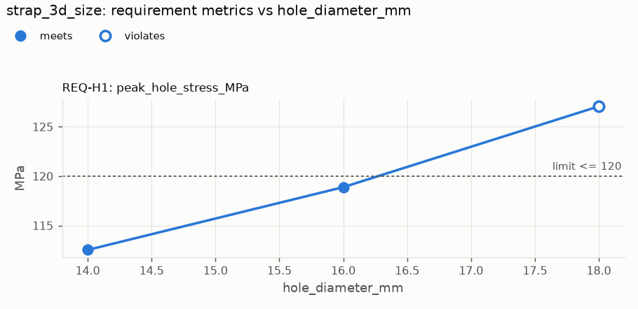
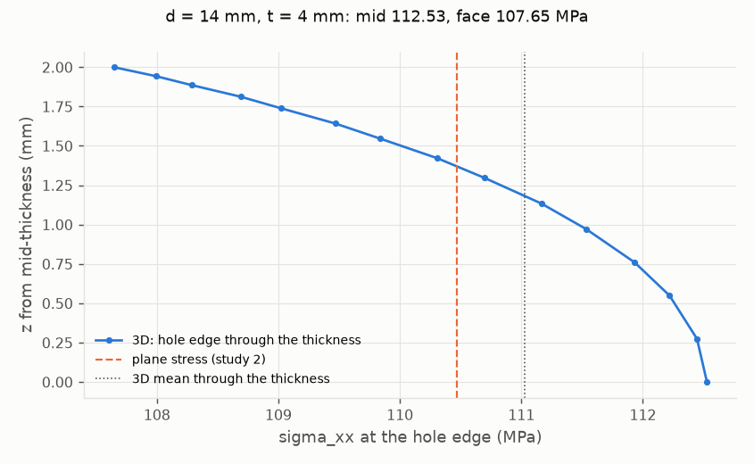
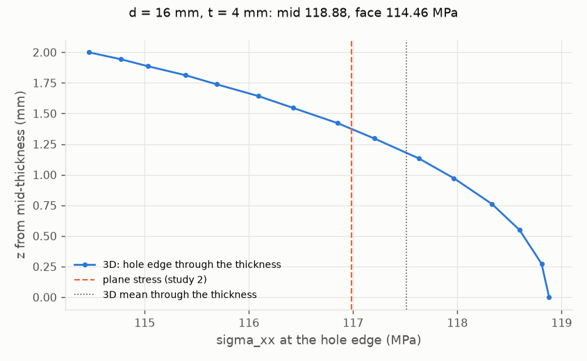
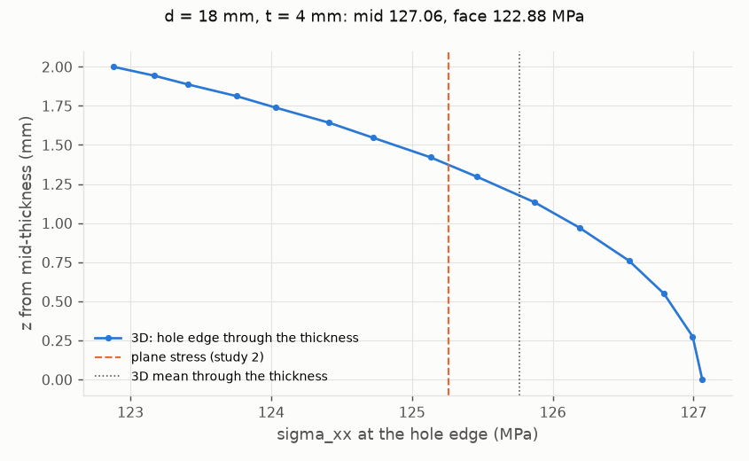

# Engineering review report: strap_3d_size

- **Run:** `20261127-152203_strap_3d_size`
- **Generated:** 2026-11-27T20:23:53+00:00
- **Case file SHA-256:** `ce02439b772c2cb1ac333a2531fd9587d6c278c54a4b6ddb141053cfe8972803`
- **Environment:** Python 3.14.10, numpy 2.5.5, scipy 1.18.1, matplotlib 3.11.2, cadquery 2.8.0; Windows-11-10.0.26100-SP0
- **Tools:** cadquery 2.8.0; gmsh 4.15.0; CalculiX This is Version 2.22
- **Code version:** git `7a9247e290fea5426430b32c1d0da1812dbb5d86` (uncommitted changes present)
- **Simulation status:** completed
- **Verification status:** PASS

## Scope

Study 2's strap as a 3D solid with a 14 / 16 / 18 mm cable hole; hole-edge elements 0.267 mm, 7 graded layers through the half thickness.

**Assumptions**

- Linear elastic, isotropic 6061-T6 (E = 68.9 GPa, nu = 0.33), as study 2; checked: peak below yield.
- Uniform end traction, as study 2; checked: the stress there is uniform.
- Hole smooth, central and straight through.
- The 120 MPa allowable is synthetic; compared with the largest stress on the hole edge, at mid-thickness.

## Requirements

| ID | Requirement | Metric | Limit |
|---|---|---|---|
| REQ-H1 | Peak stress at the hole edge under the 5 kN service load shall not exceed 120 MPa (synthetic fatigue allowable), anywhere through the thickness. | `peak_hole_stress_MPa` | <= 120 MPa |

## Summary across points

| Point | hole_diameter_mm | REQ-H1 | Checks |
|---|---|---|---|
| p00_hole_diameter_mm-14 | 14 | 112.5 MPa: **PASS** | 8/8 PASS |
| p01_hole_diameter_mm-16 | 16 | 118.9 MPa: **PASS** | 8/8 PASS |
| p02_hole_diameter_mm-18 | 18 | 127.1 MPa: **FAIL** | 8/8 PASS |

## Point details

### p00_hole_diameter_mm-14

Parameters: length_mm = 160, width_mm = 40, thickness_mm = 4, hole_diameter_mm = 14, axial_load_N = 5000, youngs_modulus_MPa = 6.89e+04, poisson_ratio = 0.33, yield_strength_MPa = 276, hole_element_size_mm = 0.267, far_element_size_mm = 4, z_layers = 0, z_ratio = 1.3, plane_stress_peak_MPa = {'14': 110.473, '16': 116.988, '18': 125.263}

Derived: t_over_d = 0.2857, t_over_r = 0.5714, net_stress_MPa = 48.08, kt_net_peterson = 2.287, peak_stress_peterson_MPa = 110, face_area_closed_form_mm2 = 1562

| Requirement | Result | Limit | Margin | Verdict | Evidence |
|---|---|---|---|---|---|
| REQ-H1 | 112.5 MPa | <= 120 | 7.47 | **PASS** | [point.json](points/p00_hole_diameter_mm-14/point.json) |

| Check | Description | Value | Tolerance | Status |
|---|---|---|---|---|
| cad_area | \|face area from CadQuery - closed form\| / closed form | 1.46e-16 | 1e-09 | PASS |
| loaded_area | \|area of the loaded element faces - W t / 4\| / (W t / 4) | 2.22e-16 | 1e-09 | PASS |
| equilibrium | \|reaction on x = 0 + F / 4\| / (F / 4) | 0.00e+00 | 1e-06 | PASS |
| ligament_force | \|integral of sigma_xx over the ligament face - F / 4\| / (F / 4) | 1.39e-03 | 0.01 | PASS |
| far_field_uniform | max \|sigma_xx on the loaded end - F / (W t)\| / (F / (W t)) | 1.38e-04 | 0.001 | PASS |
| kt_mean_reference | \|Kt_net of the through-thickness mean - Peterson (plane stress)\| / Peterson (model form: the mean differs from plane stress by order (t / r)^2) | 9.67e-03 | 0.02 | PASS |
| mid_is_peak (validity) | the hole-edge peak is at mid-thickness (0 = yes) | 0.00e+00 | 0 | PASS |
| linear_material (validity) | peak hole-edge stress / yield strength | 4.08e-01 | 1 | PASS |

### p01_hole_diameter_mm-16

Parameters: length_mm = 160, width_mm = 40, thickness_mm = 4, hole_diameter_mm = 16, axial_load_N = 5000, youngs_modulus_MPa = 6.89e+04, poisson_ratio = 0.33, yield_strength_MPa = 276, hole_element_size_mm = 0.267, far_element_size_mm = 4, z_layers = 0, z_ratio = 1.3, plane_stress_peak_MPa = {'14': 110.473, '16': 116.988, '18': 125.263}

Derived: t_over_d = 0.25, t_over_r = 0.5, net_stress_MPa = 52.08, kt_net_peterson = 2.236, peak_stress_peterson_MPa = 116.4, face_area_closed_form_mm2 = 1550

| Requirement | Result | Limit | Margin | Verdict | Evidence |
|---|---|---|---|---|---|
| REQ-H1 | 118.9 MPa | <= 120 | 1.12 | **PASS** | [point.json](points/p01_hole_diameter_mm-16/point.json) |

| Check | Description | Value | Tolerance | Status |
|---|---|---|---|---|
| cad_area | \|face area from CadQuery - closed form\| / closed form | 1.47e-16 | 1e-09 | PASS |
| loaded_area | \|area of the loaded element faces - W t / 4\| / (W t / 4) | 2.22e-16 | 1e-09 | PASS |
| equilibrium | \|reaction on x = 0 + F / 4\| / (F / 4) | 0.00e+00 | 1e-06 | PASS |
| ligament_force | \|integral of sigma_xx over the ligament face - F / 4\| / (F / 4) | 8.29e-04 | 0.01 | PASS |
| far_field_uniform | max \|sigma_xx on the loaded end - F / (W t)\| / (F / (W t)) | 1.63e-04 | 0.001 | PASS |
| kt_mean_reference | \|Kt_net of the through-thickness mean - Peterson (plane stress)\| / Peterson (model form: the mean differs from plane stress by order (t / r)^2) | 9.20e-03 | 0.02 | PASS |
| mid_is_peak (validity) | the hole-edge peak is at mid-thickness (0 = yes) | 0.00e+00 | 0 | PASS |
| linear_material (validity) | peak hole-edge stress / yield strength | 4.31e-01 | 1 | PASS |

### p02_hole_diameter_mm-18

Parameters: length_mm = 160, width_mm = 40, thickness_mm = 4, hole_diameter_mm = 18, axial_load_N = 5000, youngs_modulus_MPa = 6.89e+04, poisson_ratio = 0.33, yield_strength_MPa = 276, hole_element_size_mm = 0.267, far_element_size_mm = 4, z_layers = 0, z_ratio = 1.3, plane_stress_peak_MPa = {'14': 110.473, '16': 116.988, '18': 125.263}

Derived: t_over_d = 0.2222, t_over_r = 0.4444, net_stress_MPa = 56.82, kt_net_peterson = 2.193, peak_stress_peterson_MPa = 124.6, face_area_closed_form_mm2 = 1536

| Requirement | Result | Limit | Margin | Verdict | Evidence |
|---|---|---|---|---|---|
| REQ-H1 | 127.1 MPa | <= 120 | -7.06 | **FAIL** | [point.json](points/p02_hole_diameter_mm-18/point.json) |

| Check | Description | Value | Tolerance | Status |
|---|---|---|---|---|
| cad_area | \|face area from CadQuery - closed form\| / closed form | 1.48e-16 | 1e-09 | PASS |
| loaded_area | \|area of the loaded element faces - W t / 4\| / (W t / 4) | 2.22e-16 | 1e-09 | PASS |
| equilibrium | \|reaction on x = 0 + F / 4\| / (F / 4) | 0.00e+00 | 1e-06 | PASS |
| ligament_force | \|integral of sigma_xx over the ligament face - F / 4\| / (F / 4) | 5.53e-04 | 0.01 | PASS |
| far_field_uniform | max \|sigma_xx on the loaded end - F / (W t)\| / (F / (W t)) | 1.98e-04 | 0.001 | PASS |
| kt_mean_reference | \|Kt_net of the through-thickness mean - Peterson (plane stress)\| / Peterson (model form: the mean differs from plane stress by order (t / r)^2) | 9.20e-03 | 0.02 | PASS |
| mid_is_peak (validity) | the hole-edge peak is at mid-thickness (0 = yes) | 0.00e+00 | 0 | PASS |
| linear_material (validity) | peak hole-edge stress / yield strength | 4.60e-01 | 1 | PASS |

## Limitations

- Mesh 0.267 mm at the hole: its uncertainty comes from strap_3d_mesh at 16 mm.
- No surface finish, burrs, chamfer or residual stress, as study 2.
- A converged solver run that matches an analytical reference shows that the equations were solved correctly. It does not show that the equations represent real hardware.

## Engineering acceptance

Pending human review. This report does not accept or reject the design.
