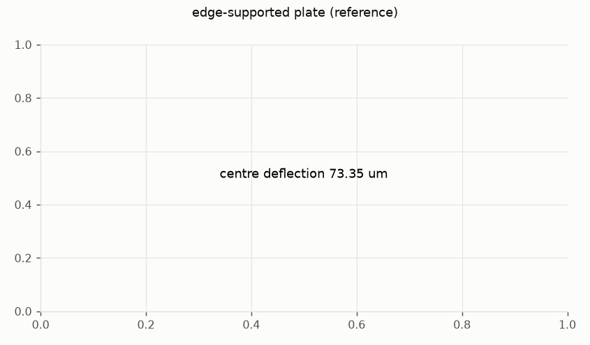

# Engineering review report: oring_cover_reference

- **Run:** `20261127-161150_oring_cover_reference`
- **Generated:** 2026-11-27T21:12:00+00:00
- **Case file SHA-256:** `25e770e1a99a3d505b789e700b0cbe712bf827e6e778793f03b42a3b2703cfef`
- **Environment:** Python 3.14.10, numpy 2.5.5, scipy 1.18.1, matplotlib 3.11.2, cadquery 2.8.0; Windows-11-10.0.26100-SP0
- **Tools:** cadquery 2.8.0; gmsh 4.15.0; CalculiX This is Version 2.22
- **Code version:** git `51861052fd56a511b6e4ed1c648d6ad8c09b3331` (uncommitted changes present)
- **Simulation status:** completed
- **Verification status:** PASS

## Scope

Study 25's synthetic pump cover (6061-T6, 96 mm across, 6 mm thick) simply supported along its underside's edge under 3 bar over the whole underside: the 3D solid against Mindlin's plate.

**Assumptions**

- Linear elastic aluminium, E 68.9 GPa, nu 0.33; small displacement.
- Simple support along the underside's outer edge (vertical only); quarter model by symmetry.

## Requirements

| ID | Requirement | Metric | Limit |
|---|---|---|---|
| REQ-REF | Reference only: the edge-supported plate's centre deflection (no design limit; the plate_theory check is the point of this case), recorded against 1 mm. | `centre_deflection_um` | <= 1000 um |

## Summary across points

| Point | REQ-REF | Checks |
|---|---|---|
| p00_baseline | 73.35 um: **PASS** | 2/2 PASS |

## Point details

### p00_baseline

Parameters: cover_diameter_mm = 96, cover_thickness_mm = 6, bolt_count = 4, bolt_circle_diameter_mm = 76, bolt_hole_diameter_mm = 6.6, washer_diameter_mm = 12, pressure_MPa = 0.3, pressure_radius_mm = 28.53, oring_line_load_N_per_mm = 1.887, oring_radius_mm = 26.8, oring_contact_width_mm = 1.68, youngs_modulus_MPa = 6.89e+04, poisson_ratio = 0.33, element_size_mm = 1.5, support = edge, loosest_cross_section_mm = 3.43, loosest_groove_depth_mm = 2.84

Derived: loosest_squeeze_flat_pct = 17.2, allowed_lift_for_15pct_mm = 0.0755, mindlin_centre_deflection_mm = 0.07298

| Requirement | Result | Limit | Margin | Verdict | Evidence |
|---|---|---|---|---|---|
| REQ-REF | 73.35 um | <= 1000 | 927 | **PASS** | [point.json](points/p00_baseline/point.json) |

| Check | Description | Value | Tolerance | Status |
|---|---|---|---|---|
| cad_valid | CadQuery B-rep valid, one solid (0 = yes) | 0.00e+00 | 0 | PASS |
| plate_theory | \|centre deflection (mid-plane) - Mindlin plate\| / Mindlin | 5.05e-03 | 0.02 | PASS |

## Limitations

- A reference for the model only.
- A converged solver run that matches an analytical reference shows that the equations were solved correctly. It does not show that the equations represent real hardware.

## Engineering acceptance

Pending human review. This report does not accept or reject the design.
