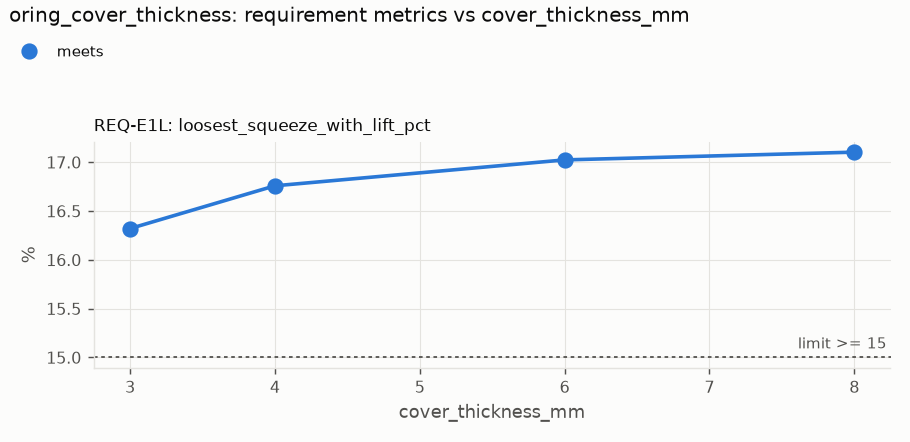
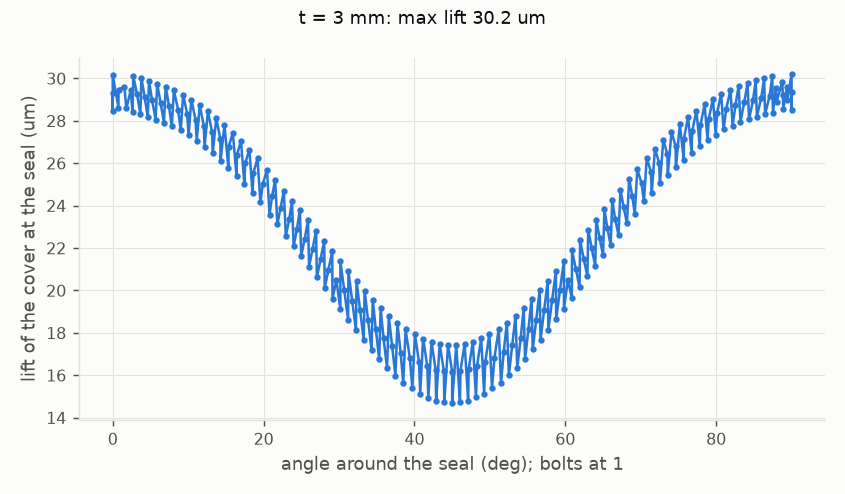
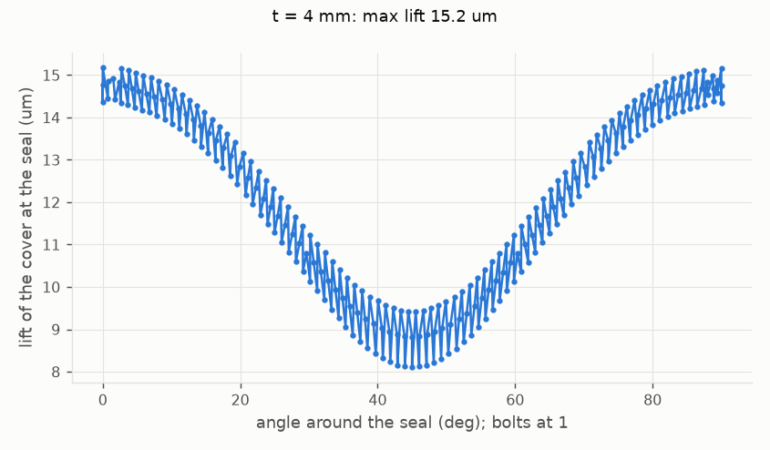
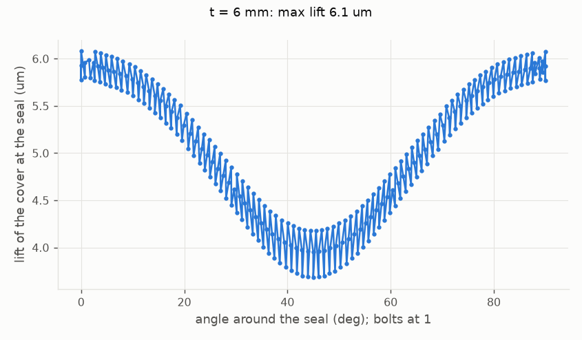
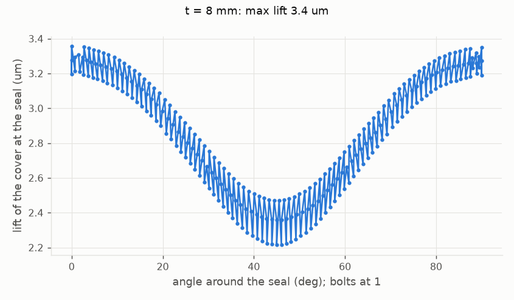

# Engineering review report: oring_cover_thickness

- **Run:** `20261127-161311_oring_cover_thickness`
- **Generated:** 2026-11-27T21:16:53+00:00
- **Case file SHA-256:** `c847243880937d21c19c5cd3d6bc6c9d7d0ee27e556a4c048b006db6e917415d`
- **Environment:** Python 3.14.10, numpy 2.5.5, scipy 1.18.1, matplotlib 3.11.2, cadquery 2.8.0; Windows-11-10.0.26100-SP0
- **Tools:** cadquery 2.8.0; gmsh 4.15.0; CalculiX This is Version 2.22
- **Code version:** git `51861052fd56a511b6e4ed1c648d6ad8c09b3331` (uncommitted changes present)
- **Simulation status:** completed
- **Verification status:** PASS

## Scope

Study 25's pump cover (synthetic: 6061-T6, 96 mm across, 4 x M6 on a 76 mm circle) at 3 / 4 / 6 / 8 mm thickness, lifted by 3 bar and the O-ring's reaction at the loosest corner; element size 1.0 mm.

**Assumptions**

- The cover [synthetic, part 1 never drew it]: 6061-T6 aluminium, 96 mm across, held by 4 M6 bolts on a 76 mm circle with 12 mm washers; the groove is in the pump, the cover's underside flat.
- Loads: 3 bar out to the groove's outer radius (conservative) and the O-ring's reaction from part 1 at the loosest corner, 1.887 N/mm over its 1.68 mm contact; both push the cover up.
- The washer footprints held against lifting only (free to slide and pivot: the softer support); the pump flange rigid; the rim beyond the bolts unsupported (a real flange pushes back on it, which lowers the lift).
- The O-ring's reaction held at its part 1 value as the cover lifts (it falls as the squeeze falls: conservative).
- Linear elastic, small displacement.

## Requirements

| ID | Requirement | Metric | Limit |
|---|---|---|---|
| REQ-E1L | With the cover's lift between the bolts, the squeeze at the loosest corner of the stack stays at or above 15 % (REQ-E1 of part 1, at the worst point around the seal). | `loosest_squeeze_with_lift_pct` | >= 15 % |

## Summary across points

| Point | cover_thickness_mm | REQ-E1L | Checks |
|---|---|---|---|
| p00_cover_thickness_mm-3 | 3 | 16.32 %: **PASS** | 3/3 PASS |
| p01_cover_thickness_mm-4 | 4 | 16.76 %: **PASS** | 3/3 PASS |
| p02_cover_thickness_mm-6 | 6 | 17.02 %: **PASS** | 3/3 PASS |
| p03_cover_thickness_mm-8 | 8 | 17.1 %: **PASS** | 3/3 PASS |

## Point details

### p00_cover_thickness_mm-3

Parameters: cover_diameter_mm = 96, cover_thickness_mm = 3, bolt_count = 4, bolt_circle_diameter_mm = 76, bolt_hole_diameter_mm = 6.6, washer_diameter_mm = 12, pressure_MPa = 0.3, pressure_radius_mm = 28.53, oring_line_load_N_per_mm = 1.887, oring_radius_mm = 26.8, oring_contact_width_mm = 1.68, youngs_modulus_MPa = 6.89e+04, poisson_ratio = 0.33, element_size_mm = 1, support = bolts, loosest_cross_section_mm = 3.43, loosest_groove_depth_mm = 2.84

Derived: loosest_squeeze_flat_pct = 17.2, allowed_lift_for_15pct_mm = 0.0755, mindlin_centre_deflection_mm = 0.5759

| Requirement | Result | Limit | Margin | Verdict | Evidence |
|---|---|---|---|---|---|
| REQ-E1L | 16.32 % | >= 15 | 1.32 | **PASS** | [point.json](points/p00_cover_thickness_mm-3/point.json) |

| Check | Description | Value | Tolerance | Status |
|---|---|---|---|---|
| cad_valid | CadQuery B-rep valid, one solid (0 = yes) | 0.00e+00 | 0 | PASS |
| equilibrium | \|reaction at the washer footprints + applied load\| / applied load (the footprints carry no load, so RF is the reaction) | 8.49e-09 | 1e-06 | PASS |
| lifts_everywhere (validity) | the cover lifts (does not press down) all along the seal line (min lift / max lift >= 0; 0 = yes) | 0.00e+00 | 0 | PASS |

### p01_cover_thickness_mm-4

Parameters: cover_diameter_mm = 96, cover_thickness_mm = 4, bolt_count = 4, bolt_circle_diameter_mm = 76, bolt_hole_diameter_mm = 6.6, washer_diameter_mm = 12, pressure_MPa = 0.3, pressure_radius_mm = 28.53, oring_line_load_N_per_mm = 1.887, oring_radius_mm = 26.8, oring_contact_width_mm = 1.68, youngs_modulus_MPa = 6.89e+04, poisson_ratio = 0.33, element_size_mm = 1, support = bolts, loosest_cross_section_mm = 3.43, loosest_groove_depth_mm = 2.84

Derived: loosest_squeeze_flat_pct = 17.2, allowed_lift_for_15pct_mm = 0.0755, mindlin_centre_deflection_mm = 0.2438

| Requirement | Result | Limit | Margin | Verdict | Evidence |
|---|---|---|---|---|---|
| REQ-E1L | 16.76 % | >= 15 | 1.76 | **PASS** | [point.json](points/p01_cover_thickness_mm-4/point.json) |

| Check | Description | Value | Tolerance | Status |
|---|---|---|---|---|
| cad_valid | CadQuery B-rep valid, one solid (0 = yes) | 0.00e+00 | 0 | PASS |
| equilibrium | \|reaction at the washer footprints + applied load\| / applied load (the footprints carry no load, so RF is the reaction) | 8.49e-09 | 1e-06 | PASS |
| lifts_everywhere (validity) | the cover lifts (does not press down) all along the seal line (min lift / max lift >= 0; 0 = yes) | 0.00e+00 | 0 | PASS |

### p02_cover_thickness_mm-6

Parameters: cover_diameter_mm = 96, cover_thickness_mm = 6, bolt_count = 4, bolt_circle_diameter_mm = 76, bolt_hole_diameter_mm = 6.6, washer_diameter_mm = 12, pressure_MPa = 0.3, pressure_radius_mm = 28.53, oring_line_load_N_per_mm = 1.887, oring_radius_mm = 26.8, oring_contact_width_mm = 1.68, youngs_modulus_MPa = 6.89e+04, poisson_ratio = 0.33, element_size_mm = 1, support = bolts, loosest_cross_section_mm = 3.43, loosest_groove_depth_mm = 2.84

Derived: loosest_squeeze_flat_pct = 17.2, allowed_lift_for_15pct_mm = 0.0755, mindlin_centre_deflection_mm = 0.07298

| Requirement | Result | Limit | Margin | Verdict | Evidence |
|---|---|---|---|---|---|
| REQ-E1L | 17.02 % | >= 15 | 2.02 | **PASS** | [point.json](points/p02_cover_thickness_mm-6/point.json) |

| Check | Description | Value | Tolerance | Status |
|---|---|---|---|---|
| cad_valid | CadQuery B-rep valid, one solid (0 = yes) | 0.00e+00 | 0 | PASS |
| equilibrium | \|reaction at the washer footprints + applied load\| / applied load (the footprints carry no load, so RF is the reaction) | 8.49e-09 | 1e-06 | PASS |
| lifts_everywhere (validity) | the cover lifts (does not press down) all along the seal line (min lift / max lift >= 0; 0 = yes) | 0.00e+00 | 0 | PASS |

### p03_cover_thickness_mm-8

Parameters: cover_diameter_mm = 96, cover_thickness_mm = 8, bolt_count = 4, bolt_circle_diameter_mm = 76, bolt_hole_diameter_mm = 6.6, washer_diameter_mm = 12, pressure_MPa = 0.3, pressure_radius_mm = 28.53, oring_line_load_N_per_mm = 1.887, oring_radius_mm = 26.8, oring_contact_width_mm = 1.68, youngs_modulus_MPa = 6.89e+04, poisson_ratio = 0.33, element_size_mm = 1, support = bolts, loosest_cross_section_mm = 3.43, loosest_groove_depth_mm = 2.84

Derived: loosest_squeeze_flat_pct = 17.2, allowed_lift_for_15pct_mm = 0.0755, mindlin_centre_deflection_mm = 0.03123

| Requirement | Result | Limit | Margin | Verdict | Evidence |
|---|---|---|---|---|---|
| REQ-E1L | 17.1 % | >= 15 | 2.1 | **PASS** | [point.json](points/p03_cover_thickness_mm-8/point.json) |

| Check | Description | Value | Tolerance | Status |
|---|---|---|---|---|
| cad_valid | CadQuery B-rep valid, one solid (0 = yes) | 0.00e+00 | 0 | PASS |
| equilibrium | \|reaction at the washer footprints + applied load\| / applied load (the footprints carry no load, so RF is the reaction) | 8.49e-09 | 1e-06 | PASS |
| lifts_everywhere (validity) | the cover lifts (does not press down) all along the seal line (min lift / max lift >= 0; 0 = yes) | 0.00e+00 | 0 | PASS |

## Limitations

- No bolt stretch or flange flexibility, no flatness tolerance on the machined faces (a flatness callout adds to the lift directly).
- The cover geometry is synthetic: the answer is the lift per thickness, read against the 75.5 um the loosest corner can give up.
- A converged solver run that matches an analytical reference shows that the equations were solved correctly. It does not show that the equations represent real hardware.

## Engineering acceptance

Pending human review. This report does not accept or reject the design.
