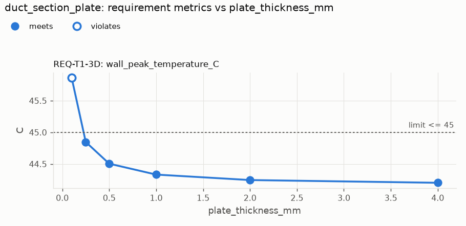
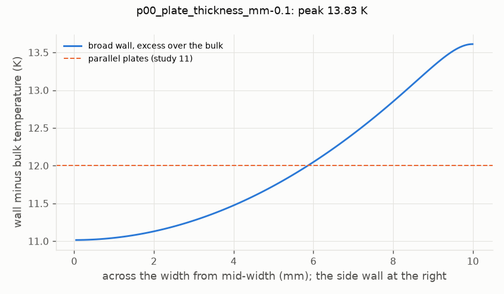
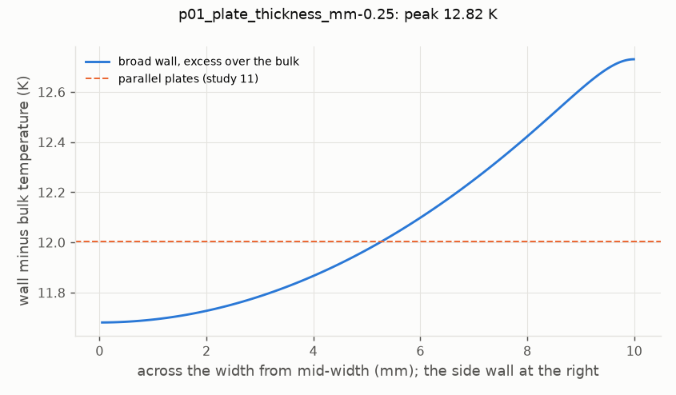
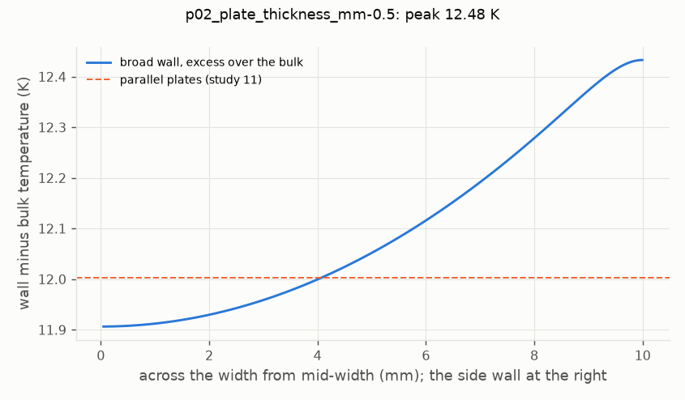
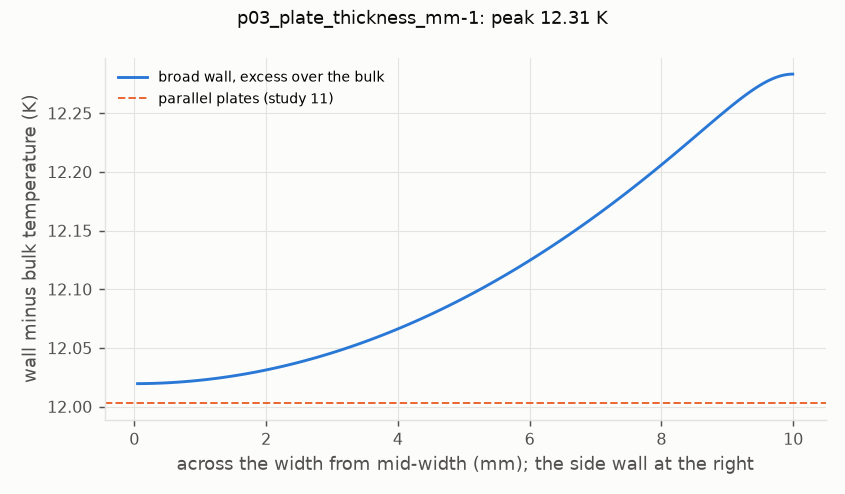
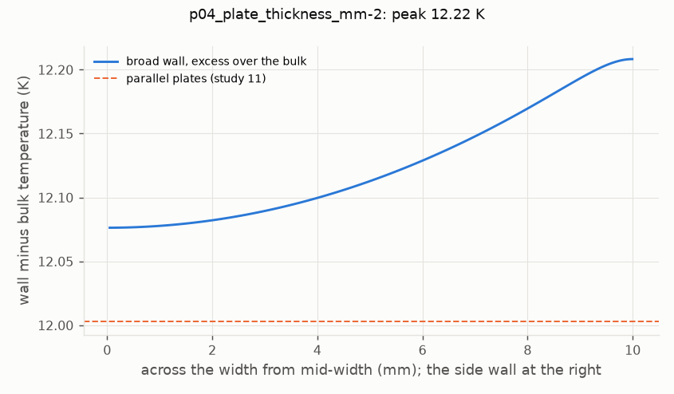
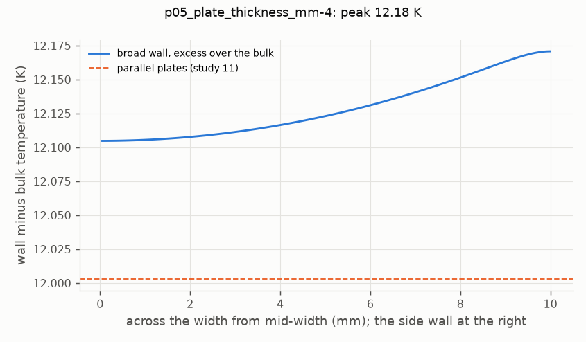

# Engineering review report: duct_section_plate

- **Run:** `20261127-170409_duct_section_plate`
- **Generated:** 2026-11-27T22:04:11+00:00
- **Case file SHA-256:** `be372fc9c627b30ae5e6c2d2ce3d149a0a849f799a607f9284ec9078051015c7`
- **Environment:** Python 3.14.10, numpy 2.5.5, scipy 1.18.1, matplotlib 3.11.2, cadquery 2.8.0; Windows-11-10.0.26100-SP0
- **Tools:** scipy 1.18.1; numpy 2.5.5
- **Code version:** git `5d6aa1b53b70e1166ea3b379f24dcf696d4aa862` (uncommitted changes present)
- **Simulation status:** completed
- **Verification status:** PASS

## Scope

Study 11's passage with its side walls, fully developed, the broad wall a 6061-T6 sheet 0.1 / 0.25 / 0.5 / 1 / 2 / 4 mm thick; 40 cells across the half gap.

**Assumptions**

- Fully developed flow and heat transfer in the cross-section; the 3D correction (peak excess over the bulk, 3D minus parallel plates) is added to study 11's verified 2D wall temperature, which includes the thermal entry (98 % developed at the outlet in 2D).
- The passage 1 x 20 mm [width synthetic], heated on both broad walls at 30 kW/m2 over its width; the side walls adiabatic (conservative: metal side walls carry heat away).
- The broad wall a conducting sheet of 6061-T6 (k 167 W/m K), its temperature uniform through its thickness; the heat applied uniformly over the passage's width.
- Water properties as study 11 (k 0.607 W/m K); laminar (Re 224).

## Requirements

| ID | Requirement | Metric | Limit |
|---|---|---|---|
| REQ-T1-3D | With the side walls, the passage's wall stays at or under 45 C (study 11's REQ on the wall temperature, at its hottest point across the width): the 3D peak excess corrected onto study 11's verified 2D value. | `wall_peak_temperature_C` | <= 45 C |

## Summary across points

| Point | plate_thickness_mm | REQ-T1-3D | Checks |
|---|---|---|---|
| p00_plate_thickness_mm-0.1 | 0.1 | 45.86 C: **FAIL** | 4/4 PASS |
| p01_plate_thickness_mm-0.25 | 0.25 | 44.85 C: **PASS** | 4/4 PASS |
| p02_plate_thickness_mm-0.5 | 0.5 | 44.5 C: **PASS** | 4/4 PASS |
| p03_plate_thickness_mm-1 | 1 | 44.33 C: **PASS** | 4/4 PASS |
| p04_plate_thickness_mm-2 | 2 | 44.25 C: **PASS** | 4/4 PASS |
| p05_plate_thickness_mm-4 | 4 | 44.2 C: **PASS** | 4/4 PASS |

## Point details

### p00_plate_thickness_mm-0.1

Parameters: gap_mm = 1, width_mm = 20, cells_across_half_gap = 40, side_growth = 1.08, dz_max_over_dy = 8, bc = plate, plate_conductivity_W_per_mK = 167, plate_thickness_mm = 0.1, fluid_conductivity_W_per_mK = 0.607, wall_heat_flux_W_per_m2 = 3e+04, wall_temperature_2D_C = 44.03, wall_limit_C = 45

Derived: parallel_plate_excess_K = 12, plate_conductance_rel_mm = 27.51, study11_margin_K = 0.971

| Requirement | Result | Limit | Margin | Verdict | Evidence |
|---|---|---|---|---|---|
| REQ-T1-3D | 45.86 C | <= 45 | -0.861 | **FAIL** | [point.json](points/p00_plate_thickness_mm-0.1/point.json) |

| Check | Description | Value | Tolerance | Status |
|---|---|---|---|---|
| parallel_plate_limit | \|wall excess with the side wall replaced by symmetry - 17/70 q H / k\| / (17/70 q H / k) (exact) | 1.10e-04 | 0.001 | PASS |
| fRe_exact | \|Fanning fRe - the exact rectangular-duct series\| / exact | 3.42e-04 | 0.001 | PASS |
| incropera_Nu_ar4 | \|Nu, four walls at one temperature, b/a = 4 - Incropera Table 8.1 (5.33)\| / 5.33 (printed to 3 figures) | 4.25e-04 | 0.0015 | PASS |
| incropera_Nu_ar8 | \|Nu, four walls at one temperature, b/a = 8 - Incropera Table 8.1 (6.49)\| / 6.49 (printed to 3 figures) | 2.27e-04 | 0.0015 | PASS |

### p01_plate_thickness_mm-0.25

Parameters: gap_mm = 1, width_mm = 20, cells_across_half_gap = 40, side_growth = 1.08, dz_max_over_dy = 8, bc = plate, plate_conductivity_W_per_mK = 167, plate_thickness_mm = 0.25, fluid_conductivity_W_per_mK = 0.607, wall_heat_flux_W_per_m2 = 3e+04, wall_temperature_2D_C = 44.03, wall_limit_C = 45

Derived: parallel_plate_excess_K = 12, plate_conductance_rel_mm = 68.78, study11_margin_K = 0.971

| Requirement | Result | Limit | Margin | Verdict | Evidence |
|---|---|---|---|---|---|
| REQ-T1-3D | 44.85 C | <= 45 | 0.153 | **PASS** | [point.json](points/p01_plate_thickness_mm-0.25/point.json) |

| Check | Description | Value | Tolerance | Status |
|---|---|---|---|---|
| parallel_plate_limit | \|wall excess with the side wall replaced by symmetry - 17/70 q H / k\| / (17/70 q H / k) (exact) | 1.10e-04 | 0.001 | PASS |
| fRe_exact | \|Fanning fRe - the exact rectangular-duct series\| / exact | 3.42e-04 | 0.001 | PASS |
| incropera_Nu_ar4 | \|Nu, four walls at one temperature, b/a = 4 - Incropera Table 8.1 (5.33)\| / 5.33 (printed to 3 figures) | 4.25e-04 | 0.0015 | PASS |
| incropera_Nu_ar8 | \|Nu, four walls at one temperature, b/a = 8 - Incropera Table 8.1 (6.49)\| / 6.49 (printed to 3 figures) | 2.27e-04 | 0.0015 | PASS |

### p02_plate_thickness_mm-0.5

Parameters: gap_mm = 1, width_mm = 20, cells_across_half_gap = 40, side_growth = 1.08, dz_max_over_dy = 8, bc = plate, plate_conductivity_W_per_mK = 167, plate_thickness_mm = 0.5, fluid_conductivity_W_per_mK = 0.607, wall_heat_flux_W_per_m2 = 3e+04, wall_temperature_2D_C = 44.03, wall_limit_C = 45

Derived: parallel_plate_excess_K = 12, plate_conductance_rel_mm = 137.6, study11_margin_K = 0.971

| Requirement | Result | Limit | Margin | Verdict | Evidence |
|---|---|---|---|---|---|
| REQ-T1-3D | 44.5 C | <= 45 | 0.496 | **PASS** | [point.json](points/p02_plate_thickness_mm-0.5/point.json) |

| Check | Description | Value | Tolerance | Status |
|---|---|---|---|---|
| parallel_plate_limit | \|wall excess with the side wall replaced by symmetry - 17/70 q H / k\| / (17/70 q H / k) (exact) | 1.10e-04 | 0.001 | PASS |
| fRe_exact | \|Fanning fRe - the exact rectangular-duct series\| / exact | 3.42e-04 | 0.001 | PASS |
| incropera_Nu_ar4 | \|Nu, four walls at one temperature, b/a = 4 - Incropera Table 8.1 (5.33)\| / 5.33 (printed to 3 figures) | 4.25e-04 | 0.0015 | PASS |
| incropera_Nu_ar8 | \|Nu, four walls at one temperature, b/a = 8 - Incropera Table 8.1 (6.49)\| / 6.49 (printed to 3 figures) | 2.27e-04 | 0.0015 | PASS |

### p03_plate_thickness_mm-1

Parameters: gap_mm = 1, width_mm = 20, cells_across_half_gap = 40, side_growth = 1.08, dz_max_over_dy = 8, bc = plate, plate_conductivity_W_per_mK = 167, plate_thickness_mm = 1, fluid_conductivity_W_per_mK = 0.607, wall_heat_flux_W_per_m2 = 3e+04, wall_temperature_2D_C = 44.03, wall_limit_C = 45

Derived: parallel_plate_excess_K = 12, plate_conductance_rel_mm = 275.1, study11_margin_K = 0.971

| Requirement | Result | Limit | Margin | Verdict | Evidence |
|---|---|---|---|---|---|
| REQ-T1-3D | 44.33 C | <= 45 | 0.668 | **PASS** | [point.json](points/p03_plate_thickness_mm-1/point.json) |

| Check | Description | Value | Tolerance | Status |
|---|---|---|---|---|
| parallel_plate_limit | \|wall excess with the side wall replaced by symmetry - 17/70 q H / k\| / (17/70 q H / k) (exact) | 1.10e-04 | 0.001 | PASS |
| fRe_exact | \|Fanning fRe - the exact rectangular-duct series\| / exact | 3.42e-04 | 0.001 | PASS |
| incropera_Nu_ar4 | \|Nu, four walls at one temperature, b/a = 4 - Incropera Table 8.1 (5.33)\| / 5.33 (printed to 3 figures) | 4.25e-04 | 0.0015 | PASS |
| incropera_Nu_ar8 | \|Nu, four walls at one temperature, b/a = 8 - Incropera Table 8.1 (6.49)\| / 6.49 (printed to 3 figures) | 2.27e-04 | 0.0015 | PASS |

### p04_plate_thickness_mm-2

Parameters: gap_mm = 1, width_mm = 20, cells_across_half_gap = 40, side_growth = 1.08, dz_max_over_dy = 8, bc = plate, plate_conductivity_W_per_mK = 167, plate_thickness_mm = 2, fluid_conductivity_W_per_mK = 0.607, wall_heat_flux_W_per_m2 = 3e+04, wall_temperature_2D_C = 44.03, wall_limit_C = 45

Derived: parallel_plate_excess_K = 12, plate_conductance_rel_mm = 550.2, study11_margin_K = 0.971

| Requirement | Result | Limit | Margin | Verdict | Evidence |
|---|---|---|---|---|---|
| REQ-T1-3D | 44.25 C | <= 45 | 0.754 | **PASS** | [point.json](points/p04_plate_thickness_mm-2/point.json) |

| Check | Description | Value | Tolerance | Status |
|---|---|---|---|---|
| parallel_plate_limit | \|wall excess with the side wall replaced by symmetry - 17/70 q H / k\| / (17/70 q H / k) (exact) | 1.10e-04 | 0.001 | PASS |
| fRe_exact | \|Fanning fRe - the exact rectangular-duct series\| / exact | 3.42e-04 | 0.001 | PASS |
| incropera_Nu_ar4 | \|Nu, four walls at one temperature, b/a = 4 - Incropera Table 8.1 (5.33)\| / 5.33 (printed to 3 figures) | 4.25e-04 | 0.0015 | PASS |
| incropera_Nu_ar8 | \|Nu, four walls at one temperature, b/a = 8 - Incropera Table 8.1 (6.49)\| / 6.49 (printed to 3 figures) | 2.27e-04 | 0.0015 | PASS |

### p05_plate_thickness_mm-4

Parameters: gap_mm = 1, width_mm = 20, cells_across_half_gap = 40, side_growth = 1.08, dz_max_over_dy = 8, bc = plate, plate_conductivity_W_per_mK = 167, plate_thickness_mm = 4, fluid_conductivity_W_per_mK = 0.607, wall_heat_flux_W_per_m2 = 3e+04, wall_temperature_2D_C = 44.03, wall_limit_C = 45

Derived: parallel_plate_excess_K = 12, plate_conductance_rel_mm = 1100, study11_margin_K = 0.971

| Requirement | Result | Limit | Margin | Verdict | Evidence |
|---|---|---|---|---|---|
| REQ-T1-3D | 44.2 C | <= 45 | 0.797 | **PASS** | [point.json](points/p05_plate_thickness_mm-4/point.json) |

| Check | Description | Value | Tolerance | Status |
|---|---|---|---|---|
| parallel_plate_limit | \|wall excess with the side wall replaced by symmetry - 17/70 q H / k\| / (17/70 q H / k) (exact) | 1.10e-04 | 0.001 | PASS |
| fRe_exact | \|Fanning fRe - the exact rectangular-duct series\| / exact | 3.42e-04 | 0.001 | PASS |
| incropera_Nu_ar4 | \|Nu, four walls at one temperature, b/a = 4 - Incropera Table 8.1 (5.33)\| / 5.33 (printed to 3 figures) | 4.25e-04 | 0.0015 | PASS |
| incropera_Nu_ar8 | \|Nu, four walls at one temperature, b/a = 8 - Incropera Table 8.1 (6.49)\| / 6.49 (printed to 3 figures) | 2.27e-04 | 0.0015 | PASS |

## Limitations

- No axial development in 3D: the side-wall correction is the fully developed one.
- The plate's own temperature rise through its thickness (q t / k, 0.36 K for 2 mm) is not in the fluid-side wall temperature this requirement is about; a component on the plate sees it on top.
- A converged solver run that matches an analytical reference shows that the equations were solved correctly. It does not show that the equations represent real hardware.

## Engineering acceptance

Pending human review. This report does not accept or reject the design.
