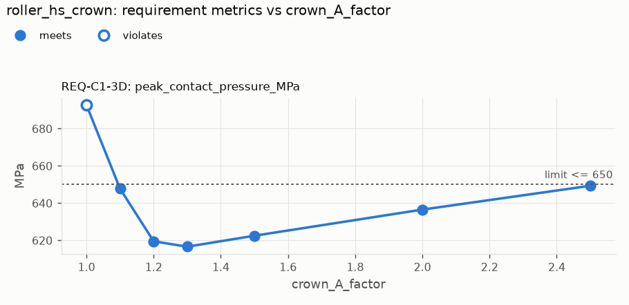
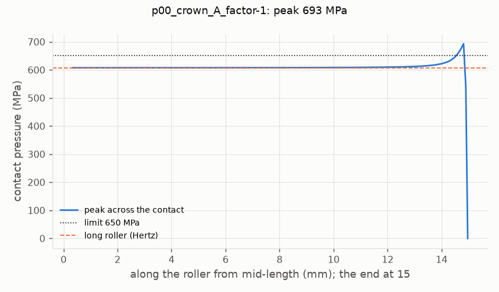
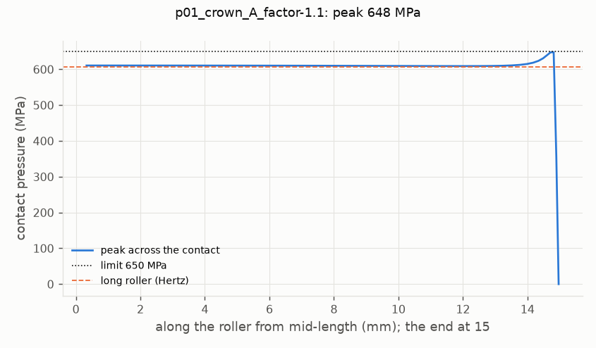
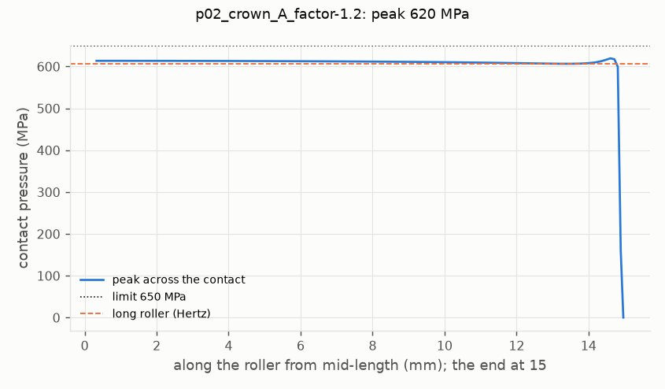
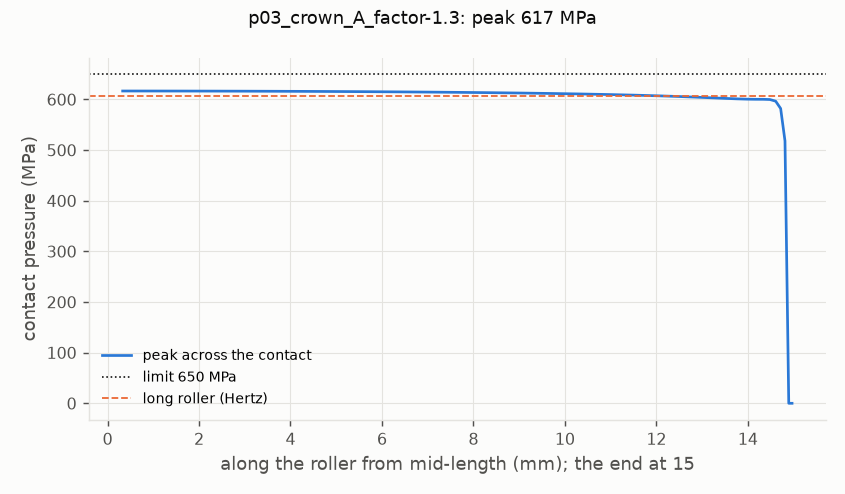
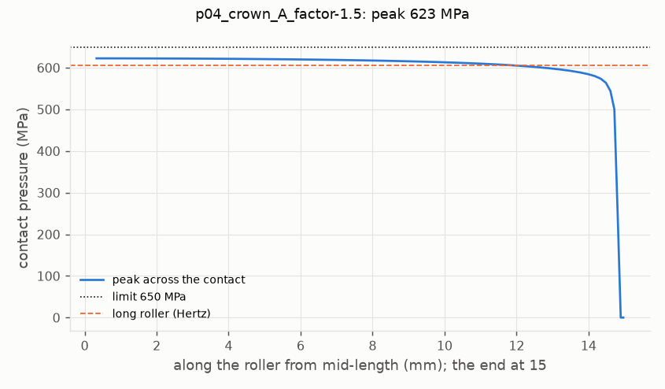
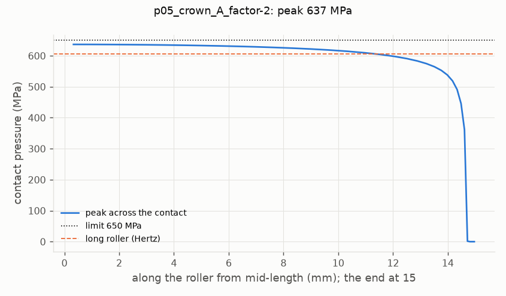
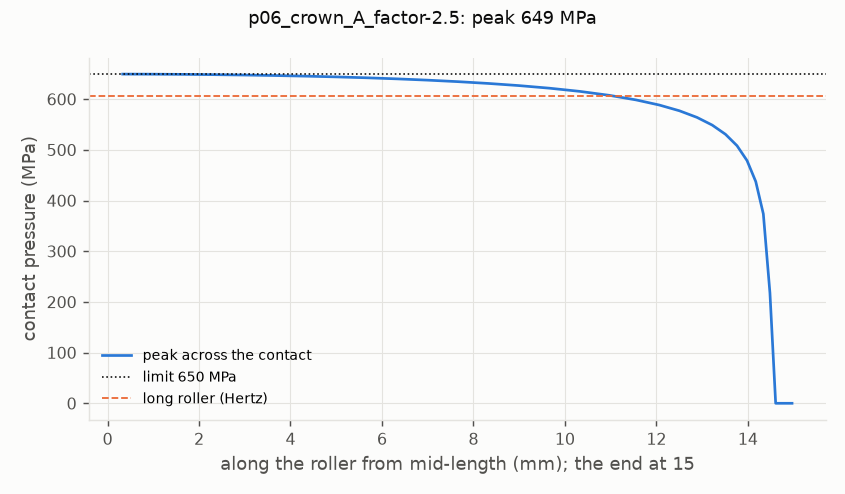

# Engineering review report: roller_hs_crown

- **Run:** `20261127-172125_roller_hs_crown`
- **Generated:** 2026-11-27T22:24:23+00:00
- **Case file SHA-256:** `496ffc7e1bdbef08588b3af7198af3b07f456e6e905d4d15227904f984d54e12`
- **Environment:** Python 3.14.10, numpy 2.5.5, scipy 1.18.1, matplotlib 3.11.2, cadquery 2.8.0; Windows-11-10.0.26100-SP0
- **Tools:** scipy 1.18.1; numpy 2.5.5
- **Code version:** git `1122218b1ad8377167269afdceb46ac2d47417a4` (uncommitted changes present)
- **Simulation status:** completed
- **Verification status:** PASS

## Scope

Study 10's track roller (100 mm diameter, 30 mm long [synthetic], 500 N/mm) with a logarithmic crown of A = 1.0 / 1.1 / 1.2 / 1.3 / 1.5 / 2.0 / 2.5 x Lundberg's, on half-spaces; grid scale 1.5.

**Assumptions**

- Both bodies elastic half-spaces (E 210 GPa, nu 0.3), frictionless; the roller 100 mm in diameter and 30 mm long [length synthetic], the plate wider and deeper than the contact.
- The roller's end face is not modelled (the half-space continues past it): near the end the method overstates a sharp-edged peak somewhat; the crowned design's peak is at mid-length, where this does not apply.
- The profiles as the 3D FE model's (models/fea/roller_3d.drop_um): an edge radius of 1 mm, or a logarithmic crown of the Fujiwara-Kawase form, z_m 30 um, A a multiple of Lundberg's 2 Q / (pi l E').
- The load centred and the roller aligned: no tilt or misalignment.

## Requirements

| ID | Requirement | Metric | Limit |
|---|---|---|---|
| REQ-C1-3D | The peak contact pressure anywhere along the roller, its ends included, shall not exceed 650 MPa (study 10's REQ on the peak pressure). | `peak_contact_pressure_MPa` | <= 650 MPa |

## Summary across points

| Point | crown_A_factor | REQ-C1-3D | Checks |
|---|---|---|---|
| p00_crown_A_factor-1 | 1 | 692.7 MPa: **FAIL** | 3/3 PASS |
| p01_crown_A_factor-1.1 | 1.1 | 647.8 MPa: **PASS** | 3/3 PASS |
| p02_crown_A_factor-1.2 | 1.2 | 619.5 MPa: **PASS** | 3/3 PASS |
| p03_crown_A_factor-1.3 | 1.3 | 616.6 MPa: **PASS** | 3/3 PASS |
| p04_crown_A_factor-1.5 | 1.5 | 622.5 MPa: **PASS** | 3/3 PASS |
| p05_crown_A_factor-2 | 2 | 636.5 MPa: **PASS** | 3/3 PASS |
| p06_crown_A_factor-2.5 | 2.5 | 649.3 MPa: **PASS** | 3/3 PASS |

## Point details

### p00_crown_A_factor-1

Parameters: roller_radius_mm = 50, roller_length_mm = 30, youngs_modulus_MPa = 2.1e+05, poisson_ratio = 0.3, line_load_N_per_mm = 500, profile_code = 2, edge_radius_mm = 1, z_fine_mm = 0, crown_A_factor = 1, crown_zm_um = 30, cap_um = 200, grid_scale = 1.5, pressure_limit_MPa = 650

Derived: long_roller_hertz_MPa = 606, long_roller_half_width_mm = 0.5252, profile = log, grid = {'nx': 36, 'y_fine': 0.06666666666666667, 'y_max_cell': 0.6666666666666666}

| Requirement | Result | Limit | Margin | Verdict | Evidence |
|---|---|---|---|---|---|
| REQ-C1-3D | 692.7 MPa | <= 650 | -42.7 | **FAIL** | [point.json](points/p00_crown_A_factor-1/point.json) |

| Check | Description | Value | Tolerance | Status |
|---|---|---|---|---|
| hertz_line_mid | \|long straight roller's mid-length pressure - Hertz line contact for the line load that section carries\| / Hertz | 5.73e-04 | 0.003 | PASS |
| hertz_ellipse | \|circularly crowned roller's peak - Hertz elliptical contact\| / Hertz | 1.69e-04 | 0.003 | PASS |
| load | max \|total contact force / target - 1\| over the design and reference solves | 1.36e-09 | 1e-05 | PASS |

### p01_crown_A_factor-1.1

Parameters: roller_radius_mm = 50, roller_length_mm = 30, youngs_modulus_MPa = 2.1e+05, poisson_ratio = 0.3, line_load_N_per_mm = 500, profile_code = 2, edge_radius_mm = 1, z_fine_mm = 0, crown_A_factor = 1.1, crown_zm_um = 30, cap_um = 200, grid_scale = 1.5, pressure_limit_MPa = 650

Derived: long_roller_hertz_MPa = 606, long_roller_half_width_mm = 0.5252, profile = log, grid = {'nx': 36, 'y_fine': 0.06666666666666667, 'y_max_cell': 0.6666666666666666}

| Requirement | Result | Limit | Margin | Verdict | Evidence |
|---|---|---|---|---|---|
| REQ-C1-3D | 647.8 MPa | <= 650 | 2.24 | **PASS** | [point.json](points/p01_crown_A_factor-1.1/point.json) |

| Check | Description | Value | Tolerance | Status |
|---|---|---|---|---|
| hertz_line_mid | \|long straight roller's mid-length pressure - Hertz line contact for the line load that section carries\| / Hertz | 5.73e-04 | 0.003 | PASS |
| hertz_ellipse | \|circularly crowned roller's peak - Hertz elliptical contact\| / Hertz | 1.69e-04 | 0.003 | PASS |
| load | max \|total contact force / target - 1\| over the design and reference solves | 4.00e-10 | 1e-05 | PASS |

### p02_crown_A_factor-1.2

Parameters: roller_radius_mm = 50, roller_length_mm = 30, youngs_modulus_MPa = 2.1e+05, poisson_ratio = 0.3, line_load_N_per_mm = 500, profile_code = 2, edge_radius_mm = 1, z_fine_mm = 0, crown_A_factor = 1.2, crown_zm_um = 30, cap_um = 200, grid_scale = 1.5, pressure_limit_MPa = 650

Derived: long_roller_hertz_MPa = 606, long_roller_half_width_mm = 0.5252, profile = log, grid = {'nx': 36, 'y_fine': 0.06666666666666667, 'y_max_cell': 0.6666666666666666}

| Requirement | Result | Limit | Margin | Verdict | Evidence |
|---|---|---|---|---|---|
| REQ-C1-3D | 619.5 MPa | <= 650 | 30.5 | **PASS** | [point.json](points/p02_crown_A_factor-1.2/point.json) |

| Check | Description | Value | Tolerance | Status |
|---|---|---|---|---|
| hertz_line_mid | \|long straight roller's mid-length pressure - Hertz line contact for the line load that section carries\| / Hertz | 5.73e-04 | 0.003 | PASS |
| hertz_ellipse | \|circularly crowned roller's peak - Hertz elliptical contact\| / Hertz | 1.69e-04 | 0.003 | PASS |
| load | max \|total contact force / target - 1\| over the design and reference solves | 2.68e-09 | 1e-05 | PASS |

### p03_crown_A_factor-1.3

Parameters: roller_radius_mm = 50, roller_length_mm = 30, youngs_modulus_MPa = 2.1e+05, poisson_ratio = 0.3, line_load_N_per_mm = 500, profile_code = 2, edge_radius_mm = 1, z_fine_mm = 0, crown_A_factor = 1.3, crown_zm_um = 30, cap_um = 200, grid_scale = 1.5, pressure_limit_MPa = 650

Derived: long_roller_hertz_MPa = 606, long_roller_half_width_mm = 0.5252, profile = log, grid = {'nx': 36, 'y_fine': 0.06666666666666667, 'y_max_cell': 0.6666666666666666}

| Requirement | Result | Limit | Margin | Verdict | Evidence |
|---|---|---|---|---|---|
| REQ-C1-3D | 616.6 MPa | <= 650 | 33.4 | **PASS** | [point.json](points/p03_crown_A_factor-1.3/point.json) |

| Check | Description | Value | Tolerance | Status |
|---|---|---|---|---|
| hertz_line_mid | \|long straight roller's mid-length pressure - Hertz line contact for the line load that section carries\| / Hertz | 5.73e-04 | 0.003 | PASS |
| hertz_ellipse | \|circularly crowned roller's peak - Hertz elliptical contact\| / Hertz | 1.69e-04 | 0.003 | PASS |
| load | max \|total contact force / target - 1\| over the design and reference solves | 1.11e-16 | 1e-05 | PASS |

### p04_crown_A_factor-1.5

Parameters: roller_radius_mm = 50, roller_length_mm = 30, youngs_modulus_MPa = 2.1e+05, poisson_ratio = 0.3, line_load_N_per_mm = 500, profile_code = 2, edge_radius_mm = 1, z_fine_mm = 0, crown_A_factor = 1.5, crown_zm_um = 30, cap_um = 200, grid_scale = 1.5, pressure_limit_MPa = 650

Derived: long_roller_hertz_MPa = 606, long_roller_half_width_mm = 0.5252, profile = log, grid = {'nx': 36, 'y_fine': 0.06666666666666667, 'y_max_cell': 0.6666666666666666}

| Requirement | Result | Limit | Margin | Verdict | Evidence |
|---|---|---|---|---|---|
| REQ-C1-3D | 622.5 MPa | <= 650 | 27.5 | **PASS** | [point.json](points/p04_crown_A_factor-1.5/point.json) |

| Check | Description | Value | Tolerance | Status |
|---|---|---|---|---|
| hertz_line_mid | \|long straight roller's mid-length pressure - Hertz line contact for the line load that section carries\| / Hertz | 5.73e-04 | 0.003 | PASS |
| hertz_ellipse | \|circularly crowned roller's peak - Hertz elliptical contact\| / Hertz | 1.69e-04 | 0.003 | PASS |
| load | max \|total contact force / target - 1\| over the design and reference solves | 7.49e-09 | 1e-05 | PASS |

### p05_crown_A_factor-2

Parameters: roller_radius_mm = 50, roller_length_mm = 30, youngs_modulus_MPa = 2.1e+05, poisson_ratio = 0.3, line_load_N_per_mm = 500, profile_code = 2, edge_radius_mm = 1, z_fine_mm = 0, crown_A_factor = 2, crown_zm_um = 30, cap_um = 200, grid_scale = 1.5, pressure_limit_MPa = 650

Derived: long_roller_hertz_MPa = 606, long_roller_half_width_mm = 0.5252, profile = log, grid = {'nx': 36, 'y_fine': 0.06666666666666667, 'y_max_cell': 0.6666666666666666}

| Requirement | Result | Limit | Margin | Verdict | Evidence |
|---|---|---|---|---|---|
| REQ-C1-3D | 636.5 MPa | <= 650 | 13.5 | **PASS** | [point.json](points/p05_crown_A_factor-2/point.json) |

| Check | Description | Value | Tolerance | Status |
|---|---|---|---|---|
| hertz_line_mid | \|long straight roller's mid-length pressure - Hertz line contact for the line load that section carries\| / Hertz | 5.73e-04 | 0.003 | PASS |
| hertz_ellipse | \|circularly crowned roller's peak - Hertz elliptical contact\| / Hertz | 1.69e-04 | 0.003 | PASS |
| load | max \|total contact force / target - 1\| over the design and reference solves | 4.76e-08 | 1e-05 | PASS |

### p06_crown_A_factor-2.5

Parameters: roller_radius_mm = 50, roller_length_mm = 30, youngs_modulus_MPa = 2.1e+05, poisson_ratio = 0.3, line_load_N_per_mm = 500, profile_code = 2, edge_radius_mm = 1, z_fine_mm = 0, crown_A_factor = 2.5, crown_zm_um = 30, cap_um = 200, grid_scale = 1.5, pressure_limit_MPa = 650

Derived: long_roller_hertz_MPa = 606, long_roller_half_width_mm = 0.5252, profile = log, grid = {'nx': 36, 'y_fine': 0.06666666666666667, 'y_max_cell': 0.6666666666666666}

| Requirement | Result | Limit | Margin | Verdict | Evidence |
|---|---|---|---|---|---|
| REQ-C1-3D | 649.3 MPa | <= 650 | 0.66 | **PASS** | [point.json](points/p06_crown_A_factor-2.5/point.json) |

| Check | Description | Value | Tolerance | Status |
|---|---|---|---|---|
| hertz_line_mid | \|long straight roller's mid-length pressure - Hertz line contact for the line load that section carries\| / Hertz | 5.73e-04 | 0.003 | PASS |
| hertz_ellipse | \|circularly crowned roller's peak - Hertz elliptical contact\| / Hertz | 1.69e-04 | 0.003 | PASS |
| load | max \|total contact force / target - 1\| over the design and reference solves | 7.69e-08 | 1e-05 | PASS |

## Limitations

- No misalignment: a tilted roller loads one end; a crown's margin against tilt is a separate check.
- Contact pressure only (study 10's REQ-C1); the subsurface shear is not computed here.
- Half-spaces: the roller's end face and the plate's finite size are left out.
- A converged solver run that matches an analytical reference shows that the equations were solved correctly. It does not show that the equations represent real hardware.

## Engineering acceptance

Pending human review. This report does not accept or reject the design.
