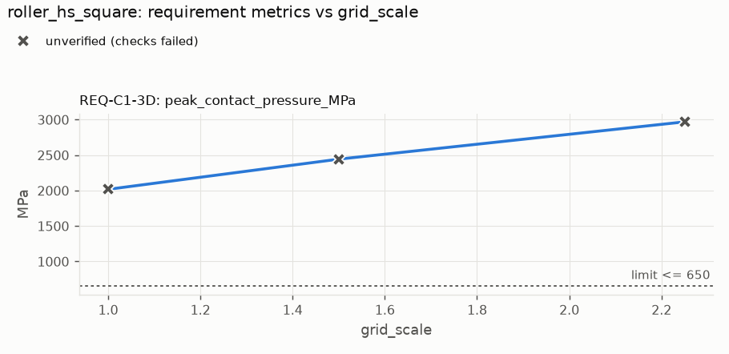
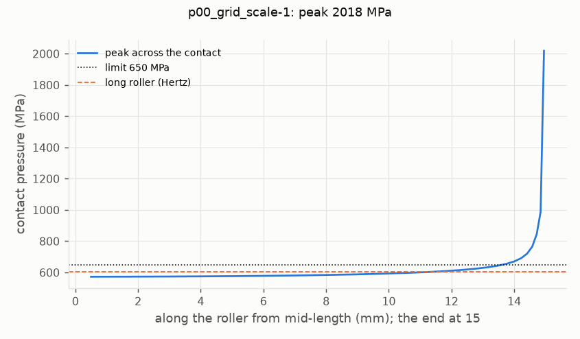
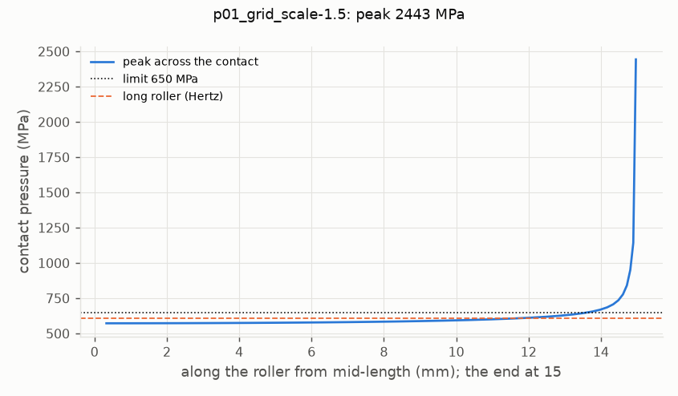
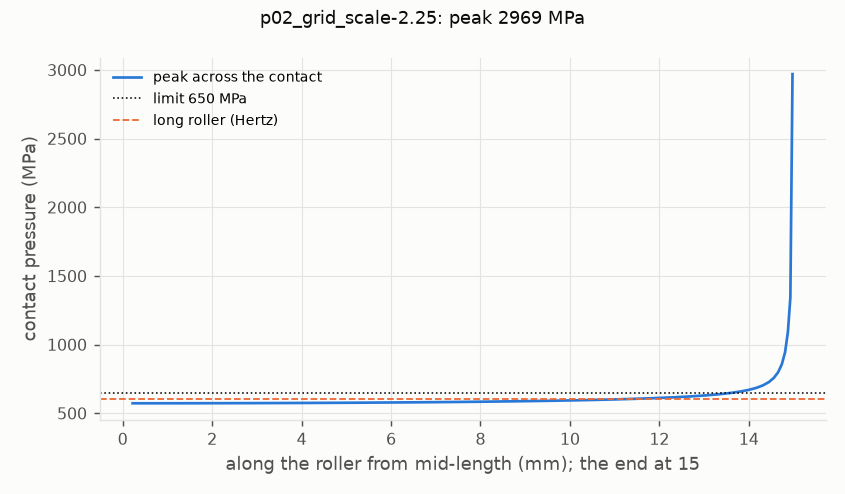

# Engineering review report: roller_hs_square

- **Run:** `20261127-172828_roller_hs_square`
- **Generated:** 2026-11-27T22:30:21+00:00
- **Case file SHA-256:** `47f753df278552f0188186897c90ef9183d1697727b9a2db5c4b057f84be1bfb`
- **Environment:** Python 3.14.10, numpy 2.5.5, scipy 1.18.1, matplotlib 3.11.2, cadquery 2.8.0; Windows-11-10.0.26100-SP0
- **Tools:** scipy 1.18.1; numpy 2.5.5
- **Code version:** git `1122218b1ad8377167269afdceb46ac2d47417a4` (uncommitted changes present)
- **Simulation status:** completed
- **Verification status:** FAIL

> **Warning:** verification did not pass for every point. Requirement verdicts marked *(unverified)* are not supported by evidence and must not be used for acceptance.

## Scope

Study 10's track roller, straight with square ends (the singular case), on half-spaces; grid scale 1 / 1.5 / 2.25.

**Assumptions**

- Both bodies elastic half-spaces (E 210 GPa, nu 0.3), frictionless; the roller 100 mm in diameter and 30 mm long [length synthetic], the plate wider and deeper than the contact.
- The roller's end face is not modelled (the half-space continues past it): near the end the method overstates a sharp-edged peak somewhat; the crowned design's peak is at mid-length, where this does not apply.
- The profiles as the 3D FE model's (models/fea/roller_3d.drop_um): an edge radius of 1 mm, or a logarithmic crown of the Fujiwara-Kawase form, z_m 30 um, A a multiple of Lundberg's 2 Q / (pi l E').
- The load centred and the roller aligned: no tilt or misalignment.

## Requirements

| ID | Requirement | Metric | Limit |
|---|---|---|---|
| REQ-C1-3D | The peak contact pressure anywhere along the roller, its ends included, shall not exceed 650 MPa (study 10's REQ on the peak pressure). | `peak_contact_pressure_MPa` | <= 650 MPa |

## Summary across points

| Point | grid_scale | REQ-C1-3D | Checks |
|---|---|---|---|
| p00_grid_scale-1 | 1 | 2018 MPa: **FAIL (unverified)** | 3/3 PASS |
| p01_grid_scale-1.5 | 1.5 | 2443 MPa: **FAIL (unverified)** | 3/3 PASS |
| p02_grid_scale-2.25 | 2.25 | 2969 MPa: **FAIL (unverified)** | 3/3 PASS |

## Run-level checks

Checks that use several points together (for example mesh convergence).

| Check | Description | Value | Tolerance | Status |
|---|---|---|---|---|
| discretization_peak_contact_pressure_MPa | relative discretization uncertainty of peak_contact_pressure_MPa, divergent (R = 1.236): no estimate | inf | 0.01 | FAIL |

A failed run-level check withholds the verdicts of requirements on `peak_contact_pressure_MPa` at every point: they are marked *(unverified)* in the table above.

## Point details

### p00_grid_scale-1

Parameters: roller_radius_mm = 50, roller_length_mm = 30, youngs_modulus_MPa = 2.1e+05, poisson_ratio = 0.3, line_load_N_per_mm = 500, profile_code = 0, edge_radius_mm = 1, z_fine_mm = 0, crown_A_factor = 1.3, crown_zm_um = 30, cap_um = 200, grid_scale = 1, pressure_limit_MPa = 650

Derived: long_roller_hertz_MPa = 606, long_roller_half_width_mm = 0.5252, profile = none, grid = {'nx': 24, 'y_fine': 0.1, 'y_max_cell': 1.0}

| Requirement | Result | Limit | Margin | Verdict | Evidence |
|---|---|---|---|---|---|
| REQ-C1-3D | 2018 MPa | <= 650 | -1.37e+03 | **FAIL (unverified)** | [point.json](points/p00_grid_scale-1/point.json) |

| Check | Description | Value | Tolerance | Status |
|---|---|---|---|---|
| hertz_line_mid | \|long straight roller's mid-length pressure - Hertz line contact for the line load that section carries\| / Hertz | 8.91e-04 | 0.003 | PASS |
| hertz_ellipse | \|circularly crowned roller's peak - Hertz elliptical contact\| / Hertz | 5.54e-04 | 0.003 | PASS |
| load | max \|total contact force / target - 1\| over the design and reference solves | 7.38e-07 | 1e-05 | PASS |

### p01_grid_scale-1.5

Parameters: roller_radius_mm = 50, roller_length_mm = 30, youngs_modulus_MPa = 2.1e+05, poisson_ratio = 0.3, line_load_N_per_mm = 500, profile_code = 0, edge_radius_mm = 1, z_fine_mm = 0, crown_A_factor = 1.3, crown_zm_um = 30, cap_um = 200, grid_scale = 1.5, pressure_limit_MPa = 650

Derived: long_roller_hertz_MPa = 606, long_roller_half_width_mm = 0.5252, profile = none, grid = {'nx': 36, 'y_fine': 0.06666666666666667, 'y_max_cell': 0.6666666666666666}

| Requirement | Result | Limit | Margin | Verdict | Evidence |
|---|---|---|---|---|---|
| REQ-C1-3D | 2443 MPa | <= 650 | -1.79e+03 | **FAIL (unverified)** | [point.json](points/p01_grid_scale-1.5/point.json) |

| Check | Description | Value | Tolerance | Status |
|---|---|---|---|---|
| hertz_line_mid | \|long straight roller's mid-length pressure - Hertz line contact for the line load that section carries\| / Hertz | 5.73e-04 | 0.003 | PASS |
| hertz_ellipse | \|circularly crowned roller's peak - Hertz elliptical contact\| / Hertz | 1.69e-04 | 0.003 | PASS |
| load | max \|total contact force / target - 1\| over the design and reference solves | 2.22e-16 | 1e-05 | PASS |

### p02_grid_scale-2.25

Parameters: roller_radius_mm = 50, roller_length_mm = 30, youngs_modulus_MPa = 2.1e+05, poisson_ratio = 0.3, line_load_N_per_mm = 500, profile_code = 0, edge_radius_mm = 1, z_fine_mm = 0, crown_A_factor = 1.3, crown_zm_um = 30, cap_um = 200, grid_scale = 2.25, pressure_limit_MPa = 650

Derived: long_roller_hertz_MPa = 606, long_roller_half_width_mm = 0.5252, profile = none, grid = {'nx': 54, 'y_fine': 0.044444444444444446, 'y_max_cell': 0.4444444444444444}

| Requirement | Result | Limit | Margin | Verdict | Evidence |
|---|---|---|---|---|---|
| REQ-C1-3D | 2969 MPa | <= 650 | -2.32e+03 | **FAIL (unverified)** | [point.json](points/p02_grid_scale-2.25/point.json) |

| Check | Description | Value | Tolerance | Status |
|---|---|---|---|---|
| hertz_line_mid | \|long straight roller's mid-length pressure - Hertz line contact for the line load that section carries\| / Hertz | 2.42e-04 | 0.003 | PASS |
| hertz_ellipse | \|circularly crowned roller's peak - Hertz elliptical contact\| / Hertz | 1.01e-04 | 0.003 | PASS |
| load | max \|total contact force / target - 1\| over the design and reference solves | 5.61e-10 | 1e-05 | PASS |

## Limitations

- No misalignment: a tilted roller loads one end; a crown's margin against tilt is a separate check.
- Contact pressure only (study 10's REQ-C1); the subsurface shear is not computed here.
- Half-spaces: the roller's end face and the plate's finite size are left out.
- A converged solver run that matches an analytical reference shows that the equations were solved correctly. It does not show that the equations represent real hardware.

## Engineering acceptance

Pending human review. This report does not accept or reject the design.
