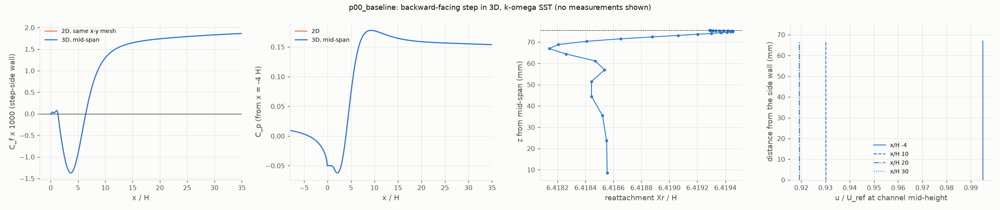

# Engineering review report: step3d_symmetry

- **Run:** `20261127-200510_step3d_symmetry`
- **Generated:** 2026-11-28T02:57:57+00:00
- **Case file SHA-256:** `6d6abd9d9878de45579399433fa7042ee6718e3272faabdf05aee944301b3ab2`
- **Environment:** Python 3.14.10, numpy 2.5.5, scipy 1.18.1, matplotlib 3.11.2, cadquery 2.8.0; Windows-11-10.0.26100-SP0
- **Tools:** openfoam_bashrc /opt/openfoam14/etc/bashrc; openfoam_version 14; openfoam_package openfoam14 20261008; linux Ubuntu 22.04.5 LTS; mpi mpirun (Open MPI) 4.1.2; n_procs 6
- **Code version:** git `6273f683f4bf82f9462d2841e0ce8af22925335a` (uncommitted changes present)
- **Simulation status:** completed
- **Verification status:** FAIL

> **Warning:** verification did not pass for every point. Requirement verdicts marked *(unverified)* are not supported by evidence and must not be used for acceptance.

## Scope

Backward-facing step (Driver and Seegmiller, ERCOFTAC 030) in 3D over half the tunnel span with the side wall as a symmetry plane: the exact 2D limit of the 3D pipeline, against the 2D model on the same x-y mesh (level 0.5).

**Assumptions**

- Steady, incompressible RANS, k-omega SST (openfoam.org v14), walls resolved (y+ under 1), as part 2.
- Geometry from the case description: step H 12.7 mm, inlet duct 8 H, parallel top wall; half span 75.5 mm (span 151 mm); Re_H 37500.
- Side wall as a symmetry plane (slip): the flow is 2D, so the 3D result must equal the 2D solution on the same x-y mesh.
- Inflow as part 2: uniform 41.95 m/s 1.153 m upstream of the step, Tu 1 %, viscosity ratio 10.

## Requirements

| ID | Requirement | Metric | Limit |
|---|---|---|---|
| REQ-S3-LIMIT | Exact limit (internal): with the side wall a symmetry plane, the 3D recovery equals the 2D model's on the same mesh within 5e-4. | `cp_recovery_change_abs` | <= 0.0005 - |

## Summary across points

| Point | REQ-S3-LIMIT | Checks |
|---|---|---|
| p00_baseline | 2.099e-05 -: **PASS (unverified)** | 14/16 FAIL |

## Point details

### p00_baseline

Parameters: step_height_m = 0.0127, inlet_height_ratio = 8, reynolds_number_h = 3.75e+04, inlet_velocity_m_per_s = 41.95, inlet_velocity_2d_m_per_s = 41.95, reference_velocity_m_per_s = 44.2, upstream_length_m = 1.153, downstream_length_over_h = 50, inlet_turbulence_intensity = 0.01, inlet_viscosity_ratio = 10, mesh_level = 0.5, turbulence_model = kOmegaSST, half_span_m = 0.0755, side_wall = 0, spanwise_level = 1, side_wall_start_m = -1.153

Derived: nu_m2_per_s = 1.497e-05, cells = 5.664e+05, cells_2d = 1.77e+04, nz = 32, y1_m = 6e-06, y1z_m = 6e-06, growth_z = 1.293, dz_mid_m = 0.01709, dx_lip_m = 0.000635, side_wall_split = None

| Requirement | Result | Limit | Margin | Verdict | Evidence |
|---|---|---|---|---|---|
| REQ-S3-LIMIT | 2.099e-05 - | <= 0.0005 | 0.000479 | **PASS (unverified)** | [point.json](points/p00_baseline/point.json) |

| Check | Description | Value | Tolerance | Status |
|---|---|---|---|---|
| converged | 3D, side wall a symmetry plane: largest final initial residual of Ux, Uy, p, k, omega over its target (Uz excluded: it is zero, see uz_zero) | 9.07e-01 | 1 | PASS |
| uz_zero | 3D, side wall a symmetry plane: max \|Uz\| / U_ref (the flow is 2D) | 1.33e-03 | 0.0001 | FAIL |
| converged_2d | 2D solution (initial field and same-mesh comparison): residual control reached (0 = yes) | 0.00e+00 | 0 | PASS |
| continuity | 3D: time-step continuity error, sum local (last iteration) | 1.84e-06 | 1e-06 | FAIL |
| mass_balance | 3D: \|inlet + outlet volume flow\| / inlet flow | 9.42e-11 | 1e-06 | PASS |
| recovery_settled | 3D: range of the probe recovery Cp(30 H) - Cp(-4 H) at mid-span over the last 10 % of the iterations | 5.74e-07 | 0.0002 | PASS |
| mesh_matches_2d | max \|x-y cell centre of the 3D mesh - its 2D cell's\| (m): the 3D x-y plane is the 2D mesh, and the cell map is right | 1.00e-13 | 1e-09 | PASS |
| inflow_theta (validity) | \|momentum thickness at x = -4 H, mid-span - stated\| / stated | 3.16e-03 | 0.05 | PASS |
| inflow_velocity (validity) | \|edge velocity at x = -4 H, mid-span - stated reference\| / reference | 2.73e-03 | 0.02 | PASS |
| yplus_walls (validity) | max y+ on every wall but the step face, side wall included (viscous sublayer resolved) | 4.66e-01 | 1 | PASS |
| mesh | checkMesh failures other than the aspect-ratio test (0 = none) | 0.00e+00 | 0 | PASS |
| reattachment_found | reattachment point on the floor at mid-span missing (0 = found, 1 = none) | 0.00e+00 | 0 | PASS |
| limit_xr | side wall as symmetry = 2D: \|Xr/H 3D - 2D\| / 2D | 7.58e-05 | 0.001 | PASS |
| limit_cp_recovery | side wall as symmetry = 2D: \|recovery 3D - 2D\| | 2.10e-05 | 0.0005 | PASS |
| limit_cf20 | side wall as symmetry = 2D: \|Cf(20 H) 3D - 2D\| / 2D | 5.11e-05 | 0.005 | PASS |
| limit_spanwise_uniform | side wall as symmetry = 2D: max \|Xr/H(z) - Xr/H(mid-span)\| / Xr/H | 1.40e-04 | 0.001 | PASS |

## Limitations

- One x-y mesh level (0.5) and one spanwise mesh; this case checks the pipeline, not the physics.
- A converged solver run that matches an analytical reference shows that the equations were solved correctly. It does not show that the equations represent real hardware.

## Engineering acceptance

Pending human review. This report does not accept or reject the design.
