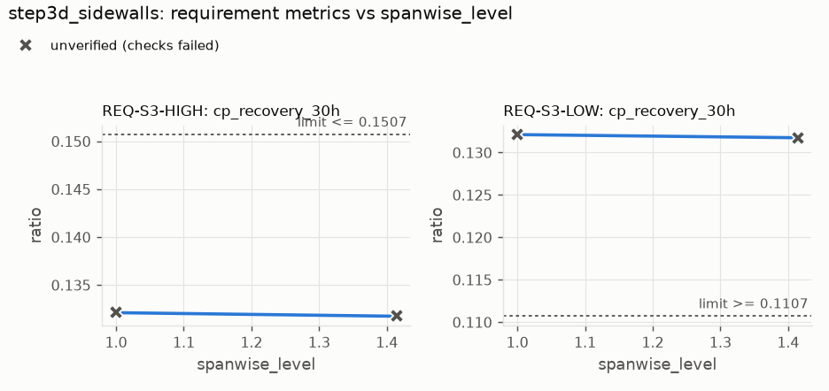
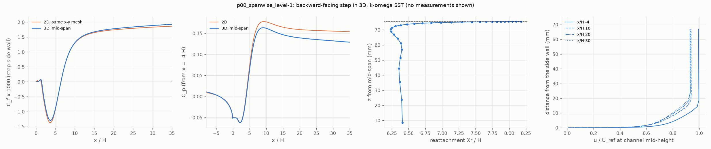
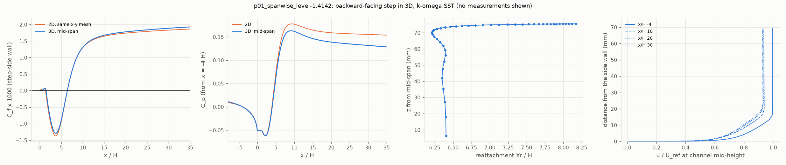

# Engineering review report: step3d_sidewalls

- **Run:** `20261127-223049_step3d_sidewalls`
- **Generated:** 2026-11-28T10:43:23+00:00
- **Case file SHA-256:** `1fdd1ef4cc2fa3a54f9d74e0245422731c41cd53805c3810dbd915c087be6b2d`
- **Environment:** Python 3.14.10, numpy 2.5.5, scipy 1.18.1, matplotlib 3.11.2, cadquery 2.8.0; Windows-11-10.0.26100-SP0
- **Tools:** openfoam_bashrc /opt/openfoam14/etc/bashrc; openfoam_version 14; openfoam_package openfoam14 20261008; linux Ubuntu 22.04.5 LTS; mpi mpirun (Open MPI) 4.1.2; n_procs 6
- **Code version:** git `9c8edc5c965b63857486b47c57c7d33f33ae5315` (uncommitted changes present)
- **Simulation status:** completed
- **Verification status:** FAIL

> **Warning:** verification did not pass for every point. Requirement verdicts marked *(unverified)* are not supported by evidence and must not be used for acceptance.

## Scope

Backward-facing step (Driver and Seegmiller, ERCOFTAC 030) in 3D over half the tunnel span with the side wall as a no-slip wall, its boundary layer from the same inlet as the floor's; spanwise levels 1 and 1.41 (x-y mesh level 0.5).

**Assumptions**

- Steady, incompressible RANS, k-omega SST (openfoam.org v14), every wall resolved (y+ under 1), the side wall included.
- Geometry from the case description: step H 12.7 mm, inlet duct 8 H, parallel top wall; half span 75.5 mm (span 151 mm), mid-span a symmetry plane; Re_H 37500.
- The side walls' boundary layers start at the same uniform inlet as the floor's and the top wall's, 1.153 m upstream of the step (not in the case description: stated, bracketed by step3d_sidewall_start).
- Inflow re-matched to the stated edge velocity at x = -4 H at mid-span (44.2 m/s); 2D stage at part 2's 41.95 m/s.

## Requirements

| ID | Requirement | Metric | Limit |
|---|---|---|---|
| REQ-S3-HIGH | Part 2's REQ-S3 (upper side): the recovery Cp(30 H) - Cp(-4 H) at mid-span at most the measured 0.1307 + 0.02. | `cp_recovery_30h` | <= 0.1507 - |
| REQ-S3-LOW | Part 2's REQ-S3 (lower side): the recovery at mid-span at least the measured 0.1307 - 0.02. | `cp_recovery_30h` | >= 0.1107 - |

## Summary across points

| Point | spanwise_level | REQ-S3-HIGH | REQ-S3-LOW | Checks |
|---|---|---|---|---|
| p00_spanwise_level-1 | 1 | 0.1321 -: **PASS (unverified)** | 0.1321 -: **PASS (unverified)** | 9/11 FAIL |
| p01_spanwise_level-1.4142 | 1.414 | 0.1317 -: **PASS (unverified)** | 0.1317 -: **PASS (unverified)** | 9/11 FAIL |

## Run-level checks

Checks that use several points together (for example mesh convergence).

| Check | Description | Value | Tolerance | Status |
|---|---|---|---|---|
| refinement_cp_recovery_30h | |cp_recovery_30h finer - coarser| (spanwise_level, two levels: a change, not an uncertainty) | 0.000372 | 0.002 | PASS |
| refinement_xr_over_h | |xr_over_h finer - coarser| (spanwise_level, two levels: a change, not an uncertainty) | 0.00372 | 0.03 | PASS |

## Point details

### p00_spanwise_level-1

Parameters: step_height_m = 0.0127, inlet_height_ratio = 8, reynolds_number_h = 3.75e+04, inlet_velocity_m_per_s = 40.91, inlet_velocity_2d_m_per_s = 41.95, reference_velocity_m_per_s = 44.2, upstream_length_m = 1.153, downstream_length_over_h = 50, inlet_turbulence_intensity = 0.01, inlet_viscosity_ratio = 10, mesh_level = 0.5, turbulence_model = kOmegaSST, half_span_m = 0.0755, side_wall = 1, spanwise_level = 1, side_wall_start_m = -1.153

Derived: nu_m2_per_s = 1.497e-05, cells = 5.664e+05, cells_2d = 1.77e+04, nz = 32, y1_m = 6e-06, y1z_m = 6e-06, growth_z = 1.293, dz_mid_m = 0.01709, dx_lip_m = 0.000635, side_wall_split = None

| Requirement | Result | Limit | Margin | Verdict | Evidence |
|---|---|---|---|---|---|
| REQ-S3-HIGH | 0.1321 - | <= 0.1507 | 0.0186 | **PASS (unverified)** | [point.json](points/p00_spanwise_level-1/point.json) |
| REQ-S3-LOW | 0.1321 - | >= 0.1107 | 0.0214 | **PASS (unverified)** | [point.json](points/p00_spanwise_level-1/point.json) |

| Check | Description | Value | Tolerance | Status |
|---|---|---|---|---|
| converged | 3D: SIMPLE residual control reached (0 = yes) | 1.00e+00 | 0 | FAIL |
| converged_2d | 2D solution (initial field and same-mesh comparison): residual control reached (0 = yes) | 0.00e+00 | 0 | PASS |
| continuity | 3D: time-step continuity error, sum local (last iteration) | 4.89e-06 | 1e-06 | FAIL |
| mass_balance | 3D: \|inlet + outlet volume flow\| / inlet flow | 2.93e-10 | 1e-06 | PASS |
| recovery_settled | 3D: range of the probe recovery Cp(30 H) - Cp(-4 H) at mid-span over the last 10 % of the iterations | 3.04e-07 | 0.0002 | PASS |
| mesh_matches_2d | max \|x-y cell centre of the 3D mesh - its 2D cell's\| (m): the 3D x-y plane is the 2D mesh, and the cell map is right | 1.00e-13 | 1e-09 | PASS |
| inflow_theta (validity) | \|momentum thickness at x = -4 H, mid-span - stated\| / stated | 2.63e-02 | 0.05 | PASS |
| inflow_velocity (validity) | \|edge velocity at x = -4 H, mid-span - stated reference\| / reference | 3.94e-04 | 0.02 | PASS |
| yplus_walls (validity) | max y+ on every wall but the step face, side wall included (viscous sublayer resolved) | 4.58e-01 | 1 | PASS |
| mesh | checkMesh failures other than the aspect-ratio test (0 = none) | 0.00e+00 | 0 | PASS |
| reattachment_found | reattachment point on the floor at mid-span missing (0 = found, 1 = none) | 0.00e+00 | 0 | PASS |

### p01_spanwise_level-1.4142

Parameters: step_height_m = 0.0127, inlet_height_ratio = 8, reynolds_number_h = 3.75e+04, inlet_velocity_m_per_s = 40.91, inlet_velocity_2d_m_per_s = 41.95, reference_velocity_m_per_s = 44.2, upstream_length_m = 1.153, downstream_length_over_h = 50, inlet_turbulence_intensity = 0.01, inlet_viscosity_ratio = 10, mesh_level = 0.5, turbulence_model = kOmegaSST, half_span_m = 0.0755, side_wall = 1, spanwise_level = 1.414, side_wall_start_m = -1.153

Derived: nu_m2_per_s = 1.497e-05, cells = 7.965e+05, cells_2d = 1.77e+04, nz = 45, y1_m = 6e-06, y1z_m = 4.243e-06, growth_z = 1.199, dz_mid_m = 0.01254, dx_lip_m = 0.000635, side_wall_split = None

| Requirement | Result | Limit | Margin | Verdict | Evidence |
|---|---|---|---|---|---|
| REQ-S3-HIGH | 0.1317 - | <= 0.1507 | 0.019 | **PASS (unverified)** | [point.json](points/p01_spanwise_level-1.4142/point.json) |
| REQ-S3-LOW | 0.1317 - | >= 0.1107 | 0.021 | **PASS (unverified)** | [point.json](points/p01_spanwise_level-1.4142/point.json) |

| Check | Description | Value | Tolerance | Status |
|---|---|---|---|---|
| converged | 3D: SIMPLE residual control reached (0 = yes) | 1.00e+00 | 0 | FAIL |
| converged_2d | 2D solution (initial field and same-mesh comparison): residual control reached (0 = yes) | 0.00e+00 | 0 | PASS |
| continuity | 3D: time-step continuity error, sum local (last iteration) | 6.20e-06 | 1e-06 | FAIL |
| mass_balance | 3D: \|inlet + outlet volume flow\| / inlet flow | 2.93e-10 | 1e-06 | PASS |
| recovery_settled | 3D: range of the probe recovery Cp(30 H) - Cp(-4 H) at mid-span over the last 10 % of the iterations | 3.08e-07 | 0.0002 | PASS |
| mesh_matches_2d | max \|x-y cell centre of the 3D mesh - its 2D cell's\| (m): the 3D x-y plane is the 2D mesh, and the cell map is right | 1.00e-12 | 1e-09 | PASS |
| inflow_theta (validity) | \|momentum thickness at x = -4 H, mid-span - stated\| / stated | 2.67e-02 | 0.05 | PASS |
| inflow_velocity (validity) | \|edge velocity at x = -4 H, mid-span - stated reference\| / reference | 8.37e-04 | 0.02 | PASS |
| yplus_walls (validity) | max y+ on every wall but the step face, side wall included (viscous sublayer resolved) | 4.58e-01 | 1 | PASS |
| mesh | checkMesh failures other than the aspect-ratio test (0 = none) | 0.00e+00 | 0 | PASS |
| reattachment_found | reattachment point on the floor at mid-span missing (0 = found, 1 = none) | 0.00e+00 | 0 | PASS |

## Limitations

- One x-y mesh level (0.5): its 2D values differ from part 2's finest by 0.0019 in recovery and 0.2 % in Xr/H (stated, from the 2D levels).
- Two spanwise levels: a change, not a formal uncertainty.
- Linear eddy-viscosity model: no secondary flow of the second kind in the corners.
- A converged solver run that matches an analytical reference shows that the equations were solved correctly. It does not show that the equations represent real hardware.

## Engineering acceptance

Pending human review. This report does not accept or reject the design.
