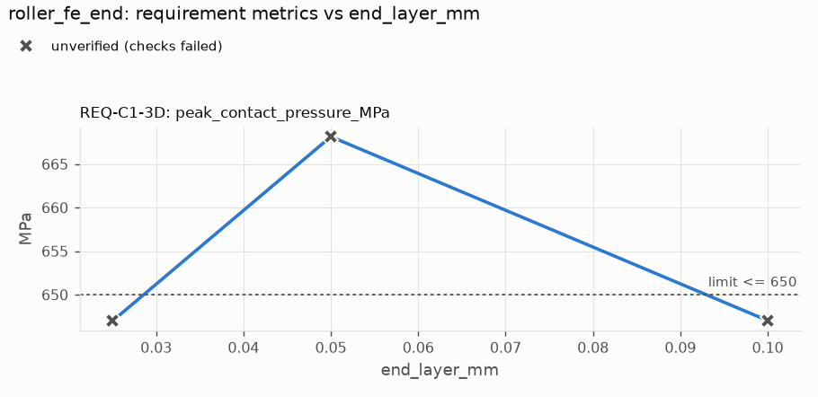
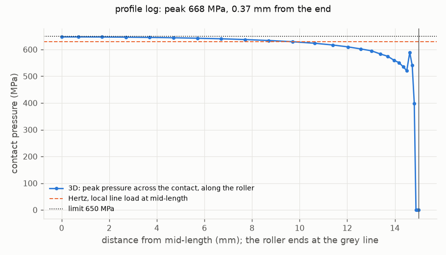
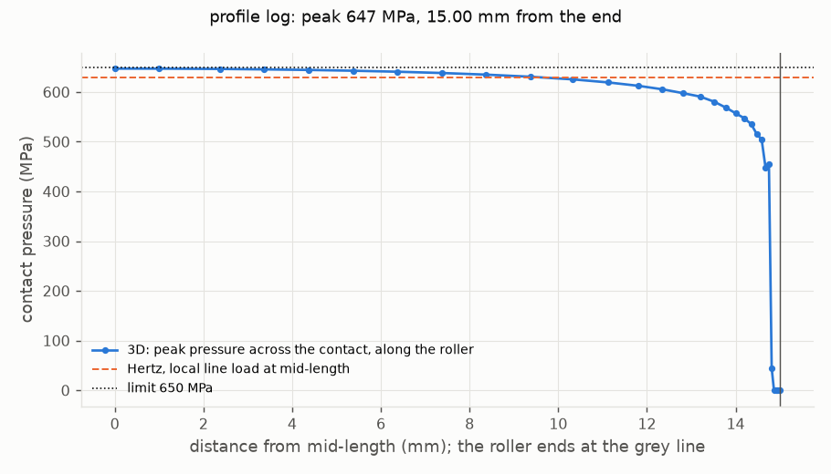

# Engineering review report: roller_fe_end

- **Run:** `20261128-014852_roller_fe_end`
- **Generated:** 2026-11-28T16:24:00+00:00
- **Case file SHA-256:** `7b15757c548031811124ca253b634c8a11a90f7b6daa71961529f6c2eb42bc86`
- **Environment:** Python 3.14.10, numpy 2.5.5, scipy 1.18.1, matplotlib 3.11.2, cadquery 2.8.0; Windows-11-10.0.26100-SP0
- **Tools:** gmsh 4.15.0; CalculiX This is Version 2.22
- **Code version:** git `e9c05444fef8f5441a14c205a6a293b99f53470f`
- **Simulation status:** completed
- **Verification status:** FAIL

> **Warning:** verification did not pass for every point. Requirement verdicts marked *(unverified)* are not supported by evidence and must not be used for acceptance.

## Scope

Study 10's track roller (100 mm diameter, 30 mm long [synthetic], 500 N/mm) with the chosen logarithmic crown (A = 1.793 um, z_m 30 um) on a 60 mm plate, 3D CalculiX penalty contact, 0.08 mm contact elements; the layers along the roller refined at the end (0.1 / 0.05 / 0.025 mm) to draw the crown's steep end; two approach steps bracketing the load.

**Assumptions**

- Linear elastic steel (E 210 GPa, nu 0.3), frictionless penalty contact as study 10 (50 E / h).
- Quarter model: symmetric about the plane through the roller's axis and about its mid-length; the plate 60 mm wide, 50 mm deep, 120 mm long (study 10's section).
- The crown applied as a micron drop of the roller's nodes (each slice shifted), capped at 60 um; between layer planes the surface is straight (8-node bricks).
- The results interpolated linearly in load between the two steps that bracket 500 N/mm.

## Requirements

| ID | Requirement | Metric | Limit |
|---|---|---|---|
| REQ-C1-3D | The peak contact pressure anywhere along the crowned roller shall not exceed 650 MPa (study 10's REQ on the peak pressure), on the 3D finite-element model. | `peak_contact_pressure_MPa` | <= 650 MPa |

## Summary across points

| Point | end_layer_mm | REQ-C1-3D | Checks |
|---|---|---|---|
| p00_end_layer_mm-0.1 | 0.1 | 647 MPa: **PASS (unverified)** | 4/5 FAIL |
| p01_end_layer_mm-0.05 | 0.05 | 668.1 MPa: **FAIL (unverified)** | 4/5 FAIL |
| p02_end_layer_mm-0.025 | 0.025 | 647 MPa: **PASS (unverified)** | 4/5 FAIL |

## Point details

### p00_end_layer_mm-0.1

Parameters: roller_radius_mm = 50, roller_length_mm = 30, plate_width_mm = 60, block_half_width_mm = 60, block_depth_mm = 50, youngs_modulus_MPa = 2.1e+05, poisson_ratio = 0.3, yield_strength_MPa = 1200, contact_element_size_mm = 0.08, far_element_size_mm = 4, refined_zone_mm = 1.6, end_layer_mm = 0.1, layer_growth = 1.2, max_layer_mm = 1, penalty_stiffness_factor = 50, line_load_N_per_mm = 500, profile = log, crown_A_um = 1.793, crown_zm_um = 30, cap_um = 60, approach_mm = 0.0155, approach_factors = [0.98, 1.02]

Derived: hertz_long_roller = {'E_star_MPa': 115384.61538461539, 'half_width_mm': 0.5252319183236601, 'peak_pressure_MPa': 606.0368288349923, 'max_shear_MPa': 181.98262131343319, 'max_shear_depth_mm': 0.4129117977874304}, lundberg_A_um = 1.379, total_load_N = 1.5e+04

| Requirement | Result | Limit | Margin | Verdict | Evidence |
|---|---|---|---|---|---|
| REQ-C1-3D | 647 MPa | <= 650 | 2.98 | **PASS (unverified)** | [point.json](points/p00_end_layer_mm-0.1/point.json) |

| Check | Description | Value | Tolerance | Status |
|---|---|---|---|---|
| load_bracketed (validity) | the target load lies between two completed steps (0 = yes) | 0.00e+00 | 0 | PASS |
| equilibrium | max over the steps of \|roller reaction + plate reaction\| / roller reaction | 0.00e+00 | 1e-05 | PASS |
| contact_integral | \|contact pressure integrated over the patch / roller reaction - 1\| at the target load (the nodal pressures' smearing of the contact edge) | 9.98e-02 | 0.03 | FAIL |
| hertz_mid_pressure | \|peak pressure at mid-length - Hertz p0 for the local line load there\| / p0 (long-roller limit) | 2.91e-02 | 0.03 | PASS |
| elastic (validity) | max subsurface shear / shear yield (Tresca, yield / 2) | 3.23e-01 | 1 | PASS |

### p01_end_layer_mm-0.05

Parameters: roller_radius_mm = 50, roller_length_mm = 30, plate_width_mm = 60, block_half_width_mm = 60, block_depth_mm = 50, youngs_modulus_MPa = 2.1e+05, poisson_ratio = 0.3, yield_strength_MPa = 1200, contact_element_size_mm = 0.08, far_element_size_mm = 4, refined_zone_mm = 1.6, end_layer_mm = 0.05, layer_growth = 1.2, max_layer_mm = 1, penalty_stiffness_factor = 50, line_load_N_per_mm = 500, profile = log, crown_A_um = 1.793, crown_zm_um = 30, cap_um = 60, approach_mm = 0.0155, approach_factors = [0.98, 1.02]

Derived: hertz_long_roller = {'E_star_MPa': 115384.61538461539, 'half_width_mm': 0.5252319183236601, 'peak_pressure_MPa': 606.0368288349923, 'max_shear_MPa': 181.98262131343319, 'max_shear_depth_mm': 0.4129117977874304}, lundberg_A_um = 1.379, total_load_N = 1.5e+04

| Requirement | Result | Limit | Margin | Verdict | Evidence |
|---|---|---|---|---|---|
| REQ-C1-3D | 668.1 MPa | <= 650 | -18.1 | **FAIL (unverified)** | [point.json](points/p01_end_layer_mm-0.05/point.json) |

| Check | Description | Value | Tolerance | Status |
|---|---|---|---|---|
| load_bracketed (validity) | the target load lies between two completed steps (0 = yes) | 0.00e+00 | 0 | PASS |
| equilibrium | max over the steps of \|roller reaction + plate reaction\| / roller reaction | 0.00e+00 | 1e-05 | PASS |
| contact_integral | \|contact pressure integrated over the patch / roller reaction - 1\| at the target load (the nodal pressures' smearing of the contact edge) | 9.63e-02 | 0.03 | FAIL |
| hertz_mid_pressure | \|peak pressure at mid-length - Hertz p0 for the local line load there\| / p0 (long-roller limit) | 2.74e-02 | 0.03 | PASS |
| elastic (validity) | max subsurface shear / shear yield (Tresca, yield / 2) | 3.23e-01 | 1 | PASS |

### p02_end_layer_mm-0.025

Parameters: roller_radius_mm = 50, roller_length_mm = 30, plate_width_mm = 60, block_half_width_mm = 60, block_depth_mm = 50, youngs_modulus_MPa = 2.1e+05, poisson_ratio = 0.3, yield_strength_MPa = 1200, contact_element_size_mm = 0.08, far_element_size_mm = 4, refined_zone_mm = 1.6, end_layer_mm = 0.025, layer_growth = 1.2, max_layer_mm = 1, penalty_stiffness_factor = 50, line_load_N_per_mm = 500, profile = log, crown_A_um = 1.793, crown_zm_um = 30, cap_um = 60, approach_mm = 0.0155, approach_factors = [0.98, 1.02]

Derived: hertz_long_roller = {'E_star_MPa': 115384.61538461539, 'half_width_mm': 0.5252319183236601, 'peak_pressure_MPa': 606.0368288349923, 'max_shear_MPa': 181.98262131343319, 'max_shear_depth_mm': 0.4129117977874304}, lundberg_A_um = 1.379, total_load_N = 1.5e+04

| Requirement | Result | Limit | Margin | Verdict | Evidence |
|---|---|---|---|---|---|
| REQ-C1-3D | 647 MPa | <= 650 | 3.04 | **PASS (unverified)** | [point.json](points/p02_end_layer_mm-0.025/point.json) |

| Check | Description | Value | Tolerance | Status |
|---|---|---|---|---|
| load_bracketed (validity) | the target load lies between two completed steps (0 = yes) | 0.00e+00 | 0 | PASS |
| equilibrium | max over the steps of \|roller reaction + plate reaction\| / roller reaction | 0.00e+00 | 1e-05 | PASS |
| contact_integral | \|contact pressure integrated over the patch / roller reaction - 1\| at the target load (the nodal pressures' smearing of the contact edge) | 9.99e-02 | 0.03 | FAIL |
| hertz_mid_pressure | \|peak pressure at mid-length - Hertz p0 for the local line load there\| / p0 (long-roller limit) | 2.92e-02 | 0.03 | PASS |
| elastic (validity) | max subsurface shear / shear yield (Tresca, yield / 2) | 3.23e-01 | 1 | PASS |

## Limitations

- In-plane contact mesh fixed at 0.08 mm, the coarsest level of roller_fe_mesh: the mid-length value carries that mesh's discretization error, measured there.
- No misalignment; contact pressure and the shear below it only.
- A converged solver run that matches an analytical reference shows that the equations were solved correctly. It does not show that the equations represent real hardware.

## Engineering acceptance

Pending human review. This report does not accept or reject the design.
