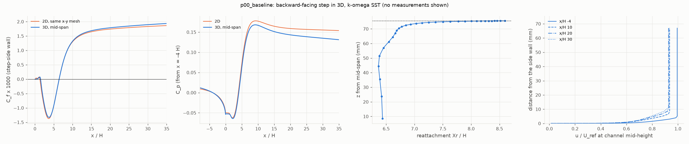

# Engineering review report: step3d_sidewall_start

- **Run:** `20261128-054328_step3d_sidewall_start`
- **Generated:** 2026-11-28T13:24:42+00:00
- **Case file SHA-256:** `bee5224b7694c14e2a8fc7521bc3a5e86f8fed2295a3c23b9d2cab5f305fc338`
- **Environment:** Python 3.14.10, numpy 2.5.5, scipy 1.18.1, matplotlib 3.11.2, cadquery 2.8.0; Windows-11-10.0.26100-SP0
- **Tools:** openfoam_bashrc /opt/openfoam14/etc/bashrc; openfoam_version 14; openfoam_package openfoam14 20261008; linux Ubuntu 22.04.5 LTS; mpi mpirun (Open MPI) 4.1.2; n_procs 6
- **Code version:** git `95010eb6bcf526f227155fa89fe0dd51644d0fa3`
- **Simulation status:** completed
- **Verification status:** FAIL

> **Warning:** verification did not pass for every point. Requirement verdicts marked *(unverified)* are not supported by evidence and must not be used for acceptance.

## Scope

Backward-facing step in 3D with the side wall slip upstream of x = -0.30 m and no-slip downstream: a thinner side-wall boundary layer at the step (bracket on the unstated side-wall inflow); spanwise level 1, x-y level 0.5.

**Assumptions**

- As step3d_sidewalls, except the side walls' boundary layers start at x = -0.30 m (slip upstream of it), a bracket: the case description does not give them.
- Inflow re-matched to the stated edge velocity at x = -4 H at mid-span (44.2 m/s); 2D stage at part 2's 41.95 m/s.

## Requirements

| ID | Requirement | Metric | Limit |
|---|---|---|---|
| REQ-S3-HIGH | Part 2's REQ-S3 (upper side): the recovery Cp(30 H) - Cp(-4 H) at mid-span at most the measured 0.1307 + 0.02. | `cp_recovery_30h` | <= 0.1507 - |
| REQ-S3-LOW | Part 2's REQ-S3 (lower side): the recovery at mid-span at least the measured 0.1307 - 0.02. | `cp_recovery_30h` | >= 0.1107 - |

## Summary across points

| Point | REQ-S3-HIGH | REQ-S3-LOW | Checks |
|---|---|---|---|
| p00_baseline | 0.1349 -: **PASS (unverified)** | 0.1349 -: **PASS (unverified)** | 9/11 FAIL |

## Point details

### p00_baseline

Parameters: step_height_m = 0.0127, inlet_height_ratio = 8, reynolds_number_h = 3.75e+04, inlet_velocity_m_per_s = 41.61, inlet_velocity_2d_m_per_s = 41.95, reference_velocity_m_per_s = 44.2, upstream_length_m = 1.153, downstream_length_over_h = 50, inlet_turbulence_intensity = 0.01, inlet_viscosity_ratio = 10, mesh_level = 0.5, turbulence_model = kOmegaSST, half_span_m = 0.0755, side_wall = 1, spanwise_level = 1, side_wall_start_m = -0.3

Derived: nu_m2_per_s = 1.497e-05, cells = 5.664e+05, cells_2d = 1.77e+04, nz = 32, y1_m = 6e-06, y1z_m = 6e-06, growth_z = 1.293, dz_mid_m = 0.01709, dx_lip_m = 0.000635, side_wall_split = {'m_s': 70, 'x_s_m': -0.2959010336905267, 'growth_up': 1.0451848263882604}

| Requirement | Result | Limit | Margin | Verdict | Evidence |
|---|---|---|---|---|---|
| REQ-S3-HIGH | 0.1349 - | <= 0.1507 | 0.0158 | **PASS (unverified)** | [point.json](points/p00_baseline/point.json) |
| REQ-S3-LOW | 0.1349 - | >= 0.1107 | 0.0242 | **PASS (unverified)** | [point.json](points/p00_baseline/point.json) |

| Check | Description | Value | Tolerance | Status |
|---|---|---|---|---|
| converged | 3D: SIMPLE residual control reached (0 = yes) | 1.00e+00 | 0 | FAIL |
| converged_2d | 2D solution (initial field and same-mesh comparison): residual control reached (0 = yes) | 0.00e+00 | 0 | PASS |
| continuity | 3D: time-step continuity error, sum local (last iteration) | 5.16e-06 | 1e-06 | FAIL |
| mass_balance | 3D: \|inlet + outlet volume flow\| / inlet flow | 2.77e-08 | 1e-06 | PASS |
| recovery_settled | 3D: range of the probe recovery Cp(30 H) - Cp(-4 H) at mid-span over the last 10 % of the iterations | 6.42e-07 | 0.0002 | PASS |
| mesh_matches_2d | max \|x-y cell centre of the 3D mesh - its 2D cell's\| (m): the 3D x-y plane is the 2D mesh, and the cell map is right | 1.00e-12 | 1e-09 | PASS |
| inflow_theta (validity) | \|momentum thickness at x = -4 H, mid-span - stated\| / stated | 1.49e-02 | 0.05 | PASS |
| inflow_velocity (validity) | \|edge velocity at x = -4 H, mid-span - stated reference\| / reference | 1.79e-03 | 0.02 | PASS |
| yplus_walls (validity) | max y+ on every wall but the step face, side wall included (viscous sublayer resolved) | 5.37e-01 | 1 | PASS |
| mesh | checkMesh failures other than the aspect-ratio test (0 = none) | 0.00e+00 | 0 | PASS |
| reattachment_found | reattachment point on the floor at mid-span missing (0 = found, 1 = none) | 0.00e+00 | 0 | PASS |

## Limitations

- One x-y and one spanwise mesh level (the coarser of step3d_sidewalls'); the thin side-wall layer starts from a slip-to-wall jump.
- A converged solver run that matches an analytical reference shows that the equations were solved correctly. It does not show that the equations represent real hardware.

## Engineering acceptance

Pending human review. This report does not accept or reject the design.
