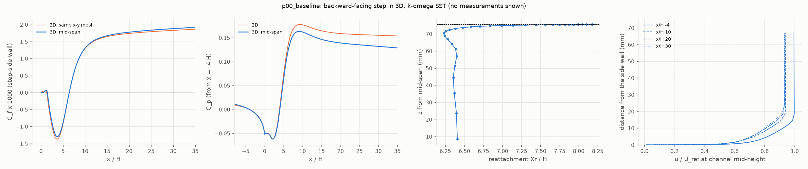

# Engineering review report: step3d_stall_locate

- **Run:** `20261128-112429_step3d_stall_locate`
- **Generated:** 2026-11-28T17:15:14+00:00
- **Case file SHA-256:** `3b76eae5f27786500a598dcf114801b8a6e14600f203912e219863f8486d71ea`
- **Environment:** Python 3.14.10, numpy 2.5.5, scipy 1.18.1, matplotlib 3.11.2, cadquery 2.8.0; Windows-11-10.0.26100-SP0
- **Tools:** openfoam_bashrc /opt/openfoam14/etc/bashrc; openfoam_version 14; openfoam_package openfoam14 20261008; linux Ubuntu 22.04.5 LTS; mpi mpirun (Open MPI) 4.1.2; n_procs 6
- **Code version:** git `9767d00ec7757e624fdc82c009e05c524dd0bfc4`
- **Simulation status:** completed
- **Verification status:** FAIL

> **Warning:** verification did not pass for every point. Requirement verdicts marked *(unverified)* are not supported by evidence and must not be used for acceptance.

## Scope

Backward-facing step in 3D with the side walls (step3d_sidewalls' spanwise level 1), rerun to iteration 3,000 with the stall diagnostics: the continuity error per cell, U and p at iterations 2,800 / 2,900 / 3,000, and probes every iteration behind the step lip.

**Assumptions**

- Steady, incompressible RANS, k-omega SST (openfoam.org v14), every wall resolved (y+ under 1), the side wall included.
- Geometry from the case description: step H 12.7 mm, inlet duct 8 H, parallel top wall; half span 75.5 mm (span 151 mm), mid-span a symmetry plane; Re_H 37500.
- The side walls' boundary layers start at the same uniform inlet as the floor's and the top wall's, 1.153 m upstream of the step (not in the case description: stated, bracketed by step3d_sidewall_start).
- Inflow re-matched to the stated edge velocity at x = -4 H at mid-span (44.2 m/s); 2D stage at part 2's 41.95 m/s.

## Requirements

| ID | Requirement | Metric | Limit |
|---|---|---|---|
| REQ-S3-HIGH | Part 2's REQ-S3 (upper side): the recovery Cp(30 H) - Cp(-4 H) at mid-span at most the measured 0.1307 + 0.02. | `cp_recovery_30h` | <= 0.1507 - |
| REQ-S3-LOW | Part 2's REQ-S3 (lower side): the recovery at mid-span at least the measured 0.1307 - 0.02. | `cp_recovery_30h` | >= 0.1107 - |

## Summary across points

| Point | REQ-S3-HIGH | REQ-S3-LOW | Checks |
|---|---|---|---|
| p00_baseline | 0.1321 -: **PASS (unverified)** | 0.1321 -: **PASS (unverified)** | 9/11 FAIL |

## Point details

### p00_baseline

Parameters: step_height_m = 0.0127, inlet_height_ratio = 8, reynolds_number_h = 3.75e+04, inlet_velocity_m_per_s = 40.91, inlet_velocity_2d_m_per_s = 41.95, reference_velocity_m_per_s = 44.2, upstream_length_m = 1.153, downstream_length_over_h = 50, inlet_turbulence_intensity = 0.01, inlet_viscosity_ratio = 10, mesh_level = 0.5, turbulence_model = kOmegaSST, half_span_m = 0.0755, side_wall = 1, spanwise_level = 1, side_wall_start_m = -1.153

Derived: nu_m2_per_s = 1.497e-05, cells = 5.664e+05, cells_2d = 1.77e+04, nz = 32, y1_m = 6e-06, y1z_m = 6e-06, growth_z = 1.293, dz_mid_m = 0.01709, dx_lip_m = 0.000635, side_wall_split = None

| Requirement | Result | Limit | Margin | Verdict | Evidence |
|---|---|---|---|---|---|
| REQ-S3-HIGH | 0.1321 - | <= 0.1507 | 0.0186 | **PASS (unverified)** | [point.json](points/p00_baseline/point.json) |
| REQ-S3-LOW | 0.1321 - | >= 0.1107 | 0.0214 | **PASS (unverified)** | [point.json](points/p00_baseline/point.json) |

| Check | Description | Value | Tolerance | Status |
|---|---|---|---|---|
| converged | 3D: SIMPLE residual control reached (0 = yes) | 1.00e+00 | 0 | FAIL |
| converged_2d | 2D solution (initial field and same-mesh comparison): residual control reached (0 = yes) | 0.00e+00 | 0 | PASS |
| continuity | 3D: time-step continuity error, sum local (last iteration) | 5.93e-06 | 1e-06 | FAIL |
| mass_balance | 3D: \|inlet + outlet volume flow\| / inlet flow | 9.12e-10 | 1e-06 | PASS |
| recovery_settled | 3D: range of the probe recovery Cp(30 H) - Cp(-4 H) at mid-span over the last 10 % of the iterations | 8.16e-06 | 0.0002 | PASS |
| mesh_matches_2d | max \|x-y cell centre of the 3D mesh - its 2D cell's\| (m): the 3D x-y plane is the 2D mesh, and the cell map is right | 1.00e-13 | 1e-09 | PASS |
| inflow_theta (validity) | \|momentum thickness at x = -4 H, mid-span - stated\| / stated | 2.63e-02 | 0.05 | PASS |
| inflow_velocity (validity) | \|edge velocity at x = -4 H, mid-span - stated reference\| / reference | 3.94e-04 | 0.02 | PASS |
| yplus_walls (validity) | max y+ on every wall but the step face, side wall included (viscous sublayer resolved) | 4.58e-01 | 1 | PASS |
| mesh | checkMesh failures other than the aspect-ratio test (0 = none) | 0.00e+00 | 0 | PASS |
| reattachment_found | reattachment point on the floor at mid-span missing (0 = found, 1 = none) | 0.00e+00 | 0 | PASS |

## Limitations

- A diagnostic rerun: stopped at iteration 3,000 by design, so `converged` and `continuity` fail by construction; its requirement values repeat step3d_sidewalls' at that iteration, not at 12,000.
- One spanwise level (1) and one x-y level (0.5): the stall's location on this mesh.
- Linear eddy-viscosity model: no secondary flow of the second kind in the corners.
- A converged solver run that matches an analytical reference shows that the equations were solved correctly. It does not show that the equations represent real hardware.

## Engineering acceptance

Pending human review. This report does not accept or reject the design.
