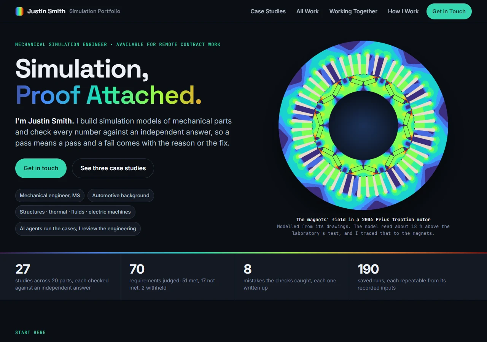
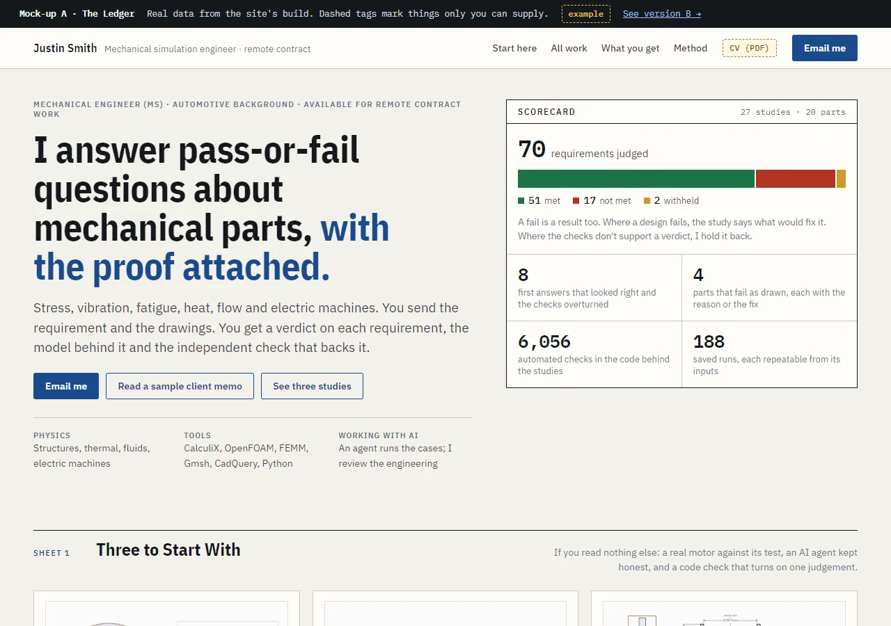
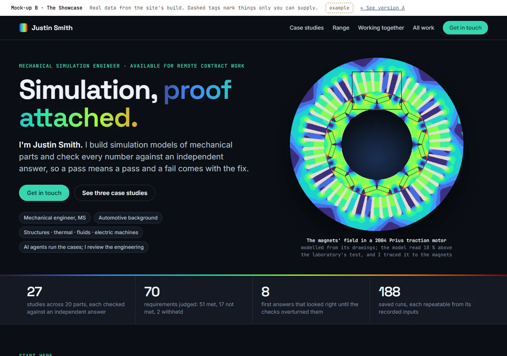

# Site review and two alternative home pages

Written 2026-11-24, on the `ui-redesign` branch. Nothing here is published; `main` and the live site are unchanged.

**Status, 2026-11-24 23:32:** version B was chosen and is built into the site on this branch (`site/build_v2.py`,
`site/pages/home.html`, `site/assets/site.css`; the built pages are in `docs/`). The mock-ups below are kept as the
record of what was compared. What section 5 lists as not covered still applies, except the motor picture, which is
now exported from the field data, and the email button, which is the site's own.

- **Version A, the Ledger:** `site/proposals/a.html`
- **Version B, the Showcase:** `site/proposals/b.html`
- Rebuild both after any data change: `python site/proposals/build_proposals.py`

Both mock-ups are filled from the site's own data (cards, verdicts, questions, counts, the method steps, the
lessons, the sample memo), so every number on them is one the site already publishes. Their links open the
built study pages. Dashed tags mark things only you can supply.

## 1. What a first-time visitor needs

A recruiter gives a page under a minute. A hiring manager gives it a few minutes if the first one went well.
Both ask the same five questions, in this order:

| # | The visitor's question | Time they give it |
|---|---|---|
| 1 | Who is this, and what do they do? | 5 seconds |
| 2 | Is it my kind of work? (physics, tools, industry) | 10 seconds |
| 3 | Is there proof? One result I can grasp without the background | 20 seconds |
| 4 | Can I trust it? | 30 seconds |
| 5 | What do I do next? (contact, CV, availability) | whenever they decide |

A client with a problem adds a sixth: what would I get, and what do you need from me?

## 2. The current home page against those questions

Measured on the built site at 1280 px and 390 px wide.

| Question | Where the current site answers it | Verdict |
|---|---|---|
| 1. Who and what | The byline: the third block of text on the first screen, in the smallest type. The headline, "Simulation, Proof Attached", doesn't say who or what is on offer. | Weak |
| 2. My kind of work | Filter buttons below the first screen, and tool names in small type on each card. No list of physics or tools near the top. | Weak |
| 3. Proof | Three examples packed into one five-line paragraph. The motor figure is cut off by the bottom of the first screen. | Fair |
| 4. Trust | The strongest evidence is two clicks away: the 51 met / 17 not met / 2 withheld tally is on the requirements page, behind a text link under the last card. The eight "mistakes the checks caught" are at the bottom of the method page. | Hidden |
| 5. Next step | One email button, at the bottom of every page. No CV, no LinkedIn, no location or time zone. | Weak |
| 6. What would I get | The sample client memo is the best answer the site has. It's a small text link beside the buttons, and it opens a raw file on GitHub. Nothing says what kinds of work can be hired. | Missing |

Other things the screenshots show:

- **The four headline numbers count volume, not outcomes.** Studies, checks, runs and licences. A recruiter
  can't tell whether 6,056 checks is a lot. "0 paid licences" can read as "no ANSYS or Abaqus experience"
  with no line about commercial tools beside it.
- **Twenty cards carry equal weight.** After the viewer, nothing tells a visitor which three to open.
- **Line drawings fade at card size.** The setup drawings are right for the study pages. At 380 px wide
  they're thin grey lines on white, and several cards look alike. The bracket's card is nearly blank.
- **A card doesn't say what was found.** It shows a title, a verdict chip and the tools. Twelve of twenty
  chips say "Passes". The finding, the interesting part, is only on the study page.
- **The wide cards make the grid irregular,** so there's no clear reading order.
- **The words are the maker's, not the buyer's.** "Studies", "saved runs", "Grading", "Requirements". The
  work section opens with "Most of the problems are made up".
- **The page is long.** 4,908 px on a desktop and 7,906 px on a phone, with the contact at the very end.
- **Study pages hold the verdict below the first screen.** The motor page opens with the title, the question
  and the drawing, and the answer is a scroll away on a page 14,501 px long, with no summary or contents.
- **The style is clean and anonymous.** Inter, one blue and light grey could be any software product. Nothing
  says engineering until the images load.

What works and stays in both versions: the setup before the result, the honest verdict wording, the evidence
links, plain first-person copy, and numbers that come from the runs.

## 3. Two versions

Both put the same things on the first screen: your name and what you do, the kinds of work, the verdict
tally and a way to act. Both keep "setup first, then the result". They differ in what they lead with.

### Version A: the Ledger

The site as a signed engineering record. Light paper, thin rules, a condensed typeface and monospaced
numbers, laid out like a drawing sheet.

1. **First screen:** a headline that states the service ("I answer pass-or-fail questions about mechanical
   parts, with the proof attached"), three facts (physics, tools, how the AI agent is used), and a scorecard
   drawn like a title block: 70 requirements judged, 51 met, 17 not met, 2 withheld.
2. **Three to start with:** the motor, the bracket and the nozzle, each with its drawing and one large number.
3. **The ledger:** every part as one row: drawing, question, verdict, finding, tools. It filters by
   discipline and by verdict, so "show me what failed" is one click.
4. **What I can take on, and what you get:** four kinds of work, the four method steps, and the sample memo
   shown as a page instead of a link.
5. **What the checks caught:** four of the eight lessons.
6. **Contact,** with the slots for a CV and the rest.

Best for the visitor who scans: twenty parts read in twenty seconds. It also matches the requirement-to-verdict
work you're applying for. Its weakness is that it's quieter: little colour before the three lead studies.

### Version B: the Showcase

The site as three case stories. Dark, with the colour scale from the result plots as the brand.

1. **First screen:** the current headline with your name and the offer directly under it, and the motor's
   field map as the picture. A strip of four numbers below.
2. **Three case studies, told the same way:** each one a pair, the part on the left and the answer on the
   right, with the question, one large number, two sentences and what the checks caught.
3. **What I can model:** every analysis type as a tag that opens its study, grouped by discipline.
4. **Working together:** the same four kinds of work, the memo and the method steps.
5. **The scoreboard:** one dot per requirement, 70 in all, beside six of the lessons.
6. **Every part:** a grid where each card shows the setup and the result side by side.
7. **Contact.**

Best for the visitor who looks: the results are colourful, and a dark page lets them carry it. Its weaknesses:
it takes more scrolling to see everything (7,310 px against A's 5,704), the white drawings sit on a dark page
as plates, and a dark page prints badly.

### Side by side

| | Current | A, Ledger | B, Showcase |
|---|---|---|---|
| Who and what on the first screen | Small byline | Headline | Headline and sub-line |
| Physics and tools on the first screen | No | Yes | Yes |
| Verdict tally on the first screen | No | Yes, as a bar | Yes, as a line of text; dots further down |
| Three studies singled out | In the viewer's tabs | Three cards | Three full-width stories |
| The finding shown before the click | No | Yes, every row | Yes, every card |
| Sample memo shown | A text link | As a page | As a page |
| Kinds of work listed | No | Yes | Yes |
| Page height, desktop | 4,908 px | 5,704 px | 7,310 px |
| Page height, phone | 7,906 px | 10,297 px | 11,865 px |
| Theme | Light and dark | Light only so far | Dark only so far |

Both are longer than the current page on a phone, because they add the offer, the memo and the lessons.
The current page gets its shorter length by leaving those out.

## 4. What I'd do

Build A's structure, and take B's "the part, then the answer" pairs for the three lead studies.

A answers the five questions fastest, its ledger is the same shape as the work you're selling, and it reads
well on paper and in a screenshot. Its lead section is its weakest part, and B's pairs fix that. If you want
the page to look striking first and read fast second, B is the better base.

## 5. What these mock-ups don't cover

- **Only the home page.** Study pages, the method page and the requirements page aren't redrawn. On either
  version I'd add a summary strip to the top of each study page: the question, the verdict, what it was
  checked against and the tools, beside the drawing.
- **One theme each.** A has no dark theme and B has no light one.
- **The words for the four kinds of work are my draft,** written from what the site already says you offer.
  They need your say.
- **B's hero picture is cut from the published motor figure,** not exported by the figure script. A label
  that overlapped the rim was filled from the same field a quarter turn away. A real build would export the
  view cleanly.
- **The email button isn't wired,** and the mock-ups aren't part of `build_v2.py`.

## 6. What I need from you

1. Which version, or which parts of each.
2. The things the dashed tags mark: a CV, a LinkedIn link, your location or time zone, the commercial tools
   you've used in industry, and a typical turnaround.
3. A yes, no or rewrite on the four kinds of work.
