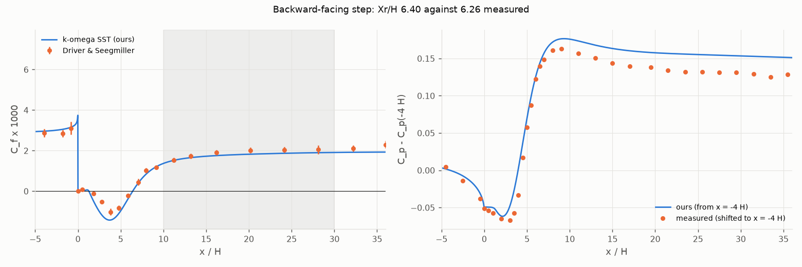

# Study 19 part 2: the step against Driver and Seegmiller (alpha 0)

Model: run `20261122-233146_step_mesh`, point `p02_mesh_level-1.4142`. Limits agreed before the data was opened (PROTOCOL.md).

| Requirement | Ours | Measured | Error | Limit | Verdict |
|---|---|---|---|---|---|
| REQ-S1 reattachment Xr/H | 6.404 | 6.26 +- 0.10 | +2.3 % | 10 % | **PASS** |
| REQ-S2 Cf, 10 <= x/H <= 30 (6 stations) | | | rms 7.0 % | 15 % | **PASS** |
| REQ-S3 Cp(30 H) - Cp(-4 H) | 0.1534 | 0.1307 | +0.0227 | 0.02 | **FAIL** |

Cf at the stations (ours / measured, relative error):

- x/H 11.20: 0.00152 / 0.00154 (-1.3 %)
- x/H 13.20: 0.00166 / 0.00173 (-4.2 %)
- x/H 16.20: 0.00176 / 0.00191 (-8.0 %)
- x/H 20.20: 0.00183 / 0.00202 (-9.6 %)
- x/H 24.14: 0.00187 / 0.00204 (-8.3 %)
- x/H 28.13: 0.00190 / 0.00205 (-7.2 %)

