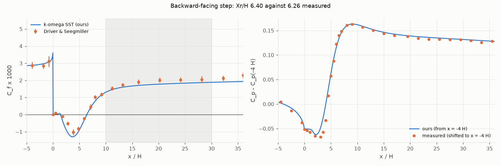

# Study 19 part 3: the step in 3D with the side walls

Model: run `20261127-223049_step3d_sidewalls`, point `p01_spanwise_level-1.4142`. Limits agreed before the data was opened (PROTOCOL.md).

> **Verification FAIL** (failed checks: converged, continuity): the verdicts below are not supported by evidence and must not be used for acceptance.

| Requirement | Ours | Measured | Error | Limit | Verdict |
|---|---|---|---|---|---|
| REQ-S1 reattachment Xr/H | 6.404 | 6.26 +- 0.10 | +2.3 % | 10 % | **PASS (unverified)** |
| REQ-S2 Cf, 10 <= x/H <= 30 (6 stations) | | | rms 9.2 % | 15 % | **PASS (unverified)** |
| REQ-S3 Cp(30 H) - Cp(-4 H) | 0.1317 | 0.1307 | +0.0010 | 0.02 | **PASS (unverified)** |

Cf at the stations (ours / measured, relative error):

- x/H 11.20: 0.00146 / 0.00154 (-5.1 %)
- x/H 13.20: 0.00160 / 0.00173 (-7.3 %)
- x/H 16.20: 0.00171 / 0.00191 (-10.6 %)
- x/H 20.20: 0.00178 / 0.00202 (-11.8 %)
- x/H 24.14: 0.00183 / 0.00204 (-10.3 %)
- x/H 28.13: 0.00187 / 0.00205 (-8.7 %)

