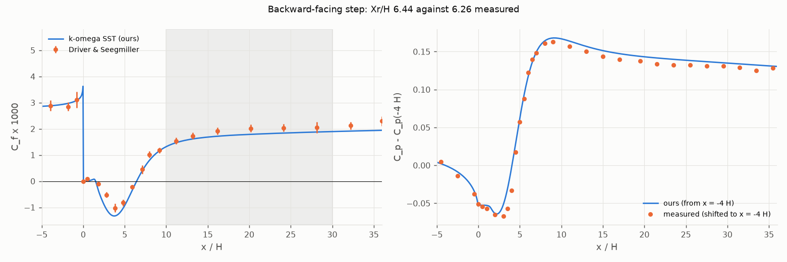

# Study 19 part 3 bracket: the step in 3D with thinner side-wall layers

Model: run `20261128-054328_step3d_sidewall_start`, point `p00_baseline`. Limits agreed before the data was opened (PROTOCOL.md).

> **Verification FAIL** (failed checks: converged, continuity): the verdicts below are not supported by evidence and must not be used for acceptance.

| Requirement | Ours | Measured | Error | Limit | Verdict |
|---|---|---|---|---|---|
| REQ-S1 reattachment Xr/H | 6.436 | 6.26 +- 0.10 | +2.8 % | 10 % | **PASS (unverified)** |
| REQ-S2 Cf, 10 <= x/H <= 30 (6 stations) | | | rms 8.8 % | 15 % | **PASS (unverified)** |
| REQ-S3 Cp(30 H) - Cp(-4 H) | 0.1349 | 0.1307 | +0.0042 | 0.02 | **PASS (unverified)** |

Cf at the stations (ours / measured, relative error):

- x/H 11.20: 0.00147 / 0.00154 (-4.5 %)
- x/H 13.20: 0.00161 / 0.00173 (-6.8 %)
- x/H 16.20: 0.00172 / 0.00191 (-10.1 %)
- x/H 20.20: 0.00179 / 0.00202 (-11.4 %)
- x/H 24.14: 0.00184 / 0.00204 (-9.9 %)
- x/H 28.13: 0.00188 / 0.00205 (-8.4 %)

